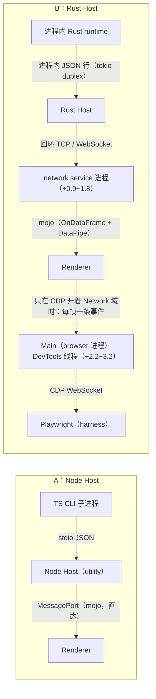

# App 级性能：Node 栈与 Rust 栈的整机对比

2026-10-10。此前的两份报告只量了一部分：[rust-performance-2026-09-25](rust-performance-2026-09-25.md) 是 Node CLI 对 Rust CLI（不含 Electron 与 Host），[rust-u3-embedded-runtime](rust-u3-embedded-runtime.md) 是 Rust Host 内两种 runtime 链路。本报告量整个桌面 App 的进程树：Electron Main、Renderer、GPU 与其他辅助进程、Host、runtime、scheduler、MCP 与工具进程，也就是用户机器为 ZCode 付出的全部内存与 CPU，以及界面的响应。

本报告做了两次测量。最前面是复测（`a17ddb6`）：CPU 窗口里断开了测量 harness 的 CDP 连接、暂停了页面探针，并合入了三项 Rust 优化，流式 CPU 的结论以它为准。后面保留首次测量（`d5ff797`）的结论、结果、“流式 CPU 为什么持平”的剖析与方法，作为历史。两次都是粗测：按要求没有等机器空闲，测量时同一台机器上有其他编译与测试任务，每次运行的 1 分钟 load average 都有记录。

## 2026-10-10 复测：修正测量方式并合入优化之后

分支 `perf/rust-app-remeasure`，基于 `feat/rust-unified-host` 的 `a17ddb6`。构建与首次相同：`zcode-host`、`zcode-cli-rust` 的 release，Main / Renderer 的生产构建，TS CLI 的单文件 bundle，全部从 `a17ddb6` 构建。三种配置各 3 次、交错运行（startup 与 stream 两个 suite，18 次有效；另有 1 次因窗口没有出帧而作废重跑，见“复测的方法与偏差”），测量时间 2026-10-10 23:43 至 10-11 00:53。仍是粗测：机器上同时有其他会话的编译与磁盘扫描，每次运行开始与结束时的 1 分钟 load average 中位 20.4，范围 6.7–74.2（逐次见本节附录）。

### 结论

表中是中位数，括号里是最小–最大值；† 表示 3 次的最大与最小之差超过中位数的一半。内存是 macOS physical footprint 的进程树合计，CPU 是单核百分比（10 核机器上限 1000%）。CPU 窗口里没有任何 CDP 客户端连着 Renderer，页面探针也暂停。

| 指标                                                  | A：Node Host + TS CLI | B：Rust Host + 进程内 runtime | C：Node Host + Rust CLI | B 对 A |
| ----------------------------------------------------- | --------------------: | ----------------------------: | ----------------------: | -----: |
| 内存，空闲（启动后 30 s，未开会话）                   |     939 MiB (864–949) |             436 MiB (422–487) |       628 MiB (567–635) |   −54% |
| 内存，4 个 workspace 各完成一轮                       |  1494 MiB (1428–1608) |             449 MiB (448–553) |       703 MiB (696–798) |   −70% |
| 内存，8 个 workspace 各完成一轮                       |  2365 MiB (2255–2511) |             515 MiB (456–523) |       726 MiB (720–809) |   −78% |
| 每多一个 workspace                                    |     203 MiB (196–227) |          3.7 MiB (1.0–12.2) † |    18.2 MiB (15.7–20.9) |   −98% |
| 内存，4 个会话同时流式（均值）                        |  1771 MiB (1758–1849) |             688 MiB (677–710) |       835 MiB (808–903) |   −61% |
| CPU 合计，1 个会话流式                                |     44.7% (44.6–47.2) |             37.9% (34.6–39.6) |       37.0% (36.9–42.4) |   −15% |
| CPU 合计，4 个会话同时流式                            |     54.8% (54.6–56.6) |             39.2% (37.7–46.2) |       39.8% (39.5–48.2) |   −28% |
| CPU 合计，4 路，保温结束后只订阅可见会话              |     52.8% (52.5–54.4) |             40.8% (40.2–41.8) |       41.4% (41.2–48.5) |   −23% |
| CPU，空闲 60 s，Host 一侧（Host、scheduler、runtime） |     0.35% (0.31–0.36) |             0.12% (0.12–0.14) |       0.22% (0.19–0.24) |   −65% |
| CPU，空闲 60 s，整个进程树                            |   1.90% (0.50–2.14) † |           0.64% (0.40–1.84) † |     0.52% (0.43–2.14) † |      — |
| 冷启动：启动 → 主界面可用                             |    4.27 s (4.04–6.14) |            2.01 s (1.92–2.16) |      2.81 s (2.50–3.28) |   −53% |
| 首条消息：Enter → 首段可见                            |    1412 ms (988–1528) |              236 ms (221–299) |      208 ms (175–348) † |   −83% |
| 新 workspace 的首条消息首段                           |     977 ms (879–1160) |              178 ms (160–211) |      147 ms (145–242) † |   −82% |
| 退出：SIGTERM → 进程树全部结束（8 个 workspace）      |  1.87 s (1.57–3.41) † |          0.28 s (0.27–5.43) † |    1.50 s (1.44–3.83) † |   −85% |

一句话：**流式 CPU 不再持平。4 个会话同时流式时，整个 App 的 CPU B 比 A 低约 15 个点（−28%），1 个会话时低约 7 个点（−15%）；差别全部来自 Host 与 runtime，剩下约 35 个点是两边相同的界面渲染。**

- **差别全在 Host 一侧。** Host 一侧（Host、scheduler、runtime 子进程、MCP，加上 B 的回环 WebSocket 经过的 network service）4 路时 A 18.7、B 4.7、C 7.0 个点，1 路时 A 8.3、B 1.7、C 2.7（3 次的中位数，逐角色见下表）。A 的大头是 TS CLI 子进程（4 路 15.2）。界面一侧（Main、Renderer、GPU）三种配置在噪声内相同：4 路 A 36.3、B 34.5、C 33.5，1 路 A 36.7、B 36.2、C 34.3。B 的 Main 与 A 相同（0.3–0.9），首次测量里 B 多出的 Main 与一部分 Renderer 开销确实来自 CDP。
- **剩下的底数是界面渲染，两边相同。** Renderer 23–27 个点、GPU 9–12 个点，不随 Host 变化。GPU 在运行之间有 8–13 个点的起伏，与配置无关：第 1 轮（23:50–00:02）三种配置的 4 路窗口都在 11.5–12.4，之后的运行在 8.7–9.9，只有 A 在 00:48 的重跑是 12.8。A 的 3 次里有 2 次落在 GPU 高的时段，所以 A 的 GPU 中位数比 B、C 高约 2.5 个点，这部分不应算作 Host 的差别；按同一轮比较，B 比 A 低 8.6–17.4 个点（4 路）。
- **空闲 CPU 很低，Host 一侧 B 约为 A 的三分之一。** 整个进程树 60 s 合计 0.4–2.1%，大小取决于窗口是否在前台：窗口在前台时 composer 的光标闪烁让 Renderer 与 GPU 多用约 1.5 个点，三种配置都一样（逐次见附录），所以合计不比较。Host 一侧 A 0.35%（Node Host 0.21、TS CLI 0.12、scheduler 0.02）、B 0.12%、C 0.22%。B 的 Main 略高（0.14–0.26 对 A 的 0.09–0.10），没有查。
- **内存、启动与退出的结论与首次一致。** Electron 自己的部分（Main、Renderer、GPU、辅助进程）三种配置都在 390–550 MiB：Renderer 在约 150 与 200–270 MiB 两档之间跳，是 V8 的回收时机，三种配置都有，这也是 B 的“每多一个 workspace”只能看量级的原因。Rust Host 自己空闲 34–37 MiB、8 个 workspace 时 46–51 MiB，每个 workspace 约 1.5–2.7 MiB。A 每个 workspace 约 200 MiB（TS CLI 约 130、node_repl MCP 约 80）；扣掉 MCP，B 仍少 49%（空闲）、62%（4 个）、70%（8 个）、53%（4 路流式）。
- **A 的首段比首次测量慢，原因没有查。** A 的首条消息首段 1412 ms（首次 740），新 workspace 首段 977 ms（首次 762）；A 的代码在两次之间没有实质变化，B、C 的同项与首次相近。测量期间 OmniDiskSweeper 与系统的 Storage 扩展在扫描磁盘，A 的首段要等 TS CLI 子进程从外接 SSD 加载 16 MB 的 bundle，推测是磁盘 IO 竞争，没有验证。冷启动 A 4.27 s 与首次（4.08 s）相近。
- **C 与 B 的流式 CPU 相近。** C（Node Host + Rust CLI 子进程）4 路 39.8%，Host 一侧 7.0 个点（Node Host 2.7、Rust CLI 4.3），B 是 4.7。B 的进程内 runtime 比“Node Host + Rust CLI 子进程”再省约 2 个点，在合计的噪声之内。

### 分角色 CPU（单核 %，3 次的中位数）

| 角色            |   1 路 A |        B |        C |   4 路 A |        B |        C | 4 路，1 个订阅 A |        B |        C |
| --------------- | -------: | -------: | -------: | -------: | -------: | -------: | ---------------: | -------: | -------: |
| Main            |      0.8 |      0.9 |      0.8 |      0.4 |      0.4 |      0.4 |              0.3 |      0.4 |      0.3 |
| Renderer        |     25.4 |     26.3 |     24.2 |     23.3 |     24.2 |     24.5 |             27.3 |     27.2 |     27.4 |
| GPU             |     12.1 |      9.2 |      9.5 |     12.4 |      9.9 |      9.3 |             12.1 |      9.6 |      9.1 |
| network service |      0.0 |      0.3 |      0.0 |      0.0 |      0.7 |      0.0 |              0.0 |      0.4 |      0.0 |
| Host            |      2.8 |      1.4 |      1.3 |      3.8 |      4.0 |      2.7 |              2.7 |      3.4 |      1.3 |
| scheduler       |      0.2 |        — |      0.2 |      0.0 |        — |      0.0 |              0.0 |        — |      0.0 |
| runtime 子进程  |      5.1 |        — |      1.3 |     15.2 |        — |      4.3 |             10.7 |        — |      3.7 |
| node_repl MCP   |      0.2 |        — |        — |      0.0 |        — |        — |              0.0 |        — |        — |
| **合计**        | **44.7** | **37.9** | **37.0** | **54.8** | **39.2** | **39.8** |         **52.8** | **40.8** | **41.4** |
| 其中 Host 一侧  |      8.3 |      1.7 |      2.7 |     18.7 |      4.7 |      7.0 |             13.6 |      3.9 |      5.0 |
| 其中界面一侧    |     36.7 |     36.2 |     34.3 |     36.3 |     34.5 |     33.5 |             39.7 |     36.9 |     36.9 |

- 每个角色分别取中位数，相加不一定等于合计；“Host 一侧”“界面一侧”是每次运行先相加再取中位数。Host 一侧 = Host + scheduler + runtime 子进程 + MCP + network service；界面一侧 = Main + Renderer + GPU + 其他辅助进程。其他 Electron 辅助进程（audio service 等）在所有窗口都 ≤ 0.1，没有列出。
- “4 路”是刚依次切过 4 个会话、4 个 conversation 订阅都在保温期（30 s）内的 20 s 窗口，与首次测量的订阅状态相同；“4 路，1 个订阅”是保温结束后只订阅可见会话的 20 s 窗口，另外 3 路只有遥测与列表事实，可见会话的回复也更长（约 13–20 KB，“4 路”窗口里约 1–9 KB），所以 Renderer 更高。
- footprint（窗口均值，MiB）：4 路时 A 1771（其中 TS CLI 679、MCP 314、Node Host 114）、B 688（Rust Host 46）、C 835（Node Host 67、Rust CLI 90）。
- 所有有效窗口里 Renderer 都没有长任务（≥ 50 ms）。切换会话（在窗口外、连着 Playwright 量）三种配置 42–44 ms，与首次相同。

### 与首次测量相比改了什么

测量方法（三种配置相同）：

1. **CPU 窗口与稳态内存快照期间断开 Playwright、暂停页面探针**（`suites.mjs` 的 `detached`）。没有任何 CDP 客户端连着 Renderer；Main 的 inspector 仍连着，只在窗口开始前用来枚举 webContents。计时（冷启动、首段、切换会话）仍靠 Playwright 与探针，都在窗口之外。原因见“流式 CPU 为什么持平”：Playwright 总会打开 CDP Network 域，B 的每个 WebSocket 帧都变成一条经 Main 转发给 Playwright 的事件；探针每帧读一次 `document.body.textContent`。
2. **窗口里没有交互。** 首次的流式窗口里每秒在 composer 打一个字、4 路时还在窗口后段切换会话，这些都要 Playwright，复测改在窗口之外做。4 路量两个窗口（见上表的说明）；4 路的流从 2000 段改为 5000 段，以覆盖两个窗口。
3. **新增空闲 60 s 的整树 CPU**（启动后静置 30 s 之后，只有活动 workspace 预热了 runtime，没有会话）。
4. **CPU 百分比的分母改为窗口内第一次与最后一次读进程表之间的墙钟。** 原来分母还包括最后一次 footprint 读数的时间，进程多的配置（A）读得慢，CPU 百分比因此偏低约 1–5%（相对值）。
5. **有效性检查多了两条：** 每个流式窗口里 GPU 进程 ≥ 2%（窗口在出帧），以及页面一直可见（探针记录 `visibilitychange`）。
6. 去掉了工具负载一轮、按键延迟与增量端到端延迟（都要在窗口里交互或开着探针）；history suite 没有重跑。

代码（只改了 Rust 一侧；A 的构建在两次之间没有实质变化，TS 一侧只有 Renderer 读取合并后遥测事实的两个可选字段，Node 的事实不带它们）：

- `983257b`：`activeWorks[].startedAt` 记录轮次开始时间，不再随每个分片变化，流式文本只发 `row.delta`；`canRetry` / `canFork` 只在回复完成后出现（剖析里的 (a)、(b)，改进选项 4 的前半与 6）。
- `8290868`：`stream.chunk` 遥测事实按 250 ms 窗口合并（改进选项 5）。
- `9d71c41`：供应商配置的轮询先比文件元数据，没变就不读（改进选项 8）。
- 此外首次测量（`d5ff797`）之后合入了 U2 的 Host 任务归属与有界通道（`f659885` 等）。它也在下面的“修复前”构建里，所以下表只反映上面三项。

代码的贡献，用同一新方法对照：把 `b127888`（即 `a17ddb6` 去掉上面三项修复）的 Rust 源码导出到临时目录，另做一个 release 的 `zcode-host`，与当前构建按 修复前、当前、当前、修复前 的顺序各跑 2 次 stream suite（10-11 00:54–01:18，load 6.3–21.3）。每格是两次的读数。

| 指标（B，单核 %）                           |                    修复前（`b127888`） |                      当前（`a17ddb6`） |
| ------------------------------------------- | -------------------------------------: | -------------------------------------: |
| Rust Host，空闲 60 s                        |                            0.83 / 0.84 |                            0.12 / 0.09 |
| Rust Host footprint，空闲（MiB）            |                            39.3 / 38.6 |                            34.5 / 34.5 |
| 1 路：Rust Host + network service           |                            3.45 / 3.23 |                            1.79 / 1.71 |
| 4 路：Rust Host + network service           |                            6.55 / 6.78 |                            4.23 / 4.00 |
| 4 路，1 个订阅：Rust Host + network service |                            6.04 / 6.22 |                            3.42 / 3.76 |
| 4 路，1 个订阅：Renderer                    |                            28.9 / 29.1 |                            26.5 / 27.7 |
| 合计：1 路 / 4 路 / 4 路，1 个订阅          | 39.7 / 41.3 / 43.9；38.7 / 39.8 / 44.5 | 36.7 / 38.8 / 38.8；36.8 / 40.8 / 41.6 |

- 三项修复让 Rust Host 空闲时的 CPU 从约 0.83% 降到约 0.1%（配置轮询），流式时 Rust Host 少 1.0–2.3 个点、network service 少 0.5–0.7 个点（帧更少、更小）。回复较长时（“1 个订阅”窗口，可见会话的回复约 13–20 KB）Renderer 少 1.2–2.6 个点，与剖析里 `canRetry` 投影随回复长度增长一致；其余窗口的 Renderer 差别在噪声内。
- 修复前的 B 在新方法下 4 路就已经是 39.8–41.3%，比 A（54.6–56.6%）低约 14 个点。所以首次的“持平”主要是测量方式造成的：CDP 放大了 B 的 Main 与 Renderer，窗口里的打字、探针和 3 次的噪声也有份；三项修复在此之上再省约 2.5 个点（Host 一侧），回复长时还有 Renderer 的 1–2.5 个点。

### 首次结论的修正

- 首次结论里“流式时总 CPU 没有下降（4 路 A 52.1%、B 53.0%）”与“流式 CPU 为什么持平”一节的总判断，被本节取代。那一节对机制的分析（CDP 的每帧事件、network service 的真实成本、Rust runtime 推给界面的数据差异、两边相同的界面底数）仍然成立；其中的改进选项 1、4 的前半、5、6、8 已经完成，2、3、7、9 没有做。
- 首次与本次的绝对读数不能直接比：窗口里没有交互，4 路的流更长，机器负载不同。例如 A 的 4 路合计首次 52.1%、本次 54.8%：A 的 runtime 子进程首次 11.3、本次 15.2（剖析时的复测是 16.1–16.8），GPU 首次 8.0、本次 9.6–12.8。比较请只在同一组运行之内做。
- 内存、启动、首段与退出的结论不变，量级与首次一致。

### 复测的方法与偏差

```sh
node scripts/rust-host/perf/app-perf.mjs build
node scripts/rust-host/perf/app-perf.mjs batch --out <dir> --reps 3 --suites startup,stream --configs A,B,C
node scripts/rust-host/perf/app-perf.mjs report --out <dir>
# 修复前的对照：B 换一个 Rust Host 构建
node scripts/rust-host/perf/app-perf.mjs run --config B --suite stream --host-binary <zcode-host> --out <f.json>
```

- 隔离、mock 模型、8 个 workspace 的 profile、进程归属与 footprint 读法都与首次相同（见后面首次测量的“方法”）。startup suite 只多了一处：三次稳态快照前的静置期间断开 Playwright。
- 作废与重跑：00:18 的 stream-A-2 在三个流式窗口里 GPU 进程只有 0.0–0.05%：窗口被遮挡或显示器熄屏（这台机器 10 分钟无操作就熄屏），Renderer 照常处理消息与渲染，但不出帧，合计只有 32–34%。事后按“GPU ≥ 2%”判为无效，00:48 重跑（读数与另外两次 A 一致）。重跑与修复前对照的运行用 `caffeinate -d` 防止熄屏；对照里有 1 次在“1 个订阅”窗口里页面变为 hidden，被可见性检查拦下后重跑。
- 偏差：开发检出（没有 ASAR 与签名）、只有 macOS / arm64、本地 mock 模型（20 ms 一段，比真实模型密），与首次相同。机器共用，时间类指标在 load 高的运行里有长尾：B 的退出 5.4 s、C 的 3.8 s、A 的 3.4 s 都发生在 00:02–00:09（load 28–74）的那几次。每项只有 3 次（对照 2 + 2 次）。
- 机器：Apple M1 Max（10 核）、64 GB，macOS 15.7.7，Electron 41.0.3，Node 24.14.0（harness），rustc 1.95.0；仓库在外接 SSD 上。

#### 附录：复测的逐次读数

时间为本地时间，load 为 1 分钟 load average；内存为 footprint 合计（MiB），CPU 为单核 %（空闲为整树 60 s，括号里是 Host 一侧）。

| 运行               | 开始  | load 开始 / 结束 | 读数                                                                                                |
| ------------------ | ----- | ---------------- | --------------------------------------------------------------------------------------------------- |
| startup-A-1        | 23:43 | 9.8 / 10.8       | 可用 4267，首段 1412，新 workspace 首段 977，N1 / N4 / N8 995 / 1608 / 2365，退出 1568              |
| startup-B-1        | 23:45 | 10.8 / 7.5       | 可用 1920，首段 221，新 workspace 首段 160，N1 / N4 / N8 448 / 449 / 456，退出 277                  |
| startup-C-1        | 23:47 | 7.5 / 6.9        | 可用 2809，首段 208，新 workspace 首段 147，N1 / N4 / N8 579 / 703 / 726，退出 1498                 |
| stream-A-1         | 23:50 | 6.7 / 20.8       | 空闲 939 MiB、0.50%（0.35），1 路 47.2，4 路 54.8，4 路 1 个订阅 52.8，4 路均值 1849 MiB，退出 1015 |
| stream-B-1         | 23:54 | 19.9 / 24.0      | 空闲 422 MiB、0.40%（0.12），1 路 37.9，4 路 46.2，4 路 1 个订阅 41.8，4 路均值 710 MiB，退出 289   |
| stream-C-1         | 23:58 | 24.0 / 62.8      | 空闲 635 MiB、0.52%（0.24），1 路 42.4，4 路 48.2，4 路 1 个订阅 48.5，4 路均值 903 MiB，退出 1431  |
| startup-B-2        | 00:02 | 68.4 / 70.2      | 可用 2163，首段 299，新 workspace 首段 211，N1 / N4 / N8 489 / 553 / 515，退出 5427                 |
| startup-C-2        | 00:05 | 74.2 / 45.5      | 可用 3280，首段 348，新 workspace 首段 242，N1 / N4 / N8 699 / 798 / 809，退出 3827                 |
| startup-A-2        | 00:07 | 42.5 / 27.6      | 可用 6137，首段 1528，新 workspace 首段 1160，N1 / N4 / N8 920 / 1494 / 2511，退出 3406             |
| stream-B-2         | 00:10 | 32.4 / 8.7       | 空闲 436 MiB、1.84%（0.12），1 路 34.6，4 路 37.7，4 路 1 个订阅 40.2，4 路均值 677 MiB，退出 277   |
| stream-C-2         | 00:14 | 8.3 / 10.8       | 空闲 628 MiB、2.14%（0.19），1 路 37.0，4 路 39.5，4 路 1 个订阅 41.2，4 路均值 835 MiB，退出 819   |
| stream-A-2（作废） | 00:18 | 10.8 / 26.8      | GPU 0.0–0.05%，窗口没有出帧：1 路 31.9，4 路 33.9，4 路 1 个订阅 34.0                               |
| startup-C-3        | 00:22 | 26.8 / 10.1      | 可用 2499，首段 175，新 workspace 首段 145，N1 / N4 / N8 593 / 696 / 720，退出 1444                 |
| startup-A-3        | 00:25 | 10.1 / 16.9      | 可用 4037，首段 988，新 workspace 首段 879，N1 / N4 / N8 832 / 1428 / 2255，退出 1873               |
| startup-B-3        | 00:27 | 16.9 / 30.4      | 可用 2008，首段 236，新 workspace 首段 178，N1 / N4 / N8 438 / 448 / 523，退出 268                  |
| stream-C-3         | 00:29 | 30.4 / 14.5      | 空闲 567 MiB、0.43%（0.22），1 路 36.9，4 路 39.8，4 路 1 个订阅 41.4，4 路均值 808 MiB，退出 769   |
| stream-A-3         | 00:33 | 13.7 / 29.4      | 空闲 949 MiB、1.90%（0.36），1 路 44.6，4 路 56.6，4 路 1 个订阅 54.4，4 路均值 1758 MiB，退出 1254 |
| stream-B-3         | 00:38 | 29.4 / 30.0      | 空闲 487 MiB、0.64%（0.14），1 路 39.6，4 路 39.2，4 路 1 个订阅 40.8，4 路均值 688 MiB，退出 285   |
| stream-A-2（重跑） | 00:48 | 23.0 / 12.8      | 空闲 864 MiB、2.14%（0.31），1 路 44.7，4 路 54.6，4 路 1 个订阅 52.5，4 路均值 1771 MiB，退出 1013 |
| B 修复前 1         | 00:54 | 8.1 / 8.5        | 空闲 Host 0.83%，1 路 39.7，4 路 41.3，4 路 1 个订阅 43.9                                           |
| B 当前 1           | 00:59 | 7.7 / 8.3        | 空闲 Host 0.12%，1 路 36.7，4 路 38.8，4 路 1 个订阅 38.8                                           |
| B 当前 2（作废）   | 01:04 | 6.3 / 11.4       | “1 个订阅”窗口里页面变为 hidden                                                                     |
| B 当前 2（重跑）   | 01:09 | 9.0 / 15.9       | 空闲 Host 0.09%，1 路 36.8，4 路 40.8，4 路 1 个订阅 41.6                                           |
| B 修复前 2         | 01:14 | 21.3 / 8.1       | 空闲 Host 0.84%，1 路 38.7，4 路 39.8，4 路 1 个订阅 44.5                                           |

## 首次测量的结论

> 2026-10-10 13:23–14:22，分支 `perf/rust-app-level`（基于 `feat/rust-unified-host` 的 `d5ff797`），每项测量 3 次（A/B/C 交错）。其中“流式时总 CPU 没有下降”一条已被上面的复测取代；内存、启动、首段与退出的结论与复测一致。

三种配置各 3 次、交错运行（startup / stream / history 三个 suite，共 27 次，全部有效），表中是中位数，括号里是最小–最大值。内存是 macOS physical footprint 的进程树合计（活动监视器的“内存”之和），CPU 是单核百分比（10 核机器上限 1000%）。

| 指标                                             | A：Node Host + TS CLI | B：Rust Host + 进程内 runtime | C：Node Host + Rust CLI | B 对 A |
| ------------------------------------------------ | --------------------: | ----------------------------: | ----------------------: | -----: |
| 内存，空闲（启动后 30 s，未开会话）              |     868 MiB (866–870) |             460 MiB (440–491) |       582 MiB (582–587) |   −47% |
| 内存，4 个 workspace 各完成一轮                  |  1479 MiB (1471–1491) |             514 MiB (511–516) |       717 MiB (716–721) |   −65% |
| 内存，8 个 workspace 各完成一轮                  |  2203 MiB (2180–2283) |             535 MiB (532–535) |       799 MiB (753–810) |   −76% |
| 每多一个 workspace                               |     193 MiB (192–205) |           10.6 MiB (9.9–10.7) |    27.9 MiB (20.4–29.7) |   −95% |
| 内存，4 个会话同时流式（均值）                   |  1717 MiB (1700–1733) |             664 MiB (662–666) |       822 MiB (821–861) |   −61% |
| CPU 合计，4 个会话同时流式                       |     52.1% (45.6–52.2) |             53.0% (51.7–53.8) |       47.5% (46.7–48.8) |   持平 |
| 其中 Host + runtime                              |                 14.7% |                          5.9% |                    8.9% |   −60% |
| 冷启动：启动 → 主界面可用                        |    4.08 s (3.78–4.11) |            1.79 s (1.68–2.09) |      2.59 s (2.23–3.35) |   −56% |
| 首条消息：Enter → 首段可见                       |      740 ms (595–790) |              274 ms (188–351) |        199 ms (176–211) |   −63% |
| 新 workspace 的首条消息首段                      |      762 ms (761–928) |              146 ms (144–161) |        149 ms (130–160) |   −81% |
| 退出：SIGTERM → 进程树全部结束（8 个 workspace） |    1.50 s (1.41–2.48) |            0.24 s (0.24–0.25) |      1.41 s (1.24–1.42) |   −84% |

- **内存是最大的差别。** Electron 自己的部分（Main、Renderer、GPU、network service 等辅助进程）三种配置相同，空闲时约 405 MiB，4 个 workspace 时约 465–490 MiB。差别全在其余部分：空闲时 A 约 460 MiB（Node Host 158、scheduler 55、预热的 TS CLI 170、它启动的 node_repl MCP 79），B 只有 Rust Host 的 40 MiB，C 约 180 MiB（Node Host 101、scheduler 55、Rust CLI 22）。每多一个 workspace，A 多一个 TS CLI（约 125 MiB）和一个 node_repl MCP（约 78 MiB），B 只多约 10 MiB（其中 Rust Host 约 2 MiB，其余是 Renderer 里多出的会话数据；Renderer 有 V8 回收时机带来的 ±10 MiB 起伏，这个数只能看量级）。所以 workspace 越多差距越大：8 个时整个 App 从 2.2 GiB 降到 0.54 GiB。
- **流式时总 CPU 没有下降（已被复测取代）。** 1 路约 39–40%，4 路约 48–53%，三种配置的差别在噪声范围内。大头是 Renderer（26–34%）和 GPU（约 8%），三种配置相同。Host 与 runtime 的 CPU 确实少了（4 路时 A 14.7%、C 8.9%、B 5.9%），但 B 的 Renderer、Main 与 network service 进程反而多用了约 10 个百分点，抵消了这部分节省。后来的剖析（“流式 CPU 为什么持平”一节）表明其中 Main 与约一半的 Renderer 差别来自测量 harness 本身，不带 harness 时 B 的合计比 A 低 8–14 个点。
- **启动、首条消息与退出明显更快。** B 的主界面可用时间是 A 的 44%，Host 数据库就绪 1.1 s 对 3.5 s。首条消息首段从 740 ms 降到 274 ms；以后每打开一个新 workspace，A 都要冷启动一个 TS CLI 子进程（首段约 760 ms），B 与 C 约 150 ms。退出时 B 只有 6 个进程要收，0.24 s 结束；A 有 23 个，1.4–2.5 s。
- **界面响应没有差别。** 三种配置在 1 路和 4 路流式时都没有 Renderer 长任务（≥ 50 ms）；按键到字符上屏 p50 约 23–27 ms、最大约 35 ms；点侧栏切换会话到内容可见约 42–48 ms；mock 发出一段到它出现在 DOM 的 p50 在 28–55 ms，p95 在 50–70 ms。这些差别都在一帧到两帧之内，3 次之间的波动与配置之间的差别同量级。
- **C 说明了 Host 与 runtime 各自的贡献。** 只把 runtime 换成 Rust（C），每个 workspace 的成本就从 193 MiB 降到 28 MiB，新 workspace 首段与 B 相同；但 Node Host 与 Node scheduler 仍在（约 155 MiB），启动慢约 0.8 s，退出与 A 同量级。B 在此基础上再省掉这两个 Node 进程，并把 runtime 收进 Host 进程（每个 workspace 约 10 MiB，而不是一个 22 MiB 的子进程）。

## 首次测量的结果

### 冷启动与首条消息（startup suite，8 个 workspace 的 profile）

| 指标（ms）                                          |                A |                 B |                C |
| --------------------------------------------------- | ---------------: | ----------------: | ---------------: |
| 启动 → composer 可点                                | 4078 (3783–4108) |  1790 (1682–2085) | 2587 (2231–3351) |
| 启动 → Host 数据库就绪                              | 3487 (3371–3585) | 1094 (763–1360) † | 1935 (1769–2610) |
| 启动 → 发送键可用                                   | 4971 (4741–5034) |  1883 (1759–2251) | 2661 (2327–3454) |
| 首条消息：Enter → 首段可见                          |    740 (595–790) |   274 (188–351) † |    199 (176–211) |
| 首条消息：Enter → 回复完整（40 段 × 20 ms）         | 1601 (1465–1645) |   1083 (992–1146) |  1003 (998–1023) |
| 第 2–8 个 workspace 的首段（每次运行取 7 个的中位） |    762 (761–928) |     146 (144–161) |    149 (130–160) |

† 表示 3 次的最大与最小之差超过中位数的 50%，不足以支撑细的比较。stream 与 history 两个 suite 也各记了冷启动，结论相同（主界面可用，stream：A 4.1 s、B 1.8 s、C 2.5 s；history：A 3.5 s、B 1.7 s、C 2.1 s）。

A 慢的可能原因有两处（从代码看出，没有逐段计时）：Node Host 在一个 Worker 线程里加载 16 MB 的 TS bundle 做会话库的存储准备（`packages/desktop/src/host/storagePreparationProcesses.ts`：非原生 runtime 用 `new Worker(entry)`），然后预热的 TS CLI 子进程自己再加载一次；C 的存储准备交给 Rust CLI 进程（`storagePreparationMode: "process"`），B 在 Host 进程内完成。首条消息首段 B 比 C 慢约 75 ms 且波动大（188–351 ms），本次没有拆开。

### 稳态内存（每个角色，footprint 中位数，MiB；括号内为进程数）

| 角色                   |      空闲 A |      空闲 B |      空闲 C |       N = 4 A |     N = 4 B |      N = 4 C |       N = 8 A |     N = 8 B |      N = 8 C |
| ---------------------- | ----------: | ----------: | ----------: | ------------: | ----------: | -----------: | ------------: | ----------: | -----------: |
| Main                   |         111 |         109 |         110 |           109 |         104 |          109 |           110 |         106 |          111 |
| Renderer               |         148 |         151 |         151 |           234 |         211 |          210 |           158 |         223 |          216 |
| GPU                    |         137 |         137 |         137 |           133 |         133 |          134 |           132 |         134 |          134 |
| 其他 Electron 辅助进程 |         8.4 |         8.6 |         8.3 |      15.9 (2) |    17.0 (2) |     16.3 (2) |      15.9 (2) |    17.0 (2) |     16.3 (2) |
| Host                   |         158 |        40.4 |         101 |           110 |        46.0 |          108 |           114 |        54.7 |          111 |
| scheduler              |        55.2 |           — |        55.5 |          54.2 |           — |         54.0 |          45.1 |           — |         33.0 |
| runtime 子进程         |         170 |           — |        22.2 |       500 (4) |           — |     88.3 (4) |       998 (8) |           — |      179 (8) |
| node_repl MCP          |        79.0 |           — |           — |       318 (4) |           — |            — |       627 (8) |           — |            — |
| **合计**               | **868** (8) | **460** (5) | **582** (7) | **1479** (15) | **514** (6) | **717** (11) | **2203** (23) | **535** (6) | **799** (15) |

- “空闲”取自 stream suite（启动后静置 30 s，只有活动 workspace 的 runtime 被预热，没有会话）；N = 4、8 取自 startup suite（每个 workspace 完成一轮后静置 35 s）。各角色的中位数相加不一定等于合计的中位数。
- 同一状态的 RSS（`ps`）合计：空闲 A 1601 / B 725 / C 983 MiB，N = 8 时 A 4536 / B 880 / C 1401 MiB。A 的 RSS 在 3 次之间相差很大（N = 8：2722–5055 MiB），是 macOS 在内存压力下压缩、换出页面的结果；footprint 稳定在 2180–2283 MiB。
- Node Host 的 footprint 在 A 里随时间下降（空闲 158 → N = 4 时 110 MiB），在 C 里稳定在约 100–110 MiB：A 多出的部分推测来自上面说的存储准备 Worker，结束后被回收。Rust Host 从 37–40 MiB 涨到 55 MiB（N = 8），每个 workspace 约 2–2.5 MiB（runtime 实例加会话缓存），与 [U3 报告](rust-u3-embedded-runtime.md) 的 2–4 MiB / workspace 一致。
- Renderer 在 N = 4 与 N = 8 之间有 50–80 MiB 的起伏（A 的 N = 8 反而比 N = 4 少），是 V8 的回收时机，三种配置都有，不代表 Host 的差别。

### 流式（stream suite）

20 ms 一段的 mock 流，采样窗口约 20 s（4 路时另加切换会话的约 7 s）。CPU 为单核百分比，footprint 为窗口内每 2 s 一次读数的均值（MiB）。

| 角色                   | 1 路 CPU A |        B |        C | 4 路 CPU A |        B |        C | 4 路 footprint A |       B |       C |
| ---------------------- | ---------: | -------: | -------: | ---------: | -------: | -------: | ---------------: | ------: | ------: |
| Main                   |        0.9 |      1.7 |      0.8 |        0.8 |      3.2 |      0.7 |              107 |     105 |     107 |
| Renderer               |       25.7 |     27.1 |     26.5 |       28.2 |     34.2 |     30.0 |              256 |     285 |     280 |
| GPU                    |        7.3 |      7.4 |      7.9 |        8.0 |      8.1 |      7.7 |              201 |     206 |     201 |
| 其他 Electron 辅助进程 |        0.0 |      0.6 |      0.0 |        0.1 |      1.6 |      0.1 |             16.7 |    16.3 |    16.2 |
| Host                   |        2.1 |      2.2 |      2.5 |        3.4 |      5.9 |      4.3 |             73.7 |    52.5 |    69.8 |
| scheduler              |        0.0 |        — |      0.0 |        0.0 |        — |      0.0 |             53.8 |       — |    54.2 |
| runtime 子进程         |        4.5 |        — |      1.4 |       11.3 |        — |      4.6 |              681 |       — |    95.3 |
| node_repl MCP          |        0.0 |        — |        — |        0.0 |        — |        — |              317 |       — |       — |
| **合计**               |   **39.8** | **39.1** | **39.1** |   **52.1** | **53.0** | **47.5** |         **1717** | **664** | **822** |

| 响应指标                                    |                A |                B |                C |
| ------------------------------------------- | ---------------: | ---------------: | ---------------: |
| Renderer 长任务（≥ 50 ms），1 路 / 4 路     |            0 / 0 |            0 / 0 |            0 / 0 |
| 按键 → 字符上屏 p50，1 路 / 4 路（ms）      |      26.3 / 23.4 |      26.3 / 27.0 |      24.8 / 26.5 |
| 按键 → 字符上屏 最大，1 路 / 4 路（ms）     |      34.2 / 33.7 |      33.1 / 34.8 |      35.2 / 33.7 |
| 点侧栏切换会话 → 内容可见（ms，4 次的中位） | 47.6 (43.8–50.4) | 41.7 (41.6–44.7) | 44.6 (43.2–47.6) |
| mock 发出 → DOM 可见 p50，1 路（ms）        |       43 (32–43) |       42 (42–57) |       40 (40–51) |
| mock 发出 → DOM 可见 p95，1 路（ms）        |       51 (49–52) |       50 (50–67) |       49 (48–69) |
| mock 发出 → DOM 可见 p50，4 路（ms）        |     28 (22–43) † |       55 (39–61) |       46 (42–46) |
| mock 发出 → DOM 可见 p95，4 路（ms）        |       50 (32–54) |       68 (47–69) |       70 (58–72) |

“mock 发出 → DOM 可见”包括 runtime 合并增量、Host 转发、Renderer 渲染，以及页面每帧检查一次 DOM 的取样误差（最多约 17 ms）。4 路时 A 的 p50 低一些，B、C（都是 Rust runtime）高 15–25 ms，但 A 自己 3 次之间就在 22–43 ms 之间；这可能与 Rust runtime 合并增量的节奏有关（U3 报告里也观察到 runtime 合并了部分增量），本次没有拆开。

### 工具负载一轮

模型先调用 Bash `seq 1 200000`，再 Read 一个 10 万行文件的前 2000 行，最后回复 40 段。

| 指标                            |                A |                B |                C |
| ------------------------------- | ---------------: | ---------------: | ---------------: |
| Enter → 回复完整（ms）          | 1463 (1460–1650) | 1053 (1038–1060) | 1202 (1156–1232) |
| Host + runtime 的 CPU 时间（s） | 0.55 (0.52–0.55) | 0.14 (0.13–0.15) | 0.18 (0.16–0.21) |
| footprint 合计峰值（MiB）       | 1676 (1644–1687) |    772 (763–781) |    922 (918–972) |

这一轮的会话在 ws1，此时 4 路流式刚结束，A 有 5 个 TS CLI 与 5 个 MCP 在场，所以内存峰值主要是前面留下的进程，不是工具本身。CPU 时间只比 Host 与 runtime：采样窗口要等最后一次 footprint 读数结束，A 的进程多、读得慢，窗口约 3.6 s，B 约 1.6 s，Renderer 等进程在窗口尾部的空闲 CPU 会混进合计，所以合计不可比。Bash 子进程在两次采样之间就结束了，它的 CPU 没有计入（三种配置相同）。

### 长会话冷加载（history suite）

120 轮的会话（mock 每轮回约 2.3 KB Markdown，含代码块与列表；每 10 轮一次 Read）。会话库约 2 MB，265 条消息、529 个 part，由配置 A 生成，三种配置读同一份。

| 指标                                  |                A |             B |             C |
| ------------------------------------- | ---------------: | ------------: | ------------: |
| 点开侧栏里的会话 → 最后一轮可见（ms） |    779 (654–896) | 258 (250–275) | 255 (247–295) |
| 滚到顶 → 第一轮可见（ms）             |       78 (75–81) |    81 (76–84) |    74 (72–91) |
| 打开后 footprint 合计（MiB）          | 1155 (1131–1163) | 732 (731–737) | 873 (856–879) |
| 其中 Renderer / Main（MiB）           |        379 / 147 |     393 / 171 |     384 / 175 |

点开会话的时间里 Renderer 的工作三种配置相同，A 多出的约 520 ms 应在 TS runtime 读取并投递这段历史（B、C 都是 Rust runtime 读 Node 的会话库），本次没有拆开计时。滚动由 Renderer 的虚拟列表完成，与 Host 无关。

### 退出

| 指标                                                 |                  A |             B |                C |
| ---------------------------------------------------- | -----------------: | ------------: | ---------------: |
| 8 个 workspace 后：SIGTERM → 进程树全部结束（ms）    | 1502 (1412–2480) † | 244 (235–248) | 1413 (1243–1419) |
| 4 路流式后（5 个 workspace 有 runtime）（ms）        |      897 (891–897) | 240 (240–246) |   761 (728–1061) |
| 长会话后（1 个 workspace）（ms）                     |   423 (414–2724) † | 248 (237–253) | 407 (396–1869) † |
| 退出前的进程数（8 个 workspace / 流式后 / 长会话后） |        23 / 15 / 8 |     6 / 6 / 5 |      15 / 11 / 7 |

每次都断言 Main 走完退出流程、没有残留进程。A 与 C 的退出时间随子进程数增长，B 与 workspace 数无关。A、C 各有一次 1.9–2.7 s 的长尾，发生在 load 较高的第一轮。

## 意外与需要跟进的地方

- **A 每个 workspace 都起一个 node_repl MCP。** TS CLI 为官方插件（Browser Use / Computer Use 共用的 node_repl 宿主）启动 `zcode-node-repl-mcp`，每个约 78 MiB footprint、约 200 MiB RSS，占了 A 每个 workspace 成本的四成。B、C（Rust runtime）在这份开发检出里没有启动它：Rust 的官方插件定义里有 node_repl（`apps/zcode-cli-rust/crates/plugins/src/official.rs`），但本次没有查清是开发检出里没有播种插件目录，还是 Rust runtime 按需启动。所以这部分差别有一半是“功能没跑”，不全是实现效率。去掉 MCP 后 A 的合计：空闲 789 MiB、N = 4 约 1161 MiB、N = 8 约 1576 MiB、4 路流式约 1400 MiB，B 仍然分别少 42%、56%、66%、53%。
- **B 的 Renderer、Main 与 network service 进程 CPU 更高。** 4 路流式时 B 的 Renderer 34.2%（A 28.2%、C 30.0%），Main 3.2%（A、C 0.7–0.8%），network service 等辅助进程 1.6%（A、C 0.1%）；1 路和工具负载时方向相同。A 与 C 的 Renderer 经 MessagePort 连 Node Host，B 的 Renderer 经回环 WebSocket 连 Rust Host，WebSocket 的数据要经过 Chromium 的 network service 进程，这是可能的原因，但没有验证；也可能是 Rust runtime 推送增量的频率不同（见上面的端到端延迟）。这部分抵消了 Host 与 runtime 省下的 CPU。原因已另行剖析，见下一节“流式 CPU 为什么持平”：Main 与大部分 Renderer 差别是测量 harness 的 CDP 造成的，network service 是回环 WebSocket 的真实成本。
- **Read 的大文件行为不同。** 搭夹具时发现：不带 `limit` 读 3.7 MB 的文件，TS CLI 按 `READ_MAX_FILE_SIZE_BYTES`（256 KB）拒绝（工具结果约 200 字符），Rust runtime 直接返回前 2000 行（约 73 KB）。测量里改为显式 `limit: 2000`，两边读到相同的内容。这是一个对齐问题，需要另行确认哪一边符合预期。
- 生成长会话时，TS CLI 在第 90 轮左右发给模型的请求里，最后一条用户消息不再是用户输入（推测是 runtime 追加的用户角色上下文）；mock 原来只看最后一条用户消息，因此答错。本次只改了 mock（从后往前找带提示词的用户消息），没有深究，也没有用 Rust runtime 驱动同样的 90 轮对照。

## 流式 CPU 为什么持平

> 本节的总判断已被最前面的复测取代：CPU 窗口里断开 CDP、合入三项修复之后，4 路时 B 比 A 低约 15 个点。下面对机制的分析仍然成立；改进选项 1、4 的前半、5、6、8 已经完成。

2026-10-10 补充，分支 `perf/rust-app-cpu`（基于 `feat/rust-unified-host` 的 `40d99f7`；`40d99f7` 相对 `d5ff797` 只改了 Rust 测试，构建产物与上文相同）。上表里 4 路流式时 B 省下约 9 个点的 Host + runtime，却在 Renderer（+6.0）、Main（+2.4）与辅助进程（+1.5）上多用，合计持平。本节逐项给出证据。脚本是 `scripts/rust-host/perf/stream-cpu.mjs`（方法见本节末）。**已确认**表示有直接的运行时证据，**推测**表示只有间接证据或估算。

### 结论

1. **Main 的 +2.4 是测量假象（已确认）。** harness 用 Playwright 经 CDP 连着 Renderer，而 Playwright 总会打开 Network 域。B 的每个 WebSocket 帧因此都变成一条 `Network.webSocketFrameReceived` 事件（二进制载荷转成 base64），从 Renderer 经 Main（Electron 的 browser 进程）的 DevTools 线程转给 Playwright。A 的 MessagePort 消息 CDP 看不到，所以没有这份开销。断开 Playwright 后，B 的 Main 与 A 相同（0.2%）。流式期间 Rust Host 没有发任何控制消息，也没有日志行；Main 落盘的日志两边都是 0–2.5 行/s，全是 Renderer 的生命周期日志（例如会话保温到期）。所以日志转发、off-peak、资源采样都不是原因。
2. **辅助进程的 +1.5 是真实成本（已确认）。** 这个进程是 Chromium 的 network service（命令行带 `--utility-sub-type=network.mojom.NetworkService`）。回环 WebSocket 的 TCP 读写与分帧都在这里完成，再经 mojo 交给 Renderer。A 的 MessagePort 从 Node Host 直达 Renderer，不经过它，A 里这个进程是 0.0%。成本约为每 100 KiB/s 0.9 个点，按条算每条消息约 45–60 µs。
3. **Renderer 的 +6 不是稳定的差别。** 在报告条件下复测 7 + 7 次，B 只比 A 多 2.1 个点（中位数），逐次在 −4 到 +8 之间。这 2 个点大致分成两半：
   - **一半仍是 CDP 假象**（机制已确认，份额是推测）。同一次运行里交替连着 Playwright（H）与断开 Playwright（C）测量，H − C 在 A 是 +0.1~+3.4，在 B 是 +4.9~+6.0。H 下 B 的 Renderer IO 线程每秒多发约 220 条 IPC，正好是每个 WebSocket 帧一条 CDP 事件；trace 里 B 的 Renderer 主线程 H 比 C 多 10–38 ms/s，A 没有这个差别。
   - **另一半是真实的额外界面工作**（原因已确认，按 JS profile 量化）。不带 CDP 时，B 的 Renderer 主线程多出 13–31 ms/s，即 1.3–3 个点，而且回复越长多得越多。来源是 Rust runtime 推给界面的数据与 Node 不一致：
     - (a) Rust runtime 在正文还在流式时，就给 assistantText 行加上了 `actions.canRetry`。`apps/zcode-cli-rust/crates/domain/src/history.rs` 的 `history_actions` 不看这一轮是否结束；Node 只在完成时加 actions。结果界面在流式中就有了 `latestAssistantTextRow`，`ConversationTurnGroup` 每次渲染都要对整段回复重新计算复制文本与代码评论投影（`resolveAssistantCopyText` + `projectAssistantCodeComments`）。回复约 17 KB 时这一项 4–5.5 ms/s，约 44 KB 时 9–10 ms/s，A 里接近 0。界面上看不出区别，两边在流式时都不显示操作栏。
     - (b) Rust runtime 给每个文本分片都附带一条 `state.updated`。原因在 `apps/zcode-cli-rust/crates/domain/src/session_projection.rs`：`activeWorks[].startedAt` 取的是 `session.updated_at`，每个事件都会变；`stopTargetKind` 也恒为 `mixed`。Node 一轮只发两次 control。这样一来，30 ms 窗口里相邻的 `row.delta` 就无法合并：B 的 conversation 帧平均 1191 字节、含 4 个 op，A 是 533 字节、1 个 op。消息入口（解码与分发）因此在 4 个订阅时 A 11.8 ms/s、B 17.8 ms/s，只订阅可见会话时 A 7.3、B 9.1。
     - (c) 传输本身：两边收到的消息数相同。WebSocket 每条消息是一个独立任务，MessagePort 一个任务常处理多条，但 trace 里两边主线程处理消息的任务合计都是约 190–210 ms/s，看不出净差别。
   - 断开 CDP、用 ps 量整个 Renderer 进程时，A 与 B 没有稳定差别：4 个订阅时 32.9 vs 33.5，只订阅可见会话时 34.9 vs 34.6。也就是说，真实差别落在单次读数的噪声（±3 个点）以内。
4. **大头是两边相同的底数。** 不带 CDP 与探针时，Renderer + GPU 约 43–44 个点，比 A 的 Host + runtime（13–22 个点）大得多。harness 本身在其中的份额：A 是 0–3.5 个点（探针每帧读一次 `document.body.textContent`，加上 CDP）；B 是 7–9 个点（Main 2.2–3.2，Renderer 4.9–6.0）。
5. **“持平”本身也有噪声。** 本次按报告条件（带 harness）复测 7 + 7 次，合计中位数 A 71.1%、B 62.1%，B 低 9 个点；不带 harness 时 B 低 8–14 个点（只订阅可见会话时 49.5 vs 57.3，4 个订阅时 50.8 vs 64.8）。原报告的 3 + 3 次是在 load 15–39 下测的，A 自己就在 45.6–52.2 之间。本次 A 的 Renderer 与 runtime 子进程都比原报告高（37.5 vs 28.2、16.8 vs 11.3），没有查清是负载还是条件不同（本次多了一次 reload 与计数补丁，流也更长）。

一句话：原报告里 B 省下的约 9 个点，被这几项抵消了：Main +2.4（测量假象）、network service +1.5（回环 WebSocket 的真实成本）、Renderer +6（复测只有 +2，一半是测量假象，一半是 Rust runtime 推给界面的数据差异，其余是噪声）。剩下的节省放在约 45 个点的相同底数上，就显得不多了。



### 证据

分进程 CPU（单核 %）。“报告条件”与 App 级报告的 4 路窗口相同（Playwright 连着、探针开着、打字 12 次、切换会话 4 次），7 + 7 次运行；其余列是 3 + 3 次（batch2）的中位数。H = Playwright 连着、探针开着；C = 断开 Playwright、暂停探针。同一次运行里 H、C 各交替两次，以抵消窗口先后的漂移。“4 个订阅”是刚切换过会话、4 个会话都在保温期（30 s）内；“1 个订阅”是保温结束后只订阅可见会话。

| 角色            | 报告条件 A |        B | 4 个订阅 H A |        B | 4 个订阅 C A |        B | 1 个订阅 H A |        B | 1 个订阅 C A |        B |
| --------------- | ---------: | -------: | -----------: | -------: | -----------: | -------: | -----------: | -------: | -----------: | -------: |
| Main            |        1.6 |      4.5 |          0.4 |      3.4 |          0.4 |      0.2 |          0.3 |      2.4 |          0.2 |      0.2 |
| Renderer        |       37.5 |     39.6 |         36.0 |     36.2 |         32.9 |     33.5 |         35.0 |     39.7 |         34.9 |     34.6 |
| GPU             |       10.3 |      9.3 |          9.8 |      8.6 |         10.1 |      9.3 |          8.8 |      8.7 |          9.1 |      8.8 |
| network service |        0.0 |      1.8 |          0.0 |      1.6 |          0.0 |      1.4 |          0.0 |      1.2 |          0.0 |      0.9 |
| Host            |        4.3 |      6.8 |          4.2 |      6.4 |          3.7 |      6.3 |          2.4 |      5.5 |          2.4 |      5.3 |
| runtime 子进程  |       16.8 |        — |         16.1 |        — |         16.7 |        — |         10.6 |        — |         10.7 |        — |
| **合计**        |   **71.1** | **62.1** |     **65.8** | **56.0** |     **64.8** | **50.8** |     **57.1** | **58.1** |     **57.3** | **49.5** |

Renderer 收到的消息。A、B 用同一个计数补丁，在 RPC 层计数（页面脚本运行之前包住 MessagePort 与 WebSocket 的 `message` 监听）；抓包 3 s，事后解码分类。

| 指标                                               | A              | B                   |
| -------------------------------------------------- | -------------- | ------------------- |
| 报告条件：条/s，KiB/s                              | 289，133       | 298，199            |
| 1 个订阅：条/s，KiB/s                              | 207，93        | 211，108            |
| 其中 `stream.chunk` 等遥测事实（每个模型分片一条） | 189/s × 451 B  | 194/s × 424 B       |
| 其中 conversation 帧（全部 complete，30 ms 窗口）  | 23.6/s × 533 B | 24.2/s × 1191 B     |
| 4 个订阅时的 conversation 帧                       | 92/s × 530 B   | 96/s × 1190 B       |
| 每轮的 control `state.updated`（400 段的一轮）     | 2              | 402                 |
| React 提交（经 DevTools 全局 hook 计数）           | 70–88/s        | 77–89/s             |
| CDP `Network.webSocketFrameReceived`（1 个订阅）   | —              | 222/s，与消息数相同 |

没有分片帧，没有重复订阅，流式期间没有 sessions-index 帧，也没有 RPC 回复；Renderer 发出的消息 ≤ 5 条/s（只在打字时）。两边的消息数相同，B 多出的字节全部来自 conversation 帧。

Main 与 Renderer 线程（1 个订阅，Chromium trace 5 s，线程 CPU ms/s；括号里是 ps）：

| 指标                                                            |             A H |             A C |             B H |             B C |
| --------------------------------------------------------------- | --------------: | --------------: | --------------: | --------------: |
| Main 进程                                                       |      1.3 (0.3%) |      1.1 (0.2%) |     13.1 (2.4%) |      1.0 (0.2%) |
| 其中 DevTools 线程 `DispatchProtocolMessage`（约 220–296 次/s） |               0 |               0 |             7.9 |               0 |
| 其中 CrBrowserMain 的 `DevToolsSessionHost` 消息                |               0 |               0 |             3.4 |               0 |
| Renderer IO 线程（B H：每秒约 220 次 IPC 发送）                 |             0.6 |             0.6 |             2.2 |             0.6 |
| Renderer 主线程（逐次）                                         | 290 / 284 / 286 | 296 / 290 / 292 | 283 / 312 / 305 | 273 / 273 / 295 |

另一个旁证来自 batch1：只暂停探针、Playwright 仍连着时，B 的 Main 仍是 3.3–3.8%（A 0.5%）。可见开销来自 CDP，不是探针。

Renderer 主线程（C，直连 CDP 只开 Profiler，ms/s；Renderer 生产包的 hidden sourcemap 映射回源文件）：

| 指标                                                         | 4 个订阅 A |       B | 1 个订阅 A |        B |
| ------------------------------------------------------------ | ---------: | ------: | ---------: | -------: |
| 非 idle 合计                                                 |      205.6 |   218.5 |      259.2 |    290.2 |
| React 同步渲染（`scheduleImmediateRootScheduleTask` 微任务） |       92.9 |   100.3 |      141.7 |    160.1 |
| 消息入口（`protocol.ts` / `websocket.ts`：解码与分发）       |       11.8 |    17.8 |        7.3 |      9.1 |
| `ConversationTurnGroup` 的复制文本与代码评论投影             |    0.2–0.5 | 4.2–5.5 |    0.1–0.3 | 9.3–10.2 |

两次 profile 时，可见会话的回复已流了约 50 s 与 125 s，长度约 17 KB（4 个订阅）与 44 KB（1 个订阅）。同一个界面在 B 下多做的工作，几乎都落在 (a) 与 (b) 两处。

### Host（B 的 Rust Host，已确认）

B 的 Host（含进程内 runtime）流式时 5–7%，A 是 Host 2.4–4.3 加 runtime 子进程 10.6–16.8。用同一源码、不剥符号的 release 构建（`cargo rustc --release -p zcode-host --bin zcode-host -- -C strip=none`，代码与测量用的二进制相同）做了两次 macOS `sample`（各 5 s）。非空闲样本按函数归类（inclusive，各项会重叠）如下：

- runtime 的事件投影（`apply_event`）约 27%。其中 `publish` 约 15%：每个事件都重建完整的 `Session::patch()`（7.5%）再与上次做比较（`ConversationTopic::changed`，5%）。这正是 (b) 的源头。
- 进程内 runtime 与 Host 之间仍走 JSON 行协议（`app_server::serve`、`ProtocolClient::handle_line`），约 11%；`serde_json::Value` 的解析、序列化、释放各占 7–9%。
- 供应商配置每秒轮询一次（`ProviderRuntime::start_polling` → `reload`：读并解析两份 release JSON，再对个人配置做 sha256），约 10%。空闲时也在跑。
- 遥测事实（`telemetry_chunk`、`emit_telemetry`、`Normalizer`，每个分片一条，含生成 UUID 的 `getentropy`）约 10–15%。
- 模型 HTTP 流解码约 7–8%；WebSocket 写出（tungstenite + `sendto`）约 4–8%。
- 按库算 self 时间：malloc/free 约 18%，tokio 调度与通道 9–19%。看不到日志（tracing）帧。

### 底数：两边相同的 Renderer + GPU

不带 CDP 与探针时，A 的 Renderer + GPU 约 43–44 个点（4 个订阅时 32.9 + 10.1，1 个订阅时 34.9 + 9.1）。带上 harness 是 44–46 个点，所以 harness 在 A 里只占 0–3.5 个点。这比原报告的 36 个点高，原因同上没有查清。1 个订阅、回复约 44 KB 时的构成（A，ms/s，单核 1000）：

- Renderer 主线程约 290（trace）：
  - React 同步渲染约 140。每秒提交 70–90 次，多于 60 Hz；`SessionPane` 按整个会话快照取数，每次提交都会重渲染它（从代码看出，推测）。
  - 帧（样式、布局、绘制，`BeginMainFrame`）83–91。
  - 每次渲染对整段回复的全文处理约 80：Markdown 解析（marked、remend、streamdown、micromark）约 44，查找索引 `conversationFindIndex` 9–11（查找栏没打开时也在建），正文行的代码评论投影约 8，文件引用约 6–7，轮次导航约 10。
  - 消息解码与分发约 7。
- Compositor 约 24，V8 后台线程（编译、GC）与光栅 10–45，GPU 进程约 55。
- 回复越长，渲染越贵：可见会话的回复约 17 KB 时主线程非 idle 约 206，约 44 KB 时约 259（两次的订阅数也不同，只看量级）；全文处理随长度线性增长。

### 改进选项（剖析时只列选项；1、4 的前半、5、6、8 后来已完成；按预计节省排序，均指 4 路流式）

| #   | 选项                                                                                                                                     | 范围                      | 预计节省                                                                                                                 | 依据                                        |
| --- | ---------------------------------------------------------------------------------------------------------------------------------------- | ------------------------- | ------------------------------------------------------------------------------------------------------------------------ | ------------------------------------------- |
| 1   | App 级测量在 CPU 采样窗口里断开 CDP（或至少不开 Network 域），再重做报告里的流式对比                                                     | 测量                      | 读数上 B −7~9 个点、A −0~3.5 个点（不是产品节省，但会改变结论）                                                          | 已确认（H/C 交替）                          |
| 2   | 界面：流式时不对整段回复反复做全文处理。查找索引只在查找打开时建；代码评论、文件引用、Markdown 按段缓存或增量处理                        | UI，A、B 相同             | 2–4 个点（这几项合计约 80 ms/s 中的大部分），回复越长越多                                                                | 份额已确认（profile），节省是推测           |
| 3   | 界面：store 更新按帧合并，React 每帧最多提交一次（现在 70–90 次/s）                                                                      | UI，A、B 相同             | 1–3 个点                                                                                                                 | 推测                                        |
| 4   | Rust runtime 与 Node 对齐：`activeWorks.startedAt` 用轮次开始时间，流式文本只发 `row.delta`；并且只在 control 真变化时才构建、比较 patch | Rust runtime（B、C）      | 1–2 个点：conversation 帧字节 −55%，network service、Renderer 解码，以及 Host 的 patch 重建与比较（约 12% 的 Host 时间） | 原因已确认，节省是推测                      |
| 5   | `stream.chunk` 遥测事实按窗口合并（现在每个分片一条，占消息数的 65–90%，约 80 KiB/s）                                                    | 两种 runtime 与 UI        | B 1–2 个点（network service 0.6–0.7，Renderer 分发，Host 遥测路径约 10–15%）；A 约 1 个点                                | 推测                                        |
| 6   | Rust runtime 与 Node 对齐：流式中的正文行不带 `canRetry`（或界面在 running 时跳过复制文本投影）                                          | Rust runtime（B、C）或 UI | 0.4–1 个点，回复越长越多                                                                                                 | 原因已确认（抓包与 profile）                |
| 7   | 进程内 runtime 与 Host 之间改为直接传结构化事件，不再序列化成 JSON 行                                                                    | Rust Host                 | 约 0.5–1 个点                                                                                                            | 推测（sample 份额约 11% 加上 Value 的处理） |
| 8   | 供应商配置轮询改为文件监听或先比 mtime                                                                                                   | Rust Host                 | 约 0.5 个点，空闲时同样省                                                                                                | sample 份额已确认                           |
| 9   | 传输：保留回环 WebSocket，靠 4、5 减少字节（network service 约 0.9 个点 / 100 KiB/s）；改走 MessagePort 需要经 Main 转发，不划算         | Rust Host / Renderer      | 随 4、5 降到约 0.3–0.5 个点                                                                                              | 比例已确认                                  |

### 方法与偏差

- 构建、mock 模型、隔离 HOME 与 8 个 workspace 的 profile 都与上文相同。每次运行先 reload 一次页面，让计数补丁（`rpc-tap.mjs`）先于页面脚本装上；然后起 4 路 20 ms 一段的长流（9000 段）。之后依次是：报告条件窗口；4 个订阅时 H/C 交替两轮（各 4 s）；再切一遍会话，C 下录 8 s Renderer CPU profile；等保温结束后，抓包 3 s，1 个订阅时 H/C 交替两轮（各 5 s），H、C 各录 5 s Chromium trace（Electron `contentTracing`，`toplevel` 与 `mojom` 类别）；C 下 Renderer 与 Main 各录 10 s CPU profile；最后 `sample` Host 5 s。每次运行都检查 4 路流覆盖了全部窗口、4 个订阅的窗口都在保温期内。
- 运行批次：batch1（15:49–16:03，3 + 3 次，窗口先后排列；其中“断开”窗口落在保温结束之后，只用于报告条件窗口与“只暂停探针”的对照）；batch2（16:27–17:06，3 + 3 次，H/C 交替，上面各表的主要来源）；React 提交计数 1 + 1 次（17:22–17:30）；不剥符号的 Host 各 1 次（17:15、17:47）。A、B 交错运行。每次运行开始与结束的 1 分钟 load：batch1 为 5.0–17.0，batch2 为 6.9–33.1，提交计数为 12.4–22.2，不剥符号的两次为 10–75。机器上同时有其他会话在编译。
- 单个窗口的 ps 读数波动约 ±3 个点；trace 与 profile 只有 5–10 s，只用来看构成，不用来比较合计。报告条件窗口与 batch1 中“连着 Playwright”的窗口都会被 CDP 放大 B 的读数，这正是本节要说明的问题。
- 新增的测量脚本：`stream-cpu.mjs`（入口）、`stream-cpu-lib.mjs`、`stream-cpu-report.mjs`、`rpc-tap.mjs`（RPC 层计数、抓包解码、React 提交计数）、`cpu-profile.mjs`（直连 CDP 与 inspector 的 Profiler、sourcemap 映射）、`trace-summary.mjs`（contentTracing 汇总）、`host-sample.mjs`（`sample` 汇总）。harness 只做了测量所需的小改动：`e2e/app.mjs` 返回 CDP 与 inspector 端口，`e2e/main-process.mjs` 暴露原始的 inspector 调用，`page-probes.mjs` 可以暂停探针。产品代码没有改动。

## 首次测量的方法

复测只改了 stream suite 的内容、CPU 窗口的条件与 CPU 的分母（见“复测的方法与偏差”），其余与下文相同。

### 三种配置

三种配置用同一份 Electron（41.0.3）、同一份 Main / preload / Host / scheduler / Renderer 生产构建、同一个本地 mock 模型与同一组夹具，只换 Host 与 runtime：

| 配置 | Host                                                                           | runtime                                                                                                  | 代表什么                        |
| ---- | ------------------------------------------------------------------------------ | -------------------------------------------------------------------------------------------------------- | ------------------------------- |
| A    | Node Host（Electron utility 进程，标题 `zcode-host-local-1`）                  | TS CLI，每个 workspace 一个子进程（Electron-as-Node 运行 `zcode.cjs`）；另有 Node scheduler utility 进程 | 今天发布的组合                  |
| B    | Rust Host（release 构建，`ZCODE_DESKTOP_HOST=rust`、`ZCODE_RUST_HOST_BINARY`） | Rust runtime 在 Host 进程内，每个 workspace 一个实例                                                     | 目标                            |
| C    | Node Host                                                                      | Rust CLI 子进程（release，`ZCODE_AGENT_SERVER_COMMAND` + `ZCODE_AGENT_SERVER_RUNTIME=zcode-cli-rust`）   | 区分 Host 与 runtime 各自的贡献 |

构建（`node scripts/rust-host/perf/app-perf.mjs build`）：

- Main / preload / Host / scheduler：`tsup`，Renderer：`vite build`，都是 `NODE_ENV=production`（`packages/desktop/scripts/run-production-build.mjs`，与打包链同一个脚本：压缩、无 sourcemap）。Renderer 从 `out/renderer/index.html` 以 `file://` 加载，不经 Vite 开发服务器（`ELECTRON_RENDERER_URL` 置空）。App 进程树设 `ZCODE_ENV=production` 与 `NODE_ENV=production`。
- TS CLI：`scripts/build-desktop-agent-cli.mjs` 产出的单文件 bundle `apps/zcode-cli/packages/cli/dist/zcode.cjs`（16.0 MB），打包链（`prepare-agent-node-bundle.mjs`）调用的是同一个脚本，再把同一个文件复制到 `resources/glm/zcode.cjs`。开发检出里 Node Host 经 `resolveBundledWorkspaceZCodeAgentCommand` 找到 `dist/zcode.cjs`，打包态经 `resolveElectronRuntimeZCodeAgentCommand` 找到 `resources/glm/zcode.cjs`，两者都用 Electron 自带的 Node（`ELECTRON_RUN_AS_NODE=1`）运行同一份 JS。字节码（`build-desktop-agent-bytecode.mjs`）只在显式设 `ZCODE_DESKTOP_AGENT_BYTECODE=1` 的开发实验里使用，打包态的解析不走它，所以发布的是 JS bundle，本次测量与之一致。
- Rust：`cargo build --release`（`lto = "thin"`、`strip = true`），`zcode-host` 与 `zcode-cli-rust` 都从 `d5ff797` 构建。没有用调试构建。

做不到与发布一致的部分及其可能影响：

- 没有打包：没有 ASAR、没有代码签名、App 从外接 SSD 上的仓库目录运行。Main 与 Host 的模块从散文件加载，ASAR 通常能少一些文件打开开销；签名与公证只影响首次启动。这些对三种配置相同，主要影响冷启动的绝对值。
- Rust Host 的开关只在未打包时生效（`isRustDesktopHostEnabled`），B 本来就只能在开发检出里测。
- 开发检出里远端资源走仓库里的 mock-cdn（`resolveRemoteAssetDirs`），打包态走 CDN 缓存；测量不涉及远端 workspace。

### 隔离与驱动

脚本在 `scripts/rust-host/perf/`，复用桌面 E2E harness（`scripts/rust-host/e2e/`，本次把 mock 模型、离线控制面与 profile 播种从 `e2e-desktop.mjs` 抽到 `e2e/profile.mjs` 共用）：每次运行一个全新的 Electron 实例，临时 HOME（整个进程树的 `HOME`、数据目录、Electron userData 都在临时目录），私有 CDP 端口，本地 OpenAI 兼容 mock 模型，ZCode 控制面指向一律 404 的本地桩，遥测端点置空。不读写 `~/.zcode`，不访问外部服务。Main 带 `--inspect`（harness 用它枚举 webContents），Renderer 经 CDP 由 Playwright 驱动，三种配置相同。Electron 的终端输出写到临时目录的文件里。

profile：8 个本地 workspace（各是一个已提交的 git 仓库）都在侧栏，与多项目的老用户相同；启动时 Main 只预热活动的那一个。

一条命令跑一个配置的一个 suite：

```sh
node scripts/rust-host/perf/app-perf.mjs run --config A|B|C --suite startup|stream|history
node scripts/rust-host/perf/app-perf.mjs batch --out <dir> --reps 3   # 交错运行全部
node scripts/rust-host/perf/app-perf.mjs report --out <dir>           # 汇总
```

### 进程归属与读数

从 harness 拉起的 Electron Main 向下遍历进程树（`ps -o pid,ppid,rss,time,command`），每个进程归一个角色：

| 角色      | 判定                                                                               |
| --------- | ---------------------------------------------------------------------------------- |
| main      | harness 启动的 Electron Main                                                       |
| renderer  | 主窗口的 Renderer（Main 里加载 `/renderer/index.html` 的 webContents 的 OS pid）   |
| gpu       | `--type=gpu-process`                                                               |
| helper    | 其他 Electron 辅助进程（network service 等 utility）                               |
| host      | Node Host（标题 `zcode-host-local-<n>`）或 Rust Host（Main 的子进程 `zcode-host`） |
| scheduler | 其余以 Node 运行的 utility 进程（Node scheduler，`zcode-cron-scheduler`）          |
| runtime   | CLI 子进程：TS CLI（标题 `zcode-cli`）或 `zcode-cli-rust`                          |
| mcp       | Host / runtime 下的 MCP 服务进程（A 里 TS CLI 起的 `zcode-node-repl-mcp`）         |
| tool      | Host / runtime 下的其他子进程（Bash、git、存储准备等）                             |

内存同时报 `ps` 的 RSS 和 macOS physical footprint（`footprint -j`，活动监视器的“内存”）。macOS 的 RSS 含共享页与分配器已释放、可复用的页，内存紧张时又会被压缩或换出而变小，同一状态两次读数可以差很多；footprint 是“用户付出”的数字，结论以它为准。CPU 是窗口首尾累计 CPU 时间之差除以墙钟，单核百分比（10 核机器上限 1000%）。窗口内退出的短命进程（Bash 等）只计到最后一次采样，工具负载的 CPU 因此偏低。

### suite

- **startup**：启动 → composer 真实可点（hit-test）；启动 → Host 数据库就绪（Main 日志 `[database-startup] terminal … "status":"ready"` 的时间戳）；启动 → 发送键可用；首条消息 Enter → 首段出现在 DOM、→ 回复完整（40 段、每段 20 ms）。之后在第 2–8 个 workspace 各新建一个会话、完成一轮；N = 1、4、8 时静置 35 s（Renderer 离开会话后保温 30 s 才释放订阅）再取一次分角色快照。最后正常退出。
- **stream**：启动后静置 30 s，取空闲快照（只有活动 workspace 预热了 runtime，没有会话）。1 路：ws1 一个 1500 段（20 ms 一段，约 30 s）的流，进入稳定输出后采样 20 s，同时每秒在 composer 里敲一个字符。4 路：ws2–ws4、ws1 各起一个 2000 段的流，ws1 可见；采样窗口内先敲 12 个字符，再依次点侧栏切到另外三个会话并切回。然后工具负载一轮。最后正常退出。
  - 长任务：Renderer 的 `PerformanceObserver("longtask")`（≥ 50 ms）。
  - 按键延迟：keydown 事件时间戳 → 字符出现在 composer 之后的下一帧。
  - 切换延迟：click 事件时间戳 → 目标会话的首段标记出现在可见文本（`innerText`）之后的下一帧。
  - 增量端到端延迟：mock 每 10 段写一个标记词并记下写出时刻，页面记下它首次出现在 DOM 的时刻（每帧检查一次），两者之差；harness、mock 与页面用同一个系统时钟。
  - 工具负载：模型先调用 Bash `seq 1 200000`，再 Read 一个 10 万行、3.7 MB 文件的前 2000 行（显式 `limit`），最后回复 40 段。
- **history**：一个 120 轮的长会话（约 2.3 KB Markdown 回复一轮，每 10 轮带一次 Read；用配置 A 驱动 mock 生成，会话库与 tasks-index 由 Node 与 Rust 共用），三种配置复制同一份 HOME 冷启动。点开侧栏里的会话 → 最后一轮的标记出现在 DOM；再把消息列表滚到顶 → 第一轮可见；之后静置 10 s 取快照。最后正常退出。
- **退出**：SIGTERM 只发给 Main（与 Dock 退出同一条 `before-quit` 路径），计时到退出前的 Main 及其全部后代都不在了；同时断言 Main 走完退出流程、没有残留进程（harness 的 `assertCleanQuit`）。

正确性：每次运行检查每条回复的全部标记按序出现（流式窗口里的 4 路在窗口结束后逐个切过去确认末段），工具负载的两个工具结果都回到了模型，历史会话能滚到第一轮，退出干净。任何一项不满足，这次运行作废重跑。本次 27 次测量运行全部有效。

### 机器与负载

Apple M1 Max（10 核）、64 GB，macOS 15.7.7，Electron 41.0.3，Node 24.14.0（harness），rustc 1.95.0。仓库在外接 SSD 上。测量时间 2026-10-10 13:23–14:22（本地时间），机器上同时有其他会话的编译与测试任务。

每次运行的开始与结束都记了 1 分钟 load average：27 次运行的中位数 21.6，范围 5.7–38.9（逐次数值见附录）。第 1、2 轮（13:23–13:50）大多在 15–39，第 3 轮（14:09–14:22）大多在 6–21；三轮的读数没有随 load 系统性变化（例如 B 的空闲合计 440 / 491 / 460 MiB，A 的 4 路流式 CPU 52.2 / 45.6 / 52.1%），但时间类指标的长尾（退出、Host 就绪）集中在 load 较高的运行里。

预热：构建之后每个配置都先跑过几次调试性的运行（不计入），批量运行本身没有再单独预热。

## 偏差与没有测量的内容

已知偏差：

- 开发检出，不是安装包：没有 ASAR、没有签名、从外接 SSD 加载散文件（见“三种配置”）。三种配置相同，主要影响冷启动的绝对值。
- Electron 自身的部分（约 400–490 MiB）三种配置相同。所以整个 App 的相对节省比只看 runtime 的数字小：runtime 单独对比时 Rust 的空闲 RSS 是 Node 的 4%（[09-25 报告](rust-performance-2026-09-25.md)），整个 App 空闲 footprint 是 53%。
- 只有 macOS / arm64。Windows 与 Linux 的进程模型（尤其 Windows 上子进程的开销）不同，没有测。
- 模型是本地回环上的 mock：没有网络延迟、没有真实供应商的分块节奏；20 ms 一段比真实模型的输出密。
- harness 给 Main 开了 `--inspect`，Renderer 接着 CDP 与 Playwright，页面里装了探针（MutationObserver 与每帧一次的 DOM 文本检查）。首次测量时以为三种配置相同、只让 Main 与 Renderer 偏高一点；后来的剖析表明 CDP 对 B 的影响大得多（见“流式 CPU 为什么持平”），复测在 CPU 窗口里已断开它们。
- C 不完全等于 npm 启动器（`apps/zcode-cli-rust/npm`）：启动器让未修改的 v3.14.3 Host 为每个 workspace 先起一个 Electron-as-Node 的 `bridge.cjs`，再由它起 Rust CLI；本次 C 由 Node Host 直接启动 Rust CLI，没有这层 bridge 进程，是启动器组合的下限。
- 每项只有 3 次，标 † 的指标 3 次之间差别超过中位数的一半，只能看量级。短命的工具进程（Bash）的 CPU 没有计入。
- footprint 在窗口里每 2 s 读一次，峰值可能漏掉更短的尖峰。
- 长会话由 A 生成；Rust runtime 读 Node 的会话库是既定的共用格式（[rust-m11-node-storage](../specs/rust-m11-node-storage.md)），没有另用 Rust 生成一份对照。

没有测量：

- 10 分钟以上的长时间运行与内存增长斜率（按要求本次不做 soak）。
- 远端（SSH / WSL）workspace、手机远控、多窗口。
- MCP 与插件较多的 profile、真实账号与供应商。
- 打包后的安装包、安装体积、首次启动（签名校验与解包）、磁盘 IO、耗电。
- Renderer 侧的帧率与 GPU 合成开销（只量了长任务与交互延迟）。

## 附录：首次测量的逐次读数

时间为本地时间，load 为 1 分钟 load average；读数单位 ms 与 MiB（footprint 合计）。完整的 JSON（含每个进程的明细）由 `app-perf.mjs batch` 写在输出目录的 `runs/`，汇总由 `app-perf.mjs report` 生成。

| 运行        | 开始  | load 开始 / 结束 | 读数                                                                                |
| ----------- | ----- | ---------------- | ----------------------------------------------------------------------------------- |
| startup-A-1 | 13:23 | 16.3 / 7.8       | 可用 3783，首段 740，N1 / N4 / N8 838 / 1471 / 2180，退出 2480                      |
| startup-B-1 | 13:25 | 7.7 / 15.3       | 可用 2085，首段 351，N1 / N4 / N8 466 / 516 / 535，退出 235                         |
| startup-C-1 | 13:27 | 15.3 / 24.8      | 可用 2587，首段 176，N1 / N4 / N8 602 / 721 / 810，退出 1413                        |
| startup-B-2 | 13:36 | 31.4 / 34.7      | 可用 1682，首段 188，N1 / N4 / N8 460 / 511 / 535，退出 248                         |
| startup-C-2 | 13:38 | 34.7 / 35.7      | 可用 2231，首段 199，N1 / N4 / N8 604 / 717 / 799，退出 1243                        |
| startup-A-2 | 13:40 | 34.0 / 38.9      | 可用 4078，首段 595，N1 / N4 / N8 849 / 1479 / 2203，退出 1412                      |
| startup-C-3 | 14:09 | 7.8 / 5.9        | 可用 3351，首段 211，N1 / N4 / N8 610 / 716 / 753，退出 1419                        |
| startup-A-3 | 14:11 | 5.7 / 11.7       | 可用 4108，首段 790，N1 / N4 / N8 848 / 1491 / 2283，退出 1502                      |
| startup-B-3 | 14:13 | 11.7 / 7.9       | 可用 1790，首段 274，N1 / N4 / N8 457 / 514 / 532，退出 244                         |
| stream-A-1  | 13:29 | 24.2 / 32.5      | 可用 4210，空闲 868，1 路 CPU 40.9%，4 路 CPU 52.2%、均值 1700，工具 1463，退出 891 |
| stream-B-1  | 13:31 | 30.4 / 24.4      | 可用 1814，空闲 440，1 路 CPU 39.1%，4 路 CPU 51.7%、均值 666，工具 1038，退出 246  |
| stream-C-1  | 13:33 | 24.4 / 18.4      | 可用 2110，空闲 582，1 路 CPU 38.3%，4 路 CPU 47.5%、均值 822，工具 1232，退出 1061 |
| stream-B-2  | 13:42 | 38.9 / 30.3      | 可用 1792，空闲 491，1 路 CPU 39.7%，4 路 CPU 53.0%、均值 664，工具 1053，退出 240  |
| stream-C-2  | 13:44 | 30.3 / 22.2      | 可用 2461，空闲 582，1 路 CPU 39.1%，4 路 CPU 48.8%、均值 821，工具 1202，退出 728  |
| stream-A-2  | 13:46 | 22.2 / 30.8      | 可用 3664，空闲 866，1 路 CPU 39.7%，4 路 CPU 45.6%、均值 1733，工具 1650，退出 897 |
| stream-C-3  | 14:15 | 8.6 / 20.6       | 可用 3000，空闲 587，1 路 CPU 39.7%，4 路 CPU 46.7%、均值 861，工具 1156，退出 761  |
| stream-A-3  | 14:17 | 20.6 / 18.9      | 可用 4100，空闲 870，1 路 CPU 39.8%，4 路 CPU 52.1%、均值 1717，工具 1460，退出 897 |
| stream-B-3  | 14:19 | 18.9 / 10.0      | 可用 1888，空闲 460，1 路 CPU 37.7%，4 路 CPU 53.8%、均值 662，工具 1060，退出 240  |
| history-A-1 | 13:35 | 18.4 / 24.2      | 可用 3518，点开 896，滚到顶 81，打开后 1131，退出 2724                              |
| history-B-1 | 13:35 | 24.2 / 29.7      | 可用 1635，点开 275，滚到顶 81，打开后 737，退出 237                                |
| history-C-1 | 13:35 | 29.7 / 31.4      | 可用 2059，点开 295，滚到顶 72，打开后 873，退出 1869                               |
| history-B-2 | 13:48 | 30.8 / 26.5      | 可用 1721，点开 250，滚到顶 76，打开后 732，退出 253                                |
| history-C-2 | 13:48 | 24.7 / 21.6      | 可用 2008，点开 247，滚到顶 74，打开后 879，退出 396                                |
| history-A-2 | 13:49 | 21.6 / 17.8      | 可用 3468，点开 779，滚到顶 74，打开后 1163，退出 423                               |
| history-A-3 | 14:21 | 9.6 / 9.3        | 可用 4082，点开 654，滚到顶 78，打开后 1155，退出 414                               |
| history-C-3 | 14:21 | 10.0 / 9.6       | 可用 2196，点开 255，滚到顶 91，打开后 856，退出 407                                |
| history-B-3 | 14:22 | 9.3 / 9.2        | 可用 1849，点开 258，滚到顶 84，打开后 731，退出 248                                |
