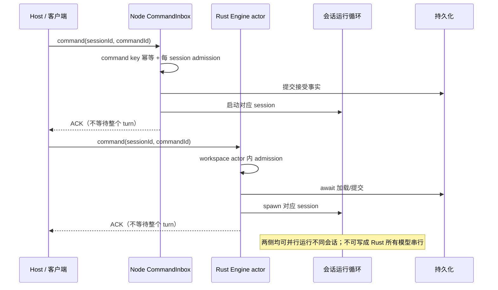
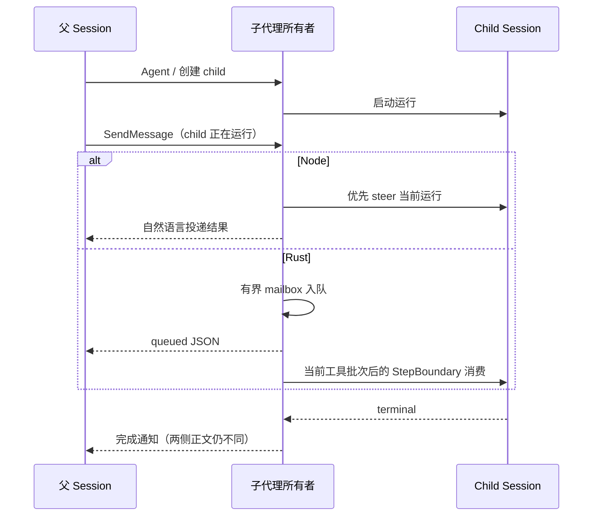

# Rust / Node CLI 对齐审计 · 2026-10-10

**结论：未达到完整替换条件；未达到轨迹字符级对齐条件。**

| 检查项   | 结论                                                                                    |
| -------- | --------------------------------------------------------------------------------------- |
| 基线     | `docs/rust-host-plan`，`e2d7b0bd912ad6324825b1f802e561dd09c3b8fb`                       |
| 对象     | 当前源码构建的 Node CLI 与 Rust debug 二进制；不是已安装发行包                          |
| 环境     | macOS ARM64；Node `24.14.0`、pnpm `10.33.2`；工作区 freshness 通过                      |
| 方法     | 主审计 + 模型/轨迹、工具/MCP、会话/子代理三个并行审计分支；源码交叉复核与本地双进程差分 |
| 实测范围 | 三种模型协议、模型异常分支、Plan 提醒、Read 边界、重复 Read、Bash cwd、MCP 内容与元数据 |
| 证据级别 | **实测**：当前进程复现；**源码**：当前执行路径确认；**待验**：未做对应运行验证          |
| 处置     | 保留 Node 为默认；先建立严格差分门禁，再按下列阻断项对齐                                |
| 本轮变更 | 仅报告及审计证据；不修改行为、不刷新过期 fixture、不覆盖无关本地改动                    |

优先级按“完整替换 + 字符级一致”定义：**P0** 为模型输入/结果/控制语义的直接阻断；**P1** 为功能、配置或生命周期缺口；**P2** 为验证与发布缺口。不是线上事故等级。历史 spec 中的“刻意差异”仍计入本次对齐差异。

## 1. 功能覆盖表

“有实现”仅表示能力存在，不表示全部边界相同。下文列出已确认差异。

| 领域          | Rust 已有实现                                                                                               | 仍不同或缺失                                                                       |
| ------------- | ----------------------------------------------------------------------------------------------------------- | ---------------------------------------------------------------------------------- |
| 模型          | Chat Completions、Responses、Anthropic；流式、取消、常规重试、账号 Host 鉴权、媒体预算                      | 请求形态、工具描述、缓存、异常结束、签名修复、OffPeak；见 M/T                      |
| 上下文        | 基础 prompt、AGENTS.md、环境、Skill、Plan/Todo 提醒、手动/自动/反应式压缩                                   | 主代理 memory、自定义 system/output style、MCS 提醒角色、可选 microcompact；见 F/M |
| 文件工具      | Read/Write/Edit、Glob/Grep、媒体 Read、文件 checkpoint/回退                                                 | 读取缓存/编码/预算、diff 表达、搜索限制；见 T                                      |
| Shell         | Bash、显式后台、超时转后台、TaskOutput/TaskStop、后代进程回收                                               | cwd 连续性、Host shell 偏好、EPIPE；见 T/S                                         |
| Session       | 按需加载、队列、guide/startNow、取消、retry/edit/fork、Goal、冷恢复、Node 共库                              | admission 粒度、legacy 回放、ACK/调度边界；见 S                                    |
| 子代理        | 真实 child Session、前后台 Agent/Task、SendMessage、TaskOutput/TaskStop、取消树、profile/Skill/MCP/记忆文件 | 递归、默认步数、profile 权限、前台转后台、邮箱投递、模型结果；见 A                 |
| MCP           | stdio、Streamable HTTP、legacy SSE、发现/调用、复用、官方鉴权、插件配置插值                                 | OAuth、调用元数据、媒体/结构化结果、进度超时与连接取消；见 C                       |
| 插件          | 发现、配置、市场、安装/更新/卸载/恢复入口、Skill 与 MCP                                                     | 官方资产首次 seed、宿主注入的 Browser/CUA/Node REPL；见 F                          |
| 自动任务      | 可接收外部提交中的 automation/offPeak 归属字段和工具禁用约束                                                | Cron/OffPeak 工具及完整执行链；不能把归属字段当作功能已交付                        |
| 终端          | `-p`、text/json/stream-json、resume/continue、attach                                                        | TUI 占位；管理命令、部分参数和 slash command 不完整                                |
| 工作流        | 部分协议字段/拒绝分支                                                                                       | 动态工作流按旧迁移范围排除；按本次“完整替换”要求仍是缺口                           |
| Desktop / Web | V4 两种投递 profile、增量恢复、snapshot fallback、流控                                                      | 本轮未验真实手机/远端/多窗口/发行包切换，不作全链路等价结论                        |

## 2. 字符级验收规则

**当前位置：未通过。** 普通 Read 的短文本可以一致，不能推广到完整轨迹。

| 层           | 必须对比                                                                                          | 不允许用来消除差异的操作                                           |
| ------------ | ------------------------------------------------------------------------------------------------- | ------------------------------------------------------------------ |
| 模型输入     | role、消息/内容块顺序、system/reminder、工具名称/顺序/描述/schema、调用参数原文、历史回填、媒体块 | trim、合并消息、排序工具、把 user/system 视为等价                  |
| 模型可见结果 | tool_result 全文、错误包装、空行、制表符、Unicode、截断/落盘提示、子代理通知                      | 只比较解析后的 JSON、删提示语、统一空白                            |
| 事件轨迹     | 请求开始/结束、工具开始/完成、ACK、取消、提交、子代理完成的因果顺序                               | 重排事件、只比较最终状态、丢掉当前一侧独有字段                     |
| 网络请求     | 原始 UTF-8 body 与解析后的字段分别比；明确 header/auth 排除项                                     | 用 JSON 键序差异直接证明业务错误，或反过来用 JSON 等价证明字符相同 |
| 存储/恢复    | canonical rows、模型历史重建、重启后下一次请求、同一命令重放结果                                  | 仅比较数据库能打开、UI 能显示、schema 能解析                       |

正式门禁应固定 provider 响应及分块、时钟、ID、随机种子、工作区路径、环境/locale、配置、Host 偏好和完成屏障。需要保留自然变量时，必须另列允许差异及理由；本报告没有将其默认为豁免。

正式门禁要求每次失败记录：**首个不同字节、UTF-16 字符位置、JSON 路径、两侧上下文、消息/事件序号、原始文件 SHA-256**。本轮尚未为所有差分齐备这些定位字段。字符统计注明口径；本轮描述长度和 Read 长度使用 JavaScript UTF-16 code units。

现有门禁不足：[telemetry diff](../../scripts/zcode-cli-rust-telemetry-diff.mjs) 的 `canonicalOrder`（66–95）重排模型结束与工具开始，`normalizeFacts`（127）丢弃 `memoryEnabled`。它可验证部分事实，**不能证明原始顺序或字符一致**。[tool parity 测试](../../packages/services/tests/zcode-cli-rust-tool-parity.test.ts) 只抽查部分描述，未覆盖下列实测分歧。

## 3. 模型请求与执行

| 编号 / 级别 | 触发                                             | Node → Rust 差异                                                                                                      | 证据 / 处置                                                                                                                  |
| ----------- | ------------------------------------------------ | --------------------------------------------------------------------------------------------------------------------- | ---------------------------------------------------------------------------------------------------------------------------- |
| M01 / P0    | 同配置首次 Chat 请求                             | 前导 system 合并为 1 条 → 保留 3 条；仅 `max_completion_tokens` → 同时含 `max_tokens`；显式 `tool_choice:auto` → 缺失 | **实测**。消息边界与请求字段分别对齐，不能仅修 JSON 序列化                                                                   |
| M02 / P0    | 同配置 Anthropic 请求及工具回填                  | user/tool_result 的 ephemeral cache 标记存在 → 缺失；`tool_choice:auto` → 缺失                                        | **实测**。基础 system 三块在该 fixture 相同；不把随机 metadata ID 当固定文本缺陷                                             |
| M03 / P0    | 同配置 Responses 请求                            | user `input_text[]` → 字符串；Rust 额外 `store:false`、`include:[reasoning.encrypted_content]`；tool choice 不同      | **实测**。部分字段可能是有效协议选择，但不是字符/请求等价；需确认产品规则                                                    |
| M04 / P0    | Anthropic thinking signature 导致 400            | 仅修复请求副本，删除被拒的 signed/redacted reasoning 块并重试成功 → 直接 `invalid_model_request`                      | **实测**。Node 3 次请求、Rust 2 次；不是只删 signature 属性，不改 canonical history                                          |
| M05 / P0    | Anthropic 非原生搜索响应 `stop_reason:refusal`   | 保留回复并成功 → `invalid_model_response`                                                                             | **实测**。终态解析集合不同                                                                                                   |
| M06 / P0    | Chat 非空回复、`finish_reason:content_filter`    | 成功提交回复 → `invalid_model_response`                                                                               | **实测**。不能把有效结束原因统一当损坏响应                                                                                   |
| M07 / P0    | Chat 完整 Read call，同时 `finish_reason:length` | 执行工具并继续请求 → 直接 `invalid_model_response`                                                                    | **实测**。Node 2 次请求、Rust 1 次；完整工具调用与截断判断顺序不同                                                           |
| M08 / P0    | 支持 MCS 的模型，Plan 提醒                       | `role:system` + 提醒正文 → `role:user` + `<system-reminder>`                                                          | **实测**。模型角色和全文均不同                                                                                               |
| M09 / P0    | guide 使运行中模型能力发生变化                   | 下一步按新模型重新 `getTools` → 本 run 工具定义仍取开头快照                                                           | **源码**。WebSearch/PDF 等能力过滤可能过期；增加跨能力模型切换差分                                                           |
| M10 / P1    | OffPeak 排队/票据失效                            | 专门的排队等待与过期标记 → 常规有限重试                                                                               | **源码**。不能用普通 429 重试代替任务调度协议                                                                                |
| M11 / P1    | 首方 Anthropic strict 工具或 MFJS schema 配置    | 按 provider/model/contract 改写 strict/schema → 未见对应转换                                                          | **源码**。strict 当前主要使用者是 workflow typed submit_result；MFJS/MCP 局部 `$ref` 为独立缺口。普通 fixture 不覆盖这些分支 |
| M12 / P1    | 显式启用 microcompact                            | Node 清理旧工具结果 → Rust agent loop 只有完整压缩路径                                                                | **源码**。Node 默认禁用，不能描述成默认每轮均不同；Rust README 的已支持描述需更正                                            |
| M13 / P0    | 跨模型/兼容套餐 provider 续聊                    | Node 按 reasoning 类型和兼容 provider 组决定保留 → Rust provider/model 精确不等时全部移除相关 reasoning               | **源码**。历史正文及签名保留政策不同；先统一规则，不能盲目保留签名                                                           |
| M14 / P0    | 工具名带空格/空名，参数为 BOM/空串/null/坏 JSON  | Node trim 名称，对若干异常参数先降为 `{}` 再校验 → Rust 保留名称空格、严格 JSON parse，空名可使整段响应失败           | **源码**。错误落点与文案不同；补默认参数及闭合 tool-call fixture                                                             |

位置：

- M01–03：[Node system 合并:6](../../apps/zcode-cli/packages/adapters/src/model/system-message-compat.ts)、[Node 请求:120](../../apps/zcode-cli/packages/adapters/src/model/runner-options.ts)、[Rust body:83](../../apps/zcode-cli-rust/crates/model/src/model_protocol.rs)。
- M04–07：[Node stream:174](../../apps/zcode-cli/packages/adapters/src/model/runner-stream.ts)、[Node generate:364](../../apps/zcode-cli/packages/adapters/src/model/runner-generate.ts)、[Node continuation:30](../../apps/zcode-cli/packages/core/src/runtime/methods/turn-output-token-continuation.ts)、[Rust provider:175](../../apps/zcode-cli-rust/crates/model/src/provider.rs)、[Rust Chat 终态:126](../../apps/zcode-cli-rust/crates/model/src/model_stream.rs)、[Rust Anthropic 终态:206](../../apps/zcode-cli-rust/crates/model/src/anthropic_stream.rs)。
- M08–14：其余精确执行路径见本报告末尾源证据表。M11 只针对满足条件的 contract，不能理解为所有普通工具都应开启 strict。

## 4. 工具目录与文件/Shell 结果

### 4.1 同配置工具目录

实测条件：内存关闭、增强搜索开启、隔离 HOME、官方 Browser/CUA 插件禁用、无自定义 MCP；同一个本地 provider。

| 项目                | Node                                                             | Rust                                      |
| ------------------- | ---------------------------------------------------------------- | ----------------------------------------- |
| 工具数              | 20                                                               | 17                                        |
| 仅 Node             | CronCreate、CronDelete、CronList、CronUpdate、ReadSessionContext | —                                         |
| 仅 Rust             | —                                                                | Glob、Grep                                |
| 共同工具输入 schema | 15 个在此配置下相同                                              | 不能推广至 strict/MFJS/native-search 分支 |
| 顺序                | Agent、AskUserQuestion、Bash…                                    | Read、Write、Edit…                        |

Node 增强搜索分支把搜索放入 Bash 并隐藏 Glob/Grep；Rust 没有落实该 Host 偏好。工具集合和顺序会改变 prompt。位置：[Node 注册:197](../../apps/zcode-cli/packages/core/src/tool/handlers/index.ts)、[Host 偏好:3159](../../apps/zcode-cli/packages/bootstrap/src/zcode-protocol/server-operations.ts)、[Rust 定义](../../apps/zcode-cli-rust/crates/tools/src/tool_definitions.rs)。

共同工具中，以下 8 个描述不同；另 7 个在本 fixture 相同。

| 工具          | Node 字符数 | Rust 字符数 | 首个不同位置（0 起） |
| ------------- | ----------: | ----------: | -------------------: |
| Agent         |        1946 |        2709 |                  911 |
| Bash          |        1032 |         162 |                    7 |
| Edit          |         360 |          89 |                    0 |
| EnterPlanMode |        4011 |        3997 |                 2496 |
| Read          |         784 |          83 |                    4 |
| TaskOutput    |        1049 |          96 |                    0 |
| TaskStop      |         203 |          81 |                    0 |
| Write         |         240 |          78 |                    0 |

**T01 / P0：** Rust `tool_definitions.rs:8–17` 仍有手写短描述；Agent 又追加 `Current profile catalog (authoritative)`。当前生成脚本通过，不代表这些运行时描述已逐字符对齐。

### 4.2 Read 实测矩阵

| 输入                      | Node                                                                                            | Rust                             | 判定                                      |
| ------------------------- | ----------------------------------------------------------------------------------------------- | -------------------------------- | ----------------------------------------- |
| 普通文本；CRLF            | 相同的带行号文本                                                                                | 相同                             | 仅这两个直接读取样本通过                  |
| 空文件                    | “shorter than the provided offset…1 lines”                                                      | “contents are empty”             | **T02 / P0**：文案及行数不同              |
| `offset:0`                | 行号从 0 开始                                                                                   | 钳制为 1                         | **T02 / P0**                              |
| 2100 行；未给 limit       | 2100 行                                                                                         | 默认 2000 行                     | **T03 / P0**：Rust 在该案例无额外截断提示 |
| 90000 个“中”；未给 limit  | 超过 256 KiB，报错                                                                              | 64 KiB 部分视图，成功            | **T03 / P0**：错误/成功语义不同           |
| 相同文件；`limit:1`       | 估算 60000 tokens，超过 25000，报错                                                             | 部分视图，成功                   | **T03 / P0**                              |
| GBK “你好”                | 解码成功                                                                                        | `Read requires valid UTF-8 text` | **T04 / P0**                              |
| 同会话重复 Read，文件未变 | `Wasted call — file unchanged since your last Read. Refer to that earlier tool_result instead.` | 再发全文                         | **T05 / P0**：真实会话复现                |

处置：以现行 Node 可观察行为为验收基线；空文件等可疑 Node 行为若要一起更改，先另立产品规则，不能直接豁免 Rust。

位置：[Node Read:185](../../apps/zcode-cli/packages/core/src/tool/handlers/read.ts)、[Node 文本预算:111](../../apps/zcode-cli/packages/core/src/tool/handlers/read-text.ts)、[Node 编码](../../apps/zcode-cli/packages/adapters/src/fs/text-metadata.ts)、[Rust Read:131](../../apps/zcode-cli-rust/crates/tools/src/tool_files.rs)。直接 Read 边界 probe 调用两侧真实读取实现；重复 Read probe 使用两侧完整 runtime。

### 4.3 其余工具

| 编号 / 级别 | 触发                                         | 差异                                                                                                  | 证据 / 处置                                                                     |
| ----------- | -------------------------------------------- | ----------------------------------------------------------------------------------------------------- | ------------------------------------------------------------------------------- |
| T06 / P0    | 主会话 `cd sub && pwd` 后再次 `pwd`          | 第一次相同；第二次 Node 在 `workspace/sub`，Rust 在 `workspace`                                       | **实测**。cwd 状态必须由会话唯一所有者维护                                      |
| T07 / P1    | 配置非默认执行 shell                         | Node 从 Host 偏好解析并继承 shell；Rust 上下文/执行默认 bash 或 cmd                                   | **源码**。补 shell 选择与环境提示差分，不能只改 prompt 声称使用某 shell         |
| T08 / P0    | Write/Edit 多处分离改动                      | 实测 16 行仅改首尾：Node 2 hunks、+2/-2；Rust 1 hunk、+16/-16                                         | **实测**。adapter data、display 与计数/telemetry 不同；该案例的模型成功文案相同 |
| T09 / P0    | Grep files、空结果、分页                     | Node 有 `Found 1 file`、`No files found` 和分页摘要；Rust 直接路径、`No matches found` 和另一截断提示 | **实测**。结果文本没有对齐；700 字符长行样本相同，不因实现不同臆测失败          |
| T10 / P0    | Write 未先 Read 已有文件；覆盖已 Read 空文件 | 未读错误全文不同；空文件 Node 报 create、Rust 报 update                                               | **实测**。模型成功文案也分别为 created/updated；保留或共同修改 Node 基线须明确  |
| T11 / P1    | Grep 搜索 17 MiB 文件                        | Node 成功；Rust `grep_too_large: ... exceeds 16 MiB`                                                  | **实测**。搜索预算不同；更多 Glob/type/排序/ignore 边界仍待验                   |
| T12 / P1    | 非 UTF-8 或大文件 Write/Edit                 | Node 保留 read.encoding，Edit 上限 1 GiB；Rust UTF-8-only、8 MiB 上限                                 | **源码**。不要将 Read GBK 实测冒充 Write/Edit 全矩阵实测                        |
| T13 / P0    | Bash stdout 图像 data URL 或 gh 限额提示     | Node 可投影 image 内容块及专门提示；Rust shell 输出固定文本                                           | **源码**。需对媒体块和限额错误分别做 fixture                                    |

位置：[Node cwd:206](../../apps/zcode-cli/packages/core/src/tool/handlers/bash.ts)、[cwd 策略:33](../../apps/zcode-cli/packages/core/src/tool/handlers/bash-cwd-policy.ts)、[Rust dispatch:128](../../apps/zcode-cli-rust/crates/tools/src/tools.rs)、[Node patch:4](../../apps/zcode-cli/packages/core/src/tool/diff.ts)、[Rust patch:51](../../apps/zcode-cli-rust/crates/tools/src/file_write.rs)、[Node Write:45、148](../../apps/zcode-cli/packages/core/src/tool/handlers/write.ts)、[Node Edit:61](../../apps/zcode-cli/packages/core/src/tool/handlers/edit.ts)、[Rust Write/Edit:245、300](../../apps/zcode-cli-rust/crates/tools/src/tool_files.rs)、[Node Grep:201](../../apps/zcode-cli/packages/core/src/tool/handlers/grep.ts)、[Rust search:200、310](../../apps/zcode-cli-rust/crates/tools/src/tool_search.rs)、[Node ripgrep 参数:921](../../apps/zcode-cli/packages/adapters/src/fs/index.ts)。T13 位置见末尾源表。

## 5. MCP

### 5.1 返回内容：7 类全部实测不同

| 输入                      | Node 模型可见内容                                       | Rust 模型可见内容                   |
| ------------------------- | ------------------------------------------------------- | ----------------------------------- |
| 两个 text block           | `alpha\n\nbeta`                                         | `alpha\nbeta`                       |
| text + structuredContent  | `Structured content:\n` + 两空格缩进 JSON               | 无前缀、紧凑 JSON                   |
| 空 structuredContent `{}` | 忽略                                                    | 追加 `\n{}`                         |
| `isError:true`            | `MCP tool returned an error:\nfixture error`            | `fixture error`                     |
| text resource             | `MCP resource content:\n` + URI/MIME/text 的 JSON       | 仅 resource.text                    |
| audio                     | `[MCP audio content omitted: audio/wav]`                | 含 base64 的 JSON 文本              |
| image                     | 媒体提示 + 真实 image 内容块；Chat 中另附 user 媒体消息 | 含 base64 的 JSON 文本，无 image 块 |

**C01 / P0：** 统一内容转换、空值、错误、媒体和截断规则。图片差异会改变模型能否看到图像，不能作为格式小差异放行。

### 5.2 调用与连接

| 编号 / 级别 | 触发                                                   | Node → Rust 差异                                                                                                                                      | 证据 / 处置                                                                                                    |
| ----------- | ------------------------------------------------------ | ----------------------------------------------------------------------------------------------------------------------------------------------------- | -------------------------------------------------------------------------------------------------------------- |
| C02 / P0    | MCP tools/call                                         | 发送 `_meta` 中的 trace/session/turn/runtime_scope/workspace/client_mode/delivery_kind，远程存在时追加 identity/remote_session_id → 仅 name/arguments | **本地实测，远程字段源码确认**。影响会话/工作区关联与宿主桥接；不等同鉴权头缺失                                |
| C03 / P1    | OAuth MCP                                              | authorization_code、refresh、client_credentials 路径存在 → 显式拒绝 OAuth 配置                                                                        | **源码**。官方 Host 鉴权已存在，不代表通用 OAuth 已实现                                                        |
| C04 / P1    | 持续 progress 的慢调用                                 | SDK `resetTimeoutOnProgress:true` → 固定调用超时                                                                                                      | **源码**。真实服务器的超时行为待验                                                                             |
| C05 / P0    | tools/call 已成功 dispatch，等待响应期间出错/取消/超时 | Node 普通取消/超时不主动关闭整条连接 → Rust 此等待分支出错后关闭连接                                                                                  | **源码**。不含发送前取消、dispatch 失败或正常 `isError:true` result；对其他共享调用的影响待双调用 fixture 验证 |
| C06 / P1    | 大图/官方 CUA 返回                                     | Node 媒体归一化、落盘及特定图像契约 → Rust 通用文本结果路径                                                                                           | **源码**。7 类小样本不覆盖大结果/压缩/真实 CUA                                                                 |
| C07 / P0    | 大 MCP 文本                                            | Node 普通工具 50000 bytes、官方 CUA 256 KiB、node_repl 64 KiB + artifact；Rust 通用 64 KiB 后追加截断文案                                             | **源码**。阈值和截断/落盘文字均需对齐                                                                          |
| C08 / P1    | 断连后同 turn 的下一次 MCP 调用                        | Node call 前可恢复连接并重试连接检查；Rust call 直接使用 binding，重建在 prepare 阶段                                                                 | **源码**。不能写成 Rust 从不重连；差异是恢复时机                                                               |
| C09 / P1    | MCP annotations / 未指定 protocolVersion               | Node 并发采用 readOnly/idempotent hint、版本默认 auto；Rust safe 要 readOnly=true 且 destructive=false、版本缺省 Initialize                           | **源码**。影响并发和协议协商；不能声称所有现代服务器均连接失败                                                 |
| C10 / P2    | stdio server 启动失败写 stderr                         | Node 保留有限诊断；Rust stderr 置 null                                                                                                                | **源码**。错误排障信息缺失                                                                                     |

位置：[Node 内容:369](../../apps/zcode-cli/packages/core/src/mcp/index.ts)、[Node 媒体:27](../../apps/zcode-cli/packages/core/src/mcp/image-normalization.ts)、[Node 调用/取消:438、692、742](../../apps/zcode-cli/packages/adapters/src/mcp/index.ts)、[Rust OAuth:61、调用:299、内容:318](../../apps/zcode-cli-rust/crates/tools/src/mcp_connection.rs)。

## 6. Session 与调度

### 6.1 所有者和事件顺序



| 编号 / 级别 | 触发                                          | 差异                                                                          | 证据 / 处置                                                              |
| ----------- | --------------------------------------------- | ----------------------------------------------------------------------------- | ------------------------------------------------------------------------ |
| S01 / P1    | 不同 session 同时 admission，一侧存储变慢     | Node 按 session 排队；Rust 全 workspace actor await 该操作                    | **源码**。跨 session 队头阻塞是结构性风险，本轮未量化延迟                |
| S02 / P0    | 模型仍在流式输出、前面的安全 tool call 已完整 | Node 可以启动工具；Rust 等模型结束再执行                                      | **源码**。事件和副作用时刻不同；固定完成屏障后对比原始顺序               |
| S03 / P1    | 多个可并行工具，或设置 toolConcurrency        | Node 调度器默认 10、可配置且读取安全元数据；Rust 连续安全组固定 `buffered(4)` | **源码**。配置值不能只被 schema 接受却不落实                             |
| S04 / P1    | legacy `session/subscribe` 带 afterSeq        | Node 收集并回放事件；Rust 返回空 events                                       | **源码**。仅限 legacy，不能推广为 V4 无回放                              |
| S05 / P0    | stdout EPIPE，存在忽略 TERM 的 shell 后代     | 当前 Rust 以 1 退出并报 `Protocol writer stopped`，测试期望正常退出           | **实测**。全量、串行重跑均失败；尚未证明具体竞态根因或与 Node 的故障差分 |

位置：[Node admission:107](../../apps/zcode-cli/packages/bootstrap/src/zcode-protocol-v4/command-inbox.ts)、[Rust actor:170](../../apps/zcode-cli-rust/crates/core/src/app/engine.rs)、[Node scheduler:48](../../apps/zcode-cli/packages/core/src/tool/scheduler.ts)、[Rust calls:262](../../apps/zcode-cli-rust/crates/core/src/app/tool_execution.rs)、[Node legacy:676、1901](../../apps/zcode-cli/packages/bootstrap/src/zcode-protocol/server-operations.ts)、[Rust legacy:133](../../apps/zcode-cli-rust/crates/core/src/app/legacy_stream.rs)、[EPIPE 场景:79](../../packages/services/tests/zcode-cli-rust-shell-lifecycle.test.ts)。

上图描画空闲 sendText 的接受路径；busy/startNow 另有队列和取消屏障，不能按图推导所有命令相同。已有边界：接受的 busy 输入由 runtime 管理；startNow 在旧执行结束后启动；stale run 防护、Node 共库、LRU、V4 replay/snapshot、两种 clientMode 都有实现与测试。**未验证真实跨 Host owner/lease、远程 identity、多窗口争用和手机断线全链路。**

## 7. 子代理

| 编号 / 级别 | 触发                                                  | Node → Rust 差异                                                                   | 证据 / 处置                                                                        |
| ----------- | ----------------------------------------------------- | ---------------------------------------------------------------------------------- | ---------------------------------------------------------------------------------- |
| A01 / P0    | general-purpose 子代理再次调用 Agent                  | child 配置禁用 subagents → `tools:["*"]` 仍允许 Agent，直到 depth 4                | **源码**。递归能力和 child prompt 工具目录都不同                                   |
| A02 / P1    | 未显式设置子代理 maxTurns                             | 默认最多 4 步 → 仅 profile 有 maxTurns 才限制                                      | **源码**。预算与终止行为不同                                                       |
| A03 / P0    | 用户级/受信插件 profile 声明 permissionMode:auto/plan | Node 读取并应用 → Rust Profile 不保存该字段；Explore 特例外继承父权限/Plan         | **源码**。Node 项目级 profile 刻意忽略此字段，不在本差异条件内                     |
| A04 / P1    | 父会话大量并发 Agent/SendMessage                      | Rust 另限每父 4、workspace 32、邮箱 32；Node 当前相应 runner/registry 无同款硬限制 | **源码**。不据此声称 Node 全系统无任何限制                                         |
| A05 / P0    | SendMessage 到正在运行的 child                        | 优先 steer；自然语言 tool_result → 排邮箱并回 queued；JSON tool_result             | **源码**。投递状态与模型可见字符不同；两侧都在合法步骤边界消费，生效时序需另外差分 |
| A06 / P0    | 前台/后台 Agent 返回                                  | 后台“不要重复子代理工作”等提示 → 缺失/缩短；空完成结果 fallback → 空正文           | **源码**。按完整模型可见字符串对齐                                                 |
| A07 / P0    | TaskOutput 读取子代理                                 | XML 标签与空行格式 → 整个结果对象 JSON 字符串                                      | **源码**。不能只对比 result 字段                                                   |
| A08 / P0    | 后台子代理完成/失败通知                               | Node summary 带 agent 类型、任务说明与状态；错误/状态/截断规则 → Rust 不同         | **源码**。验证通知只注入一次及重启后回填                                           |
| A09 / P1    | 前台 Agent 运行中转后台                               | Node runner 有定时/手动 background 迁移 → Rust foreground wait 等终态              | **源码**。需补取消、用户 steer 和进程退出时序矩阵                                  |



位置：[Node child config:269、284、473](../../apps/zcode-cli/packages/core/src/runtime/methods/subagent.ts)、[Node runner:291、941](../../apps/zcode-cli/packages/core/src/subagent/runner.ts)、[Node mailbox:161](../../apps/zcode-cli/packages/core/src/runtime-task/registry.ts)、[Node profile:182](../../apps/zcode-cli/packages/core/src/subagent/profile.ts)、[Node Agent formatter:130](../../apps/zcode-cli/packages/core/src/tool/handlers/agent.ts)、[Node SendMessage:142](../../apps/zcode-cli/packages/core/src/tool/handlers/send-message.ts)、[Node TaskOutput:173](../../apps/zcode-cli/packages/core/src/tool/handlers/task-output.ts)、[Rust profile/结果:52、102](../../apps/zcode-cli-rust/crates/domain/src/subagent.rs)、[Rust 限流/继承/邮箱:48、118、235](../../apps/zcode-cli-rust/crates/core/src/app/subagents.rs)、[Rust 调用返回:94](../../apps/zcode-cli-rust/crates/core/src/app/subagent_tools.rs)。

## 8. 完整替换仍缺的产品能力

| 编号 / 级别 | 位置 / 职责               | 当前差异                                                                                                 | 处置                                                     |
| ----------- | ------------------------- | -------------------------------------------------------------------------------------------------------- | -------------------------------------------------------- |
| F01 / P1    | 终端入口 / 管理           | Rust TUI 返回 2；Node 有交互 TUI、login/logout/doctor/commands/plugins/skills 命令                       | 先明确完整 CLI 还是仅 App stdio 的交付范围               |
| F02 / P1    | headless 输入             | Rust 拒绝 `--target`、`--browser-use`、`--memory-bench`、`--force-mcs`；workspace slash 目录只有 compact | 每个受支持参数、命令、退出码单独列验收                   |
| F03 / P0    | 主代理上下文              | memory 读索引/提取、custom system、output style 未接入 Rust 根上下文                                     | 与 child profile memory 区分；开启配置后做首轮及重启差分 |
| F04 / P0    | ReadSessionContext        | Node 读取持久化历史并可调用辅助模型抽取；Rust 无注册/执行                                                | 补工具、权限边界、截断与跨会话引用输出                   |
| F05 / P1    | Cron / OffPeak            | Node 按能力装配；Rust 缺对应工具及完整运行链                                                             | Host 外部触发一次输入不等于完整自动任务                  |
| F06 / P1    | Browser / CUA / Node REPL | Node 注入官方 node_repl MCP 与 Browser broker；Rust 缺同等宿主注入链                                     | 普通第三方 MCP 能连接不等于官方能力可用                  |
| F07 / P1    | 官方插件资产              | Node 启动 seed 内置资产；Rust 读已有官方缓存；restore 入口不会补齐缺失 bundle                            | 用全新 HOME 验收，不能依赖曾启动过 Node                  |
| F08 / P1    | 动态工作流                | Node 有 workflow runtime、工具、actor；Rust 当前迁移明确排除                                             | 完整替换须实现或明确删减产品范围                         |

位置：F01–02 [Node 命令:531](../../apps/zcode-cli/packages/cli/src/run.ts)、[Rust TUI:39](../../apps/zcode-cli-rust/src/main.rs)、[Rust 参数:159](../../apps/zcode-cli-rust/crates/headless/src/args.rs)、[Rust workspace 展示:10](../../apps/zcode-cli-rust/crates/core/src/app/queries.rs)；F03 [Node context:136](../../apps/zcode-cli/packages/core/src/runtime/methods/context.ts)、[Node builder:84](../../apps/zcode-cli/packages/core/src/context/builder.ts)、[Rust prefix:73](../../apps/zcode-cli-rust/crates/domain/src/prompt.rs)；F04 [Node handler:37](../../apps/zcode-cli/packages/core/src/tool/handlers/read-session-context.ts)；F05 [Node 注册:241](../../apps/zcode-cli/packages/core/src/tool/handlers/index.ts)、[Rust 归属字段](../../apps/zcode-cli-rust/crates/core/src/app/submission.rs)；F06 [Node 注入:230](../../apps/zcode-cli/packages/bootstrap/src/app/create-app.ts)、[Rust 方法表](../../apps/zcode-cli-rust/crates/core-api/src/transport.rs)；F07 [Node seed:240](../../apps/zcode-cli/packages/bootstrap/src/app/bundled-plugins.ts)、[Rust discovery:78](../../apps/zcode-cli-rust/crates/plugins/src/discovery.rs)、[Rust restore:124](../../apps/zcode-cli-rust/crates/plugins/src/install_admin.rs)；F08 [Node workflow driver](../../apps/zcode-cli/packages/bootstrap/src/app/workflow-driver.ts)。

## 9. 已排除的误报

| 旧说法或疑点                                               | 当前结论                                                                               |
| ---------------------------------------------------------- | -------------------------------------------------------------------------------------- |
| Rust 没有 MCP、Skill、子代理、Goal、权限、队列、历史操作   | 错误；均已有核心实现                                                                   |
| Rust Bash 到超时必杀死                                     | 错误；已有超时转后台，现有场景本轮通过                                                 |
| Rust 不支持 image/video/PDF 或 Node 共库存储               | 错误；已有实现、媒体集成和 18 类存储对照通过                                           |
| 子代理不继承 hooks 是 Rust 独有缺失                        | 当前两侧都不把主代理 hooks 传给 child                                                  |
| 缺独立完整 JSONL transcript sidecar                        | Node 当前也明确不重复写该 sidecar；不能按旧清单判缺失                                  |
| 成功 `model_context_window_exceeded` 只有 Rust 先 Continue | 两侧都先走最多 3 次 Continue；真正请求超窗另走 reactive compact                        |
| Goal verifier 非法 JSON：Node 通过、Rust 必失败            | 当前两侧都 fail-open，旧结论已失效                                                     |
| D14 解析怪癖、D16 legacy strict 多余字段是 Rust 独有问题   | 当前源码保留双方共同行为；不是 Rust 欠实现。D16 是否被当前 Host 丢弃还需 Host 路径证据 |
| schema/生成器检查通过即可证明轨迹对齐                      | 错误；手写描述、runtime formatter、工具顺序和未覆盖配置都可漂移                        |

## 10. 验证结果与剩余边界

| 检查                                         | 结果                                                                                           |
| -------------------------------------------- | ---------------------------------------------------------------------------------------------- |
| `node scripts/check-workspace-freshness.mjs` | 通过；相对已存在 origin/main ahead 3 / behind 0；没有执行 fetch                                |
| 当前 Node CLI 及依赖构建                     | 11/11 通过；先前缺 dist 的失败已通过构建依赖解决                                               |
| `pnpm typecheck`                             | 通过；这不是 Rust 编译检查                                                                     |
| `pnpm lint`                                  | 通过，0 errors / 140 warnings；包含工作区已有内容，不记为零警告                                |
| Rust `cargo test --workspace --locked`       | 407 tests 通过；46 个测试结果块含空/doc suites                                                 |
| 集成测试 TypeScript 检查                     | 通过                                                                                           |
| Node 读取 Rust 写入的会话库                  | 18 场景通过，含 compact、fork、goal、subagent、rewind、media                                   |
| `pnpm test:rust-npm`                         | 13/13 通过；仅 launcher fixture，不是实机发行验收                                              |
| `pnpm test:zcode-cli-rust`                   | **失败**：`domain/fixtures/web.json` 的当前月份过期（September → October）；该命令没有全程通过 |
| 直接运行全部服务层 Rust 集成测试             | 301 个：298 通过、3 失败                                                                       |
| 串行重跑上述 3 个失败所在文件                | 17 个：16 通过、1 失败；EPIPE 仍失败                                                           |
| 本轮专门双进程差分                           | 76 次本地 fixture 模型请求；另有 Read 8 例、Write/Grep 8 例直接实现对照；结果见证据 JSON       |

全量另两次失败为图像准备命令超时、超大空闲会话测试关闭时 SIGKILL；串行重跑通过。仅能记录“复跑通过”，不能据此确认高负载是根因。EPIPE 不再仅按历史“偶发已通过”描述。

月份失败是 fixture 时效问题：Rust WebSearch runtime 描述会按当前月份生成。**不将这个检查失败误判为 WebSearch 未实现，也不修改 fixture 来制造全绿。**

未覆盖：真实供应商/账号及网关、实际 OAuth 授权、真实 MCP/CUA 图像契约、所有 Responses 异常结束、断流与工具副作用交错的完整组合、真实远端/手机/多窗口、Windows/Linux/macOS x64、SSH/WSL、安装升级回退、长期磁盘 GC。音频用户附件也未建立两侧 fixture 等价结论；不能因为 MCP audio 对照而宣称用户音频支持已对齐。

待定点 fixture 的源码疑点：legacy workspaceIdentity 空白归一化、非 accepted ACK 重放状态、续跑 child 的 tool-use 计数是否累计。当前不足以把这三项升级为已复现故障。

## 11. 执行顺序与放行条件

| 顺序 | 工作                                              | 放行条件                                                               |
| ---- | ------------------------------------------------- | ---------------------------------------------------------------------- |
| 1    | 固定输入与环境；保存未归一化请求/事件；建立差分器 | 不排序事件、不丢 memory 字段；失败能定位首个字符及因果节点             |
| 2    | T01–13、C01–02/C07、A05–08                        | 所有模型可见目录、结果、通知、媒体块逐字符/逐块一致；display/diff 另验 |
| 3    | M01–14                                            | 三协议成功、异常、重试、模型切换、MCS/compact 分支一致                 |
| 4    | S01–05、A01–04/A09、C03–06/C08–10                 | 多 session/child/MCP 并发、取消、重连、恢复、权限边界一致；EPIPE 通过  |
| 5    | F01–08 与平台矩阵                                 | 功能范围明确；独立新 HOME、真实 Desktop/Web/远端及升级回退通过         |

每批先更新对应 spec，再补 Node/Rust 共用输入的差分场景，然后实现。不要给每个差异追加各自的容错分支；优先统一模板来源、formatter、配置装配和状态所有权。

## 12. 证据索引

机器可读结果：[rust-node-cli-parity-evidence-2026-10-10.json](rust-node-cli-parity-evidence-2026-10-10.json)。只保存合成数据、稳定摘要和必要上下文；运行时随机路径替换有明确标记。原始请求/日志在本次会话临时审计目录，未提交个人路径或凭据。

补充源证据（行号对应本报告基线）：

| 编号       | Node 位置                                                                                                                                                                                                                                                        | Rust 位置                                                                                                                                                 |
| ---------- | ---------------------------------------------------------------------------------------------------------------------------------------------------------------------------------------------------------------------------------------------------------------- | --------------------------------------------------------------------------------------------------------------------------------------------------------- |
| M08        | [MCS capability:17](../../apps/zcode-cli/packages/core/src/runtime/helpers/runtime-provider-request-messages.ts)、[投影:54](../../apps/zcode-cli/packages/core/src/runtime/helpers/provider-request-messages.ts)                                                 | [固定 reminder:85](../../apps/zcode-cli-rust/crates/domain/src/plan_mode.rs)                                                                              |
| M09        | [Guide 切模:36](../../apps/zcode-cli/packages/core/src/runtime/methods/turn-guide-drain.ts)、[每步工具:114](../../apps/zcode-cli/packages/core/src/runtime/methods/turn-loop.ts)                                                                                 | [一次定义:34、每步 bind:115](../../apps/zcode-cli-rust/crates/core/src/app/agent_loop.rs)                                                                 |
| M10        | [OffPeak:30](../../apps/zcode-cli/packages/adapters/src/model/offpeak-retry.ts)                                                                                                                                                                                  | [有限 attempt:205](../../apps/zcode-cli-rust/crates/model/src/provider.rs)、[策略:29](../../apps/zcode-cli-rust/crates/model/src/model_policy.rs)         |
| M11        | [strict/schema:85](../../apps/zcode-cli/packages/adapters/src/model/tool-transform.ts)                                                                                                                                                                           | [直接投影:91、124、229](../../apps/zcode-cli-rust/crates/model/src/model_protocol.rs)                                                                     |
| M12        | [可选 microcompact:36](../../apps/zcode-cli/packages/core/src/runtime/methods/microcompact.ts)、[每步入口:69](../../apps/zcode-cli/packages/core/src/runtime/methods/turn-loop.ts)                                                                               | [预算 full compact:135](../../apps/zcode-cli-rust/crates/core/src/app/agent_loop.rs)、[过期声明:17](../../apps/zcode-cli-rust/README.md)                  |
| M13        | [reasoning 兼容组:18、94](../../apps/zcode-cli/packages/adapters/src/model/reasoning-history-normalization.ts)                                                                                                                                                   | [精确身份过滤:52](../../apps/zcode-cli-rust/crates/model/src/model_protocol.rs)                                                                           |
| M14        | [名称:8](../../apps/zcode-cli/packages/adapters/src/model/tool-call-validation.ts)、[输入:13](../../apps/zcode-cli/packages/adapters/src/model/tool-input-normalization.ts)                                                                                      | [名称:139](../../apps/zcode-cli-rust/crates/model/src/model_stream.rs)、[输入:58](../../apps/zcode-cli-rust/crates/core/src/app/tool_execution.rs)        |
| T07        | [Host shell:3240](../../apps/zcode-cli/packages/bootstrap/src/zcode-protocol/server-operations.ts)                                                                                                                                                               | [环境 shell:60](../../apps/zcode-cli-rust/crates/host/src/context_source.rs)、[Shell 执行:67](../../apps/zcode-cli-rust/crates/tools/src/tool_process.rs) |
| T13        | [图像:20](../../apps/zcode-cli/packages/core/src/tool/handlers/bash-image-output.ts)、[输出:58](../../apps/zcode-cli/packages/core/src/tool/handlers/bash-output.ts)、[限额提示:192](../../apps/zcode-cli/packages/core/src/tool/handlers/bash-model-content.ts) | [纯文本:79](../../apps/zcode-cli-rust/crates/tools/src/bash_output.rs)                                                                                    |
| C07        | [按工具预算:124](../../apps/zcode-cli/packages/core/src/mcp/index.ts)                                                                                                                                                                                            | [通用截断:341](../../apps/zcode-cli-rust/crates/tools/src/mcp_connection.rs)                                                                              |
| C08        | [call 时恢复:455](../../apps/zcode-cli/packages/adapters/src/mcp/index.ts)                                                                                                                                                                                       | [prepare:173、call:305](../../apps/zcode-cli-rust/crates/tools/src/mcp_hub.rs)                                                                            |
| C09        | [安全元数据:170](../../apps/zcode-cli/packages/core/src/mcp/index.ts)、[默认协商:1773](../../apps/zcode-cli/packages/adapters/src/mcp/index.ts)                                                                                                                  | [safe:52](../../apps/zcode-cli-rust/crates/tools/src/mcp_hub_bindings.rs)、[版本:71](../../apps/zcode-cli-rust/crates/tools/src/mcp_connection.rs)        |
| C10        | [stderr:1427、1583](../../apps/zcode-cli/packages/adapters/src/mcp/index.ts)                                                                                                                                                                                     | [stderr:102](../../apps/zcode-cli-rust/crates/tools/src/mcp_connection.rs)                                                                                |
| A08        | [summary:43](../../apps/zcode-cli/packages/core/src/subagent/completion-notification.ts)、[local-agent 通知:145](../../apps/zcode-cli/packages/core/src/runtime-task/notification.ts)                                                                            | [通知:128](../../apps/zcode-cli-rust/crates/domain/src/subagent.rs)                                                                                       |
| 排误：Goal | [非法 JSON fail-open:289](../../apps/zcode-cli/packages/contracts/src/tools/target.ts)                                                                                                                                                                           | [非法 JSON fail-open:82](../../apps/zcode-cli-rust/crates/domain/src/goal_verdict.rs)                                                                     |

复核方法：使用 [interop runtime helper](../../scripts/zcode-cli-rust-interop-runtime.mjs) 启动已构建的两侧进程，隔离 HOME/SQLite/工作区；本地 HTTP provider 固定响应，stdio MCP 固定内容。保存下一次模型请求中的 tool_result；直接工具案例使用实际 Node handler/adapter 与 [Rust tool_fixture](../../apps/zcode-cli-rust/examples/tool_fixture.rs)。数据中的 `localArtifactManifest` 标识本轮临时 probe/日志的摘要，**这些临时 probe 尚未接入仓库测试门禁**。

可重复的现有检查命令：

```sh
node scripts/check-workspace-freshness.mjs
node node_modules/turbo/bin/turbo --skip-infer --cwd apps/zcode-cli run build --filter='@zcode/cli'
cargo test --workspace --locked --manifest-path apps/zcode-cli-rust/Cargo.toml
cargo build --examples --locked --manifest-path apps/zcode-cli-rust/Cargo.toml
node node_modules/typescript/bin/tsc -p packages/services/tests/tsconfig.zcode-cli-rust.json
TSX_TSCONFIG_PATH=packages/services/tests/tsconfig.zcode-cli-rust.json node --import tsx scripts/zcode-cli-rust-node-storage-check.mjs
TSX_TSCONFIG_PATH=packages/services/tests/tsconfig.zcode-cli-rust.json node --import tsx --test packages/services/tests/zcode-cli-rust-*.test.ts
pnpm test:rust-npm
pnpm typecheck
pnpm lint
```

上述独立检查用于绕过已注明的日期 fixture 阻断、观察后续结果；不等同 `pnpm test:zcode-cli-rust` 全程成功。
