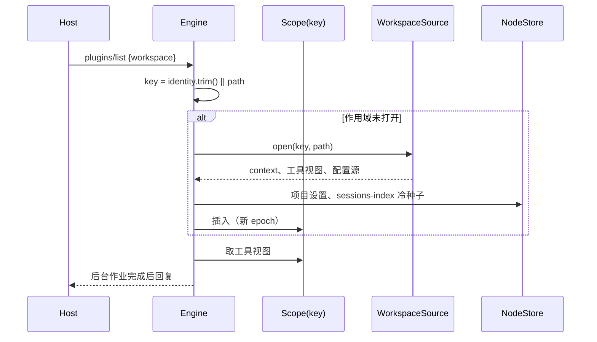
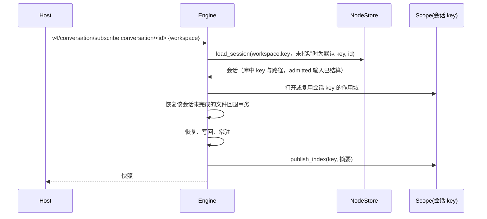
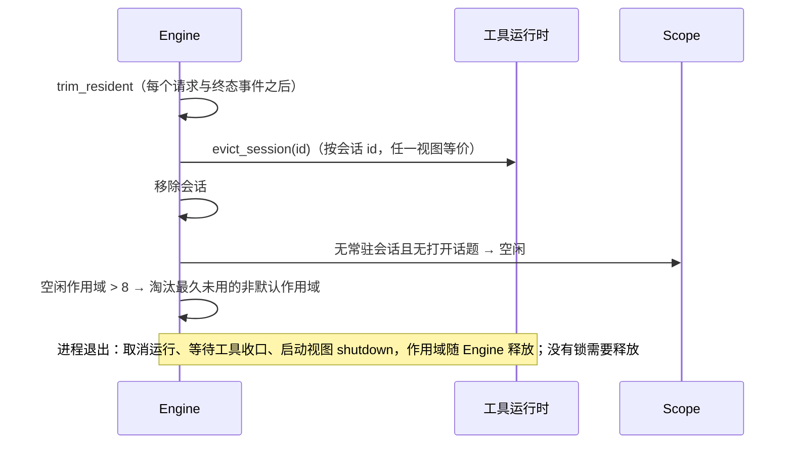

# zcode-cli-rust 多 crate 架构

## 目标

将现有单 crate 实现重构为 `apps/zcode-cli-rust` Cargo workspace，形成可复用的 zcode-cli-rust 核心，并由 App Server 与 Rust TUI 复用。当前 V4/App stdio wire contract 保持兼容；本规格只定义模块边界、状态所有权、端口和迁移顺序。

## Workspace 与依赖方向

目标 workspace 包含以下 crate：

- `zcode-cli-protocol`：V4 RPC、command、ACK、snapshot、event、capability 和错误 DTO；只包含 schema/type conversion。
- `zcode-cli-domain`：Session、history、queue、context、goal、todo、attachment、subagent 和 workspace identity 的纯领域模型。
- `zcode-cli-core-api`：`SessionRuntime`、`SessionStore`、`ModelPort`、`ToolPort`、`ContextPort`、`AuthPort` 和 `Clock` 公共契约。
- `zcode-cli-core`：Session actor、Agent loop、command admission、commit barrier、recovery 和 projection。
- `zcode-cli-state`：SQLite、session index/history、ACK、TS 只读导入、附件快照和 recovery。
- `zcode-cli-model`：OpenAI/Anthropic provider、SSE、retry、registry 和请求期鉴权。
- `zcode-cli-tools`：文件工具、Shell、后台任务、MCP、Skills、checkpoint/rewind 和 process cleanup。
- `zcode-cli-host`：workspace 路径/身份、配置、context source、平台路径和 runtime 环境组合。
- `zcode-cli-delivery`：V4 topic 投递（订阅、缓冲与刷新窗口、snapshot/resync 恢复、两种 profile、wire 编码与分片）；只依赖 `core-api` 与 `domain`，stdio 前端与 Host 共用（rust-u3-stage-b.md 3.2）。
- `zcode-cli-app-server`：stdio framing、RPC 路由、startup/storage handshake；投递经 `zcode-cli-delivery`。
- `zcode-cli-tui`：只负责 TUI 输入和渲染，通过 `core-api` 工作。
- `zcode-cli-rust`：唯一二进制和 composition root，负责 clap、依赖注入、信号和前端选择。

依赖方向固定为：

```text
protocol/domain → core-api → core
                         ↑
                state/model/tools/host
                         ↓
              app-server / tui → cli binary
```

`domain` 不依赖 tokio、reqwest、rusqlite、文件系统或具体 adapter；`core` 不依赖 state/model/tools；TUI 不直接访问持久化或 provider。

## 状态所有权与事件顺序

```text
CLI/TUI/AppServer input
        │
        ▼
SessionRuntime / SessionActor（唯一业务状态 owner）
        │ command admission
        ▼
state transition → durable commit receipt → event projection
        │                                  │
        ├─ Agent loop → ModelPort/ToolPort ┘
        └─ snapshot/query
```

- accepted input 只能进入 Core owner 一次；前端只保留 draft 和 pending optimistic overlay。
- 模型结果、工具结果、问答、todo、goal 和 file checkpoint 必须先完成 durable commit，再继续模型请求或发布下一步事件。
- 旧 run 事件按 `sessionId + runId + generation` 丢弃。
- 所有任务携带 `traceId`；`sessionId`、`turnId`、`messageId`、`toolCallId` 和 `spanId` 是其结构化子标识。
- `workspaceIdentity?.trim() || workspacePath` 用于隔离、去重和关联；`workspacePath` 只用于文件操作、cwd 和展示。
- desktop 使用 `desktop-continuous` 连续流；mobile 使用 `web-remote-replayable` snapshot/resync 恢复；两者共享同一 Session owner。

## 公开端口

- `SessionRuntime::dispatch` 返回带幂等状态和 stale revision 的 `CommandAck`。
- `SessionRuntime::query` 只读，不激活 Session、不触发模型或工具。
- `SessionRuntime::subscribe` 返回带 trace/session/run/turn/sequence 的 typed event。
- `SessionStore::commit_receipt` 是唯一持久化写入入口，事务成功后返回 durable receipt；底层 `commit` 只作为 adapter 的实现钩子。
- `ModelPort::complete` 返回 canonical `ModelOutput` 或结构化 `ModelFailure`。
- `ToolPort::execute_scoped` 返回 model content、display projection、artifact reference 和 failure 状态。
- `AuthPort` 只提供请求范围凭据，凭据不进入 session/history/queue。

## 改名规则

本仓库尚未发布，不保留旧入口。旧单 crate 目录、旧包名、旧 Rust 标识符、旧数据目录变量和旧 runtime 值都已删除；唯一有效名称是：

- workspace：`apps/zcode-cli-rust`
- package/binary：`zcode-cli-rust`
- Rust 标识符：`zcode_cli_rust`
- 数据目录变量：`ZCODE_CLI_RUST_DATA_DIR`
- runtime 选择：`ZCODE_AGENT_SERVER_RUNTIME=zcode-cli-rust`

V4 wire method、已有 SQLite schema 和 TS 只读导入语义不在本任务中改动。

## 迁移顺序与验收

1. 先完成规格和全量改名，确保新名称可独立构建、启动和被测试发现。
2. 建立 workspace、`protocol`、`domain`、`core-api` 和 Rust dependency-direction checker。
3. 迁移 `domain` 与 `core`，保持 Session owner、commit barrier、recovery 和旧 run 防护。
4. 按能力拆分 state/model/tools/host adapters。
5. 重建 app-server 和 CLI composition root。
6. 接入最小 Rust TUI：创建/恢复、发送、流式事件、stop、queue、错误和 snapshot 恢复。

每阶段必须执行 `pnpm typecheck`、`pnpm lint`、`pnpm fmt:check`、`pnpm architecture:check --changed`、`pnpm check:zcode-cli-rust` 和 `pnpm test:zcode-cli-rust`。默认 TypeScript runtime、数据库 schema redesign 和完整 TUI parity 作为后续 gate。

## Workspace 作用域（2026-10-09）

### 背景

此前一个 Rust CLI 进程只服务启动 cwd 对应的 workspace：Engine 绑定单个 `workspace`/`workspace_path`，其他 workspace 的请求以 `Workspace identity mismatch` 拒绝；启动时还在 data dir 对该 workspace 取 OS 文件锁。Host 的 plugin-management 与 mcp-status lane 工作目录相同、却要服务真实 workspace，因此两者都不可用（见 [rust-host-agent.md](rust-host-agent.md) §5.1）。TS CLI 按请求参数解析 workspace（如 `mcp.ts` 以 `params.workspace.workspacePath` 为工作目录、session record 按 `workspace.workspaceKey` 分桶），会话归属只由 Host owner/lease 保证。本节把 Rust 对齐到同一模型。

### 规则

1. **workspace 引用**：请求的 `workspace` 对象给出 `key = workspaceIdentity?.trim() || workspacePath`、`path = workspacePath`（`workspacePath` 必须非空）。字符串形式的 `workspaceId`（V4 `createSession.payload.workspaceId`、话题 `sessions-index/<id>`、`workspace-config/<id>`）：已打开作用域的 key 等于它时用该作用域的路径；否则按 Node `resolveWorkspaceRefFromId`：合法 remote identity 的路径为解析出的远端路径，`remote:` 前缀但不合法时报 `Invalid remote workspace identity`，其余按本地路径（key = path）。
2. **默认 workspace**：`--cwd`（缺省为进程 cwd）加 `ZCODE_WORKSPACE_IDENTITY`。请求不带 workspace 时使用它。`-p` 只使用默认 workspace。
3. **作用域（Scope）**：Engine 按 workspace key 持有作用域，它是以下状态的唯一所有者：该 workspace 的端口（提示上下文、工具端口视图、分层配置源）、项目权限（配置文件 `permission` 节、项目规则、项目模式偏好）、`modelAnomalyGuard`、sessions-index 状态（摘要、seq、保留日志、epoch）和 workspace-config seq。默认作用域在启动时打开；其他作用域在第一次需要时打开：读一次配置快照、项目设置和 sessions-index 冷种子。
4. **会话归属**：会话持有自己的 workspace key 与路径。新建用请求的 workspace（V4 create 用 `workspaceId`，legacy create 与导入用 `workspace`）；子代理、fork、选区侧聊继承父会话；冷加载取库中记录（key = `workspaceID.trim() || path || directory`，路径 = `path ?? directory`）。工具（文件、Shell、Glob/Grep、MCP、Plan 文件、技能、子代理定义）、hooks 的 cwd、项目 hook 信任、权限与项目设置、提示上下文和 provider 鉴权反向请求都使用会话所属的作用域，不使用进程 cwd。
5. **加载与过滤**：不带 workspace 的请求属于默认 workspace：常驻会话按 id 服务（V4 命令、会话查询），冷加载只接受默认 workspace 的会话。其他 workspace 的会话由请求指明（V4 `createSession.workspaceId`、`v4/conversation/subscribe` 的 attachment `workspace`、`session/resume`、`session/read`、导入）或继承父会话（子代理、fork、选区侧聊）；请求指明 workspace 时，常驻与冷加载的会话都必须属于该 key，否则按会话不存在处理（`Session unavailable` / `Session not found`）。同路径不同 identity 的会话与订阅因此隔离。`session/list` 与 sessions-index 按请求的 workspace 过滤。冷加载的恢复（`admitted` 输入结算为 discarded、未收口运行标为中断、未完成的文件回退事务）只在会话被本进程加载时做，回退事务不再在启动时全局扫描。
6. **workspace 级请求**：`plugins/*`、`mcp/list`、无 `sessionId` 的 `skills/referenceCatalog`、`workspace/generateText`、`provider/testModelConnectivity`、`workspace/hooks/trustGrant`、`workspace/readPresentation` 使用请求的作用域：路径用于文件操作，key 用于隔离；带 `sessionId` 的目录查询使用会话的作用域。`workspace/updateInteractionPreferences` 与 `v4/commands/query` 只校验 workspace 形状；交互偏好是进程级（Node 相同）。
7. **工具运行时共享**：各作用域的工具端口是同一个工具运行时的视图。Shell 任务、MCP 连接、读状态、写屏障和进程遥测按会话 id 存放，视图之间只有根目录、配置源和官方 MCP 身份的 workspace 不同。进程级操作（取消、关闭、淘汰会话，关机，进程事件，文件回退）经启动视图执行。
8. **MCP 状态**：`mcp/list` 的连接集合是进程级的 `mcp-status` 租约（Node `protocol-settings` lease）。每次 connect 以替换语义收敛到请求 workspace 的配置；`mode: "status"` 只返回同一 workspace 最近一次 connect 的状态，其他 workspace 返回空集合。
9. **作用域淘汰**：非默认作用域没有常驻会话、没有打开的 `sessions-index`/`workspace-config` 话题时为空闲；空闲作用域超过 8 个时按最近使用淘汰最旧的。重新打开的作用域使用新的 epoch，客户端旧 base 只能得到快照。
10. **进程级不变**：Provider Registry、网络出口（启动配置快照）、`--config` 模型、用户 hooks、交互偏好、hook 信任存储与 data dir 缓存仍按进程。
11. **无进程锁**：删除 data dir 中的 workspace owner 锁。会话的 live 归属只由 Host owner/lease 保证（同 Node 与 [rust-m11-node-storage.md](rust-m11-node-storage.md) §3）；同一 cwd 可以同时有多个 Rust 进程（chat、plugin-management、mcp-status lane）。已接受的风险：终端 `zcode -p --resume <id>` 对桌面正在运行的会话没有保护，与 TS CLI 相同。

### 状态所有者

| 状态                                                 | 所有者                    | 生命周期                         |
| ---------------------------------------------------- | ------------------------- | -------------------------------- |
| 会话（行、消息、队列、workspace key 与路径）         | Engine `sessions`         | 常驻期间；淘汰后只剩库中记录     |
| 作用域（端口、项目权限、sessions-index、config seq） | Engine `scopes`（按 key） | 打开到淘汰；默认作用域到进程退出 |
| Shell 任务、MCP 连接、读状态、写屏障                 | 工具运行时（各视图共享）  | 进程                             |
| `mcp-status` 连接集合与最近状态                      | MCP hub                   | 进程；每次 connect 替换          |
| 会话 live 归属                                       | Host owner/lease          | Host attachment                  |

### 事件顺序

请求带 workspace：



按会话 id 冷加载（V4 会话话题、命令）：



淘汰与退出：



### 与 TS CLI 的差异

- Node 冷恢复按 id 读取任意 workspace 的会话（`getSession(id)`），`session/resume` 与会话订阅带的 workspace 只用来物化 runtime（live 会话忽略它）。Rust 只冷加载请求指明（或默认）workspace 的会话，key 不一致按会话不存在拒绝，保持同路径不同 identity 的隔离，也避免以错误 identity 激活其他 workspace 的会话。Host 的会话订阅总是带 attachment workspace，所以行为对 Host 一致。
- `mcp/list mode:"status"` 对未做过 connect 的 workspace 返回空集合；Node 以配置合并进程级连接快照。Host 的设置页总是先 connect 再轮询 status。

### 验收

- 同一 cwd 的两个 app-server 进程同时存活，各自处理请求。
- cwd 为 A 的进程按 B 的文件回答 `plugins/list`、`mcp/list` 和技能目录。
- cwd 为 A 的进程在 B 中创建、加载会话：库中保存 B 的 identity 与路径，工具在 B 中执行。
- remote identity 与本地路径 key：同路径不同 identity 的会话、sessions-index 隔离。
- Host `agent_cli` 集成测试以真实 workspace 同时使用 plugin-management 与 mcp-status lane；桌面 E2E `agent-plugins-mcp` 在插件页与 MCP 设置页显示预置内容。

### 验证（2026-10-09）

- `packages/services/tests/zcode-cli-rust-workspace-scope.test.ts`（真实二进制）：同 cwd 两进程共存；cwd 为 A 的进程按 B 的文件回答插件、MCP、技能目录；B 的会话存 B 的路径、工具在 B 执行、重启后按 attachment workspace 冷加载；remote identity 与本地路径 key 隔离。`zcode-cli-rust-recovery` 改为两进程共存，`zcode-cli-rust-shared-context` 改为导入落在请求的 workspace。
- Host `agent_cli`：真实 workspace、plugin-management 与 mcp-status lane 同时存活；桌面 E2E `agent-plugins-mcp` 通过，`core`、`agent-subsystem`、`extensions-plugins`、`tasks-search` 回归通过。
- 已知与本变更无关：`generate-zcode-cli-rust-fixtures --check` 的 `web.json` 含当前月份，跨月后与 TS 不一致；`zcode-cli-rust-history` 的 Goal 编辑用例在基线二进制上同样间歇超时。
