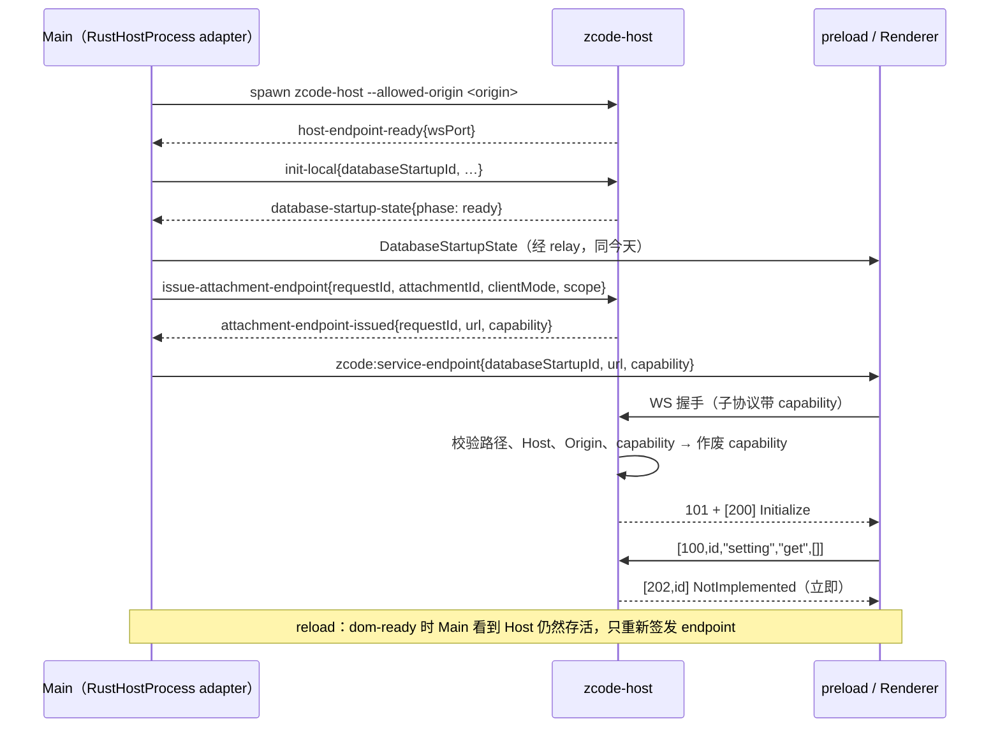

# Rust Host R0：骨架

日期：2026-10-08。上级规格：[rust-host.md](rust-host.md) 第 5 节 R0。分支：`feat/rust-host`。

## 1. 目标

开发开关打开后，Main 启动原生 `zcode-host`，Renderer 经本机 WebSocket 连上它并完成 `@zcode/rpc` 握手。40 个 channel 全部注册；每个成员都有确定的应答，不会挂起。R0 不实现任何业务服务，只是后续里程碑共用的地基。

## 2. 产品规则

1. **开关**：只有设置 `ZCODE_DESKTOP_HOST=rust` 并且 `!app.isPackaged` 时，Main 才启动 Rust Host。打包版本不读这个开关，行为与今天完全一致。
2. **二进制位置**：优先读 `ZCODE_RUST_HOST_BINARY`；没设置时用 monorepo 的 `apps/zcode-host/target/debug/zcode-host`。找不到二进制就报错退出，不回退到 Node Host，避免开发时误以为跑的是 Rust Host。
3. **应答规则**：
   - 契约内的成员：默认立即回 `202` 错误 `{name:"NotImplemented", code:"fault.host.notImplemented", message}`；`stub-value` 表里的成员回约定的值。
   - 契约外的 channel 或成员：立即回错误，不做 Node 那样的 1000 ms 等待。
   - 事件订阅：一律接受，但不会触发。
4. **数据库就绪门槛**：
   - Rust Host 收到 `InitLocal` 后，立即回一条 `phase:"ready"` 的 `DatabaseStartupState`，`startupId` 取自 `InitLocal.databaseStartupId`。R0 没有需要准备的数据库，tasks-index 迁移在 R2 随 tasks-index repo 实现。
   - 收到 `InitLocal` 之前建立的 attachment 先挂起，收到之后再发 `[200]`，与今天"就绪前挂起"的语义一致。
5. **连接关闭**：Renderer 的 WebSocket 一旦关闭，立即用错误拒绝所有挂起的调用。是否自动重启 Host 由 D2 决定，R0 不做；与 Node Host 一样，reload 窗口即可恢复。
6. **暂不支持的路径**（记录日志并明确报错）：
   - 远端 workspace 的 `ScopedServicePort`；
   - Bot 远程运行时的 `AttachServicePort`；
   - 手机 relay。

   这些路径在 R2 / R6 接入。

## 3. 状态所有者

| 状态                                       | 所有者                                | 说明                                                                 |
| ------------------------------------------ | ------------------------------------- | -------------------------------------------------------------------- |
| WS 端口                                    | Rust Host 的 transport                | 启动时绑定 `127.0.0.1:0`，经 `HostEndpointReady` 告诉 Main           |
| capability                                 | Rust Host 的 transport                | 只存在内存；32 字节随机；单次有效，30 s 过期；绑定 attachment 元数据 |
| attachment 元数据（`clientMode`、`scope`） | Rust Host，签发 capability 时一并登记 | 连接成功后，以登记的值为准，客户端无法自报                           |
| 进程句柄、窗口 → Host 映射                 | Main（`RustHostProcess` adapter）     | adapter 对外表现为 `UtilityProcess`，Main 其余代码不感知             |
| Renderer 的连接对象                        | Renderer 启动代码                     | 关闭时 dispose `ChannelClient`                                       |

## 4. 接口

### 4.1 Main ↔ Host 控制通道

- **传输**：Rust Host 的 stdin/stdout，每行一个 JSON 对象（NDJSON）。JSON 内部的换行都已转义，按行切分是安全的。
- **stdout 只放控制消息**：日志一律写 stderr，Main 交给 `hostLogRelay.onStderr`。
- **消息就是今天 `parentPort` 上的消息对象**：类型、字段都一样，只是换了传输。
- **R0 消费的消息**：

| 方向        | `type`                               | 字段                                                                                     | 说明                                   |
| ----------- | ------------------------------------ | ---------------------------------------------------------------------------------------- | -------------------------------------- |
| Host → Main | `host-endpoint-ready`（新增）        | `wsPort`                                                                                 | 监听就绪后发一次                       |
| Main → Host | `init-local`                         | 今天的 `HostInitMessage`；R0 只读 `databaseStartupId`，其余字段忽略                      | 不再附带 MessagePort                   |
| Host → Main | `database-startup-state`             | `state`（`databaseStartupStateSchema`）                                                  | 同今天                                 |
| Main → Host | `issue-attachment-endpoint`（新增）  | `requestId`、`attachmentId`、`clientMode: "desktop-continuous"`、`scope: {kind:"local"}` | 每次首次建连或 reload 都发一次         |
| Host → Main | `attachment-endpoint-issued`（新增） | `requestId`，然后是 `ok:true, url, capability` 或 `ok:false, error`                      | `url` 形如 `ws://127.0.0.1:<port>/rpc` |
| Main → Host | `dispose`                            | —                                                                                        | Host 关闭监听，退出码 0                |

其他消息：Rust Host 收到时写一条 `debug` 日志后忽略。Host 也不会发出这三类以外的消息。新增消息的 zod schema 放在 `packages/shared/src/validation.ts`，Rust 侧用 serde 定义同名类型。

### 4.2 Main → Renderer

- **新增内部通道**：`InternalChannels.ServiceEndpoint`（`zcode:service-endpoint`），载荷是 `{databaseStartupId, url, capability}`，用 strict schema 校验。
- **preload 转发**：校验通过后经 `window.postMessage` 转给页面，规则与 `ServicePort` 相同。
- **Renderer 准入**：`DatabaseStartupAdmission` 原来只接受 MessagePort，现在也接受 endpoint；"同代 ready 加同代连接"这条准入规则不变。

### 4.3 Renderer → Host：WebSocket 握手

- **请求**：`new WebSocket(url, ["zcode-rpc.v1", "zcode-cap." + capability])`。
- **Host 的校验**（任一项不通过就回 HTTP 403，并记一条 warn 日志，日志里不含 capability）：
  1. 路径是 `/rpc`。
  2. `Host` 头等于 `127.0.0.1:<port>`，用来防 DNS rebinding。
  3. `Origin` 在白名单里。白名单由 Main 通过 `--allowed-origin` 参数传入：开发时是 `ELECTRON_RENDERER_URL` 的 origin，用文件加载时是 `file://`。由于 Chromium 对 `file://` 页面发出的 Origin 可能是 `file://` 也可能是 `null`，两者都接受。
  4. capability 存在、没用过、没过期。校验通过后立即作废。
- **成功**：回 101，并选中子协议 `zcode-rpc.v1`。
- **数据**：每条 WebSocket 二进制消息承载 `SocketProtocol` 字节流，与 `connectViaWebSocket` 相同。Host 每个帧发一条消息；收到的数据按字节流重组。

### 4.4 `@zcode/rpc` 语义（Rust `rpc` crate）

- **兼容范围**：值编码和分帧与 TS 逐字节一致。错误载荷沿用 `ChannelServer` 的格式，即 `message`、`name` 加 9 个透传键。
- **请求处理**：
  - `[100]` 按 channel 和方法分派；
  - `[101]` 取消；
  - `[102]` 登记订阅；
  - `[103]` 退订。
- **发送**：只入队，不阻塞读循环；连接关闭时清理这条连接的全部订阅。

### 4.5 契约清单

- **生成脚本**：`scripts/rust-host/contract-inventory.mjs`。它用 TS compiler API 读取 `packages/client/src/remoteServiceAccess.ts`，提取 40 个"接口 ↔ `channelName`"对应，再列出每个接口的成员，产物是 `apps/zcode-host/contract/channels.json`。
- **成员字段**：只有 `name` 和 `kind`（method、event、dynamicEvent）。清单只描述 TS 契约，是纯生成物。
- **实现状态**：由 Rust 侧的 channel 注册表决定，不写进清单。R0 里所有成员都是 `stub-error`；只有 `settings-sync.getFirstRunPromptState` 是 `stub-value`，返回 `{handled:true}`，见 `crates/host-core/src/channel.rs` 的 `stub_values`。
- **一致性检查**：`--check` 模式比较产物与源码是否一致，不一致就以非 0 退出。
- **Rust 侧使用**：Rust 用 `include_str!` 读入清单，先把每个 channel 注册为 stub，已实现的服务再覆盖注册。
- **范围说明**：清单不含 `cua-pip-session`。它只在 Host 端注册，主窗口的 Renderer 不使用；本构建里 CUA 是 stub。

## 5. 事件顺序

- **`InitLocal` 与 attachment 的先后**：Main 总是先发 `init-local`，再发 `issue-attachment-endpoint`。Host 对两者的顺序不做假设：如果 WS 连接先于 `init-local` 建立，连接会挂起，等收到 `init-local` 后才发 `[200]`。
- **Host 退出**：adapter 发出 `exit` 事件，Main 照今天的逻辑清理。Renderer 的 WebSocket 随之关闭，挂起的调用被拒绝。

## 6. 验收

| 场景              | 期望                                                                                                                                                                           | 验证方式                                     |
| ----------------- | ------------------------------------------------------------------------------------------------------------------------------------------------------------------------------ | -------------------------------------------- |
| wire 夹具         | Rust 编解码与 TS `serialize` 的夹具双向一致                                                                                                                                    | `cargo test`（rpc）                          |
| 握手与应答        | Node 客户端经 WebSocket 连接后收到 `[200]`；`setting.get` 在 100 ms 内收到 `NotImplemented`；`getFirstRunPromptState` 返回 `{handled:true}`；未知 channel 立即报错；订阅不报错 | Node 集成测试（`node --test`）连接真实二进制 |
| capability        | 用过的、过期的、伪造的 capability 都被拒绝（403）                                                                                                                              | Rust 集成测试                                |
| Origin / Host     | 不在白名单的 Origin、非 `127.0.0.1:<port>` 的 Host 头都被拒绝                                                                                                                  | Rust 集成测试                                |
| 控制通道          | `init-local` → ready 状态；`issue-attachment-endpoint` → url 与 capability；`dispose` → 退出码 0                                                                               | Rust 集成测试                                |
| 契约清单          | 产物与 TS 源码一致；共 40 个 channel                                                                                                                                           | `contract-inventory.mjs --check`             |
| 连接关闭          | WebSocket 关闭后，挂起的调用立即被拒绝                                                                                                                                         | Node 集成测试                                |
| 真实 App（macOS） | 开关打开后窗口能完成 Initialize；首屏的阻塞调用都得到应答，没有一直转圈；reload 后能重新连上                                                                                   | 手动运行 `pnpm dev:desktop`，查看日志并截图  |
| 开关关闭          | 行为与今天一致                                                                                                                                                                 | `pnpm typecheck`、现有测试                   |

Windows 与 Linux 的真实 App 验证放到 R7。R0 的 Rust 集成测试在三个平台都能跑。

## 7. 不在 R0

- 任何业务服务（R1 起）；
- 控制消息 schema 的自动生成与漂移检查：R1 开始消费更多控制消息时再做；R0 只有 3 条新消息，用 serde 手写；
- Host 崩溃后自动重启（D2）；
- 资源采样与崩溃上报（R7）；
- 打包（R7）。
