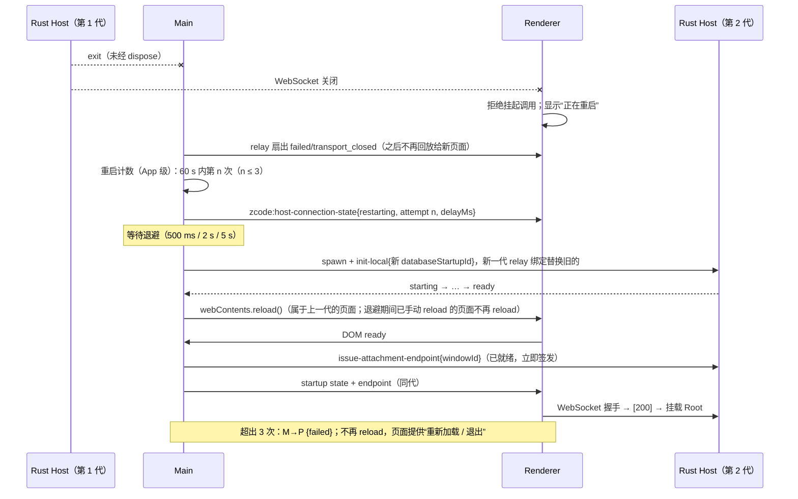
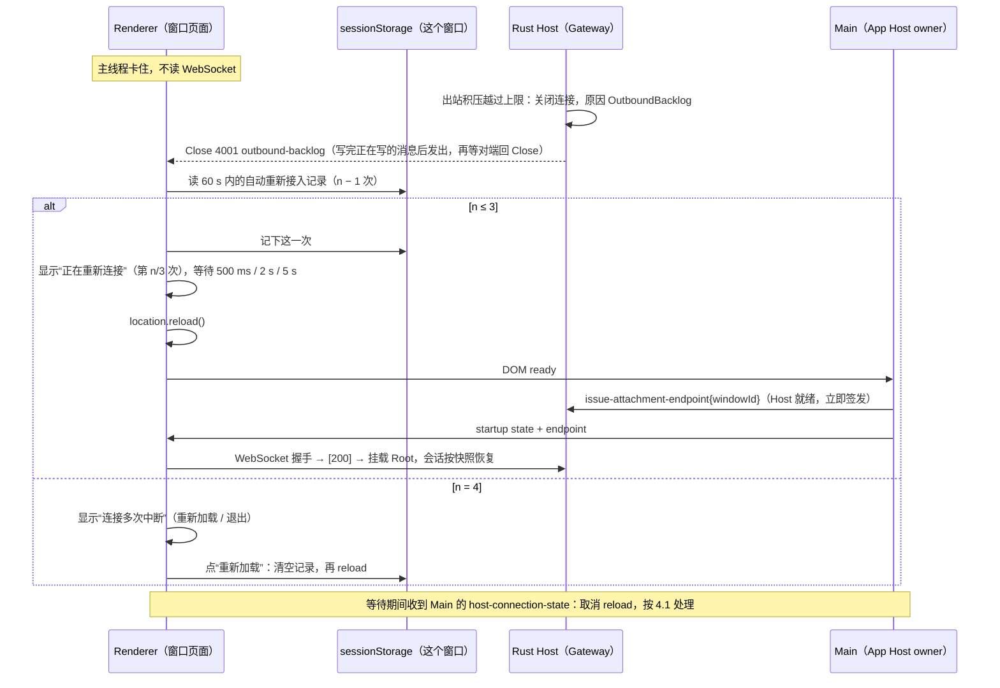

# Rust Host 韧性：自动重启、启动重试与流控

日期：2026-10-08。上级规格：[rust-host.md](rust-host.md) 3.4 与第 10 节 D2，[rust-host-r2.md](rust-host-r2.md) 第 8 节。分支：`feat/rust-host-p-resilience`。

## 1. 目标与范围

1. **D2 自动重启（已定：自动重启）**：窗口的 Rust Host 意外退出后，Main 有界重试地重新拉起它；用户始终看到明确状态，不会停在没有响应的旧界面。
2. **启动失败页的重试与退出**：迁移失败后，Retry 让 Host 以新的 attemptId 重新准备存储；Exit 退出 App。
3. **流控**：WebSocket 发送积压作为 `v4/connection/flow` 的 `saturated` / `drained` 转发给 CLI。
4. **R2 性能验收**：N ≥ 4 个 workspace 同时流式时，控制 RPC p95 ≤ 20 ms。

只改 Rust Host 路径（`ZCODE_DESKTOP_HOST=rust`）。Node Host 的行为不变。

## 2. 产品规则

### 2.1 Host 意外退出与自动重启（D2）

1. **什么算意外退出**：窗口自己的本地 Rust Host 退出，而 Main 没有对它发起过 dispose。窗口关闭、App 退出、reload 回退路径都会先 dispose（进入 `disposingHostProcesses`），因此不算。退出码不参与判断。
2. **重启方式：reload 窗口**，复用已有的“reload 时找不到 Host 就重新拉起”路径（`desktopWindowLifecycle.ts` 的 dom-ready）。新 Host 与冷启动走同一条路：`init-local` → 启动状态 → ready → 签发 endpoint。

   不选“原地重连 WebSocket”：Renderer 的握手状态、连接缓存和大量 zustand store 都以服务对象为 key（rust-host.md 3.4）。原地换服务对象需要逐一清空这些状态，否则会留下旧连接的过期事实；reload 由页面生命周期统一清空，而且 reload → 重新 attach 已有 E2E 覆盖。

3. **有界重试**：U4 起 App 级一个计数（只有一个 Host，[rust-u4-app-host.md](rust-u4-app-host.md) §2.8），任意 60 s 内最多自动重启 3 次，第 n 次之前等待 500 ms、2 s、5 s。超出后不再自动重启；失败页的“重新加载”触发一次重启并清空计数。
4. **用户看到的状态**（Renderer）：
   - WebSocket 在连上之后关闭（状态码不是 2.5 的“Host 还在”码），或收到 Main 的“正在重启”通知：立即切到“本地服务已断开，正在重启”页面（带进度动画和第 n/3 次），不再显示无法操作的旧界面。挂起的调用照旧立即被拒绝（rust-host-r0.md 规则 5）。
   - 收到“已放弃”通知：显示“本地服务多次意外退出”，提供“重新加载”和“退出”。重新加载由页面自身 `location.reload()` 触发，这次 dom-ready 让 Main 拉起新 Host；退出走启动控制的 `exit`。放弃期间新打开的主窗口直接收到“已放弃”，显示同一页面，不触发重启。
5. **CLI 与会话**：旧 Host 的 CLI 在 stdin EOF 后自行退出，正在进行的 run 中断（与 Node Host 崩溃相同）。新 Host 按窗口创建时的预热名单拉起 CLI，其余懒启动。会话事实在 CLI 的持久化存储里，reload 后按已有恢复逻辑展示。
6. **未发送的草稿**：与手动 reload 相同。

### 2.2 启动失败页的重试与退出

1. **Host 是启动状态的唯一所有者**（`host-core` 的 `StartupCoordinator`，每个 Host 一个）。`startupId` 取自 `init-local`；每次尝试有新的随机 `attemptId`；`sequence` 在同一 `startupId` 内跨尝试严格递增。
2. **`database-startup-control`**（Main 已按今天的 relay 转发，Rust Host 新增处理）：
   - `snapshot`：重发最近一次状态（与 Node `coordinator.publish()` 相同，sequence 不变）。
   - `retry{attemptId}`：只在“没有尝试在运行、最近状态是 failed、`canRetryDatabaseStartup` 为真、attemptId 等于当前尝试”时接受；否则忽略（幂等，重复点击、旧页面的过期请求都不会启动第二个执行者）。接受后生成新 attemptId、`startedAt` 取当前时间，从 `starting` 重新执行 `prepare_storage` → `starting_services` → 安装服务 → `ready`。
   - `exit`：由 Main 处理（退出 App），Host 忽略。
3. **挂起的 attachment**：失败期间建立的连接继续挂起，任何一次尝试 ready 后才发 `[200]`。
4. **endpoint 在 ready 时签发**：Main 对 Rust Host 不再在拉起时立即签发 Renderer endpoint，而是在每个 attemptId 第一次进入 `ready` 时签发一次。capability 只有 30 s 有效期，若在拉起时签发，迁移超过 30 s 或用户 30 s 后才点重试，Renderer 拿到的就是过期 capability。reload 时为存活 Host 重新签发的逻辑不变。

### 2.3 流控（WebSocket 背压）

1. **观测点**：每条 WebSocket 连接上，core 已交给写任务、但还没写进 socket 的字节数。Renderer 读得慢时 TCP 发送缓冲写满，`send` 挂起，积压随之增长。
2. **水位**：超过 1 MiB 进入 `saturated`，饱和后回落到 256 KiB 以下发 `drained`（与 `PersistentProtocol` 默认值相同）。只在边沿通知。
3. **转发**：host-core 把边沿交给 `ChannelRegistry::connection_flow`，`zcode-agent` 的连接 scope 向本连接用过的每个 workspace（有存活进程时）发 `v4/connection/flow {connectionId, state}`。
   - 同一连接的 `saturated`、`drained`、`closed` 串行、按发生顺序发送；`closed` 之后不再发其他状态。
   - 每个 workspace 只在状态变化时发送；连接处于 `saturated` 时新用到的 workspace 立即补发 `saturated`。
4. CLI 收到 `saturated` 后暂停向该连接投递帧（合并缓冲），`drained` 后刷新，必要时走快照恢复（`app-server/src/routes.rs` `flow`）。
5. 终端输出同样按连接流控：读某个终端的连接 `saturated` 时 Host 暂停读它的 PTY，`drained` 后恢复（[rust-u2-gateway.md](rust-u2-gateway.md) §2.3）。

### 2.4 reload 后的 provider 启动门禁

`resilience-reload` 在并发负载下约 1/8 落到登录引导页（2026-10-09 定位）。根因在 Renderer，与 Host 实现无关，Node Host 同样可能发生：

1. Root 的 provider 启动门禁只检查一次，判据是 `!providerFamilyDomain || (!user && !hasUsableProvider)`，`providerFamilyDomain` 来自 `useSettings` 的设置快照。
2. 门禁的“等待”原先只看两件事：provider family 迁移完成、模型选择视图已加载。迁移流程自己发一次 `settingService.get()`，`useSettings` 另发一次；Host 并发应答，顺序不保证。迁移那次先回来时，门禁在设置快照仍是 `null` 的时候检查，误判为没有 provider family，打开登录页并停在那里。
3. **规则**：设置快照加载完成（或读取失败）之前，provider 启动同步保持 pending，门禁不检查。读取失败时结束等待，沿用失败时的既有行为，避免永久停在 loading。

证据：临时在门禁里打印判据后并发压测，失败那次 reload 后 `providerFamilyDomain: null`、`hasUsableProvider: true`；同一轮通过的运行都是 `"zai"`。

### 2.5 Host 主动关闭连接：重新接入同一个 Host

用户决定（2026-10-10）。Gateway 关闭连接时在 WebSocket Close 中给出状态码与原因（[rust-u2-gateway.md](rust-u2-gateway.md) §2.6）。修复前 Renderer 把连上之后的任何关闭都当成 Host 退出（2.1.4）：Host 因出站积压越过上限关闭窗口的连接时自己仍在运行，Main 不会重启它，窗口一直停在“正在重连”，只能退出 App。

1. **只有已知的“Host 还在”状态码触发重新接入**。今天只有一个：4001 `outbound-backlog`（出站积压越过上限：Renderer 长时间没有读，Host 丢弃了这条连接的积压）。其余一律保持今天的处理：

   | 关闭                                                                            | 窗口的本地连接                                  | 远端 scope 连接                                                 |
   | ------------------------------------------------------------------------------- | ----------------------------------------------- | --------------------------------------------------------------- |
   | 4001 `outbound-backlog`                                                         | 重新接入（下面 2–5）                            | 重新接入（同一个页面 reload，远端 scope 一并重新接入）          |
   | 4005 `host-shutdown`、1011 `internal-error`、1006（异常断开）、其他或未知状态码 | 显示“正在重连”，等待 Main（2.1.4）              | 不处理（与今天相同：该远端会话的调用被拒绝）                    |
   | 4002 `detached`、4003 `scope-unavailable`、4004 `scope-closed`                  | 同上（Main 今天不会对本地 attachment 这样关闭） | 不处理：远端 workspace 的断开与重连由 Main 的远端会话管理器负责 |

   判断只看状态码；reason 用于日志。握手完成之前的关闭不在这里：照旧显示启动失败页（`transport_closed`）。

2. **重新接入的方式：页面 reload**。与 2.1.2 的理由相同：Renderer 的连接缓存与 store 以服务对象为 key，reload 由页面生命周期统一清空。reload 的 dom-ready 让 Main 为这个页面签发新的一次性 endpoint（App 级 Host 已就绪时立即签发，[rust-u4-app-host.md](rust-u4-app-host.md) §2.1），页面重新接入同一个 Host；会话由 runtime 持有，reload 后按已有恢复逻辑展示（快照）。不新增 IPC。
3. **有界重试（防止循环）**：同一个窗口任意 60 s 内最多自动重新接入 3 次，第 n 次之前等待 500 ms、2 s、5 s（与 Host 自动重启的数值相同）。等待期间显示“正在重新连接”页（`data-state="reattaching"`，带第 n/3 次），只提供“退出”。第 4 次（60 s 内）不再 reload，显示“与 ZCode 服务的连接多次中断”页（`data-state="closed"`），提供“重新加载”与“退出”；“重新加载”清空计数后 reload。
   - 计数是这个窗口的，跨 reload 保留：存在页面的 `sessionStorage`（每个窗口一份，随窗口关闭消失；Main 不参与）。只记自动重新接入的时间；超过 60 s 的记录不计。
   - `sessionStorage` 读写失败时按次数已用完处理（直接显示“连接多次中断”页），保证不会无限 reload。
   - 一个页面只按第一次关闭决定一次：之后再关闭的连接（例如本地与远端 scope 先后被关闭）不再计数，也不改变已决定的结果。
4. **与 Host 重启的关系**：等待期间收到 Main 的连接状态通知（Host 也退出了），取消计划中的 reload，显示 Main 给的状态（2.1.4）；之后由 Main 在新一代就绪后 reload。“连接多次中断”页同样被 Main 的通知取代；Main 的“已放弃”页仍不被覆盖。
5. **只改 Rust Host 路径**：Node Host 的窗口用 MessagePort，不经过 WebSocket，不受影响。

## 3. 状态所有者

| 状态                                             | 唯一所有者                                                                                                                |
| ------------------------------------------------ | ------------------------------------------------------------------------------------------------------------------------- |
| 是否重启、重启计数与退避                         | Main：`rustAppHost.ts` / `rustAppHostCore.ts`（U4 起 App 级一个计数，见 [rust-u4-app-host.md](rust-u4-app-host.md) §2.8） |
| 窗口 → Host 映射                                 | Main `windowHostProcessMap`（不变）                                                                                       |
| 启动状态（startupId、attemptId、sequence、阶段） | Host：`host-core` 的 `StartupCoordinator`                                                                                 |
| 启动状态的中继与 Renderer 侧镜像                 | Main `databaseStartupRelay`（不变）                                                                                       |
| Renderer endpoint 的签发时机                     | Main：按 Host 报告的 ready 触发                                                                                           |
| “本地服务已断开”页面状态                         | Renderer 启动代码（`main.tsx`），只消费 Main 通知与连接关闭                                                               |
| 自动重新接入的次数（2.5）                        | Renderer（`hostConnectionClose.ts`），存在窗口的 `sessionStorage`，跨 reload 保留                                         |
| 连接的关闭原因                                   | Host 的 Gateway（[rust-u2-gateway.md](rust-u2-gateway.md) §2.6），经 WebSocket Close 交给 Renderer                        |
| 连接积压字节与饱和边沿                           | Rust Host 接入层（`ws.rs` 的 `FlowGauge`）                                                                                |
| 已向各 workspace 转发的流控状态                  | `zcode-agent` 连接 scope（`agent/flow.rs`）                                                                               |

## 4. 事件顺序

### 4.1 Host 意外退出 → 自动重启



U4 起 Host 是 App 级的，先拉起新一代、就绪后再 reload 所有主窗口（[rust-u4-app-host.md](rust-u4-app-host.md) §2.8）。上一代的 relay 绑定在 Host 退出后不再用 `snapshot` 回放 `failed/transport_closed`：退避期间（或放弃后、Retry 拉起下一代之前）加载或 reload 的页面属于下一代，显示“正在启动”而不是一闪而过的失败页；这个绑定仍接受 `exit`，失败页的“退出”照常可用。

### 4.2 启动失败 → 重试

```text
Renderer                 Main relay                    Host StartupCoordinator
│ failed(attempt A, seq k) ◄──────────────────────────── prepare_storage 失败
│ 点击 Retry
│ control{retry, A} ─────►│ 转发 database-startup-control ►│ A 是当前尝试、failed、可重试、未运行
│                         │                               │ 新 attempt B，seq k+1：starting
│ starting(B) ◄───────────┤◄──────────────────────────────┤ prepare_storage …
│ ready(B) ◄──────────────┤◄──────────────────────────────┤ install → ready(seq k+n)
│                         │ ready(B) 首次 → issue endpoint ►│ capability（30 s，从此刻计）
│ endpoint ◄──────────────┤◄──────────────────────────────┤
│ WebSocket 握手 → [200] → 挂载 Root
```

### 4.3 流控

```text
Renderer 读慢 → TCP 缓冲满 → ws 写任务 send 挂起 → FlowGauge 积压 > 1 MiB
  → watch 边沿 saturated → host-core serve 循环 → registry.connection_flow(ctx, saturated)
  → agent scope（串行）→ 每个用过的 workspace：v4/connection/flow{connectionId, saturated}
写任务追上 → 积压 ≤ 256 KiB → drained，同一路径；连接关闭 → closed（排在已入队的边沿之后）
```

### 4.4 Host 主动关闭连接 → 重新接入



## 5. 有意与 Node Host 不同之处

| Node Host                                                                         | Rust Host                                                   | 理由                                                                                                  |
| --------------------------------------------------------------------------------- | ----------------------------------------------------------- | ----------------------------------------------------------------------------------------------------- |
| Host 退出后不恢复，界面停在最后状态                                               | Main 有界自动重启，Renderer 显示断开/重启状态               | D2 已定为自动重启                                                                                     |
| 本地 MessagePort 在 `init-local` 时一并交付                                       | endpoint 在每次尝试 ready 时签发                            | capability 30 s 过期；拉起时签发会让长迁移和延迟重试拿到过期凭据                                      |
| 桌面 Renderer 不发 MessagePort 流控边带（`sendFlowState` 没有调用方），从不被暂停 | 按 WebSocket 发送积压发 `saturated` / `drained`             | 积压可以在 Host 侧直接观测；暂停后由 CLI 合并缓冲，避免 Host 无界堆积帧                               |
| 启动失败后的 `retry` 由 Node `DatabaseStartupCoordinator` 处理                    | 同样语义，由 `host-core` 实现；`starting_services` 不会失败 | Rust 的服务安装是同步的，没有可失败的步骤；该阶段失败不可重试的规则照搬，便于今后出现可失败步骤时沿用 |

## 6. 验收

| 场景                                                                                                                                                      | 验证方式                                                                                    |
| --------------------------------------------------------------------------------------------------------------------------------------------------------- | ------------------------------------------------------------------------------------------- |
| 重启策略：退避序列、60 s 内第 4 次放弃、窗口外的退出不计入                                                                                                | `packages/desktop/test/rustHostRestartPolicy.test.ts`（node:test）                          |
| 启动重试：失败 → retry（错误 attemptId 被忽略）→ 新 attemptId、sequence 递增 → ready；snapshot 重发                                                       | `crates/zcode-host/tests/startup_retry.rs`（真实二进制）                                    |
| 启动重试真实 App：迁移失败页 → 等 30 s 以上 → 移除故障 → Retry → 进入主界面；Exit 退出 App                                                                | E2E `resilience-startup`（两个主窗口）                                                      |
| CLI 崩溃 → 懒重启：只杀本次隔离运行的 CLI，再发消息成功                                                                                                   | E2E `resilience-cli-crash`                                                                  |
| Renderer reload → 重新 attach，会话仍能流式                                                                                                               | E2E `resilience-reload`                                                                     |
| 设置快照加载前 provider 启动门禁保持 pending                                                                                                              | `packages/ui/test/rootStartupGate.test.ts`；`resilience-reload` 并发压测                    |
| AskUserQuestion：模型提问，用户在界面作答，模型继续                                                                                                       | E2E `resilience-ask-user`                                                                   |
| 图片附件经 attachmentBegin/Chunk/Commit 上传并被模型收到                                                                                                  | E2E `resilience-attachment`                                                                 |
| Rust Host 崩溃 → 自动重启 → 所有主窗口 reload 后可用；放弃后两个窗口都显示失败页，任一窗口 Retry 恢复                                                     | E2E `resilience-host-crash`（两个主窗口）                                                   |
| Host 主动关闭连接：状态码 → 动作（4001 重新接入，其余与今天相同）；60 s 内第 4 次放弃、超时记录不计、存储不可用时不 reload、等待期间 Main 通知取消 reload | `packages/desktop/test/hostConnectionClose.test.ts`（node:test）                            |
| 越过出站上限 → 窗口自己 reload，接入同一个 Host，对话完整；连续越过时第 4 次显示“连接多次中断”，“重新加载”恢复                                            | E2E `gateway-close-recovery`（测试用小上限，[rust-u2-gateway.md](rust-u2-gateway.md) §2.6） |
| 流控：积压超过高水位发 saturated、回落发 drained；scope 去重、补发、closed 之后不再发送                                                                   | `zcode-host` 的 `FlowGauge` 单元测试；`agent/flow.rs` 单元测试                              |
| R2 性能：4 个 workspace 同时流式时控制 RPC p95 ≤ 20 ms                                                                                                    | `crates/zcode-host/tests/control_latency.rs`（真实 Host + 真实 CLI + mock 模型，无 UI）     |

## 7. 结果（2026-10-09，macOS）

- **R2 性能**（`control_latency.rs`，4 个 workspace 同时流式，采样窗口内每路约 90–100 帧，控制 RPC 与流式帧同一条 WebSocket，各 150 次）：

  | 构建    | 调用                                           | p50     | p95     | p99     | max     |
  | ------- | ---------------------------------------------- | ------- | ------- | ------- | ------- |
  | release | `setting.get`                                  | 0.25 ms | 0.36 ms | 0.42 ms | 0.42 ms |
  | release | `queryConversationCommandsV4{clock}`（经 CLI） | 0.20 ms | 0.30 ms | 0.38 ms | 0.44 ms |
  | debug   | `setting.get`                                  | 1.60 ms | 3.62 ms | 5.01 ms | 5.06 ms |
  | debug   | `queryConversationCommandsV4{clock}`（经 CLI） | 0.82 ms | 2.17 ms | 3.07 ms | 3.16 ms |

  均远低于 20 ms 的预算。

- **E2E**：`resilience-host-crash`、`resilience-startup`、`resilience-cli-crash`、`resilience-reload`、`resilience-ask-user`、`resilience-attachment` 全部通过。
- **附件场景的注意点**：有本地路径的文件走 zero-copy，不经过上传事务；场景用内存图片（等同粘贴截图）覆盖 attachmentBegin/Chunk/Commit。图片必须是合法 PNG，CLI 会解码预处理，解码失败时模型请求里只剩 `[Attached image/*: …]` 占位文本。
