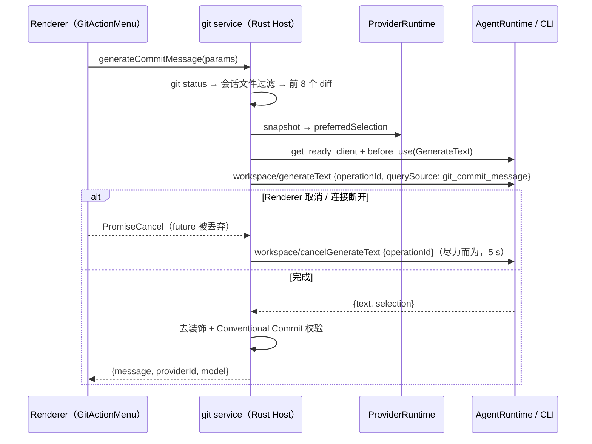
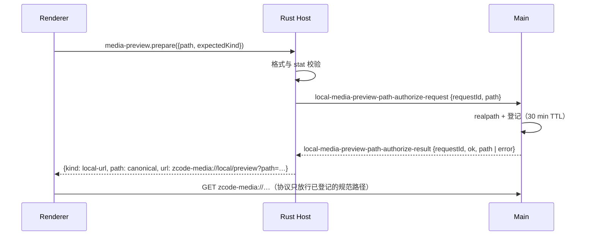

# Rust Host R3：工作区基础（workspace）

日期：2026-10-09。上级规格：[rust-host.md](rust-host.md) 第 5 节 R3。分支：`feat/rust-host-p-workspace`。

## 1. 目标与范围

把 R3 剩余部分补齐，让 Desktop 在 Rust Host 上的工作区能力与 Node Host 一致：

| channel                                   | 成员                                                                                   | 本阶段                                           |
| ----------------------------------------- | -------------------------------------------------------------------------------------- | ------------------------------------------------ |
| `git`                                     | `generateCommitMessage`                                                                | 经 AgentRuntime 调 CLI `workspace/generateText`  |
| `git-checkpoint`                          | `createCheckpoint`、`diffCheckpoints`、`restoreBetweenCheckpoints`、`deleteCheckpoint` | 全部实现                                         |
| `media-preview`                           | `prepare`、`refreshPlaybackUrl`、`release`                                             | 本地实现；后两者只服务远端，本地按 Node 行为应答 |
| `prompt-attachment-transfer`              | `stage`、`adopt`、`cancel`、`cleanup`、`onDynamicProgress`                             | 本地零拷贝实现                                   |
| `system`                                  | `probeIntranet`                                                                        | TCP 与 HTTP(S) 探测                              |
| `zcode-agent`                             | `attachmentPreviewSourceV4`                                                            | `local_path` 经 Main 授权                        |
| `file`、`file-watcher`、`terminal`、`git` | 已有成员                                                                               | 逐成员对照 Node 审计并修正                       |

不在本阶段：远端 workspace（SSH/WSL/Docker）的媒体代理与附件暂存（R6）。

## 2. 产品规则

### 2.1 提交信息生成（`git.generateCommitMessage`）

- 与 `gitService.ts` 相同：先跑一次 `git status`；`includeUnstaged` 缺省为 `true`；按 `currentSessionFilePaths` 过滤（`commitMessageFileScope.ts` 的路径规则逐条移植）；没有文件时报 `There are no changes available to commit.`；前 8 个文件取 diff，失败的 diff 丢弃。
- 模型：读 `model-selection` 视图的 `preferredSelection`（与 Node `node.ts` 的 `readCurrentModel` 相同），缺失时报 `未读取到当前模型。`。
- prompt、裁剪上限、Conventional Commit 校验与去装饰规则逐字移植 `gitCommitMessageGenerator.ts`；locale 缺省时读 Host 环境的 `LC_ALL` / `LC_MESSAGES` / `LANG`（Node 读 `Intl` 默认 locale），只有 `zh*` 视为中文。
- 调用链：agent 区域唯一的 `AgentApi::generate_workspace_text`（Node `zcodeAgentService.generateWorkspaceText`）：写 client → 使用前钩子（`UseReason::GenerateText`，对应 Node `ensureAccountProviderConfigSynced(reason: "workspace_generate_text")`）→ `workspace/generateText`（`querySource: "git_commit_message"`，带 `operationId`）。workspace 区域不再有自己的实现（[rust-host-integration.md](rust-host-integration.md) §2.6）。
- 取消：Renderer 取消调用或连接断开时，Host 丢弃该调用的 future；守卫在 drop 时向同一 CLI 发 `workspace/cancelGenerateText { operationId }`（尽力而为，失败只记 debug）。
- 错误信息与 Node 一致：模型请求失败 `模型请求失败。`，输出不合规 `模型没有返回可用的 Conventional Commit 提交消息。`。UI 只显示通用失败文案，不按 message 分支。

### 2.2 Git checkpoint（`git-checkpoint`）

- 移植 `gitCheckpointService.ts` + `gitCheckpointRepo.ts` + `gitCheckpointStore.ts` + `gitCheckpointHelpers.ts`，git 参数、错误文案（`Checkpoint does not exist: <id>`、`Checkpoint workspace mismatch: <id>`、`Checkpoint repoRoot mismatch.` 等）与 Node 相同。
- manifest：`<dataBase>/.zcode/v2/checkpoints/<sha256(workspacePath)[0..12]>/<checkpointId>.json`，内容 `JSON.stringify(meta, null, 2) + "\n"`，临时文件 + rename 原子写；同一文件的写入串行；读取时先等该文件的待完成写入。字段顺序与 Node 相同，Node 与 Rust Host 可互读。
- hidden ref：`refs/zcode/checkpoints/<hash12>/<checkpointId>`；临时 index 在 `<dataBase>/.zcode/git-checkpoint-index/index-XXXXXX/`，结束必删；先复制用户 index（`rev-parse --git-path index`），失败退到 `read-tree HEAD`，再退到空 index。
- `restoreBetweenCheckpoints`：三方比较（from→to diff、校验受影响路径仍等于 from、`force` 才覆盖、restore worktree、删除 deleted/rename 旧路径、再按 to 校验）。冲突时返回 `{ success: false, conflicts }`，校验失败报 `Checkpoint restore verification failed.`。

### 2.3 媒体预览（`media-preview`）

- `prepare({ path, expectedKind })`：扩展名表与 `getMediaPreviewFormat` 相同；格式不符报 `Unsupported media preview format: <path>`；不是文件报 `Path is not a media file: <path>`。
- 本地 desktop：Host 向 Main 发 `local-media-preview-path-authorize-request { requestId, path }`，Main（`localMediaPreviewProtocol`）规范化并登记路径后回 `local-media-preview-path-authorize-result`；Host 返回 `{ kind: "local-url", mediaType, path: <canonical>, size, url: zcode-media://local/preview?path=<form-urlencoded> }`。URL 编码与 `buildLocalMediaPreviewUrl`（WHATWG `URLSearchParams`）一致。
- Main 拒绝时把错误原样抛给 Renderer（缺省文案 `本地视频预览路径授权失败`，与 Node Host 相同）。Main 不回复时 Host 等待 30 s 后报 `Local media preview path authorization timed out.`（Node 无超时，见第 5 节）。
- `refreshPlaybackUrl` / `release`：Node 本地实现不提供这两个可选成员，经 `@zcode/rpc` 调用得到 `Method not found: <name>`；Renderer 只在 `host-range-url` 时调用它们，`release` 的失败被忽略。Rust 应答同样的错误。
- `zcode-agent.attachmentPreviewSourceV4`：只有 `desktop-continuous` 且无 `remoteSessionId` 才问 CLI `v4/attachment/previewSource`；CLI 返回 `local_path` 时同样经 Main 授权后把 `path` 换成规范路径；授权器缺失报 `fault.attachment.previewPathAuthorizationUnavailable`。授权器通过 `Extensions::set_media_path_authorizer` 注入，agent 模块不依赖 media-preview。

### 2.4 Prompt 附件传输（`prompt-attachment-transfer`，本地）

- 与 `createLocalPromptAttachmentTransferService` 相同：`stage` 直接返回 `{ operationId, ref: localPath, bytes, staged: false }`，`bytes` 优先取正的 `sizeBytes`，否则 `stat`，失败为 0；`adopt` / `cancel` / `cleanup` 空操作；`onDynamicProgress(operationId)` 合法但本地永不触发。

### 2.5 内网探测（`system.probeIntranet`）

- 逐条移植 `systemService.ts`：目标归一化（端口缺省 22、超时夹到 [100, 10000] ms、缺省 800 ms、重试次数 [1, 3]、缺省 2）、`requiredSuccessCount` 夹取、策略 `tcp-connect` / `service-http` / `mixed`、错误文案（`timeout(<n>ms)`、`HTTP <status>`、`service returned ok=false`、`marker mismatch(expected=…, actual=…)`）。
- HTTP 探测用 reqwest（rustls + ring，不读系统代理，与 Node `fetch` 一致不走 HTTP(S)\_PROXY）；token 放 `x-zcode-intranet-token`。

### 2.6 已有成员的审计结论（file / file-watcher / terminal / git）

逐成员对照 Node 后修正的差异：

| 成员                                                     | 问题                                                                         | 修正                                                                                            |
| -------------------------------------------------------- | ---------------------------------------------------------------------------- | ----------------------------------------------------------------------------------------------- |
| `file.resolvePath`                                       | Windows 上 `canonicalize` 返回 `\\?\C:\…`                                    | 去掉 verbatim 前缀，与 Node `realpath` 一致                                                     |
| `file.createDefaultWorkspace` / `createScratchWorkspace` | 路径被文件占用时报 `Workspace path is not a directory`                       | 与 Node `mkdir({ recursive: true })` 相同：本身被占用 `EEXIST`，父路径被占用 `ENOTDIR`          |
| `file.checkFilesExist`                                   | 没有结果缓存、串行检查                                                       | 正负结果缓存 60 s、最多 100 条（LRU），并发检查、按输入顺序返回                                 |
| fs 错误（file、file-watcher、git checkpoint）            | Windows 上按 `ErrorKind` 映射，拒绝访问成了 `EACCES`、文件被占用没有 `EBUSY` | 按 Windows 原始错误码走 libuv 的映射（`ERROR_ACCESS_DENIED`→`EPERM`，共享 / 锁冲突→`EBUSY` 等） |
| `terminal`（Host 退出）                                  | Host 退出只回收 CLI，不回收终端                                              | 与 Node `disposeAll` 一样逐个结束 shell（POSIX SIGHUP；Windows 结束进程并关闭伪控制台）         |

核对后无需修改：`file` 其余成员的读取上限（文本 128/256 KiB、分块 256 KiB/1 MiB、媒体 4/8 MiB、二进制 25 MiB）、二进制判定、`File is too large to preview` / `Path is not a file` 文案、UTF-16 计长的分块文件列表；`file-watcher` 的 150 ms 防抖、`changedPath` 规则、错误即清理与 `无法监视目录` 文案；`terminal` 的 shell / cwd 回退、`Terminal not found`、退出码与 200 ms 输出排空；`git` 全部错误文案（逐条比对 `gitCliRepo.ts` / `gitCliHelpers.ts`）。

## 3. 状态所有者

| 状态                          | 所有者                                                            | 说明                                              |
| ----------------------------- | ----------------------------------------------------------------- | ------------------------------------------------- |
| checkpoint manifest           | `CheckpointStore`（`<appConfig>/checkpoints/<hash12>/<id>.json`） | 与 Node Host 共享格式；hidden ref 由 git 仓库持有 |
| 临时 checkpoint index         | 单次 `createCheckpoint` 调用                                      | 结束即删                                          |
| 本地媒体路径授权表            | Main（`localMediaPreviewPathRegistry`，30 min TTL）               | Host 只发请求、拿规范路径，不缓存授权             |
| 进行中的 Host → Main 授权请求 | `MainBridge`（按 `requestId` 关联）                               | 超时后迟到的结果被丢弃                            |
| 提交信息生成的 operationId    | 本次调用的 future（`CancelOnDrop` 守卫）                          | 调用完成即解除；被丢弃时向 CLI 发取消             |
| `checkFilesExist` 缓存        | `file` service 实例                                               | 只是性能缓存，与 Node 同样的 60 s 陈旧窗口        |
| 终端实例                      | `Terminals`（整个 Host）                                          | Host 退出时 `Workspace::shutdown` 回收            |

## 4. 事件顺序

提交信息生成与取消：

本地媒体路径授权（media-preview.prepare 与 attachmentPreviewSourceV4 共用）：

## 5. 有意与 Node 不同之处

| 差异                                                                                     | 原因                                                                                                                    |
| ---------------------------------------------------------------------------------------- | ----------------------------------------------------------------------------------------------------------------------- |
| 提交信息生成总带 `operationId`，调用被丢弃时发 `workspace/cancelGenerateText`            | Node git service 不传 signal，取消只停在 Renderer；Rust 的 RPC 取消会丢弃 future，顺带让 CLI 停止生成，避免空耗模型     |
| 缺省 locale 读 `LC_ALL` / `LC_MESSAGES` / `LANG`                                         | Rust 没有 `Intl`；UI 总会传 locale，只影响无 locale 的调用                                                              |
| 媒体路径授权 30 s 超时                                                                   | `MainBridge` 必须有超时；Main 总会回复，超时只防止异常时调用永远挂起                                                    |
| checkpoint manifest 的写入用一把锁串行（Node 按文件串行）                                | checkpoint 是低频操作，语义相同（读取等待写入完成）                                                                     |
| Windows 上 checkpoint 恢复去 repoRoot 前缀时统一分隔符、忽略大小写                       | Node 用 `${repoRoot}${sep}` 字符串替换，git 报告的 `C:/repo` 与 resolve 出的 `C:\repo\…` 对不上（Node 的 Windows 缺陷） |
| `probeIntranet` 的 TCP 错误文案只覆盖常见 errno                                          | `connect ECONNREFUSED host:port`、`getaddrinfo ENOTFOUND host`、`timeout(Nms)` 与 Node 相同；其余用系统错误文本         |
| `probeIntranet` 的 HTTP 网络错误统一为 `fetch failed`，JSON 解析错误为 `invalid JSON: …` | Node 的 fetch 网络错误就是 `fetch failed`；JSON 错误文案来自 V8，无法逐字复刻                                           |
| 单文件 `file-watcher` 的事件不带 `changedPath`                                           | Node 对文件路径会拼出 `<file>/<file>` 这种不存在的路径；UI 只监听目录                                                   |
| git-checkpoint 没有本地 UI 调用方                                                        | Node 也只在远端 workspace 集合里注册给 Renderer；本地实现保持完整，供远端与后续使用                                     |

## 6. 验收

- `cargo test`（`apps/zcode-host`）：checkpoint 全流程（创建、diff、冲突拒绝、force、删除、manifest 格式与 Node 一致）、提交信息生成（mock 生成器 + 真实 git 仓库）、规则函数、媒体预览（URL 编码与 `URLSearchParams` 一致、Main 授权往返）、附件传输、内网探测（127.0.0.1 上的 TCP 与 HTTP mock）、file 边界。
- 交叉检查：`cargo clippy --all-targets --target x86_64-pc-windows-msvc` 与 `--target x86_64-unknown-linux-gnu`（C 依赖用占位编译器跳过，只检查 Rust 代码）。
- 桌面 E2E（真实 Electron + Rust Host + Rust CLI + mock 模型），与 `core` 一起通过：
  - `workspace-commit-message`：会话状态面板的 Git 入口 → Generate message（经 CLI `workspace/generateText`，mock 模型收到含分支与改动文件的 prompt，返回带围栏的文本被去装饰）→ Commit，HEAD 标题即生成的信息；
  - `workspace-media-preview`：命令中心 Files 范围打开 `media/clip.wav`，`<audio>` 的 src 是 Main 授权后的规范路径（`/private/var/…`）的 `zcode-media://` URL，并读出 0.5 s 时长；
  - `workspace-rewind`：Agent 用 Write 写文件后编辑这条消息并选 “Reset chat + files”，文件被撤销、编辑后的消息重新发送。git-checkpoint 在本地 desktop 没有 UI 调用方，由集成测试覆盖。

## 7. 已知限制

- CLI 的文件检查点要求路径没有经过符号链接（`canonicalize(path) == path`）；macOS 临时目录 `/var` → `/private/var` 下的 workspace 会被判为 “current file unreadable”。这是 CLI 的行为，与 Host 无关；E2E 用规范路径写文件。
- 交叉目标只做了 Rust 代码的 clippy（C 依赖 sqlite、ring 用占位编译器跳过）；Windows ConPTY 与 Linux inotify 的运行时行为仍需在对应系统上跑一遍 E2E。
