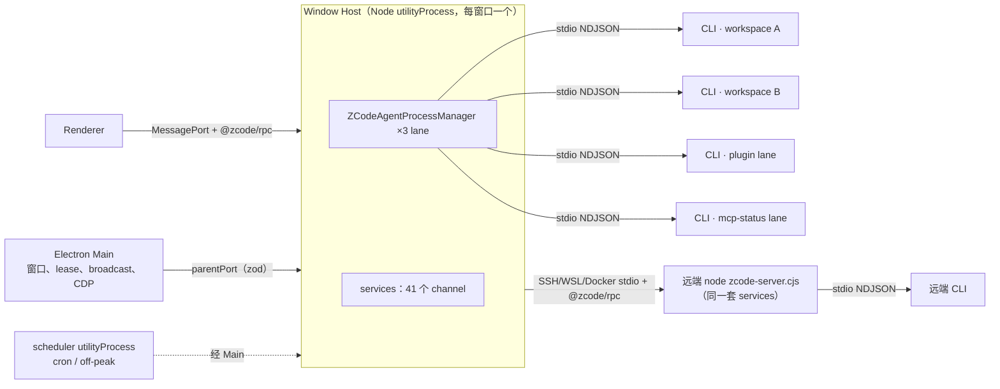
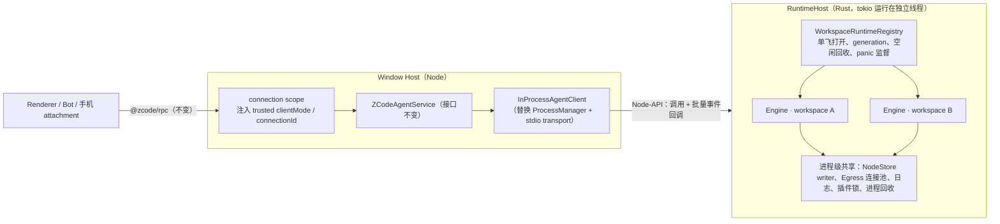
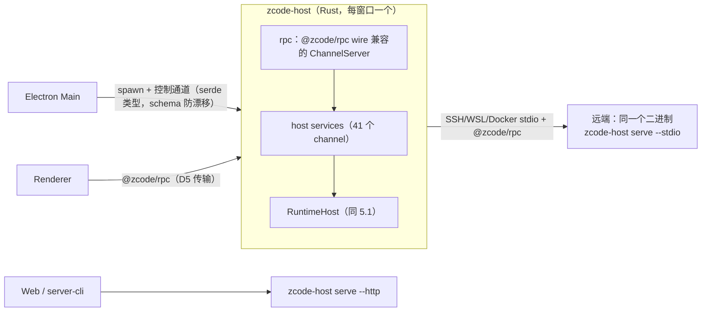
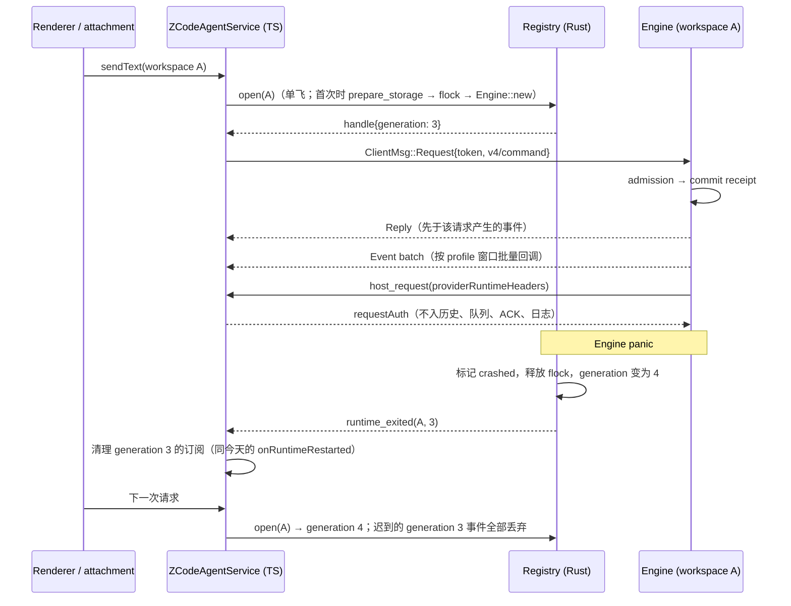

# Rust Host：进程内 runtime 与原生 Host 规划

日期：2026-10-08。基线：`main` / `06ba978`。状态：规划草案；第 9 节的决策确认后，再按里程碑补分项 spec 并开工。

## 1. 目标与非目标

**目标**

1. 一个 Host 进程承载它服务的全部 workspace 的 agent runtime，不再按 workspace 启动 CLI 子进程。今天每个 Host 最多有 N+2 个 CLI：每个 workspace 一个 chat lane，加上 plugin-management lane 和 mcp-status lane（`packages/services/src/zcode-agent/zcodeAgentService.ts:1060,1082,1091`）。另外每个 workspace 还有一个 `--prepare-storage` 子进程或 Worker。
2. Host 与 runtime 之间去掉 stdio NDJSON、逐行 zod 校验、JSON 反复解析和帧分片，改为进程内类型化调用。
3. 终态里 Host 本身是 Rust 原生进程（下称 `zcode-host`），Node 退出 Host。

**各条 IPC 链路的去留**

| 链路                               | 现在                                                  | 目标                        |
| ---------------------------------- | ----------------------------------------------------- | --------------------------- |
| Host ↔ agent runtime               | 每个 workspace 一个子进程，stdio NDJSON               | 进程内 channel，**消失**    |
| 存储准备                           | 每个 workspace 一个 `--prepare-storage` 进程或 Worker | 进程内 async 调用，**消失** |
| 远端 server ↔ 远端 CLI             | 远端机器上同样是 stdio NDJSON                         | 同样嵌入，**消失**          |
| Main ↔ Host                        | `parentPort`，30 种入站、48 种出站消息，均有 zod 校验 | 保留：Host 不能并入 Main    |
| Renderer ↔ Host                    | Electron MessagePort + `@zcode/rpc`                   | 保留：Renderer 是独立进程   |
| 桌面 Host ↔ 远端（SSH/WSL/Docker） | stdio 上跑 `@zcode/rpc`                               | 保留：跨机器                |

**非目标**：改写 UI 或 Main；改变 V4 wire 语义，或者合并 `desktop-continuous` 与 `web-remote-replayable`；修改 Node 会话库 schema；手机 relay 客户端（不在本仓库，见 2.3）。

## 2. 现状（已在源码核对）

### 2.1 进程拓扑



- Main 用 `utilityProcess.fork` 启动 Host（`packages/desktop/src/main/desktopHostProcess.ts:257`），每个 BrowserWindow 一个。Renderer reload 不重启 Host，而是把新端口 attach 到同一个 Host（`desktopWindowLifecycle.ts:136-173`）。
- Host 退出后 Main 只清理映射，**不会重启 Host**（`desktopHostProcess.ts:752`）。相比之下，CLI 崩溃由 Host 惰性重启：下次请求时 `runtimeGeneration + 1`（`zcodeAgentProcessManager.ts:1110`）。
- Host 里只用到 Electron 的 `parentPort` 和 `MessagePortMain` 类型（`host/electronPort.ts`）。原生模块已经在 Host 中加载过（node-pty，`services/src/terminal/terminalService.ts:31`），打包沿用 prebuild 加 `asarUnpack`（`packages/desktop/electron-builder.config.js:500`）。

### 2.2 规模（不含测试的 TS 行数）

| 部分                                                  | 行数                 |
| ----------------------------------------------------- | -------------------- |
| `packages/desktop/src/host`                           | 10.0k                |
| `packages/services/src`                               | 101.5k               |
| 　其中 `zcode-agent`（进程管理、协议客户端、V4 转发） | 19.8k                |
| 　其中 `bots` / `session` / `conversation-share`      | 13.8k / 11.5k / 5.5k |
| `packages/rpc` / `packages/server/src/remote`         | 3.3k / 9.8k          |
| `packages/provider` + `provider-node`                 | 6.7k                 |
| `packages/shared`（部分被 UI 使用）                   | 41.0k                |
| 合计                                                  | 约 156k–173k         |
| 对照：Rust CLI crates                                 | 约 97k               |

### 2.3 同一套 services 有 4 个宿主

`createLocalServices()`（`packages/services/src/node.ts:1285`）有 4 个调用方，它们都通过 `ZCodeAgentProcessManager` 按 workspace 启动 CLI：

| 宿主                                | 位置                                          | authority 模式            |
| ----------------------------------- | --------------------------------------------- | ------------------------- |
| 桌面 Window Host                    | `desktop/src/host/index.ts:2838`              | `desktop-local`           |
| 远端 stdio server（SSH/WSL/Docker） | `server/src/stdioServices.ts:38`              | `desktop-attached-remote` |
| Web HTTP server                     | `server/src/entry-http.ts:17`                 | 默认                      |
| `zcode-server-cli` 守护进程         | `zcode-server-cli/src/server-core/core.ts:40` | `standalone-server`       |

手机走 Main 的 `AttachServicePort`，使用 `web-remote-replayable` 模式 attach 到已有 Host（`host/index.ts:2729-2774`）。relay 客户端本身不在本仓库；仓库内唯一的 replayable attach 调用方是 Bot 远程运行时（`main/desktopRemoteSessions.ts:881-1000`）。

### 2.4 Host ↔ runtime 协议面

- **Host → CLI**：82 个请求方法，全部从 `zcodeAgentService.ts` 发出。session 16、workspace 8、provider 2、plugins 18、workflows 6、v4 28，其余 4。
- **CLI → Host 反向请求**：14 个，都在 `wireClient()` 内处理（`zcodeAgentService.ts:2116-2827`）：
  - provider runtime headers、official MCP auth、runtime preferences；
  - permission / userInput；
  - browser list / execute；
  - automation ×5、offPeak ×2。
- **CLI → Host 通知**：约 14 种。其中 V4 帧由 CLI 完成 profile 过滤、回放和分片编码；Host 只按 topic 透传，不重新编码（`zcodeAgentService.ts:2064-2114`）。
- **Rust 覆盖情况**：`Method` 枚举有 61 个 wire 名（`crates/core-api/src/transport.rs:45-107`），Host 用到的方法里缺 19 个：
  - workflows 6 个、`workflowRun*` 7 个；
  - `backgroundBashOutput`；
  - `session/messages`、`session/events`；
  - 3 个 workspace 策略更新。

  14 个反向请求里 Rust 只发 provider runtime headers 和 official MCP auth 两个。

- **已有缺陷**：Host 回给 Rust 的 JSON-RPC error 被 stdio 层当成 `result: null`（`crates/app-server/src/stdio.rs:55-62`）。改成进程内调用时一并修正。

### 2.5 Rust runtime 作为库时的阻碍

- `Engine::new(workspace, …)` 绑定一个 workspace。`Engine::serve(self, …)` 是单个循环，内部按 `connectionId` 复用多个逻辑连接（`crates/core/src/app/engine.rs:100,170`）。
- 组合层读取进程全局状态：
  - `Context::prepare` 读 cwd 和 `ZCODE_WORKSPACE_IDENTITY`、`ZCODE_CLI_RUST_DATA_DIR`（`src/runtime.rs:38-62`）；
  - `node_database()` 用 `std::env::current_dir()` 解析会话库（`src/runtime.rs:100`）；
  - `Registry::from_env` 读 provider 配置文件路径（`crates/model/src/registry.rs:33`）；
  - `agent_profiles` 读 `ZCODE_STORAGE_DIR`。
  - `net`、`git_safety`、`plugins` 中还有 `current_dir()` 兜底。
- `src/main.rs` 负责 workspace flock、全局日志初始化、信号处理和 `process::exit`。flock 今天靠进程退出释放。
- 存储准备握手是 stdio 帧（`startup/storagePath` → `storagePathReady` → `storageState` → `storagePrepared`）。
- `app-server` 的 delivery 层（profile、保留日志、合并刷新）与 stdio 编解码在同一个 crate，但已经按文件分开（`delivery.rs`、`subscription.rs`、`codec.rs`、`stdio.rs`）。

## 3. 约束与风险

| #   | 风险                                                                                                                                                                                                                                                       | 应对                                                                                                                                                                                                                                                                                                          |
| --- | ---------------------------------------------------------------------------------------------------------------------------------------------------------------------------------------------------------------------------------------------------------- | ------------------------------------------------------------------------------------------------------------------------------------------------------------------------------------------------------------------------------------------------------------------------------------------------------------- |
| R1  | **故障域扩大**。今天一个 CLI 崩溃只影响一个 workspace，并会被惰性重启。进程内 panic 会带走整个窗口的 Host（终端、Bot、远端连接全部中断），而 Main 不重启 Host                                                                                              | 每个 workspace runtime 作为独立的 supervised task，panic 由 `JoinHandle` 捕获，然后标记 crashed、generation + 1、下次请求重建（与今天语义相同）；库代码禁止 `process::exit`、`abort`、`panic = "abort"`；`ProcessCleanupFailure` 只停止该 workspace 的 actor。另行决定是否让 Main 在 Host 异常退出时重启 Host |
| R2  | **共享运行时饥饿**。今天一个 CLI 忙只影响它自己的进程                                                                                                                                                                                                      | Bash 解析、正则、图片解码、diff、大历史编码一律走 `spawn_blocking` 或专用池；验收要求 N 个 workspace 同时流式输出时控制 RPC p95 ≤ 20 ms                                                                                                                                                                       |
| R3  | **内存泄漏不再随进程回收**                                                                                                                                                                                                                                 | 沿用 Session LRU 的内存预算，并按 workspace 统计；空闲 workspace 整体 dispose；常驻 RSS 纳入每个里程碑的验收                                                                                                                                                                                                  |
| R4  | **进程全局状态**：cwd、环境变量、flock 生命周期                                                                                                                                                                                                            | 所有 workspace 参数显式传入；Bash、hooks、MCP stdio、git 子进程显式设置 cwd 和 env；flock 由 workspace runtime 的 RAII guard 持有，dispose 或 panic 时释放；边界检查禁止 composition root 之外调用 `env::var` 和 `current_dir`                                                                                |
| R5  | **删除 TS CLI 后，Rust 缺的能力变成功能缺失**：dynamic workflows（Rust 明确不做）、automation / Cron / OffPeak 工具、browser、CUA、runtime preferences 反向请求、MCP OAuth、官方插件资产写入（仍由 Node CLI 完成）、resourceSample / toolExecResource 遥测 | H4 门槛：逐项补齐，或由产品决定下线（D3）                                                                                                                                                                                                                                                                     |
| R6  | **Electron 限制**：`utilityProcess` 只能跑 JS，`MessagePortMain` 无法交给原生进程                                                                                                                                                                          | 过渡期 runtime 以 Node-API addon 形式运行在现有 Node Host 内；原生 Host 外壳放到最后（H6，D5）                                                                                                                                                                                                                |
| R7  | **UI 契约没有 schema**：41 个 channel、约 490 个成员只靠 TS 接口加 `ProxyChannel` 反射；`@zcode/rpc` 是 VS Code 风格的二进制格式                                                                                                                           | 迁移任何服务前，先从 TS 接口生成契约清单，并录制 wire 夹具做漂移检查；原生外壳要逐字节兼容 `@zcode/rpc`                                                                                                                                                                                                       |
| R8  | **4 个宿主共用 services**。只做桌面的话，会分叉成两套 Host 实现                                                                                                                                                                                            | 4 个宿主都是 Node，同一个 addon 可以同时覆盖（D4）；终态由同一个 `zcode-host` 二进制按传输方式提供 4 种入口                                                                                                                                                                                                   |
| R9  | **Host 侧的 Node 专属依赖**：node-pty、ssh2、`@larksuiteoapi/node-sdk`、`node:sqlite`、undici、node-forge、croner、yazl、`@zcode/zcode-cua`                                                                                                                | 对应替换：portable-pty、russh、手写飞书长连接、rusqlite、`net` crate 的 Egress、rustls / rcgen、cron、zip；CUA broker 单独评估                                                                                                                                                                                |
| R10 | **与 Node 互操作**：多个窗口、外部 Node CLI 共享 `db.sqlite`                                                                                                                                                                                               | 保留 workspace flock 与 SQLite 锁；进程内对会话库只开一个 writer                                                                                                                                                                                                                                              |

## 4. 方案比较

| 方案                                                                              | 首次拿到“无 per-workspace 进程” | 风险                                                 | 4 宿主覆盖                  | 终态      |
| --------------------------------------------------------------------------------- | ------------------------------- | ---------------------------------------------------- | --------------------------- | --------- |
| A：一次性重写原生 Host                                                            | 41 个服务与 rpc 全部完成之后    | 高：长期双线维护，无法分批回退                       | 仅桌面，除非一起重写 server | 原生 Host |
| **B：先把 runtime 以 Node-API addon 嵌入现有 Host，再逐个迁服务，最后换原生外壳** | **H3**                          | 低：每步都有开关、可回退                             | 同一个 addon 覆盖 4 个宿主  | 原生 Host |
| C：先上原生 Host，未迁移的服务放进 Node sidecar                                   | 原生外壳完成后                  | 中：约 490 个成员要跨进程代理，等于把 IPC 换了个位置 | 仅桌面                      | 原生 Host |

**建议选 B**。理由：

- 用户要的第一个收益（不再每个 workspace 一个进程、没有 stdio IPC）在 H3 就能拿到，不必等十万行 services 迁完。
- 远端、Web 和 `zcode-server-cli` 同时受益：远端部署从“Node + `zcode.cjs`”改成按平台的 `.node` prebuild，通道与 node-pty prebuild 相同。
- 最终形态与 A 相同。

B 的额外成本是一层临时的 napi 边界，以及 6 个平台目标的 addon 构建。Node-API 与 Electron 的 ABI 无关，不需要 electron-rebuild。

## 5. 目标架构

### 5.1 过渡态（H3–H5）：Node Host 加 runtime addon



### 5.2 终态（H6）：原生 Host



远端由“部署 Node、`zcode-server.cjs`、node-pty、CLI 4 类资产”变为部署单个静态二进制。

### 5.3 状态所有者

| 状态                                                     | 唯一所有者                                                 | 变化                                                                    |
| -------------------------------------------------------- | ---------------------------------------------------------- | ----------------------------------------------------------------------- |
| 会话事实、队列、rows、seq/epoch、交互、accepted input    | 每个 workspace 一个 Engine actor                           | 不变                                                                    |
| V4 订阅、profile 过滤、保留日志、帧编码                  | Engine 旁的 delivery 层（从 app-server 拆出的库）          | 不变；分片仍按 Channel 帧与 relay 信封预算执行，Renderer 的重组逻辑不改 |
| runtime 实例表、generation、单飞启动、空闲回收、崩溃标记 | `WorkspaceRuntimeRegistry`（Rust）                         | 取代 3 个 lane 的 ProcessManager                                        |
| attachment、trusted `clientMode` / `connectionId` 注入   | Host connection scope                                      | 不变（H6 前仍在 TS）                                                    |
| 跨窗口 owner/lease、owner 命令路由                       | Main `taskRealtimeBus`                                     | 不变                                                                    |
| workspace 独占                                           | workspace flock（跨进程）                                  | 持有者从 CLI 进程变为 workspace runtime 的 RAII guard                   |
| 账号凭据、请求期 auth                                    | Host（account、OAuth 服务），经 `HostCallbacks` 按请求提供 | 不进入 runtime 状态，与今天相同                                         |
| `db.sqlite`                                              | NodeStore，进程内单 writer                                 | 跨进程仍依赖 SQLite 锁                                                  |
| `tasks-index.sqlite`                                     | Host session 服务                                          | H5 迁到 Rust                                                            |

### 5.4 接口（Rust，H1 定稿）

```rust
pub struct RuntimeHost { /* 进程级共享资源 */ }
impl RuntimeHost {
    pub fn new(process: ProcessConfig, callbacks: Arc<dyn HostCallbacks>) -> Self;
    /// 取代 --prepare-storage：同一数据库只准备一次，进度经回调上报。
    pub async fn prepare_storage(&self, req: StorageRequest) -> Result<StorageReady, StorageError>;
    /// 同一 key 单飞；返回带 generation 的句柄。
    pub async fn open(&self, launch: WorkspaceLaunch) -> Result<WorkspaceHandle, OpenError>;
    /// generation + 1，取消并回收 run、工具进程、MCP，释放 flock。
    pub async fn dispose(&self, key: &WorkspaceKey, reason: DisposeReason);
    pub async fn shutdown(&self, deadline: Duration);
}
pub struct WorkspaceLaunch {
    pub key: WorkspaceKey,            // workspaceIdentity?.trim() || workspacePath
    pub path: PathBuf,                // 只用于文件、cwd、Git
    pub identity: Option<String>,
    pub lane: Lane,                   // Chat | PluginManagement | McpStatus
    pub surface: Surface,
    pub provider_files: ProviderFiles,
    pub env: Arc<RuntimeEnv>,         // 取代 spawn env，不读进程环境
}
pub struct WorkspaceHandle { pub generation: u64, pub tx: mpsc::Sender<ClientMsg> /* ServerMsg 经回调批量送出 */ }
#[async_trait]
pub trait HostCallbacks: Send + Sync {
    async fn host_request(&self, key: &WorkspaceKey, generation: u64, method: HostMethod, params: Value) -> Result<Value, HostError>;
    fn emit(&self, key: &WorkspaceKey, generation: u64, batch: Vec<ServerMsg>); // 只做内存入队，不反压 actor
    fn runtime_exited(&self, key: &WorkspaceKey, generation: u64, cause: ExitCause);
}
```

- 请求和结果在 H2–H4 仍沿用今天的 `Method + Value`，与 82 个方法逐一对应，不在本计划中一次性做强类型化。
- 反向请求出错时返回错误，修正 2.4 中提到的 `null` 吞错。
- plugin-management 和 mcp-status lane 在 H3 保留合成 workspace，以保证行为一致；H5 再改为 `RuntimeHost` 级服务。

### 5.5 事件顺序



### 5.6 Node-API 边界（H2）

- 新 crate `crates/node-binding`（napi-rs，cdylib），只依赖 composition 层；新 TS 包 `packages/runtime-native` 负责加载 prebuild 并提供类型化门面。
- **调用**：`open`、`dispose`、`request(key, generation, method, paramsJson)`，返回 Promise。
- **事件**：通过 ThreadsafeFunction 按 delivery 刷新窗口（30 ms / 150 ms）批量回调。V4 帧 payload 以字符串或 Buffer 原样交给 `@zcode/rpc`，topic 和 subscriptionId 作为独立字段传递，TS 不解析 payload。
- **背压**：TSFN 队列设上限，沿用 app-server 的 64 MiB / 16 MiB 水位与快照恢复语义，绝不阻塞 actor。
- **线程**：tokio 运行在 addon 自己的线程上，不占 Node 主线程；`shutdown` 的时限纳入 Host 的分阶段关闭（今天 services 阶段 3.5 s）。
- **打包**：darwin-arm64/x64、win32-x64/arm64、linux-x64/arm64（glibc 下限 2.28，与 node-pty 一致），配合 `asarUnpack`；远端部署资产新增 addon 组件。

## 6. 里程碑

| 里程碑 | 内容                                                                                                                                                                                                                                                                                                                                                                                                                                                                                                                                                                    | 验收                                                                                                                                                                                                                  |
| ------ | ----------------------------------------------------------------------------------------------------------------------------------------------------------------------------------------------------------------------------------------------------------------------------------------------------------------------------------------------------------------------------------------------------------------------------------------------------------------------------------------------------------------------------------------------------------------------- | --------------------------------------------------------------------------------------------------------------------------------------------------------------------------------------------------------------------- |
| H0     | 本规格与决策；基线测量：每个窗口在 1/3/8 个 workspace 下的进程数和 RSS、冷启动首字时间、流式期间控制 RPC p95、Stop ACK p95                                                                                                                                                                                                                                                                                                                                                                                                                                              | 报告写入 `docs/reports/`                                                                                                                                                                                              |
| H1     | **runtime 库化**（只改 Rust，外部行为不变）：`ProcessConfig` / `WorkspaceLaunch` 显式参数；清除 composition root 之外的 env 和 cwd 读取并加边界检查；`RuntimeHost` 与多 Engine 注册表；共享 NodeStore 和 Egress；panic 监督；flock 改为 RAII；进程内 `prepare_storage`；app-server 拆成 delivery 库加 stdio 传输。stdio 二进制改为单 workspace 的 `RuntimeHost` 薄壳                                                                                                                                                                                                    | 现有 Node 驱动的集成测试全部通过（这就是“外部行为不变”的证据）；新增测试：同一进程两个 workspace 的 identity、配置、cwd、MCP、Bash 隔离；panic 隔离与重建；dispose 后 flock 释放；多 workspace 并发流式时满足 RPC p95 |
| H2     | **addon 与 TS 门面**：`node-binding`、`packages/runtime-native`、`InProcessAgentClient`（实现 Host 今天在 `ZCodeProtocolClient` 上用到的请求、通知和反向请求接口）                                                                                                                                                                                                                                                                                                                                                                                                      | `packages/services/tests/zcode-cli-rust-*.test.ts` 按传输参数化，stdio 与进程内两种都通过；6 个平台 prebuild 能构建并加载                                                                                             |
| H3     | **Host 接入（开关）**：`ZCODE_AGENT_SERVER_RUNTIME=in-process`，进程 lane 保留作回退；覆盖 4 个宿主（远端部署 addon）                                                                                                                                                                                                                                                                                                                                                                                                                                                   | E2E：`desktop-continuous` 与 `web-remote-replayable` 两种语义、reload 重新 attach、多窗口 lease、cron/off-peak 派发、Bot 远程运行时、SSH/WSL、模型切换重启；macOS、Windows、Linux                                     |
| H4     | **切默认，删除进程 lane**（发布门槛）：补齐 R5 列出的能力，或按 D3 下线；删除 `ZCodeAgentProcessManager`、stdio transport、逐行 zod 校验、`--prepare-storage` 进程、glm bundle 与 bytecode 构建；同步更新 AGENTS.md 中“Desktop app 通过 stdio 与 Agent 通信”等条目                                                                                                                                                                                                                                                                                                      | 默认切换验收矩阵；回退方案（旧版本 App 读取同一会话库）                                                                                                                                                               |
| H5     | **Host 服务迁入 Rust**，分批进行，每批 TS 侧退化为 napi 代理，TS 接口仍是契约：<br>5a 与 runtime 重叠或纯数据：session / tasks-index、index syncer（进程内可直接订阅）、usage-stats、mcp-sync、skills、plugins（复用 `crates/plugins`）、hooks、memory、subagents、setting、credential<br>5b 本地系统：git、file、fileWatcher（notify）、terminal（portable-pty）、system、process<br>5c 账号与网络：provider、model-provider、oauth、coding-plan、conversation-share、feedback、telemetry、official-mcp<br>5d 外部集成：bots、remote（russh、WSL、Docker）、CUA broker | 每批：契约漂移检查、原有服务测试迁移、RSS 与延迟不回退                                                                                                                                                                |
| H6     | **原生外壳**：Rust `@zcode/rpc` 编解码、ChannelServer 与 ProxyChannel 语义（用录制的 wire 夹具做一致性测试）；Main↔Host 控制协议（zod → JSON Schema → serde，带漂移检查）；Main 用 `child_process` 启动 `zcode-host`；Renderer 传输按 D5；`serve --stdio` / `serve --http` 取代 `zcode-server.cjs` 与 `zcode-server-cli` core                                                                                                                                                                                                                                           | 删除 Node Host bundle、`utilityProcess.fork`、`tasksStorageWorker`；全平台 E2E                                                                                                                                        |

依赖关系：H1 → H2 → H3 → H4；H5 可在 H3 之后与 H4 并行；H6 依赖 H5 全部完成。

**成本分布要说清楚**：H1–H4 只涉及 Rust runtime 已有的约 97k 行和 Host 的 `zcode-agent` 约 20k 行，产出的就是用户要的“无 per-workspace 进程、无 stdio IPC”。H5–H6 是剩下约 80k 行 services 加 rpc 的重写，收益主要是 Host 去掉 Node（常驻内存、启动时间）以及远端单二进制部署。建议 H4 完成后用实测数据再决定 H5–H6 的投入。

## 7. 每个里程碑的固定检查

`pnpm typecheck`、`pnpm lint`、`pnpm fmt:check`、`pnpm architecture:check --changed`、`pnpm check:zcode-cli-rust`、`pnpm test:zcode-cli-rust`，结果如实写入报告。有交互或时序变化的里程碑，必须同时验证 `desktop-continuous` 与 `web-remote-replayable`。

## 8. 与现有规格的关系

- [rust-cli-architecture.md](rust-cli-architecture.md) 的依赖方向不变，只在 composition 层新增 `RuntimeHost`。`app-server`、`headless`、`node-binding` 都是 `RuntimeHost` 的前端。
- [rust-p0-p1-architecture.md](rust-p0-p1-architecture.md) §4.1 中的 `Runtime::connect` 设计未落地；本规格以 `RuntimeHost::open` 加 `WorkspaceHandle` 取代它。
- [rust-npm-app-launcher.md](rust-npm-app-launcher.md) 面向原版 3.14.3 App，不受本计划影响。

## 9. 待用户决定

| 编号 | 问题                                                                                                                                                                                          | 建议                                                                 |
| ---- | --------------------------------------------------------------------------------------------------------------------------------------------------------------------------------------------- | -------------------------------------------------------------------- |
| D1   | 路线：A 一次性原生 Host / B addon 渐进 / C 原生加 sidecar                                                                                                                                     | B                                                                    |
| D2   | Host 粒度：保持每窗口一个，还是改为 App 级单例（可以去掉 Main 的跨窗口 lease 和每个窗口重复的 Bot 轮询，但要改 Main 架构和 AGENTS.md 规则）                                                   | 保持每窗口一个；单例放到 H6 之后再评估                               |
| D3   | 删除 TS CLI 时，Rust 尚缺的能力怎么处理：dynamic workflows（目前明确不做）、automation / Cron / OffPeak、browser、CUA、MCP OAuth                                                              | 先列产品清单，逐项选择“补齐”或“下线”；dynamic workflows 需要明确表态 |
| D4   | H3 的覆盖范围：只做桌面，还是同时覆盖远端、Web、server-cli                                                                                                                                    | 4 个宿主同时覆盖，避免 Host 分叉                                     |
| D5   | 原生 Host 的 Renderer 传输：Main 中转 MessagePort ⇄ pipe（不开端口，但流式字节经过 Main 主线程），还是 loopback WebSocket 加一次性 capability（复用 `/ws/host` 模式与 `connectViaWebSocket`） | H6 前再决定，倾向 loopback 加 capability，避免 Main 主线程承担流量   |
| D6   | runtime panic 拖垮 Host 时，是否让 Main 自动重启 Host                                                                                                                                         | 需要；它与 R1 的 workspace 级隔离互补                                |
