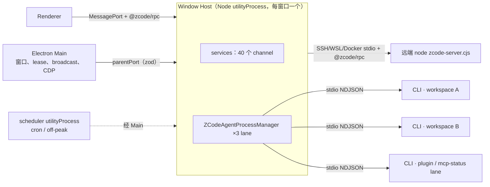
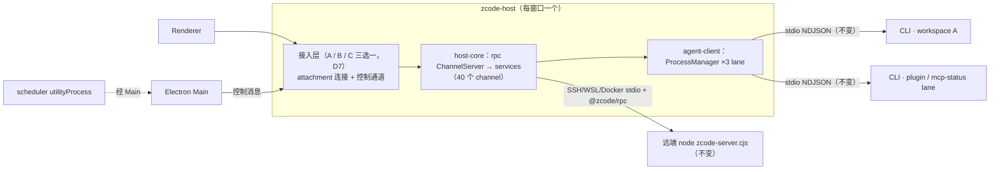
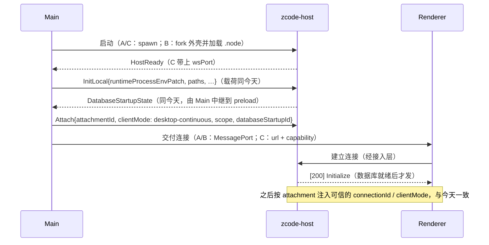
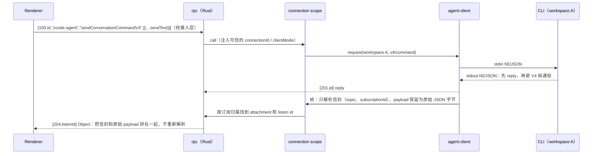

# Rust Host：原生 Host 重写规划

日期：2026-10-08（第三版）。基线：`main` / `06ba978`。状态：实施中。S0、R0 已完成（细节与验收见 [rust-host-r0.md](rust-host-r0.md)）；R1 的 setting、provider、account、file、system 已实现；R2 的 agent 子系统已实现，侧栏部分进行中（见 [rust-host-r2.md](rust-host-r2.md)）。Renderer 接入方式（D7）已按性能对比选定 C（本机 WebSocket）。性能报告是 `perf/rust-host-abc` 分支（`357e589`）上的 `docs/reports/rust-host-transport-perf-2026-10-08.md`。其余决策见第 10 节。

版本沿革：

- 第一版（`1ba725c`）：先把 runtime 编成 Node-API addon 嵌进 Node Host，再逐步替换。已作废。
- 第二版（`1ec479a`）：原生 Host 加本机 WebSocket，并由 Main 转发兜底。
- 第三版：按用户的答复，不做兜底；接入方式改为 A、B、C 三选一，等性能对比结论再定；接入层以下的部分与方案无关，可以先规划。

第一版里的 runtime 库化，以及 Host 与 CLI 合并，都推迟到本计划之后。

## 1. 已定方向与非目标

**已定方向**（用户确认）

1. **直接写完整的原生 Host**（下称 `zcode-host`）。不经过 Node sidecar 这类中间形态，也不加载现有的 Node Host。在切换之前，Node Host 仍是发布版本；开发期两者并存，由 Main 的开发开关选择启动哪一个。
2. **按 service 逐个写。** 契约以 Renderer 实际调用的 `@zcode/rpc` 成员为准（4.1）。
3. **CLI 保持独立进程。** Host ↔ CLI 仍走 stdio NDJSON，CLI 和协议都不改。lane 与今天相同：每个 workspace 一个 chat lane，另有 plugin-management 和 mcp-status 两个 lane。
4. **每个窗口一个 Host。** App 目前只有一个主窗口（`packages/desktop/src/main/primaryWindowCoordinator.ts`），所以实际上只有一个 Host。
5. **Renderer 走本机 WebSocket（方案 C），不做兜底**（D3、D7）。
   - 小消息流式：四种拓扑测不出差别。
   - 大消息：C 快 4–5 倍。128 KiB 读取，C 为 0.8 ms，其余为 3.4–4.6 ms。
   - Renderer 主线程：MessagePort 路径在 8 个 workspace 同时大输出时，让 Renderer 事件循环 p99 达到 25–64 ms；C 保持在 2 ms。

   接入层以下的 rpc、services、agent-client 与方案无关（3.1）。

6. **修复 `setting.json` 的跨进程丢更新。** 先在 Node 侧修（S0），Rust 实现沿用修复后的锁语义（D5）。

**非目标**

- 改 UI 业务逻辑或 V4 wire 语义；合并 `desktop-continuous` 与 `web-remote-replayable`。
- 改 CLI 或 Host ↔ CLI 协议；把 Host 与 CLI 合并成一个进程。
- 改会话库或 `tasks-index.sqlite` 的 schema。
- Main 的原生职责：窗口、CDP、自动更新、托盘、深链。
- 远端 server、Web server、`zcode-server-cli` 的 Rust 化（第 9 节）。
- 手机 relay 客户端（不在本仓库）。
- 开发期 Node Host 上 TS 改动的同步问题（D4）。

## 2. 现状（已在源码核对）

### 2.1 进程拓扑



- **启动方式**：Main 用 `utilityProcess.fork` 为每个 BrowserWindow 启动一个 Host（`packages/desktop/src/main/desktopHostProcess.ts:257`）。
- **Renderer reload**：不重启 Host，只把新端口 attach 到原来的 Host（`desktopWindowLifecycle.ts:143-166`）。
- **Host 退出后不恢复**：Main 只清理映射，不重启 Host；还没完成的调用会一直挂着，只能 reload 窗口。详见 3.4。
- **默认 CLI 是 TS CLI**：Host 用 Electron 自带的 Node（设置 `ELECTRON_RUN_AS_NODE=1`）运行 `resources/glm/zcode.cjs`。Rust CLI 只有在设置 `ZCODE_AGENT_SERVER_COMMAND` 加 `ZCODE_AGENT_SERVER_RUNTIME=zcode-cli-rust` 时才启用（`packages/services/src/zcode-agent/zcodeAgentProcessManager.ts:414-484`）。
- **channel 数量**：桌面 Host 注册了 39 个来自 `createLocalServices` 的 channel，加上 `window-controller`，共 40 个。`provider-provisioning-target` 只在远端和 HTTP 宿主注册（`packages/services/src/node.ts:2623`）。

### 2.2 要重写的规模（不含测试的 TS 行数）

| 部分                                                                            | 行数                |
| ------------------------------------------------------------------------------- | ------------------- |
| `packages/desktop/src/host`                                                     | 10.0k               |
| `packages/services/src`                                                         | 101.5k              |
| 　其中 agent 子系统（`zcode-agent`、task 适配、index syncer、tasks-index repo） | 约 24k              |
| 　其中 `bots` / `conversation-share` / remote（`@zcode/server/remote`）         | 13.8k / 5.5k / 9.8k |
| `packages/provider` + `provider-node`                                           | 6.7k                |
| `packages/rpc`                                                                  | 3.3k                |

本计划不删除 `packages/services`：远端 server、Web server 和 `zcode-server-cli` 还在用它。桌面 Host 切换后，这些 TS 代码只服务这 3 个宿主。

### 2.3 Renderer ↔ Host 契约：`@zcode/rpc`

Renderer 只依赖 wire 格式和方法名，中间没有 schema。Rust Host 必须**逐字节兼容**下面这些规则。

**值编码**（`packages/rpc/src/serialization.ts`）

- 每个值由 1 字节类型标签和 VQL 编码的长度开头。类型取值：Undefined 0、String 1、Buffer 2、VSBuffer 3、Array 4、Object 5、Int 6。
- 只有 int32（`(n | 0) === n`）走 Int。负数按无符号 32 位写入、按有符号读出。
- 其余数字，以及 `null`、布尔和对象，都走 Object，即 JSON 文本。
- 对象里嵌套的 `Uint8Array` 写成 `{"__zcode_rpc_nested_uint8array_v1":true,"base64":…}`。

**消息结构**（`channelServer.ts:68-97`）

- 每条消息是 `serialize(header)` 后接 `serialize(body)`。
- 请求：
  - call：`[100,id,channel,method]`，body 是参数数组；
  - listen：`[102,id,channel,event]`，body 是单个参数；
  - cancel：`[101,id]`；dispose：`[103,id]`。
- 响应：
  - `[200]`：Initialize；
  - `[201,id]`：调用成功；
  - `[202,id]`：Error，载荷是 `{message,name,stack[]}`，另外透传 9 个键：`code`、`kind`、`status`、`retryAfterMs`、`data`、`detail`、`details`、`taskId`、`traceId`；
  - `[203,id]`：非 Error 对象的拒绝；
  - `[204,id]`：事件。

**成员语义**（`proxy-channel.ts`）

- `onXxx` 是固定事件；`onDynamicXxx(arg)` 是带参事件；其他名字都是方法。
- `ProxyChannel.fromService` 没有白名单，实例上的任何方法都能被远程调用。

**分帧**

- WebSocket：用 `SocketProtocol`，13 字节帧头依次是 type u8、id u32BE、ack u32BE、len u32BE，只用 Regular 帧（`protocol.ts:236-307`）。
- MessagePort：一条消息就是一个 `Uint8Array`。

**按 attachment 包装的 channel**

`zcode-agent`、`window-controller`、`zcode-task`、`conversation-share` 这 4 个 channel，Host 会为每个 attachment 单独包一层，注入可信的 `connectionId` 和 `clientMode`（`packages/desktop/src/host/index.ts:2003-2045`）。

### 2.4 启动门槛与故障表现

**Renderer 的挂载门槛**

Renderer 要先收到 `DatabaseStartupState{phase:"ready"}`，再收到 `databaseStartupId` 与之匹配的服务端口，才会挂载（`packages/desktop/src/renderer/src/main.tsx:261-301`）。这个状态由 Host 发出、经 Main 中继；30 s 内没收到，就报 `startup_status_timeout`。

**阻塞首屏的调用**（`packages/ui/src/Root.tsx:611-618`）

- `oauth.restoreCachedSessionState`；
- `setting.get` / `update`：provider 迁移和 tab 恢复会用到；
- `model-selection.getView`；
- `file.ensureConversationWorkspace`。

此外，`setting.get` 返回之前，`OccupationOnboarding` 渲染为空。

**挂住和报错的后果不同**

- 调用挂住，或者 Host 没发 Initialize：首屏会**永远停在加载态**。
- 调用报错：几乎所有调用方都有 catch，UI 只是降级。

**今天缺失成员时的行为**

- 缺 channel：请求先挂起，1000 ms 后回 `Unknown channel` 错误（`channelServer.ts:229-253`）；监听则永远不会得到应答。
- 缺方法：回 202 错误。
- 缺事件：抛出的异常 `onEventListen` 没有捕获。

UI 也不检查成员是否存在，因为代理对象永远是真值。像 `onDynamicCuaPermissionObservation`、`onAgentRuntimeLifecycle`、`listDeletedTaskIds` 都是无条件调用的。

**会弹窗的调用**

`settings-sync.getFirstRunPromptState` 一旦报错，会弹出带错误信息的引导对话框（`packages/ui/src/hooks/useSettingsSync.ts:254-280`）。

### 2.5 Main ↔ Host 控制面

- **规模**：Main → Host 30 种消息，Host → Main 48 种，zod schema 在 `packages/shared/src/validation.ts:470,985`。Main 从不作为 RPC 客户端调用 Host 的服务。
- **主要用途**：
  - `InitLocal`，携带登录 shell 的环境补丁 `runtimeProcessEnvPatch`；
  - `DatabaseStartupState`；
  - `Attach` / `DetachServicePort`；
  - Broadcast；
  - `TaskRealtime*`，即跨窗口 owner/lease；
  - `CronRun` / `OffPeakRun`；
  - `BrowserExecute*`，经 CDP；
  - `LocalMediaPreviewPathAuthorize*`；
  - `FeedbackLogArchive*`；
  - `BotRemoteWorkspace*`、`RemoteWorkspace*`；
  - `ResourceUsageSnapshot*`、`Log`。
- **Main 自己实现的部分**：
  - Main 自己也写 Setting；
  - BroadcastHub、TaskRealtimeBus；
  - scheduler 进程；
  - 日志文件、telemetry 状态；
  - MCP 用户目录；
  - 浏览器视图与 CDP；
  - 采集登录 shell 环境。

### 2.6 共享文件：Rust 必须与 Node 写入方格式兼容

Main（Node）、TS CLI 和 scheduler 在本计划中会继续读写下面这些文件。所以 Rust 实现的格式和锁协议必须与 Node 逐字节兼容。

| 文件                                                | 写入方                                                                           | 格式要点                                                                                             |
| --------------------------------------------------- | -------------------------------------------------------------------------------- | ---------------------------------------------------------------------------------------------------- |
| `~/.zcode/v2/setting.json`（固定在 HOME 下）        | 每个 Host、远端 collection、**Main**（`packages/desktop/src/main/index.ts:671`） | 读改写只在进程内排队，文件锁只覆盖临时写和 rename（`settingService.ts:299-336`）：**跨进程会丢更新** |
| `v2/credentials.json`                               | 每个 Host、TS CLI；Main 只读                                                     | AES-256-GCM，key 为 sha256(`ZCODE_CREDENTIAL_SECRET` 或 fallback 串)；整个读改写都持锁               |
| `v2/provider_config.json`、`v2/runtime/provider/**` | 每个 Host（personal repo、CDN 刷新）；CLI 只读                                   | 持锁、原子写；每个 Host 每 1 s 轮询一次                                                              |
| `v2/tasks-index.sqlite`                             | 每个 Host 里的多个 repo 连接、migration worker、scheduler 进程                   | `node:sqlite`；多进程、多连接                                                                        |
| `~/.zcode/cli/config.json`                          | skills、commands、settings-sync、mcp-sync、subagents、hooks、Main、CLI           | 没有统一的锁                                                                                         |
| `v2/bot-*.v3.json`、`onboarding-record.json` 等     | 各个 Host                                                                        | 部分持锁                                                                                             |

- **锁协议**：锁是一个 `<file>.lock/` 目录，里面放 `owner-<token>.json`（`packages/shared/src/node/atomicFileLock.ts:175-212`）。
- **全局环境**：今天的 Host 把 PATH 等补丁一次性**写进全局 `process.env`**（`packages/services/src/runtime-tools/runtimeCommandEnv.ts:240-267`）。git、pty、CLI 子进程都依赖这份全局环境。

### 2.7 依赖关系（决定迁移顺序）

- **L0，不依赖其他服务**：credential、setting、broadcast、file-watcher、file、git-checkpoint、system、memory、plugins、skills、skill-sync、plugin-sync、commands、subagents。
- **L1–L3**：terminal、media-preview、settings-sync；ApiClient；oauth 与账号栈；client-config、client-scenes、feedback；provider runtime（`provider-settings`、`model-selection`）、coding-plan。
- **L4–L5，agent 子系统**：`zcode-agent`、`zcode-task`、`zcode-session`、index syncer、connection scope。**它必须整体迁移**，原因有两个：
  - 它和 provider runtime 之间有环：`testConnectivity` 调用 agent，agent 启动时又要用 provider runtime；
  - 内部有大量同步调用和共享 Emitter（`zcodeTaskIndexSyncer.ts:94`）。
- **L6–L7**：bots、off-peak、conversation-share；以及 Host 专属的 window-controller、cron 派发、远端 collection。

### 2.8 Node 专属依赖与 Rust 替代

| Node 依赖                             | 使用方                                    | Rust 替代                                                      |
| ------------------------------------- | ----------------------------------------- | -------------------------------------------------------------- |
| node-pty（ConPTY、spawn-helper）      | terminal、远端 server                     | portable-pty                                                   |
| `child_process` 调用 git CLI          | git、git-checkpoint                       | `tokio::process` 调用 git CLI（保持 CLI 语义，不引入 libgit2） |
| `fs.watch`（recursive）               | file-watcher                              | notify                                                         |
| `node:sqlite`                         | tasks-index、automation、off-peak         | rusqlite（WAL、busy_timeout）                                  |
| node:crypto AES-GCM、锁目录协议       | credential                                | aes-gcm、sha2，锁按同一协议实现                                |
| undici（ProxyAgent、自定义 CA）       | ApiClient、Agent 代理环境                 | reqwest + rustls（与 CLI 的 `net` crate 同一套）               |
| node-forge                            | app CA 证书                               | rcgen                                                          |
| croner、yaml、smol-toml、ignore、yazl | 自动化、skills、settings-sync、搜索、反馈 | cron、serde_yaml、toml、ignore、zip                            |
| `@larksuiteoapi/node-sdk`             | bots（飞书长连接）                        | 手写长连接客户端                                               |
| ssh2、docker/wsl CLI、tar             | 远端 backend                              | russh 或系统 ssh、tar（R6 评估）                               |

## 3. 目标架构

### 3.1 分层：只有接入层随方案变化



接入层只向 `host-core` 交付两样东西：

- 每个 attachment 一条连接。连接上传的是完整的 `@zcode/rpc` 消息字节，并附带 attachment 元数据：`attachmentId`、`clientMode`、`role`、`scope`、`databaseStartupId`。
- 一条控制通道。上面跑的是 Main ↔ Host 消息，类型由 `validation.ts` 的 zod schema 生成（4.2）。

```rust
pub struct HostCore { /* services、agent-client、attachment registry */ }
impl HostCore {
    pub fn start(config: HostConfig, control: Arc<dyn ControlSink>) -> Self;
    /// InitLocal、Dispose、TaskRealtime*、CronRun、BrowserExecuteResult……
    pub fn on_control(&self, message: MainToHost);
    /// 一条 attachment。数据库就绪前挂起，就绪后发 [200] Initialize（同今天）。
    pub fn attach(&self, meta: AttachmentMeta, connection: Box<dyn RpcConnection>);
    pub async fn shutdown(&self, deadline: Duration);
}
pub trait RpcConnection: Send {
    /// 一条完整的 @zcode/rpc 消息。只入队，不阻塞调用方。
    fn send(&self, message: Bytes);
    fn incoming(&mut self) -> BoxStream<'static, Bytes>;
}
pub trait ControlSink: Send + Sync {
    fn send(&self, message: HostToMain);
}
```

选定方案后，只需实现对应的接入层，再改 Main 和 Renderer 的建连代码。`host-core` 及以下不随方案变化。

### 3.2 三种接入方案（D7 已选 C）

下表保留选型时的对比。实施只做 C 这一列。

|                      | A：Main 转发                                                                                            | B：utilityProcess 薄壳 + napi                                                                                                                                                  | C：本机 WebSocket                                                                                                                                       |
| -------------------- | ------------------------------------------------------------------------------------------------------- | ------------------------------------------------------------------------------------------------------------------------------------------------------------------------------ | ------------------------------------------------------------------------------------------------------------------------------------------------------- |
| Host 进程            | 原生可执行文件，Main 用 `child_process.spawn` 启动                                                      | Rust 动态库（`.node`），由 `utilityProcess` 里约 100 行的 JS 外壳加载；Main 仍用 `utilityProcess.fork`                                                                         | 原生可执行文件，Main 用 `child_process.spawn` 启动                                                                                                      |
| Renderer 改动        | 无（仍是 MessagePort）                                                                                  | 无                                                                                                                                                                             | 改建连代码：从 Main 拿到 `{url, capability}`，用 WebSocket + `SocketProtocol` 连接；关闭时拒绝挂起的调用                                                |
| Main 改动            | 新增转发模块：每个 attachment 一对 `MessagePortMain` ⇄ UDS / 命名管道连接，字节原样转发，加 13 字节帧头 | 基本不改：`fork`、`parentPort`、`AttachServicePort` 原样保留                                                                                                                   | 签发 capability、下发 endpoint；Bot 远程运行时这类由 Main 发起的 attachment，改用 Node 24 自带的 WebSocket 连接                                         |
| 控制通道             | 子进程 stdin/stdout，长度前缀 JSON 帧；stderr 输出日志                                                  | `parentPort` → 外壳 → napi，传 JSON 字符串                                                                                                                                     | 同 A                                                                                                                                                    |
| 鉴权                 | UDS 放在只有当前用户可访问的目录（0700）；Windows 命名管道设当前用户 ACL                                | 不需要：端口由 Main 分发                                                                                                                                                       | capability 32 字节随机，单次有效、30 s 过期，经 WebSocket 子协议传递（浏览器不能设请求头）；校验 Host 头（防 DNS rebinding）和 Origin；只监听 127.0.0.1 |
| reload 后重新 attach | Main 新建 `MessageChannelMain` 和一条新的 socket 连接                                                   | 同今天（`AttachServicePort`）                                                                                                                                                  | Main 重新签发 capability                                                                                                                                |
| 交付物               | 6 个平台的可执行文件，与 Electron 用同一证书签名                                                        | 6 个平台的 `.node` prebuild 加 `asarUnpack`；将来远端 / Web 还要另编一个可执行文件                                                                                             | 同 A                                                                                                                                                    |
| 资源统计与崩溃收集   | `getAppMetrics` 和 crashReporter 都覆盖不到，需要自己按 pid 采样、写 panic 报告                         | 沿用 `getAppMetrics` 和 crashReporter                                                                                                                                          | 同 A                                                                                                                                                    |
| 主要风险             | 所有流量都经过 Main 的 JS 线程；Main 卡住，窗口也会跟着卡                                               | 进出流量都经过外壳的单个 JS 线程；napi 入口必须 `catch_unwind`；JS 与 Rust 之间禁止同步等待；进程何时退出由 Node 决定，需要显式 `shutdown(deadline)`；进程里仍有 V8 的基础内存 | 端口被安全软件拦截时 App 无法使用（D3：不做兜底）；本机其他进程能连上来，只能靠 capability 防护                                                         |

不论选哪个方案：

- Main 发起的可信 attachment（Bot 远程运行时，`web-remote-replayable` 模式）走与 Renderer 相同的接入层，不另写一套；
- 控制消息的类型完全相同。

### 3.3 启动与 attach（与方案无关）



### 3.4 Host 退出（D2）

**今天的 Node Host**

1. **Main**：收到 `exit` 后只做清理：记日志，注销 broadcast 和 CUA 状态源，删除窗口 → Host 映射（`packages/desktop/src/main/desktopHostProcess.ts:752-769`）。**不重启 Host。**
2. **启动状态**：Main 推一条 `phase:"failed", errorCode:"transport_closed"` 的启动状态（`databaseStartupRelay.ts:78-104`）。但 Renderer 初始化完成后会忽略所有启动状态（`packages/desktop/src/renderer/src/main.tsx:264`），所以用户看不到任何提示。
3. **Renderer**：`MessagePortProtocol` 检测不到对端关闭，还没完成的调用一直挂着，事件也不再到达。界面停在最后的状态，操作没有反应。
4. **CLI 子进程**：stdin 收到 EOF 后自行退出（TS CLI 见 `apps/zcode-cli/packages/cli/src/protocol-lifecycle.ts:61`），正在进行的 run 就此中断。
5. **恢复方式**：用户 reload 窗口。`dom-ready` 时找不到旧 Host，Main 就重新拉起一个，CLI 也在下次请求时重新拉起（`desktopWindowLifecycle.ts:136-180`）。

**可选做法**

- **保持现状**：与 Node Host 行为一致，改动最小。
- **自动恢复**：Main 收到 Host 退出后立即重启 Host，并通知 Renderer 重建连接、重挂 Root。handshake 和连接缓存都以服务对象为 key，所以需要重建服务对象。Renderer 侧在连接关闭时立即拒绝所有挂起的调用（A/B 要给 MessagePort 增加关闭通知，C 有 WebSocket 的 `onClose`）。

### 3.5 状态所有者

| 状态                                               | 唯一所有者                                              | 相对今天                                        |
| -------------------------------------------------- | ------------------------------------------------------- | ----------------------------------------------- |
| 会话事实、队列、rows、seq/epoch、V4 帧的编码与分片 | CLI                                                     | 不变                                            |
| CLI 进程表、lane、generation、惰性重启、存储准备   | `agent-client` ProcessManager（Rust）                   | 从 TS 移植，语义不变                            |
| attachment、可信的 `clientMode` / `connectionId`   | `host-core` 的 attachment registry                      | 从 TS 移植                                      |
| 每个 attachment 的 V4 订阅归属与路由               | connection scope（Rust 版 `zcodeAgentConnectionScope`） | 从 TS 移植                                      |
| 接入凭据（仅 C 的 capability）                     | 接入层；Main 只负责请求签发和转交                       | C 新增，只存在内存                              |
| 跨窗口 owner/lease、owner 命令路由                 | Main `taskRealtimeBus`                                  | 不变                                            |
| 进程环境（登录 shell 的 PATH 等）                  | `host-core` 持有的 `RuntimeEnv` 值                      | 不再改写全局 env，所有子进程显式传入            |
| `setting.json` 等共享文件                          | 文件本身加跨进程锁                                      | 格式不变；`setting.json` 的读改写整体持锁（S0） |
| `tasks-index.sqlite`                               | Host 的 session 服务；scheduler 也写                    | schema 不变；同一 Host 内只开一个连接池         |
| 账号凭据、请求期 auth                              | Host 的 oauth / account 服务                            | 不进入 CLI 状态，与今天相同                     |

### 3.6 流式热路径（与方案无关）



- **今天的开销**：CLI 编码一次 JSON；Host 逐行 `JSON.parse`、做 zod 校验，再由 `@zcode/rpc` `JSON.stringify` 一次。
- **Rust Host 的做法**：只解析信封；payload 用 `serde_json::value::RawValue` 原样拼进 Object 的 JSON。
- **不变的部分**：V4 帧的分片仍由 CLI 完成，Renderer 的重组逻辑不改。

### 3.7 代码位置与依赖方向

代码放在一个独立的 Cargo workspace：`apps/zcode-host/`。开发在新分支上进行（D6）。

| crate                      | 职责                                                                                                                                                              |
| -------------------------- | ----------------------------------------------------------------------------------------------------------------------------------------------------------------- |
| `rpc`                      | `@zcode/rpc` 值编码；`SocketProtocol` 分帧；ChannelServer（Initialize、call/cancel/listen/dispose、错误载荷）；channel 声明宏；ChannelClient（远端 workspace 用） |
| `control`                  | Main ↔ Host 消息类型（由 zod 生成）与漂移检查                                                                                                                     |
| `store`                    | 路径、锁目录协议、原子写、凭据加解密、settings 文件、tasks-index（rusqlite）                                                                                      |
| `net`                      | ApiClient：代理、自定义 CA、401 钩子                                                                                                                              |
| `agent-client`             | ProcessManager；CLI 命令解析；NDJSON 客户端（82 个请求、14 个反向请求、通知）；V4 帧透传                                                                          |
| `services`                 | 每个 channel 一个模块，按第 5 节逐个实现                                                                                                                          |
| `host-core`                | composition root：组装依赖，实现 3.1 的 `HostCore`；整个 Host 只有这里能读取 env                                                                                  |
| 入口（随 D7 选定其中一个） | A：`zcode-host` 可执行文件，UDS / 命名管道加 stdio 控制<br>B：`node-binding`（napi-rs cdylib）加 JS 外壳<br>C：`zcode-host` 可执行文件，WebSocket 加 stdio 控制   |

**依赖规则**（加入架构检查）

- 只允许依赖 CLI 的协议 crate `zcode-cli-protocol` 和无状态的工具 crate。禁止依赖 `core`、`tools`、`app-server`、`headless`、`tui` 这些 runtime crate，让“CLI 是独立进程”由编译期保证。
- services 之间通过 trait 句柄调用，不直接读别的模块的内部状态。
- provider runtime ↔ agent、ApiClient ↔ oauth 这两个依赖环，由 `host-core` 注入延迟句柄来解开。
- B 的 JS 外壳设行数上限，只能做转发；架构检查禁止它导入 `.node` 和 Electron 端口类型以外的模块。

## 4. 契约与兼容性策略

### 4.1 契约清单与 stub

- **契约清单**：用 TS compiler API 写一个脚本，从 `ServiceChannels` 对应的接口导出全部成员（方法、`onX`、`onDynamicX`，以及它们的参数和返回类型），生成 `apps/zcode-host/contract/channels.json`。再扫描 UI 调用点，标出 Renderer 实际会调用哪些成员。
- **40 个 channel 从第一天就全部注册**，每个成员处于以下三种状态之一：
  - `implemented`：已实现。
  - `stub-error`：立即回 202 错误 `{name:"NotImplemented", code:"fault.host.notImplemented"}`。绝不挂起，也不走 1000 ms 的 Unknown channel 等待。
  - `stub-value`：返回约定的默认值，只用于报错会弹窗或会阻塞首屏的成员。例如 `settings-sync.getFirstRunPromptState` 返回 `{handled:true}`。
- **事件不存在时**：订阅照常接受，只是永远不触发。
- **覆盖率**：脚本输出每个 channel 的覆盖率，作为里程碑进度的依据。

### 4.2 Wire 夹具与生成类型

- **rpc 编解码**：由 TS 的 `serialize` 生成字节向量作为夹具，Rust 的编码和解码都必须与之完全一致。夹具覆盖：
  - int32 边界、负数、大整数、浮点；
  - `null` / `undefined`；
  - 嵌套 `Uint8Array`、Unicode、空帧。
- **控制消息**：先把 zod 转成 JSON Schema，再生成 serde 类型；CI 做漂移检查。
- **Host ↔ CLI 协议**：直接复用 `zcode-cli-protocol`，并用 `packages/shared/src/zcode-protocol` 的 zod schema 做一致性测试，保证 TS CLI 和 Rust CLI 都兼容。

### 4.3 差分测试（每个 service 的主验收）

- **做法**：一个 TS 测试驱动在临时 HOME 下，分别连接 Node 和 Rust 两个 Host，跑同一组场景脚本，比较归一化后的返回值、事件序列和文件副作用。
  - Node 侧：把 `createLocalServices` 经 `SocketProtocol` 暴露出来；
  - Rust 侧：连接开发构建的测试入口（`SocketProtocol` over UDS），这个入口与 D7 选定的方案无关；
  - 归一化：抹掉时间戳、随机 id。
- **场景来源**：优先复用 `packages/services/tests` 里已有的服务测试。
- **共享文件的交叉测试**：TS 写、Rust 读；Rust 写、TS 读；并发写入不丢更新。

### 4.4 开发开关

Main 读取 `ZCODE_DESKTOP_HOST=rust` 来选择启动哪个 Host。这个开关只在开发构建中生效，默认仍是 Node Host。切换完成之前，Renderer 要同时支持两种建连：MessagePort 连 Node Host，WebSocket 连 Rust Host。

## 5. 里程碑与 service 顺序

排序依据三样东西：2.4 的启动门槛；Renderer 主流程的调用链（4.1 的清单会精确到成员）；2.7 的依赖层级。括号里的行数是要移植的 TS 规模，只作量级参考。

| 里程碑 | 内容                                                                                                                                                                                                                                                                                                                                                                                                                                                                                      | 验收                                                                                                                                                                                                                                                                                                                                                                          |
| ------ | ----------------------------------------------------------------------------------------------------------------------------------------------------------------------------------------------------------------------------------------------------------------------------------------------------------------------------------------------------------------------------------------------------------------------------------------------------------------------------------------- | ----------------------------------------------------------------------------------------------------------------------------------------------------------------------------------------------------------------------------------------------------------------------------------------------------------------------------------------------------------------------------- |
| S0     | **修复 `setting.json` 跨进程丢更新**（Node 侧，已完成；测试 `packages/services/test/settingServiceCrossProcess.test.ts`）：<br>• `settingService.ts` 的 `update`、迁移写入改为整个读改写都持跨进程锁，做法同 `credentialService.ts:112`；<br>• 锁内用 `atomicWriteText(..., {useFileLock:false})`，避免重复加锁；<br>• Main 与 Host 都用 `createSettingService()`（`packages/desktop/src/main/index.ts:671`），改这一处两边都生效                                                         | • 先补测试：两个进程并发更新不同字段，修复前丢更新，修复后两个字段都在；<br>• 现有 setting 测试通过                                                                                                                                                                                                                                                                           |
| R0     | **骨架，不含业务服务**：<br>• `rpc` 及其夹具；<br>• `control` 的生成类型，先实现 `HostReady`、`InitLocal`、`Dispose`、`Log`、`DatabaseStartupState`、`Attach`；<br>• D7 选定方案的接入层，以及 Main、Renderer 的建连改动；<br>• 测试入口；<br>• 契约清单和 40 个 channel 的 stub；<br>• Main 的开发开关                                                                                                                                                                                   | • wire 夹具双向通过；<br>• 打开开关后 Renderer 能完成 Initialize，所有调用都在 100 ms 内得到应答，没有挂起；<br>• reload 后能重新 attach；<br>• 选 C 时，重放的 capability、错误的 Origin、非 loopback 的 Host 头都被拒绝                                                                                                                                                     |
| R1     | **首屏可用**（约 20k）：<br>• `store`：路径、锁、原子写、凭据加解密、settings，读改写整体持锁，与 S0 一致；<br>• setting、credential、broadcast（经控制通道连 BroadcastHub）、system；<br>• file 的 `ensureConversationWorkspace` 和基础读取；<br>• `net` ApiClient；oauth 与账号栈；<br>• provider runtime（`provider-settings`、`model-selection`）：内置 provider 的 CDN 刷新、personal 配置轮询、Registry；<br>• onboarding-record、settings-sync、client-config、client-scenes       | • 新 profile 进入登录页；已登录的 profile 恢复 tab 并进入主窗口，过程中没有错误 toast，也没有空白；<br>• 这些服务的差分测试通过；<br>• Node 与 Rust 交叉读写 `setting.json`、`credentials.json`、`provider_config.json`                                                                                                                                                       |
| R2     | **核心聊天：agent 子系统整体迁移**（约 25k）：<br>• `agent-client`：3 个 lane、generation、惰性重启；用 `RuntimeEnv` 生成 spawn env；移植 CLI 命令解析（Electron Node 跑 TS CLI、Rust CLI 两种）；存储准备与 `DatabaseStartupState`；14 个反向请求，其中 browser 经控制通道走 Main 的 CDP；<br>• zcode-agent、connection scope、sessions index；<br>• zcode-task、index syncer、tasks-index repo；<br>• zcode-session、window-controller；<br>• task realtime bridge（lease、owner 命令） | • 在 Rust Host 上 E2E 跑通：打开 workspace、列出任务、新建会话、发送、流式、权限与提问、Stop、切换模型、查看文件改动；<br>• `desktop-continuous`、`web-remote-replayable`（Bot 远程运行时）两种语义都通过；<br>• CLI 崩溃后能惰性重启；reload 后能重新 attach；<br>• 与 Main `taskRealtimeBus` 的 lease 交互与今天一致；<br>• N 个 workspace 同时流式时，控制 RPC p95 ≤ 20 ms |
| R3     | **工作区基础**（约 8k）：file 的其余成员、file-watcher（notify）、git（git CLI；提交信息生成回调 agent）、git-checkpoint、terminal（portable-pty）、media-preview（Main 授权路径）、本地 prompt-attachment-transfer                                                                                                                                                                                                                                                                       | • 文件树、Git 状态与操作、终端的 E2E；<br>• Windows ConPTY、macOS、Linux 都要验证；<br>• 大文件和二进制预览                                                                                                                                                                                                                                                                   |
| R4     | **账号增值与网络**（约 7k）：usage-stats、coding-plan-subscription、feedback（日志归档经 Main、打 zip）、official-MCP 凭据源、telemetry 采样                                                                                                                                                                                                                                                                                                                                              | • 差分测试通过；<br>• Composer 工具栏的额度与套餐显示正常                                                                                                                                                                                                                                                                                                                     |
| R5     | **扩展**（约 9k）：skills、skill-sync、plugins、plugin-sync、plugin-management（plugin lane 的门面）、commands、memory、subagents（含 `prepareRuntimeState`）、hooks、mcp-sync                                                                                                                                                                                                                                                                                                            | • 差分测试通过；<br>• 与 Main、CLI 并发写 `~/.zcode/cli/config.json` 时不丢更新                                                                                                                                                                                                                                                                                               |
| R6     | **外部集成与自动化**（约 33k）：<br>• bots（飞书长连接）、conversation-share；<br>• off-peak-task 与 mock gateway；cron / off-peak 派发（与 Main 的 scheduler 配合）；<br>• cua-permission、cua-pip-session（本构建里是 stub，保持 fail closed）；<br>• 远端 workspace collection：Rust Host 作为 `@zcode/rpc` 客户端连接远端的 Node `zcode-server.cjs`，部署资产不变；<br>• 远端媒体预览代理                                                                                             | Bot 收发、分享的导入导出、cron 与 off-peak 派发、SSH/WSL/Docker 连接与远端会话的 E2E                                                                                                                                                                                                                                                                                          |
| R7     | **切换**：<br>• 默认改用 Rust Host；<br>• 6 个平台的打包与签名（A/C 是可执行文件，B 是 `.node` prebuild）；<br>• 选 A 或 C 时，补上按 pid 的资源采样和崩溃上报；<br>• 从桌面包中删掉 Node Host bundle；<br>• 更新 AGENTS.md                                                                                                                                                                                                                                                               | • 全平台 E2E 矩阵，两种 V4 语义都覆盖；<br>• 冷启动、常驻 RSS、流式期间 CPU 都不比 Node Host 差，实测报告写入 `docs/reports/`                                                                                                                                                                                                                                                 |

**依赖关系**

- S0 与 R0 互不依赖。
- R0 → R1 → R2。
- R3 只有提交信息生成依赖 R2，其余部分可以和 R2 并行。
- R4–R6 在 R2 之后可以并行。
- R7 依赖前面全部完成。
- R0 的接入层要等 D7 定下来才能做；但 `rpc`、`control`、契约清单、测试入口不受影响，可以先开工。

## 6. 风险

| #   | 风险                                                                                             | 应对                                                                                     |
| --- | ------------------------------------------------------------------------------------------------ | ---------------------------------------------------------------------------------------- |
| K1  | **契约没有 schema**，`ProxyChannel` 也没有白名单                                                 | 契约清单加 UI 调用点扫描；还没实现的成员一律立即报错，绝不挂起                           |
| K2  | **共享文件仍有 Node 写入方**（Main、TS CLI、scheduler）                                          | 锁协议、加密方式、schema 逐字节兼容，并做交叉测试；`setting.json` 先在 S0 修好           |
| K3  | **接入方案自身的风险**                                                                           | 见 3.2 表格最后一行；由性能对比和 D7 决定接受哪一组                                      |
| K4  | **平台差异**：Windows ConPTY 与路径；新 exe 被杀毒软件误报（A/C）；macOS 签名与 hardened runtime | 三个平台都进 E2E；可执行文件或 `.node` 与 Electron 用同一证书签名，macOS 上 Team ID 相同 |
| K5  | **Host 崩溃**：今天崩溃后不会恢复，挂起的调用一直挂着，用户没有任何提示                          | 按 D2 决定是否自动恢复；至少在连接关闭时立即拒绝挂起的调用                               |
| K6  | **全局进程环境**：今天依赖改写 `process.env`                                                     | 改为显式的 `RuntimeEnv`；`host-core` 之外禁止读 env；所有 spawn 都显式设置 cwd 和 env    |
| K7  | **R6 体量大，又依赖外部 SDK**（飞书、SSH）                                                       | 放在最后做，可以再拆子里程碑；远端仍连 Node server，不同时重写远端                       |

## 7. 每个里程碑的固定检查

- **TS 侧**：`pnpm typecheck`、`pnpm lint`、`pnpm fmt:check`、`pnpm architecture:check --changed`。
- **Rust 侧**：`apps/zcode-host` 的 `cargo fmt --check`、`cargo clippy -D warnings`、`cargo test`。
- **本计划新增的检查**：契约覆盖率、wire 夹具、差分测试。

结果如实写入报告。凡是有交互或时序变化的里程碑，都要同时验证 `desktop-continuous` 与 `web-remote-replayable`。

## 8. 与现有规格和规则的关系

- [rust-cli-architecture.md](rust-cli-architecture.md) 不受影响：CLI 及其协议都不变。
- AGENTS.md 中这些规则继续有效：
  - “Desktop app 通过 stdio 与 Agent 通信”；
  - 每个窗口一个 Local Host；
  - owner/lease 与跨 Host 路由。
- R7 切换时 AGENTS.md 要更新：Host 侧日志规则（`createServiceLogger` 对应改成 Rust 的 `tracing`）。此外：
  - 选 A：MessagePort 改为经 Main 转发，需要写清楚；
  - 选 C：MessagePort 相关描述改为 WebSocket；
  - 选 A 或 C：`utilityProcess` 相关描述也要改。
- `docs/specs/rust-host-transport-bench.md`（`perf/rust-host-abc` 分支）的结论，作为 D7 的依据。

## 9. 本计划之后

- 远端 server、Web server、`zcode-server-cli` 改用同一套 Rust Host：`serve --stdio`、`serve --http`。
- Host 与 CLI 合并：runtime 搬进 Host 进程，去掉按 workspace 启动的 CLI 进程和 stdio。

## 10. 决策

**已定**

| 编号 | 问题                            | 决定                                                                                                      |
| ---- | ------------------------------- | --------------------------------------------------------------------------------------------------------- |
| D1   | Host 粒度                       | 每个窗口一个；App 目前只有一个主窗口                                                                      |
| D3   | 是否做兜底传输                  | 不做，只实现 D7 选定的一种                                                                                |
| D4   | 开发期已迁移 service 的 TS 改动 | 不考虑                                                                                                    |
| D5   | `setting.json` 跨进程丢更新     | 修，先在 Node 侧做（S0）；Rust 实现沿用同一锁语义                                                         |
| D6   | 代码放在哪里                    | 在新分支上开发；代码放在独立的 Cargo workspace `apps/zcode-host`，只通过路径依赖引用 `zcode-cli-protocol` |
| D7   | Renderer 接入方式               | C：本机 WebSocket，依据性能报告 `rust-host-transport-perf-2026-10-08.md`                                  |

**待定**

| 编号 | 问题                                                                         | 建议                                                               |
| ---- | ---------------------------------------------------------------------------- | ------------------------------------------------------------------ |
| D2   | Host 异常退出后，是保持现状（3.4），还是由 Main 自动重启并让 Renderer 重连？ | 自动重启。今天 Host 一旦崩溃，用户只能看到界面卡住，又没有任何提示 |
