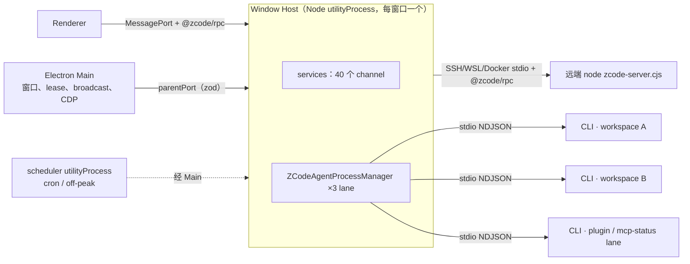
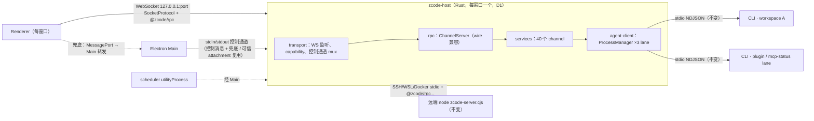
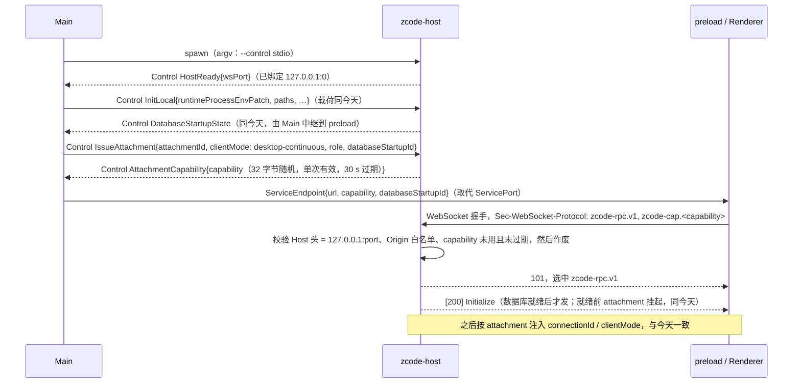
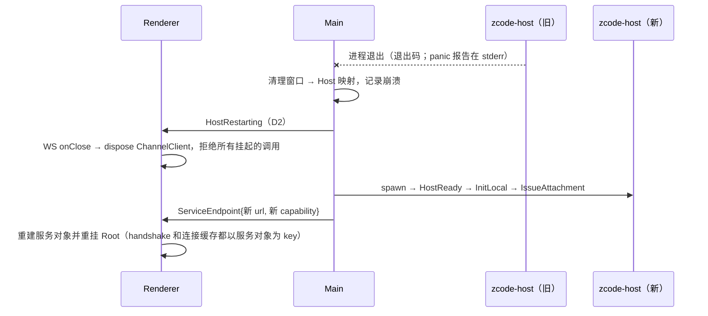
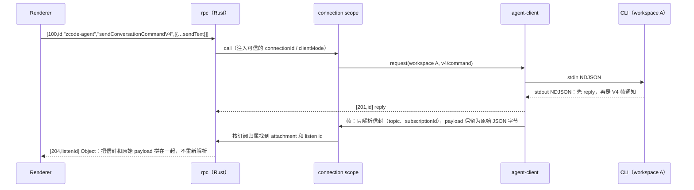

# Rust Host：原生 Host 重写规划

日期：2026-10-08（第二版）。基线：`main` / `06ba978`。状态：规划草案；第 10 节的决策确认后，按里程碑补分项 spec 再开工。

第一版（`1ba725c`）规划的是：先把 runtime 编成 Node-API addon 嵌进 Node Host，再逐步替换。按用户后续的决定，第二版改为：

- 直接写原生 Rust Host，按 service 逐个实现；
- CLI 保持独立进程；
- Renderer 改用本机 WebSocket 直连。

第一版里的 runtime 库化（H1），以及 Host 与 CLI 合并，都推迟到本计划之后。

## 1. 已定方向与非目标

**已定方向**（用户确认）

1. **直接写完整的原生 Host**（下称 `zcode-host`）。不经过 Node-API addon、Node sidecar 这类中间形态，也不加载现有 Node Host。切换之前，Node Host 仍是发布版本；开发期两者并存，由 Main 的开发开关选择启动哪一个。
2. **按 service 逐个写。** 契约以 Renderer 实际调用的 `@zcode/rpc` 成员为准（4.1）。
3. **Renderer ↔ Host 走本机 WebSocket 直连**：只监听 `127.0.0.1`，端口由系统分配，连接时出示一次性 capability。端口被拦截时，由 Main 转发兜底（3.2）。
4. **CLI 保持独立进程**：Host ↔ CLI 仍走 stdio NDJSON，CLI 和协议都不改。lane 与今天相同：每个 workspace 一个 chat lane，另有 plugin-management 和 mcp-status 两个 lane。

**非目标**

- 改 UI 业务逻辑或 V4 wire 语义；合并 `desktop-continuous` 与 `web-remote-replayable`。
- 改 CLI 或 Host ↔ CLI 协议；把 Host 与 CLI 合并成一个进程。
- 改会话库或 `tasks-index.sqlite` 的 schema。
- Main 的原生职责：窗口、CDP、自动更新、托盘、深链。
- 远端 server、Web server、`zcode-server-cli` 的 Rust 化（列在第 9 节）。
- 手机 relay 客户端（不在本仓库）。

## 2. 现状（已在源码核对）

### 2.1 进程拓扑

- **启动方式**：Main 用 `utilityProcess.fork` 为每个 BrowserWindow 启动一个 Host（`packages/desktop/src/main/desktopHostProcess.ts:257`）。
- **Renderer reload**：不重启 Host，只把新端口 attach 到原来的 Host（`desktopWindowLifecycle.ts:143-166`）。
- **Host 退出后不恢复**：Main 只清理映射，不重启 Host（`desktopHostProcess.ts:752-769`）。`MessagePortProtocol` 检测不到关闭，还没完成的调用会一直挂着，只能 reload 窗口。
- **默认 CLI 是 TS CLI**：Host 用 Electron 自带的 Node（设置 `ELECTRON_RUN_AS_NODE=1`）运行 `resources/glm/zcode.cjs`。Rust CLI 只有在设置 `ZCODE_AGENT_SERVER_COMMAND` 加 `ZCODE_AGENT_SERVER_RUNTIME=zcode-cli-rust` 时才启用（`packages/services/src/zcode-agent/zcodeAgentProcessManager.ts:414-484`）。
- **channel 数量**：桌面 Host 注册了 39 个来自 `createLocalServices` 的 channel，加上 `window-controller`，共 40 个。`provider-provisioning-target` 只在远端和 HTTP 宿主注册（`packages/services/src/node.ts:2623`）。

### 2.2 要重写的规模（不含测试的 TS 行数）

| 部分                                                                            | 行数                |
| ------------------------------------------------------------------------------- | ------------------- |
| `packages/desktop/src/host`                                                     | 10.0k               |
| `packages/services/src`                                                         | 101.5k              |
| 　其中 agent 子系统（`zcode-agent`、task 适配、index syncer、tasks-index repo） | 约 24k              |
| 　其中 `bots` / `conversation-share` / remote（`@zcode/server/remote`）         | 13.8k / 5.5k / 9.8k |
| `packages/provider` + `provider-node`                                           | 6.7k                |
| `packages/rpc`                                                                  | 3.3k                |

本计划不删除 `packages/services`：远端 server、Web server 和 `zcode-server-cli` 还在用它。桌面 Host 切换后，这些 TS 代码只服务这 3 个宿主。

### 2.3 Renderer ↔ Host 契约：`@zcode/rpc`

Renderer 只依赖 wire 格式和方法名，中间没有 schema。Rust Host 必须**逐字节兼容**下面这些规则。

**值编码**（`packages/rpc/src/serialization.ts`）

- 每个值由 1 字节类型标签和 VQL 编码的长度开头。类型取值：Undefined 0、String 1、Buffer 2、VSBuffer 3、Array 4、Object 5、Int 6。
- 只有 int32（`(n | 0) === n`）走 Int。负数按无符号 32 位写入、按有符号读出。
- 其余数字，以及 `null`、布尔和对象，都走 Object，即 JSON 文本。
- 对象里嵌套的 `Uint8Array` 写成 `{"__zcode_rpc_nested_uint8array_v1":true,"base64":…}`。

**消息结构**（`channelServer.ts:68-97`）

- 每条消息是 `serialize(header)` 后接 `serialize(body)`。
- 请求：
  - call：`[100,id,channel,method]`，body 是参数数组；
  - listen：`[102,id,channel,event]`，body 是单个参数；
  - cancel：`[101,id]`；dispose：`[103,id]`。
- 响应：
  - `[200]`：Initialize；
  - `[201,id]`：调用成功；
  - `[202,id]`：Error，载荷是 `{message,name,stack[]}`，另外透传 9 个键：`code`、`kind`、`status`、`retryAfterMs`、`data`、`detail`、`details`、`taskId`、`traceId`；
  - `[203,id]`：非 Error 对象的拒绝；
  - `[204,id]`：事件。

**成员语义**（`proxy-channel.ts`）

- `onXxx` 是固定事件；`onDynamicXxx(arg)` 是带参事件；其他名字都是方法。
- `ProxyChannel.fromService` 没有白名单，实例上的任何方法都能被远程调用。

**分帧**

- WebSocket：用 `SocketProtocol`，13 字节帧头依次是 type u8、id u32BE、ack u32BE、len u32BE，只用 Regular 帧（`protocol.ts:236-307`）。
- MessagePort：一条消息就是一个 `Uint8Array`。

**按 attachment 包装的 channel**

`zcode-agent`、`window-controller`、`zcode-task`、`conversation-share` 这 4 个 channel，Host 会为每个 attachment 单独包一层，注入可信的 `connectionId` 和 `clientMode`（`packages/desktop/src/host/index.ts:2003-2045`）。

### 2.4 启动门槛与故障表现

**Renderer 的挂载门槛**

Renderer 要先收到 `DatabaseStartupState{phase:"ready"}`，再收到 `databaseStartupId` 与之匹配的服务端口，才会挂载（`packages/desktop/src/renderer/src/main.tsx:261-301`）。这个状态由 Host 发出、经 Main 中继；30 s 内没收到，就报 `startup_status_timeout`。

**阻塞首屏的调用**（`packages/ui/src/Root.tsx:611-618`）

- `oauth.restoreCachedSessionState`；
- `setting.get` / `update`：provider 迁移和 tab 恢复会用到；
- `model-selection.getView`；
- `file.ensureConversationWorkspace`。

此外，`setting.get` 返回之前，`OccupationOnboarding` 渲染为空。

**挂住和报错的后果不同**

- 调用挂住，或者 Host 没发 Initialize：首屏会**永远停在加载态**。
- 调用报错：几乎所有调用方都有 catch，UI 只是降级。

**今天缺失成员时的行为**

- 缺 channel：请求先挂起，1000 ms 后回 `Unknown channel` 错误（`channelServer.ts:229-253`）；监听则永远不会得到应答。
- 缺方法：回 202 错误。
- 缺事件：抛出的异常 `onEventListen` 没有捕获。

UI 也不检查成员是否存在，因为代理对象永远是真值。像 `onDynamicCuaPermissionObservation`、`onAgentRuntimeLifecycle`、`listDeletedTaskIds` 都是无条件调用的。

**会弹窗的调用**

`settings-sync.getFirstRunPromptState` 一旦报错，会弹出带错误信息的引导对话框（`packages/ui/src/hooks/useSettingsSync.ts:254-280`）。

### 2.5 Main ↔ Host 控制面

- **规模**：Main → Host 30 种消息，Host → Main 48 种，zod schema 在 `packages/shared/src/validation.ts:470,985`。Main 从不作为 RPC 客户端调用 Host 的服务。
- **主要用途**：
  - `InitLocal`，携带登录 shell 的环境补丁 `runtimeProcessEnvPatch`；
  - `DatabaseStartupState`；
  - `Attach` / `DetachServicePort`；
  - Broadcast；
  - `TaskRealtime*`，即跨窗口 owner/lease；
  - `CronRun` / `OffPeakRun`；
  - `BrowserExecute*`，经 CDP；
  - `LocalMediaPreviewPathAuthorize*`；
  - `FeedbackLogArchive*`；
  - `BotRemoteWorkspace*`、`RemoteWorkspace*`；
  - `ResourceUsageSnapshot*`、`Log`。
- **Main 自己实现的部分**：
  - Main 自己也写 Setting；
  - BroadcastHub、TaskRealtimeBus；
  - scheduler 进程；
  - 日志文件、telemetry 状态；
  - MCP 用户目录；
  - 浏览器视图与 CDP；
  - 采集登录 shell 环境。

### 2.6 共享文件：Rust 必须与 Node 写入方格式兼容

Main（Node）、TS CLI 和 scheduler 在本计划中会继续读写下面这些文件。所以 Rust 实现的格式和锁协议必须与 Node 逐字节兼容。

| 文件                                                | 写入方                                                                           | 格式要点                                                                                             |
| --------------------------------------------------- | -------------------------------------------------------------------------------- | ---------------------------------------------------------------------------------------------------- |
| `~/.zcode/v2/setting.json`（固定在 HOME 下）        | 每个 Host、远端 collection、**Main**（`packages/desktop/src/main/index.ts:671`） | 读改写只在进程内排队，文件锁只覆盖临时写和 rename（`settingService.ts:299-336`）：**跨进程会丢更新** |
| `v2/credentials.json`                               | 每个 Host、TS CLI；Main 只读                                                     | AES-256-GCM，key 为 sha256(`ZCODE_CREDENTIAL_SECRET` 或 fallback 串)；整个读改写都持锁               |
| `v2/provider_config.json`、`v2/runtime/provider/**` | 每个 Host（personal repo、CDN 刷新）；CLI 只读                                   | 持锁、原子写；每个 Host 每 1 s 轮询一次                                                              |
| `v2/tasks-index.sqlite`                             | 每个 Host 里的多个 repo 连接、migration worker、scheduler 进程                   | `node:sqlite`；多进程、多连接                                                                        |
| `~/.zcode/cli/config.json`                          | skills、commands、settings-sync、mcp-sync、subagents、hooks、Main、CLI           | 没有统一的锁                                                                                         |
| `v2/bot-*.v3.json`、`onboarding-record.json` 等     | 各个 Host                                                                        | 部分持锁                                                                                             |

- **锁协议**：锁是一个 `<file>.lock/` 目录，里面放 `owner-<token>.json`（`packages/shared/src/node/atomicFileLock.ts:175-212`）。
- **全局环境**：今天的 Host 把 PATH 等补丁一次性**写进全局 `process.env`**（`packages/services/src/runtime-tools/runtimeCommandEnv.ts:240-267`）。git、pty、CLI 子进程都依赖这份全局环境。

### 2.7 依赖关系（决定迁移顺序）

- **L0，不依赖其他服务**：credential、setting、broadcast、file-watcher、file、git-checkpoint、system、memory、plugins、skills、skill-sync、plugin-sync、commands、subagents。
- **L1–L3**：terminal、media-preview、settings-sync；ApiClient；oauth 与账号栈；client-config、client-scenes、feedback；provider runtime（`provider-settings`、`model-selection`）、coding-plan。
- **L4–L5，agent 子系统**：`zcode-agent`、`zcode-task`、`zcode-session`、index syncer、connection scope。**它必须整体迁移**，原因有两个：
  - 它和 provider runtime 之间有环：`testConnectivity` 调用 agent，agent 启动时又要用 provider runtime；
  - 内部有大量同步调用和共享 Emitter（`zcodeTaskIndexSyncer.ts:94`）。
- **L6–L7**：bots、off-peak、conversation-share；以及 Host 专属的 window-controller、cron 派发、远端 collection。

### 2.8 Node 专属依赖与 Rust 替代

| Node 依赖                             | 使用方                                    | Rust 替代                                                      |
| ------------------------------------- | ----------------------------------------- | -------------------------------------------------------------- |
| node-pty（ConPTY、spawn-helper）      | terminal、远端 server                     | portable-pty                                                   |
| `child_process` 调用 git CLI          | git、git-checkpoint                       | `tokio::process` 调用 git CLI（保持 CLI 语义，不引入 libgit2） |
| `fs.watch`（recursive）               | file-watcher                              | notify                                                         |
| `node:sqlite`                         | tasks-index、automation、off-peak         | rusqlite（WAL、busy_timeout）                                  |
| node:crypto AES-GCM、锁目录协议       | credential                                | aes-gcm、sha2，锁按同一协议实现                                |
| undici（ProxyAgent、自定义 CA）       | ApiClient、Agent 代理环境                 | reqwest + rustls（与 CLI 的 `net` crate 同一套）               |
| node-forge                            | app CA 证书                               | rcgen                                                          |
| croner、yaml、smol-toml、ignore、yazl | 自动化、skills、settings-sync、搜索、反馈 | cron、serde_yaml、toml、ignore、zip                            |
| `@larksuiteoapi/node-sdk`             | bots（飞书长连接）                        | 手写长连接客户端                                               |
| ssh2、docker/wsl CLI、tar             | 远端 backend                              | russh 或系统 ssh、tar（R6 评估）                               |

## 3. 目标架构

### 3.1 进程拓扑

**启动与控制通道**

- Main 改用 `child_process.spawn` 启动 `zcode-host`，不再用 `utilityProcess.fork`。
- 控制通道用子进程的 stdin/stdout；日志和 panic 输出走 stderr。这样不需要命名管道或 UDS 路径，其他进程也打不开这条通道。
- stdout 上只能出现控制帧。Host 代码禁止 `println!`，由 clippy 的 `print_stdout` 拦截。

**走控制通道的 attachment**

这两类 attachment 以 attachment 帧复用控制通道，不走 TCP：

- Main 发起的可信 attachment：Bot 远程运行时和手机 relay，使用 `web-remote-replayable` 模式；
- 兜底转发。

**控制帧格式**

格式是 `[u8 kind][u32 attachmentId][u32 len][payload]`，`kind` 取 Control、Attach、Detach、Data 之一：

- Control 的载荷是 JSON，类型由 `validation.ts` 的 zod schema 生成（4.2）；
- Data 的载荷是原样的 `SocketProtocol` 字节。

### 3.2 Renderer 建连与鉴权

**capability 的传递方式**

- 浏览器的 WebSocket API 不能设置请求头，所以不能沿用 `/ws/host` 用的 `x-zcode-rpc-host-capability` 头（`packages/server/src/http.ts:321-346`）。
- 放在 query string 里容易被写进日志。
- 所以放在 WebSocket 子协议里。`packages/client/src/websocket.ts` 要为此增加 `protocols` 参数。

**capability 的生命周期**

- 由 Main 请求签发，由 Host 持有和校验；
- 只存在内存里，不落盘、不写日志；
- 用一次即作废；每次 reload 或 attach 都重新签发。

**其他校验**

- Origin 白名单包括生产环境的 `file://` 和开发服务器的 origin。Chromium 对 `file://` 页面实际发出的 Origin 是 `file://` 还是 `null`，需要实测。
- 不支持 CORS 预检。
- 限制单条消息的大小和并发连接数。

**兜底**

- 触发条件：WebSocket 3 s 内没建立，或者被拒绝。
- 流程：preload 报告给 Main；Main 新建一个 `MessageChannelMain` 交给 Renderer，自己把消息包成 attachment 帧，经控制通道转发给 Host。
- 每次建连都上报 `transport=ws|relay`，用来决定以后是否保留兜底。

**CSP**：主窗口没有 CSP，`connect-src` 不受限；默认 session 的代理也不拦截 loopback（`packages/desktop/src/main/desktopNetworkPolicy.ts:103`）。所以这一项不用改。

### 3.3 Host 重启与重连

- Host 退出时，CLI 的 stdin 随之关闭，CLI 按今天的规则退出。新 Host 在下一次请求时重新拉起 CLI，`runtimeGeneration` 加 1。
- Renderer reload 只重新签发 capability，不重启 Host。

### 3.4 状态所有者

| 状态                                               | 唯一所有者                                              | 相对今天                                   |
| -------------------------------------------------- | ------------------------------------------------------- | ------------------------------------------ |
| 会话事实、队列、rows、seq/epoch、V4 帧的编码与分片 | CLI                                                     | 不变                                       |
| CLI 进程表、lane、generation、惰性重启、存储准备   | `agent-client` ProcessManager（Rust）                   | 从 TS 移植，语义不变                       |
| attachment、可信的 `clientMode` / `connectionId`   | Host 的 attachment registry                             | 从 TS 移植                                 |
| 每个 attachment 的 V4 订阅归属与路由               | connection scope（Rust 版 `zcodeAgentConnectionScope`） | 从 TS 移植                                 |
| capability                                         | Host transport；Main 只请求签发并转交                   | 新增，只在内存                             |
| 跨窗口 owner/lease、owner 命令路由                 | Main `taskRealtimeBus`                                  | 不变                                       |
| 进程环境（登录 shell 的 PATH 等）                  | Host composition root 持有的 `RuntimeEnv` 值            | 不再改写全局 env，所有子进程显式传入       |
| `setting.json` 等共享文件                          | 文件本身加跨进程锁                                      | 格式不变；`setting.json` 的读改写缺口见 D5 |
| `tasks-index.sqlite`                               | Host 的 session 服务；scheduler 也写                    | schema 不变；同一个 Host 内只开一个连接池  |
| 账号凭据、请求期 auth                              | Host 的 oauth / account 服务                            | 不进入 CLI 状态，与今天相同                |

### 3.5 流式热路径

- **今天的开销**：CLI 编码一次 JSON；Host 逐行 `JSON.parse`、做 zod 校验，再由 `@zcode/rpc` `JSON.stringify` 一次。
- **Rust Host 的做法**：只解析信封；payload 用 `serde_json::value::RawValue` 原样拼进 Object 的 JSON。
- **不变的部分**：V4 帧的分片仍由 CLI 完成，Renderer 的重组逻辑不改。

### 3.6 代码位置与依赖方向

新建一个独立的 Cargo workspace：`apps/zcode-host/`（D6）。

| crate               | 职责                                                                                                                                                              |
| ------------------- | ----------------------------------------------------------------------------------------------------------------------------------------------------------------- |
| `rpc`               | `@zcode/rpc` 值编码；`SocketProtocol` 分帧；ChannelServer（Initialize、call/cancel/listen/dispose、错误载荷）；channel 声明宏；ChannelClient（远端 workspace 用） |
| `transport`         | WS 监听、capability 存储、Host/Origin 校验、控制通道 mux                                                                                                          |
| `control`           | Main ↔ Host 消息类型（由 zod 生成）与漂移检查                                                                                                                     |
| `store`             | 路径、锁目录协议、原子写、凭据加解密、settings 文件、tasks-index（rusqlite）                                                                                      |
| `net`               | ApiClient：代理、自定义 CA、401 钩子                                                                                                                              |
| `agent-client`      | ProcessManager；CLI 命令解析；NDJSON 客户端（82 个请求、14 个反向请求、通知）；V4 帧透传                                                                          |
| `services`          | 每个 channel 一个模块，按第 5 节逐个实现                                                                                                                          |
| `zcode-host`（bin） | composition root：唯一读取 argv 和 env 的地方，负责组装依赖                                                                                                       |

**依赖规则**（加入架构检查）

- `zcode-host` 只能依赖 CLI 的协议 crate `zcode-cli-protocol` 和无状态的工具 crate。**禁止**依赖 `core`、`tools`、`app-server`、`headless`、`tui` 这些 runtime crate。这样“CLI 是独立进程”由编译期保证。
- services 之间通过 trait 句柄调用，不直接读其他模块的内部状态。
- provider runtime ↔ agent、ApiClient ↔ oauth 之间的环，由 composition root 注入延迟句柄来解开。

## 4. 契约与兼容性策略

### 4.1 契约清单与 stub

**生成清单**

用 TS compiler API 写一个脚本，从 `ServiceChannels` 对应的接口导出全部成员：方法、`onX`、`onDynamicX`，以及它们的参数和返回类型。输出到 `apps/zcode-host/contract/channels.json`。再扫描 UI 调用点，标出 Renderer 实际会调用哪些成员。

**成员状态**

40 个 channel 从第一天就全部注册，每个成员处于以下三种状态之一：

- `implemented`：已实现。
- `stub-error`：立即回 202 错误 `{name:"NotImplemented", code:"fault.host.notImplemented"}`。绝不挂起，也不走 1000 ms 的 Unknown channel 等待。
- `stub-value`：返回约定的默认值。只用于报错会弹窗或阻塞首屏的成员，例如 `settings-sync.getFirstRunPromptState` 返回 `{handled:true}`。

对还没实现的事件：接受订阅，但永远不触发。

**CI 检查**

- 输出每个 channel 的覆盖率。
- TS 接口新增了成员、而 Rust 侧没有登记状态时，CI 报错。

### 4.2 Wire 夹具与生成类型

- **rpc 编解码**：用 TS 的 `serialize` 生成字节向量作为夹具，Rust 的编码和解码都必须与之一致。夹具覆盖：
  - int32 边界、负数、大整数、浮点；
  - `null` / `undefined`；
  - 嵌套 `Uint8Array`、Unicode、空帧。
- **控制消息**：先把 zod 转成 JSON Schema，再生成 serde 类型；CI 做漂移检查。
- **Host ↔ CLI 协议**：直接复用 `zcode-cli-protocol`，并用 `packages/shared/src/zcode-protocol` 的 zod schema 做一致性测试，保证 TS CLI 和 Rust CLI 都兼容。

### 4.3 差分测试（每个 service 的主验收）

- **做法**：一个 TS 测试驱动在临时 HOME 下，分别连接 Node 和 Rust 两个 Host，跑同一组场景脚本；比较归一化后的返回值、事件序列和文件副作用。
  - Node 侧：把 `createLocalServices` 经 `SocketProtocol` 暴露出来；
  - Rust 侧：经 WS 连接 `zcode-host`；
  - 归一化：抹掉时间戳、随机 id。
- **场景来源**：优先复用 `packages/services/tests` 里已有的服务测试。
- **共享文件的交叉测试**：TS 写、Rust 读；Rust 写、TS 读；并发写入不丢更新。

### 4.4 开发开关

- Main 读取 `ZCODE_DESKTOP_HOST=rust`，只在开发构建里生效，用来选择启动哪个 Host。默认仍是 Node Host。
- Renderer 同时支持 `ServicePort` 和 `ServiceEndpoint` 两种建连方式，切换完成前两条路径都保留。

## 5. 里程碑与 service 顺序

排序依据三样东西：2.4 的启动门槛；Renderer 主流程的调用链（4.1 的清单会精确到成员）；2.7 的依赖层级。括号里的行数是要移植的 TS 规模，只作量级参考。

| 里程碑 | 内容                                                                                                                                                                                                                                                                                                                                                                                                                                                                                      | 验收                                                                                                                                                                                                                                                                                                                                                                    |
| ------ | ----------------------------------------------------------------------------------------------------------------------------------------------------------------------------------------------------------------------------------------------------------------------------------------------------------------------------------------------------------------------------------------------------------------------------------------------------------------------------------------- | ----------------------------------------------------------------------------------------------------------------------------------------------------------------------------------------------------------------------------------------------------------------------------------------------------------------------------------------------------------------------- |
| R0     | **骨架，不含业务服务**： • `rpc` 及其夹具； • `transport`：WS、capability、Host/Origin 校验、控制通道 mux； • `control` 的生成类型，先实现 `HostReady`、`InitLocal`、`Dispose`、`Log`、`DatabaseStartupState`、`IssueAttachment`； • 契约清单和 40 个 channel 的 stub； • Main：开发开关、用 `child_process` 启动、`ServiceEndpoint`； • `packages/client` 的 WS 支持子协议和关闭处理                                                                                   | • wire 夹具双向通过； • 打开开关后 Renderer 能完成 Initialize，所有调用都在 100 ms 内得到应答，没有挂起； • 重放的 capability、错误的 Origin、非 loopback 的 Host 头都被拒绝                                                                                                                                                                                      |
| R1     | **首屏可用**（约 20k）： • `store`：路径、锁、原子写、凭据加解密、settings； • setting、credential、broadcast（经控制通道连 BroadcastHub）、system； • file 的 `ensureConversationWorkspace` 和基础读取； • `net` ApiClient；oauth 与账号栈； • provider runtime（`provider-settings`、`model-selection`）：内置 provider 的 CDN 刷新、personal 配置轮询、Registry； • onboarding-record、settings-sync、client-config、client-scenes                                   | • 新 profile 进入登录页；已登录的 profile 恢复 tab 并进入主窗口，过程中没有错误 toast 和空白； • 这些服务的差分测试通过； • Node 与 Rust 交叉读写 `setting.json`、`credentials.json`、`provider_config.json`                                                                                                                                                      |
| R2     | **核心聊天：agent 子系统整体迁移**（约 25k）： • `agent-client`：3 个 lane、generation、惰性重启；用 `RuntimeEnv` 生成 spawn env；移植 CLI 命令解析（Electron Node 跑 TS CLI、Rust CLI 两种）；存储准备与 `DatabaseStartupState`；14 个反向请求，其中 browser 经控制通道走 Main 的 CDP； • zcode-agent、connection scope、sessions index； • zcode-task、index syncer、tasks-index repo； • zcode-session、window-controller； • task realtime bridge（lease、owner 命令） | • 在 Rust Host 上 E2E 跑通：打开 workspace、列出任务、新建会话、发送、流式、权限与提问、Stop、切换模型、查看文件改动； • 两种语义都通过：`desktop-continuous`，以及 Bot 远程运行时经控制通道 attach 的 `web-remote-replayable`； • CLI 崩溃后能惰性重启；reload 后能重新 attach；两个窗口之间的 lease 正常； • N 个 workspace 同时流式时，控制 RPC p95 ≤ 20 ms |
| R3     | **工作区基础**（约 8k）：file 的其余成员、file-watcher（notify）、git（git CLI；提交信息生成回调 agent）、git-checkpoint、terminal（portable-pty）、media-preview（Main 授权路径）、本地 prompt-attachment-transfer                                                                                                                                                                                                                                                                       | • 文件树、Git 状态与操作、终端的 E2E； • Windows ConPTY、macOS、Linux 都要验证； • 大文件和二进制预览                                                                                                                                                                                                                                                             |
| R4     | **账号增值与网络**（约 7k）：usage-stats、coding-plan-subscription、feedback（日志归档经 Main、打 zip）、official-MCP 凭据源、telemetry 采样                                                                                                                                                                                                                                                                                                                                              | • 差分测试通过； • Composer 工具栏的额度与套餐显示正常                                                                                                                                                                                                                                                                                                               |
| R5     | **扩展**（约 9k）：skills、skill-sync、plugins、plugin-sync、plugin-management（plugin lane 的门面）、commands、memory、subagents（含 `prepareRuntimeState`）、hooks、mcp-sync                                                                                                                                                                                                                                                                                                            | • 差分测试通过； • 与 Main、CLI 并发写 `~/.zcode/cli/config.json` 时不丢更新                                                                                                                                                                                                                                                                                         |
| R6     | **外部集成与自动化**（约 33k）： • bots（飞书长连接）、conversation-share； • off-peak-task 与 mock gateway；cron / off-peak 派发（与 Main 的 scheduler 配合）； • cua-permission、cua-pip-session（本构建里是 stub，保持 fail closed）； • 远端 workspace collection：Rust Host 作为 `@zcode/rpc` 客户端连接远端的 Node `zcode-server.cjs`，部署资产不变； • 远端媒体预览代理                                                                                             | Bot 收发、分享的导入导出、cron 与 off-peak 派发、SSH/WSL/Docker 连接与远端会话的 E2E                                                                                                                                                                                                                                                                                    |
| R7     | **切换**： • 默认改用 Rust Host； • 完成并验证兜底转发； • 补上原生进程的资源采样和崩溃上报（今天用的 `getAppMetrics` 覆盖不到 `child_process`）； • 6 个平台的打包与签名； • 从桌面包里删掉 Node Host bundle 和 `utilityProcess.fork`； • 更新 AGENTS.md                                                                                                                                                                                                               | • 全平台 E2E 矩阵，两种 V4 语义都覆盖； • 兜底路径单独跑一遍 E2E； • 冷启动、常驻 RSS、流式期间 CPU 都不比 Node Host 差，实测报告写入 `docs/reports/`                                                                                                                                                                                                             |

**依赖关系**

- R0 → R1 → R2。
- R3 里只有提交信息生成依赖 R2，其余部分可以和 R2 并行。
- R4–R6 在 R2 之后可以并行。
- R7 依赖前面全部完成。

## 6. 风险

| #   | 风险                                                                                      | 应对                                                                                                                       |
| --- | ----------------------------------------------------------------------------------------- | -------------------------------------------------------------------------------------------------------------------------- |
| K1  | **长期双线维护**：重写期间 Node Host 还在演进，已迁移的 service 会漂移                    | 4.1 的契约检查拦住新增成员；已迁移 service 的 TS 改动必须同步到 Rust（D4）；差分测试持续运行                               |
| K2  | **契约没有 schema**，`ProxyChannel` 也没有白名单                                          | 契约清单加 UI 调用点扫描；还没实现的成员一律立即报错，绝不挂起                                                             |
| K3  | **本机端口被安全软件拦截**                                                                | 经控制通道兜底转发；上报实际使用的传输方式；R7 之前必须完成兜底                                                            |
| K4  | **本机端口的安全**：本机其他进程也能连上来                                                | 只监听 127.0.0.1；capability 单次有效、30 s 过期；校验 Host 头（防 DNS rebinding）和 Origin；限制消息大小                  |
| K5  | **共享文件还有 Node 写入方**（Main、TS CLI、scheduler）                                   | 锁协议、加密方式、schema 逐字节兼容，并做交叉测试；`setting.json` 跨进程丢更新是既有缺陷，修复方案见 D5                    |
| K6  | **原生子进程不在 Electron 的监控范围**：`getAppMetrics` 和 crashReporter 都覆盖不到       | 按 pid 采样资源，沿用今天采集 CLI 子进程的 `ps` / `Get-CimInstance` 方式；panic hook 写崩溃报告；Main 记录退出码           |
| K7  | **平台差异**：Windows ConPTY 与路径；新 exe 被杀毒软件误报；macOS 签名与 hardened runtime | 三个平台都进 E2E；exe 与 Electron 用同一个证书签名；macOS 上放在 `Contents/MacOS` 或 `Resources`，Team ID 与 Electron 相同 |
| K8  | **Host 崩溃**：今天崩溃后不会恢复，挂起的调用一直挂着                                     | 3.3 的重启与重连（D2）；WS 关闭时立即拒绝所有挂起的调用                                                                    |
| K9  | **全局进程环境**：今天依赖改写 `process.env`                                              | 改用显式的 `RuntimeEnv`；composition root 之外禁止读 env；每次 spawn 都显式设置 cwd 和 env                                 |
| K10 | **R6 体量大，又依赖外部 SDK**（飞书、SSH）                                                | 放在最后做，可以再拆子里程碑；远端仍连 Node server，不同时重写远端                                                         |

## 7. 每个里程碑的固定检查

- **TS 侧**：`pnpm typecheck`、`pnpm lint`、`pnpm fmt:check`、`pnpm architecture:check --changed`。
- **Rust 侧**：`apps/zcode-host` 的 `cargo fmt --check`、`cargo clippy -D warnings`、`cargo test`。
- **本计划新增的检查**：契约覆盖率、wire 夹具、差分测试。

结果如实写入报告。凡是有交互或时序变化的里程碑，都要同时验证 `desktop-continuous` 和 `web-remote-replayable` 两种语义。

## 8. 与现有规格和规则的关系

- [rust-cli-architecture.md](rust-cli-architecture.md) 不受影响：CLI 和它的协议都不变。
- **AGENTS.md 里继续有效的规则**：
  - “Desktop app 通过 stdio 与 Agent 通信”；
  - 每个窗口一个 Local Host（如果 D1 维持现状）；
  - owner/lease 与跨 Host 路由。
- **R7 切换时 AGENTS.md 要更新的内容**：
  - MessagePort 和 `utilityProcess` 的相关描述；
  - Host 侧日志规则：`createServiceLogger` 对应改成 Rust 的 `tracing`；
  - “Main 负责消息转发”要补上兜底转发。
- **第一版规划（`1ba725c`）**：H0–H6 的 addon 路线作废。其中的 runtime 库化（多个 workspace 共用一个进程、去掉全局 env/cwd）到 Host 与 CLI 合并时再启用。

## 9. 本计划之后

- 远端 server、Web server、`zcode-server-cli` 改用同一个 `zcode-host` 二进制：`serve --stdio`、`serve --http`。
- Host 与 CLI 合并：runtime 进入 Host 进程，去掉按 workspace 启动的 CLI 进程和 stdio。
- Host 改为 App 级单例（如果 D1 先选了每窗口一个）。

## 10. 待用户决定

| 编号 | 问题                                                                                                                                | 建议                                                                                      |
| ---- | ----------------------------------------------------------------------------------------------------------------------------------- | ----------------------------------------------------------------------------------------- |
| D1   | Host 粒度：保持每窗口一个，还是改成 App 级单例？单例能去掉跨窗口 lease 和每个窗口各自的 Bot 轮询，但要改 Main 架构和 AGENTS.md 规则 | 重写期间保持每窗口一个，这样行为能与 Node Host 逐项对照、做差分测试；单例放到切换之后再做 |
| D2   | Host 异常退出后，Main 是否自动重启 Host，并让 Renderer 重连？                                                                       | 是。今天的做法是不恢复，调用会一直挂着                                                    |
| D3   | 兜底转发是否作为切换的必要条件？                                                                                                    | 是。先有兜底再切默认；之后根据上报的 relay 比例，决定以后是否删掉兜底                     |
| D4   | 开发期间，已迁移 service 的 TS 改动怎么处理？                                                                                       | 必须同步改 Rust 实现，靠契约检查和差分测试拦住遗漏；不冻结 TS 的功能开发                  |
| D5   | `setting.json` 跨进程丢更新：是否在 R1 一并修复？修复方式是让锁覆盖整个读改写，Main 和 Node Host 同步修改                           | 修。否则 Rust 只能照搬这个缺陷                                                            |
| D6   | 代码放在哪里：新建 `apps/zcode-host` Cargo workspace，还是并入 `apps/zcode-cli-rust` 的 workspace？                                 | 新建。只通过路径依赖引用 `zcode-cli-protocol`，避免 Host 链接 CLI 的 runtime              |
