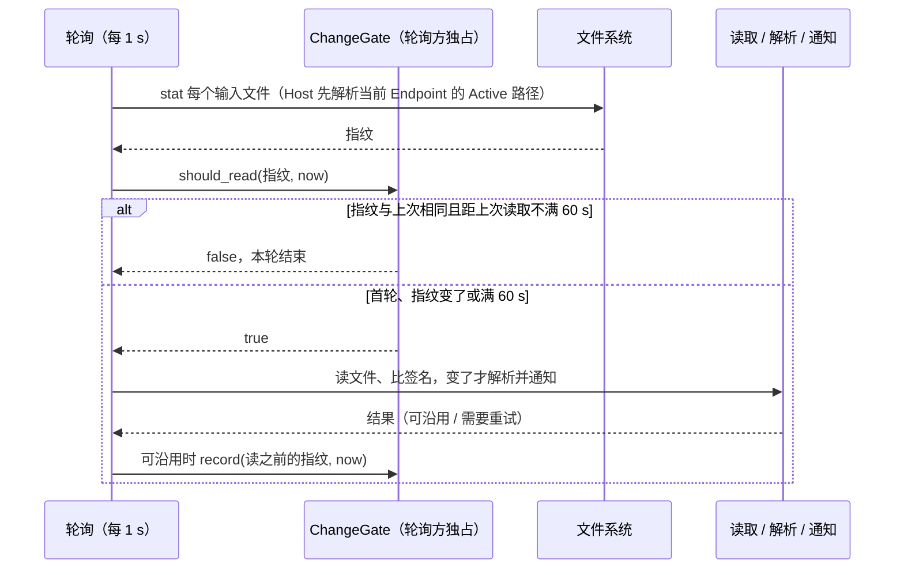

# Provider 配置轮询：先比元数据

2026-10-10。依据：`docs/reports/rust-app-performance-2026-10-10.md`“流式 CPU 为什么持平”一节，Host 的 `sample` 里供应商配置轮询（每秒读并解析两份内置 Release JSON、读个人配置，约 180 KB）约占 Host CPU 的 10%，空闲时也在跑；每个 runtime 实例的 Engine 也每秒读两份文件并算 sha256。

## 规则

轮询方每秒仍检查一次，但先取每个输入文件的元数据指纹（`zcode_kit::fs::FileStamp`），与上次读取前取的指纹相同就不读、不解析、不算哈希：

| 一方    | 轮询入口                                                   | 输入文件（顺序固定，路径计入指纹）                                                                                                             | 闸门的所有者                                |
| ------- | ---------------------------------------------------------- | ---------------------------------------------------------------------------------------------------------------------------------------------- | ------------------------------------------- |
| Host    | 常驻任务 `provider-config-poll`（`ProviderRuntime::poll`） | 随包内置配置；接入 Endpoint 来源后，当前 Endpoint 的 Active（`BuiltinSource::active_path`，每轮按设置重新解析 origin）；`provider_config.json` | 轮询循环的局部变量                          |
| runtime | Engine 每秒的 `refresh` 分支（`Registry::refresh(None)`）  | `ZCODE_BUILTIN_PROVIDER_CONFIG_FILE`、`ZCODE_PERSONAL_PROVIDER_CONFIG_FILE`                                                                    | `Registry` 的串行刷新入口（与账号同一把锁） |

- 指纹：是否存在、长度、修改时间；Unix 上另加设备号 + inode 与 ctime（秒、纳秒）。元数据读不到（不存在、权限）一律记为“不存在”，之后能读到时指纹变化。
- 指纹在读文件**之前**取：读的过程中文件再变，下一轮指纹就不同，不会漏。
- 只在读取结果可以沿用时记录指纹：
  - runtime：`load` 返回 `Ok`（包括“签名没变”和“账号基线 revision 不匹配、保留上一份快照”）；出错不记录，下一轮照常重读，与以前每轮都读时相同。
  - Host：读文件出错（不存在除外）、内置来源读取失败、Active 物化失败（`materialized: false`）时不记录，下一轮照常重读；文件不存在或 JSON 无效是稳定状态，记录。
- 兜底：距上次读取满 60 s 时不看指纹，无条件读一次（`FULL_READ_EVERY`）。
- 显式读取不经闸门：runtime 的账号更新 `refresh(Some(account))`；Host 的 `reload()`（`provider-settings.refresh`、首读、个人配置写入后、CDN 更新后）。它们读完后，下一轮轮询看到的指纹与闸门记录的不同，会多读一次（内容相同，不改 revision），之后恢复跳过。

## 语义

| 变化                                                                                                                                                                                                               | 何时读到                                             |
| ------------------------------------------------------------------------------------------------------------------------------------------------------------------------------------------------------------------ | ---------------------------------------------------- |
| 原地改写，长度或 mtime 变了                                                                                                                                                                                        | 下一轮（≤ 1 s），与以前相同                          |
| 原子替换（临时文件 + rename，`zcode_kit::fs::atomic_write` 与 Node 的写入都是）                                                                                                                                    | 下一轮：Unix 上 inode 必变；其他平台靠新文件的 mtime |
| 文件出现、消失                                                                                                                                                                                                     | 下一轮                                               |
| Host：Endpoint 切换（Active 路径变化）                                                                                                                                                                             | 下一轮：路径计入指纹                                 |
| Host：Active 物化失败、读文件出错                                                                                                                                                                                  | 每一轮都重试，与以前相同                             |
| 剩余风险：同一个文件被原地改写，长度不变，mtime 与 ctime 都落在上次读取前的同一个时间粒度内（Unix），或 mtime 被工具改回（Windows 没有 inode 与 ctime）；FAT / exFAT（2 s）、HFS+（1 s）、部分网络盘的时间粒度更粗 | ≤ 60 s（兜底读取）                                   |

本仓库的写入方（Host 的个人配置与 Active、Node 的同名文件）都用原子替换，正常使用不会落进剩余风险；兜底只为手工编辑与粗粒度文件系统。

## 验收

- `zcode-kit`：`fs::stamp` 的单元测试（出现、变长、消失；Unix 上同长度同 mtime 的 rename 覆盖；原地改写后 Unix 指纹变化、其他平台不变；闸门在未记录时一直放行、指纹或路径变化时放行、满 60 s 放行）。
- runtime：`registry_tests.rs`（出现、原地改写、rename 覆盖、删除都在下一次 `refresh(None)` 读到；Unix 上同长度、mtime 改回的 rename 覆盖；账号更新不经闸门）。
- Host：`providers_tests.rs`（没变时 `poll` 不读；出现、原地改写、rename 覆盖、删除各读一次、revision 各加一；Unix 上同长度 rename 覆盖；读不出时每轮重试；Endpoint 切换后读新的 Active）。
- 粗测 Host 空闲 CPU：release 构建、B 配置（Rust Host + 进程内 runtime）、1 个 workspace、启动后静置 20 s，再取 60 s 的 `ps` CPU 时间，改动前后交错。
- 实测（2026-10-10，3 + 3 次交错）：Host 进程 60 s 的 CPU 时间 0.59–0.73 s → 0.05–0.08 s，即约 1.0–1.2% → 0.1%（含进程内 runtime 的刷新）。
