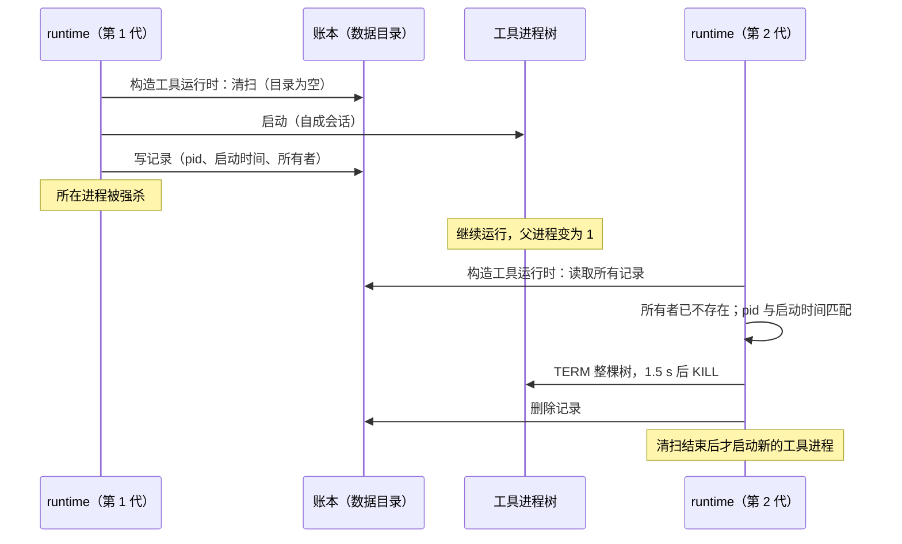

# 工具进程在 Host 异常退出后的回收

日期：2026-10-10。用户决定（[rust-unified-host.md](rust-unified-host.md) 10.1 的“进程”一行、D-U15）：账本加启动清扫，另加 Linux 与 Windows 的系统机制。

状态（2026-10-10，`feat/rust-tool-process-reaping`）：

- 账本与清扫已实现（macOS、Linux），在 macOS 上有端到端测试。
- Windows：hooks 与 MCP stdio 服务加入进程级 Job（Bash 工具原来就在自己的 Job 里）。只做了交叉编译检查，没有在 Windows 上运行过。
- Linux 的 `PR_SET_PDEATHSIG` 没有启用：按本规格的清扫规则，启用后回收反而变少（2.3）。是否改规则需要用户决定。

## 1. 问题

runtime 为 Bash 工具、hook、MCP stdio 服务启动子进程。正常停止时（取消、关闭会话、runtime 收口）由 runtime 主动结束整棵进程树（TERM，1.5 s 后 KILL）。

runtime 所在的进程被强杀或崩溃时，这段清理没有机会执行：

- Unix 上父进程退出不会带走子进程，子进程被过继给 1 号进程继续运行。
- 工具进程自成会话（为了能整棵树一起结束，也为了不占用终端），收不到任何随父进程而来的信号。
- 靠 stdin 通信的 MCP 服务读到 EOF 后多半自己退出；stdin 为空、很少输出的 Bash 命令不会察觉。

runtime 是独立进程时，Host 退出后它仍然存活，读到 stdin EOF 后自己收口。runtime 在 Host 进程内时两者同时消失，所以需要另一套保证。独立运行的 CLI 被强杀时同样受益。

## 2. 规则

### 2.1 账本

- 位置：`<数据目录>/tool-results/processes/`。工具层只拿到自己的目录 `<数据目录>/tool-results`（`WorkspaceTools::new` 的参数），账本放在它下面，入口代码不用改；测试与示例传入的目录也各自带一个账本。
- runtime 每启动一棵自成会话或进程组的进程树，就写一条记录，一棵树一个文件。范围包括 Bash 工具（前台、后台、超时转后台）、hook 与 MCP stdio 服务。这棵树结束并被确认回收后删除记录。
- 不在范围内：收集上下文时的 git 命令（`host/src/context_git.rs`，3 s 超时，丢弃时 killpg）、ps / sysctl 等短命令。它们自己会很快结束。
- 记录是一个空文件，字段都编码在文件名里，用 `create_new` 一次创建。目录项原子出现，不会读到写了一半的记录，也不需要 fsync（断电时进程也都没了）：

  `<用途>-<根 pid>-<根启动时间>-<所有者 pid>-<所有者启动时间>-<实例>`

| 字段                       | 含义                                                                                                                                                                                                          |
| -------------------------- | ------------------------------------------------------------------------------------------------------------------------------------------------------------------------------------------------------------- |
| 用途                       | `bash`、`hook`、`mcp`，只用于日志                                                                                                                                                                             |
| 根 pid、根启动时间         | 操作系统给出的启动时间，用来识别 pid 被复用的情况。macOS 用 `proc_pidinfo` 的启动时刻（微秒）；Linux 用 `/proc/<pid>/stat` 的启动 tick，前面加上开机标识（`boot_id`），重启前留下的记录不会与重启后的进程相符 |
| 进程组                     | 不单独记录：根进程是组长，进程组 id 等于根 pid                                                                                                                                                                |
| 所有者 pid、所有者启动时间 | 写下记录的进程                                                                                                                                                                                                |
| 实例                       | runtime 实例在进程内的编号（进程内递增）                                                                                                                                                                      |

- 删除记录有两种情况。一是 `Tracked::terminate` 确认整棵树已结束。二是根进程已经退出并被本进程回收，调用方有意保留其余进程（`Tracked::release`）：hook 正常结束后，它留下的后台进程照旧继续运行。根进程不在了，清扫对这样的记录也只会删除它。
- 没有确认就丢弃（结束失败，或任务、实例被中止）时，Unix 上向整个根进程组同步发 KILL，记录留给下一次清扫删除。安全性：此时根进程还是本进程尚未回收的子进程，它的 pid 与进程组 id 都不会被复用，信号只会命中这棵树。例外：`release` 时根进程还没有被回收（其余进程是有意保留的），丢弃时不结束进程组。已经离开进程组、自建会话的后代不在其中，与正常停止的边界相同。hook 被中止时，它留在组内的后台进程随之结束（hook 正常结束时仍保留）。
- 根进程刚启动就退出、读不到它的启动时间时，不写记录。写记录失败只记一条 warn（每个实例一次），工具照常运行。
- 账本只有 runtime 写，Host 与 Main 都不读写它。它是“我启动过、还没确认结束的进程树”的记录，不是业务状态。
- 账本不记录命令行、环境变量或任何可能含秘密的内容。
- 同一进程里可以有多个 runtime 实例（Host 同时运行多个，或在进程内重启）。实例在进程级登记表里登记自己的编号，实例释放时注销，与插件事务、hook 信任存储锁、设备 id 锁的做法相同（[rust-u1-runtime-library.md](rust-u1-runtime-library.md) 6.2）。

### 2.2 清扫

- 时机：构造 runtime 实例的工具运行时（`WorkspaceTools::new`）时启动一次清扫任务。启动任何工具进程树之前，先等这次清扫结束（在 `Ledger::spawn` 里等），所以“先清扫、后启动工具”不依赖任务调度。独立 CLI 与嵌入 Host 的 runtime 走同一处代码，Host 不知道账本的存在。
- 目录不存在或为空时，清扫只读一次目录。
- 对每条记录：

| 情况                                                         | 处理                                                                                    |
| ------------------------------------------------------------ | --------------------------------------------------------------------------------------- |
| 所有者是本进程（pid 与启动时间都相符），记录里的实例仍已登记 | 跳过：它属于本进程里一个正在运行的 runtime                                              |
| 所有者是另一个仍存活的进程（pid 与启动时间都相符）           | 跳过：那个进程的 runtime 下次启动实例时自己清扫                                         |
| 根进程已不存在，或同一 pid 的启动时间与记录不符              | 只删除记录：进程已结束，或 pid 已被别的进程复用                                         |
| 所有者已不存在（或实例已注销），根进程仍是记录的那个         | 结束整棵树（TERM，1.5 s 后 KILL），确认后删除记录。结束失败时保留记录，下一次清扫再处理 |

- 永远不结束身份对不上的进程。先按 pid 与启动时间确认根进程，取进程表快照之后再确认一次：两次都相符，说明快照里的这个 pid 就是记录的根进程（进程不会复活）。此后按快照中的身份追踪整棵树，与正常停止共用 `tree` 的实现，根进程组里已经离开根进程视线的成员也在其中。
- 根进程已不存在时，不结束它留下的同组进程：这些进程无法与记录核对身份。
- 需要结束的多棵树同时处理，清扫时间不随树的数量累加。
- 文件名不符合格式的条目忽略，不删除。
- 清扫的结果写日志：info 记回收和删除了几条；warn 记结束失败的树。清扫失败不阻止 runtime 启动。
- 多个 runtime 实例可以同时清扫同一个目录：删除记录与结束进程都是幂等的。

### 2.3 系统机制

| 平台    | 机制                                                                                                                                                                                                                                                                                      |
| ------- | ----------------------------------------------------------------------------------------------------------------------------------------------------------------------------------------------------------------------------------------------------------------------------------------- |
| Linux   | `PR_SET_PDEATHSIG` 未启用，原因见下文。只靠账本与清扫                                                                                                                                                                                                                                     |
| Windows | 所有工具进程树都在设置了 `KILL_ON_JOB_CLOSE` 的 Job Object 里，句柄由 runtime 所在的进程持有，进程退出时整棵树结束。Bash 工具：每条命令一个 Job（原有），结束时 `Job::terminate`。hooks 与 MCP stdio：进程级 Job（首次使用时创建，进程退出前不关闭），结束方式不变，仍用 `taskkill /T /F` |
| macOS   | 没有对应机制，只靠账本与清扫                                                                                                                                                                                                                                                              |

系统机制让进程在所有者退出的同时结束，账本与清扫负责系统机制覆盖不到的部分。

**Linux 不启用 `PR_SET_PDEATHSIG` 的原因**：

1. 这个信号只作用于设置它的那个进程（根进程），fork 出的子进程不继承。Bash 工具的根进程是 `/bin/bash -c`。复合命令（`npm run dev`、`cd x && make`、管道）里 bash 要等待自己的子进程。所有者退出时 bash 被 KILL，它的子进程被过继给 1 号进程继续运行。下一次清扫时根进程已不存在，按 2.2 只删除记录，这些进程反而逃过了清扫。不设置时 bash 一直活着，清扫确认根进程身份后结束整棵树。所以在“根进程已不存在只删除记录”的规则下，启用它会让 Linux 上回收的进程变少（单条命令时 bash 直接 exec 成目标程序，不受影响）。
2. 信号跟随 fork 的线程，不跟随进程。下表是 fork 发生的位置：

| 调用点                                                                     | fork 所在线程                                                   |
| -------------------------------------------------------------------------- | --------------------------------------------------------------- |
| Bash 前台（`tool_shell` 在工具调用的 future 里调用 `tool_process::run`）   | 轮询这个 future 的 tokio 工作线程（或 `block_on` 所在的主线程） |
| Bash 后台、超时转后台（`shell_background` 经 `Spawner::spawn` 启动的任务） | tokio 工作线程                                                  |
| hooks（`hook_process::execute`）                                           | tokio 工作线程                                                  |
| MCP stdio（`mcp_connection::Connection::open`）                            | tokio 工作线程                                                  |

独立 CLI 用 `#[tokio::main]`，Host 用 `Builder::new_multi_thread()`，嵌入的 runtime 跑在 Host 的运行时上。没有调用点在 `spawn_blocking` 线程上 fork（这些线程空闲 10 s 后退出）。tokio 的工作线程在运行时关闭前不会退出，例外是 `block_in_place`：调用它的工作线程会把自己的位置交给新线程，回到阻塞线程池，空闲后退出。三个 workspace 与它们依赖的源码目前都没有调用 `block_in_place`。所以今天 fork 的线程与进程同寿命，但这一点无法强制：以后任何一处 `block_in_place`、在阻塞线程里启动工具，或者嵌入方让 runtime 跑在自己的短命线程上，都会让信号在进程仍在运行时杀掉健康的工具进程。

要启用，需要先决定两件事。一是清扫能否结束“根进程已不存在、记录的进程组里还有成员”的进程：组内还有成员时组 id 不会被复用，但这些成员无法与记录核对身份。二是把 fork 移到与进程同寿命的专用线程上。

**Windows 上 hook 的差别**：hook 正常结束后留下的后台进程，在 Unix 上 runtime 退出后继续运行（与原来相同）。在 Windows 上它们属于进程级 Job，runtime 所在的进程退出时（正常退出或崩溃）一起结束。进程加入 Job 后无法再移出，这是用 Job 做到“随进程结束”的代价。hook 结束时不结束这些进程，这一点不变（hooks 仍不用每个 hook 一个 Job）。

### 2.4 残留的时间

- Host 崩溃后 Main 自动重启它（约 0.5 s 起），新的 runtime 实例启动时清扫，残留进程最多存活到那时。
- 用户退出 App 时 Host 没能在期限内收口而被结束：残留进程存活到下一次启动 App。
- 独立运行的 CLI 被强杀：存活到下一次启动 CLI（同一数据目录）。

### 2.5 接口

`zcode-proc` 的 `ledger` 模块是启动这类进程树的唯一入口。`group::isolate` 不再公开，自成会话或进程组的树只能经 `Ledger::spawn` 启动，所以启动时不会漏写记录。

```rust
pub struct Ledger; // 一个 runtime 实例一个；可克隆，最后一个克隆释放时注销实例
impl Ledger {
    pub fn open(dir: PathBuf) -> Self;
    /// 每个实例只清扫一次；并发调用等待同一次清扫。
    pub async fn sweep(&self);
    /// 先等清扫结束，再按 isolation 隔离、启动、写记录（Unix），按 containment 加入 Job（Windows）。
    pub async fn spawn(&self, command: &mut Command, purpose: Purpose,
        isolation: Isolation, containment: Containment) -> io::Result<Tracked>;
}
pub enum Purpose { Bash, Hook, Mcp }
pub enum Isolation { Session /* setsid：Bash、hooks */, Group /* process_group(0)：MCP */ }
pub enum Containment { OwnJob /* Bash */, ProcessJob /* hooks、MCP */ } // 只对 Windows 有意义
pub struct Tracked; // 持有 Child 与记录
impl Tracked {
    pub fn child(&mut self) -> &mut Child;
    pub fn pid(&self) -> u32;
    /// Unix：tree::terminate（语义不变），成功后删除记录。Windows：自己的 Job 用 Job::terminate，否则 taskkill。
    pub async fn terminate(&mut self, shutdown: Shutdown) -> anyhow::Result<()>;
    /// 根进程已退出并被回收：删除记录，其余进程照旧运行。
    pub async fn release(self);
}
```

| 调用点                                      | 写记录          | 删除记录                                                        |
| ------------------------------------------- | --------------- | --------------------------------------------------------------- |
| `tools/src/tool_process.rs`（全部 Bash）    | `Ledger::spawn` | 每条命令结束时的 `terminate`（`Immediate` 或 `Graceful`）成功后 |
| `tools/src/hook_process.rs`                 | `Ledger::spawn` | 取消、超时、管道未关时 `terminate` 成功后；正常结束时 `release` |
| `tools/src/mcp_connection.rs`（stdio 服务） | `Ledger::spawn` | `close` 或连接失败时 `terminate` 成功后                         |

`Ledger` 由 `tools/src/tool_runtime.rs` 在构造工具运行时时创建，Bash、hooks、MCP 共用。

MCP stdio 服务也记账：它自成进程组（`process_group(0)`，留在 runtime 的会话里，这一点不变），能按进程组结束。多数服务读到 stdin EOF 后自己退出，记录在下一次清扫时删除；不理会 EOF、仍在运行的服务连同它组内的子进程，在下一次清扫时结束。

Windows 上 Bash 的树加入自己的 Job 失败时（例如本进程所在的 Job 不允许嵌套），退回进程级 Job 与 taskkill，并记一条 warn。

## 3. 状态所有者

| 状态                       | 所有者                                                                 |
| -------------------------- | ---------------------------------------------------------------------- |
| 账本目录与记录             | runtime（`zcode-proc` 提供读写与清扫，工具层在启动与结束进程树时调用） |
| 运行中实例的登记（进程内） | runtime 实例                                                           |



## 4. 验收

- 测试（macOS 与 Linux；本机只运行过 macOS）：
  - `zcode-proc` 的 `ledger/sweep_tests.rs`，用真实进程树：所有者进程已不存在时，清扫结束整棵树并删除记录；所有者是另一个存活进程，或是本进程里仍在运行的实例时，清扫不动它的进程；pid 被复用（启动时间不符）时不结束任何进程，只删除记录；进程正常结束后记录被删除、目录为空；本进程里已经结束的实例留下的树被结束（嵌入的 runtime 在进程内重启的情形）；两个实例同时清扫同一个目录。
  - 端到端（`apps/zcode-cli-rust/tests/suite/process_reaping.rs`）：真实的 `zcode-cli-rust app-server --stdio` 对着本地假模型运行一条安静的 Bash 命令（bash 等待 `sleep 300`），SIGKILL runtime 进程后命令的进程仍然存活（这就是缺陷）；在同一数据目录再次启动后，这些进程不再存在，账本目录为空。另一个用例：正常运行带工具调用的会话后，账本目录为空。
  - 桌面 E2E（`scripts/rust-host/e2e-desktop.mjs`，嵌入式与子进程两种链路）：每个场景正常退出 App 后账本目录为空；`resilience-host-crash` 在 Host 被 SIGKILL 前让 runtime 运行一条安静的 Bash 命令（账本里有记录，所有者是 runtime 所在的进程），Host 自动重启、新的 runtime 实例启动后，按记下的 pid 与启动时刻核对这棵树已结束、账本为空；`agent-plugins-mcp` 在 MCP server 连接期间账本里有它的 `mcp-` 记录；`queue-ui` 配一个用户级 `UserPromptSubmit` hook，确认它对每个执行的输入都运行了。
- Windows 的 Job Object 有本平台的测试（`zcode-proc` 的 `ledger/windows_tests.rs`、`job_tests.rs`），由 CI 的 Windows job 运行；在其他平台上只做交叉检查编译（`cargo clippy -p zcode-proc --target x86_64-pc-windows-msvc`）。工具层（`zcode-cli-tools`）在 macOS 上无法交叉编译到 Windows（`ring` 需要 Windows 的 C 头文件），它的 Windows 分支只剩 hooks 的 `creation_flags`，平台差异都在 `zcode-proc` 里。Linux 的 `PR_SET_PDEATHSIG` 未启用，没有测试。

## 5. 不做

| 项                                 | 原因                                       |
| ---------------------------------- | ------------------------------------------ |
| 由 Main 记录并回收工具进程         | Main 会多一份监管状态，远端 Host 没有 Main |
| 为工具进程另起一个监护进程         | 增加常驻进程；账本加清扫已覆盖同样的场景   |
| 回收已经脱离进程组并自建会话的后代 | 无法可靠识别；与今天正常停止时的边界相同   |

## 6. 决定

- Linux 不启用 `PR_SET_PDEATHSIG`（用户决定，2026-10-10），与 macOS 一样只靠账本与清扫。理由：它只结束根进程（Bash 外层的 shell），真正在运行的子进程被过继后，下一次清扫因根进程已不存在只能删除记录，回收反而变少；而且它跟随的是启动子进程的线程而不是进程，以后任何从短寿命线程启动工具的改动都会误杀正常运行的工具进程。
