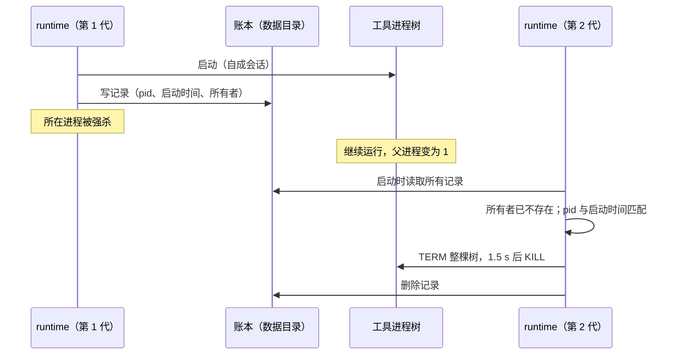

# 工具进程在 Host 异常退出后的回收

日期：2026-10-10。用户决定（[rust-unified-host.md](rust-unified-host.md) 10.1 的“进程”一行、D-U15）：账本加启动清扫，另加 Linux 与 Windows 的系统机制。

## 1. 问题

runtime 为 Bash 工具、hook、MCP stdio 服务启动子进程。正常停止时（取消、关闭会话、runtime 收口）由 runtime 主动结束整棵进程树（TERM，1.5 s 后 KILL）。

runtime 所在的进程被强杀或崩溃时，这段清理没有机会执行：

- Unix 上父进程退出不会带走子进程，子进程被过继给 1 号进程继续运行。
- 工具进程自成会话（为了能整棵树一起结束，也为了不占用终端），收不到任何随父进程而来的信号。
- 靠 stdin 通信的 MCP 服务读到 EOF 后多半自己退出；stdin 为空、很少输出的 Bash 命令不会察觉。

runtime 是独立进程时，Host 退出后它仍然存活，读到 stdin EOF 后自己收口。runtime 在 Host 进程内时两者同时消失，所以需要另一套保证。独立运行的 CLI 被强杀时同样受益。

## 2. 规则

### 2.1 账本

- runtime 每启动一棵自成会话或进程组的进程树，就在数据目录下的 `processes/` 里写一条记录（一棵树一个文件，原子创建）；这棵树结束并被确认回收后删除记录。
- 记录内容：

| 字段   | 含义                                                             |
| ------ | ---------------------------------------------------------------- |
| 根进程 | pid，以及操作系统给出的进程启动时间（用来识别 pid 被复用的情况） |
| 进程组 | 进程组 id（等于根 pid）                                          |
| 所有者 | 写下记录的进程的 pid，以及这个 runtime 实例的标识                |
| 用途   | bash、hook、mcp 等，只用于日志                                   |

- 账本只有 runtime 写，Host 与 Main 都不读写它。它是“我启动过、还没确认结束的进程树”的记录，不是业务状态。
- 账本不记录命令行、环境变量或任何可能含秘密的内容。

### 2.2 清扫

- 时机：runtime 实例启动时，在启动任何工具之前清扫一次。
- 对每条记录：

| 情况                                                             | 处理                                            |
| ---------------------------------------------------------------- | ----------------------------------------------- |
| 所有者进程仍存活，并且这个实例仍在运行（同进程内按实例标识判断） | 跳过：它属于一个正在运行的 runtime              |
| 根进程已不存在，或同一 pid 的启动时间与记录不符                  | 只删除记录：进程已结束，或 pid 已被别的进程复用 |
| 所有者已不存在（或实例已结束），根进程仍是记录的那个             | 结束整棵树（TERM，1.5 s 后 KILL），然后删除记录 |

- 永远不结束身份对不上的进程：pid 与启动时间必须同时匹配。
- 清扫的结果写日志（info：回收了几棵树；warn：结束失败的）。清扫失败不阻止 runtime 启动。
- 多个 runtime 实例可以同时清扫同一个目录：删除记录与结束进程都是幂等的。

### 2.3 系统机制

| 平台    | 机制                                                                                                                                                       |
| ------- | ---------------------------------------------------------------------------------------------------------------------------------------------------------- |
| Linux   | 工具进程树的根进程设置 `PR_SET_PDEATHSIG`：启动它的线程退出时收到 KILL。只有在确认启动工具进程的线程与进程同寿命时才启用（这个信号跟随的是线程而不是进程） |
| Windows | 工具进程放进设置了 `KILL_ON_JOB_CLOSE` 的 Job Object，句柄由 runtime 所在的进程持有，进程退出时整棵树结束                                                  |
| macOS   | 没有对应机制，只靠账本与清扫                                                                                                                               |

系统机制让进程在所有者退出的同时结束；账本与清扫负责系统机制覆盖不到的部分（macOS、已经离开根进程视线的后代在下次启动时按进程组处理）。

### 2.4 残留的时间

- Host 崩溃后 Main 自动重启它（约 0.5 s 起），新的 runtime 实例启动时清扫，残留进程最多存活到那时。
- 用户退出 App 时 Host 没能在期限内收口而被结束：残留进程存活到下一次启动 App。
- 独立运行的 CLI 被强杀：存活到下一次启动 CLI（同一数据目录）。

## 3. 状态所有者

| 状态                       | 所有者                                                                 |
| -------------------------- | ---------------------------------------------------------------------- |
| 账本目录与记录             | runtime（`zcode-proc` 提供读写与清扫，工具层在启动与结束进程树时调用） |
| 运行中实例的登记（进程内） | runtime 实例                                                           |

## 4. 验收

- 测试（macOS 与 Linux）：
  - 启动一棵进程树后模拟所有者消失：下一次清扫结束整棵树并删除记录。
  - 所有者仍在运行：清扫不动它的进程。
  - pid 被复用（启动时间不符）：不结束任何进程，只删除记录。
  - 进程正常结束：记录被删除，目录为空。
  - 端到端：强杀一个正在运行 Bash 命令的 runtime 进程，再次启动后该命令的进程不再存在。
- Linux 的 `PR_SET_PDEATHSIG` 与 Windows 的 Job Object 各有本平台的测试；在其他平台上只做交叉检查编译。

## 5. 不做

| 项                                 | 原因                                       |
| ---------------------------------- | ------------------------------------------ |
| 由 Main 记录并回收工具进程         | Main 会多一份监管状态，远端 Host 没有 Main |
| 为工具进程另起一个监护进程         | 增加常驻进程；账本加清扫已覆盖同样的场景   |
| 回收已经脱离进程组并自建会话的后代 | 无法可靠识别；与今天正常停止时的边界相同   |
