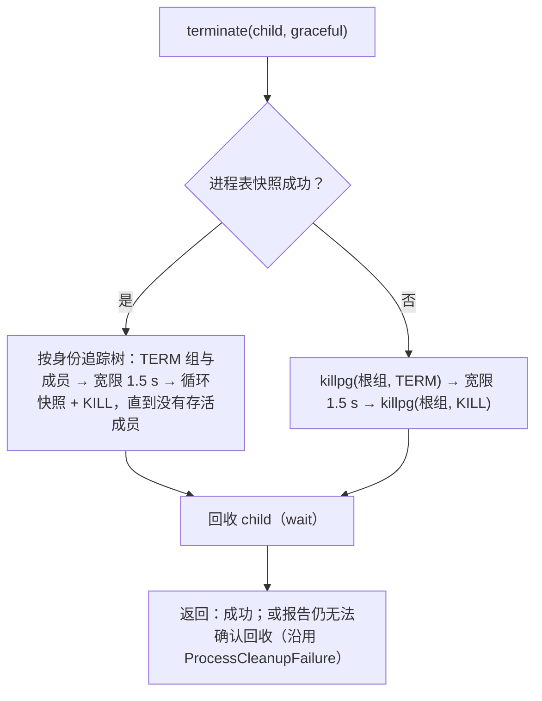

# U0：Rust 基础设施（护栏与基础 crate）

日期：2026-10-09。上级规划：[rust-unified-host.md](rust-unified-host.md) 的 U0；实践清单：[rust-engineering-practices.md](rust-engineering-practices.md) 第 10 节的第 1、2 步。分支：`feat/rust-u0-foundation`，基于 `feat/rust-host`（`9ae6fae`，已包含 workspace-scope 工作）。

## 1. 范围

**本期做**

- 第 1 步，护栏：E1–E6。工具链、构建配置、workspace lints、`clippy.toml`、stdout 保护、nextest、cargo-deny、cargo-shear、PR CI。
- 第 2 步，基础 crate 与缺陷修复：E7–E9。新建 `zcode-kit`、`zcode-async`、`zcode-proc` 三个 crate，两个应用改用它们，并修复第 4 节列出的已确认缺陷。

**本期不做**

| 项                                                                     | 放到哪里                           |
| ---------------------------------------------------------------------- | ---------------------------------- |
| 把 `apps/zcode-cli-rust`、`apps/zcode-host` 的 crate 迁入 `rust/`      | U1 开始前单独做一次机械迁移（3.1） |
| `zcode-net`、`zcode-sqlite`、`zcode-git`、`zcode-observe` 的抽取与去重 | U0 后续步骤                        |
| `TaskScope` 与 `tokio::spawn` 禁令；env / cwd 禁令                     | U2；U1                             |
| `unwrap` / `expect` 存量清理                                           | E14，按 crate 逐个推进             |
| 测试 harness（TestHost、mock 模型服务器）                              | 第 3 步                            |
| 输出头尾截断（R5 的一部分）                                            | 涉及与 Node 的输出一致性，单独决策 |
| Linux `PR_SET_PDEATHSIG`                                               | 见 4.3，暂不做                     |

## 2. 第 1 步：护栏

| 项              | 落地                                                                                                                                                                                                                                                          | 验收                                                              |
| --------------- | ------------------------------------------------------------------------------------------------------------------------------------------------------------------------------------------------------------------------------------------------------------- | ----------------------------------------------------------------- |
| 工具链          | 仓库根 `rust-toolchain.toml` 固定 `1.95.0`（与现有 Windows workflow 相同），组件 `clippy`、`rustfmt`、`rust-src`                                                                                                                                              | 三个 workspace 都使用该版本                                       |
| 构建配置        | 仓库根 `.cargo/config.toml`：Windows MSVC 目标的 `+crt-static`。workflow 中的 `RUSTFLAGS` 随之删除，避免环境变量覆盖配置                                                                                                                                      | 本地与 CI 得到同样的链接方式                                      |
| clippy 配置     | 仓库根 `clippy.toml`：测试中允许 `unwrap` / `expect` / 打印；`await-holding-invalid-types` 列出 tokio 的锁 guard；`disallowed-methods` 见第 3 节                                                                                                              | 三个 workspace 都读到同一份配置                                   |
| workspace lints | 三个 workspace 的 `[workspace.lints.clippy]` 统一为 rust-engineering-practices.md 2.1 中“直接 deny”的列表，外加 `print_stdout`、`print_stderr`；存量违例全部修掉（多数可自动修复）。`unwrap_used` / `expect_used` 只在非测试代码为 0 的 crate 中按 crate 开启 | `cargo clippy --all-targets -- -D warnings` 在三个 workspace 通过 |
| 测试运行        | 各 workspace 的 `.config/nextest.toml`：失败重试 1 次、慢测试 30 s 报告并在 60 s 时终止、JUnit 输出、子进程密集的测试分组限流；测试脚本改用 `cargo nextest run`，doctest 另用 `cargo test --doc`                                                              | 现有测试在 nextest 下全部通过                                     |
| 依赖检查        | 仓库根 `deny.toml`（安全公告、许可证白名单、重复版本告警），每条忽略都写明理由；cargo-shear 清理未使用的依赖                                                                                                                                                  | `cargo deny check` 与 `cargo shear` 在三个 workspace 通过         |
| 汇总命令        | `pnpm check:rust`：边界检查、fmt、clippy、cargo-deny、cargo-shear，覆盖三个 workspace；`pnpm test:rust`：`rust/` workspace 的测试                                                                                                                             | 本地一条命令得到与 CI 相同的结论                                  |
| PR CI           | `.github/workflows/rust-ci.yml`：按路径过滤；Linux 上跑静态检查；Linux / macOS / Windows 上跑 clippy；Linux / macOS 上跑三个 workspace 的测试，Windows 先只跑 `rust/` 与原有两个 crate 的测试；最后由 `required` job 汇总                                     | workflow 语法有效；实际运行结果以首次 PR 为准                     |

Windows 测试范围先与现有 `rust-npm-windows.yml` 对齐，因为其余 crate 的测试从未在 Windows 上运行过；扩大范围单独推进。

## 3. 第 2 步：基础 crate

### 3.1 位置

新 crate 放在仓库根的 `rust/` workspace（`rust/crates/<name>`），即 rust-unified-host.md D-U11 推荐的最终位置。两个应用 workspace 通过路径依赖使用它们，与 Host 现在引用 `zcode-cli-domain` 的方式相同。应用 crate 本期不迁移：迁移是纯机械改动，会让并行分支的合并全部冲突，所以在 U1 开始前，选一个没有并行分支的时间点单独完成。

依赖方向：`rust/` 下的 crate 不依赖任何应用 crate（由边界检查保证）。

### 3.2 `zcode-kit`

```rust
pub mod fs {
    /// 原子写：同目录 create_new 临时文件 → 写入 → sync_all → rename → fsync 父目录（Unix）。
    /// 任一步失败都删除临时文件；目标文件要么是旧内容，要么是新内容。
    pub async fn atomic_write(path: &Path, bytes: &[u8], options: WriteOptions) -> io::Result<()>;
    pub fn atomic_write_sync(path: &Path, bytes: &[u8], options: WriteOptions) -> io::Result<()>;
    pub struct WriteOptions { pub mode: Option<u32> /* Unix 权限，如 0o600 */ }
}
pub mod paths {
    /// HOME → USERPROFILE（Windows）→ 系统用户数据库（Unix getpwuid_r）；都拿不到时报错，绝不返回空路径。
    pub fn home_dir() -> io::Result<PathBuf>;
    /// `~` 与 `~/…`（Windows 也接受 `~\…`）展开为 home 下的路径；其余原样返回。
    pub fn expand_home(input: &str, home: &Path) -> PathBuf;
}
pub mod secret {
    /// Debug / Display 输出 `<redacted>`；序列化为原值（发给 provider 时需要）。取值只能经 `expose()`。
    pub struct RedactedString(String);
}
pub mod redact {
    /// 按值脱敏：`sk-…`、`Bearer …`、`AKIA…`、`ghp_…` 等形态替换为 `[REDACTED]`。
    pub fn redact_secrets(text: &str) -> Cow<'_, str>;
}
```

迁移：

- CLI 中手写的原子写（`plugins/src/{atomic_write,config_file}.rs`、`net/src/device.rs`、`host/src/{trust_store,hook_toggle}.rs`、`tools/src/{file_write,file_rewind,tools,checkpoint_blobs}.rs` 等）改用 `atomic_write`。各处原有的权限语义保留：原本写 0600 的继续写 0600，原本沿用已有文件权限的继续沿用。
- Host `services/src/store/atomic.rs` 的写入部分改用 `atomic_write`；锁目录协议不变。
- CLI 的 5 份 `home()` 改用 `paths::home_dir()`，`~` 展开改用 `expand_home`。Host 在 `HostEnvironment` 的构造中使用 `home_dir()`。
- CLI `ModelConfig` 的 API key 与 header 值改为 `RedactedString`。
- CLI `host/src/logging.rs` 与 Host `kit/src/log.rs`：日志文件以 0600 创建（Unix）；写入前对值调用 `redact_secrets`；CLI 退出时，若有丢弃的日志行，写一行 warn 记录数量。

### 3.3 `zcode-async`

```rust
/// 运行 future；panic 时返回 Err，并带上 panic 消息。用于“无论如何都要发出终态”的任务。
pub async fn catch_panic<F: Future>(future: F) -> Result<F::Output, Panicked>;
pub struct Panicked { pub message: String }
```

迁移：CLI `core/src/app` 中所有 `tokio::spawn` 出去、负责发送终态或延迟回复的任务（run、auxiliary、usage、mcp、plugins 等），都用 `catch_panic` 包住。panic 时照常发出 `Finished{error}`（run）或错误回复（延迟回复的请求）。

### 3.4 `zcode-proc`

```rust
/// 子进程的唯一入口（clippy disallowed-methods 保证）。本期只创建 Command，不改变任何默认行为；
/// U1 起在这里注入 RuntimeEnv。
pub fn command(program: impl AsRef<OsStr>) -> tokio::process::Command;
pub fn std_command(program: impl AsRef<OsStr>) -> std::process::Command;

pub mod shell {
    /// 跑一段 shell 文本：Unix `/bin/bash -c`；Windows `cmd.exe` 用 raw_arg `/d /s /c "<text>"`，
    /// 不经过 CRT 引号转义。
    pub fn script(text: &str) -> tokio::process::Command;
}
pub mod group {
    /// 让子进程成为新会话与新进程组的首进程（Unix `setsid`，EPERM 时退回 `setpgid(0, 0)`），
    /// 与 Node `spawn({detached: true})` 一致。Windows 无操作（由 Job 负责）。
    pub fn isolate(command: &mut tokio::process::Command);
}
pub mod tree {
    /// Unix：按身份（pid + 启动时间）追踪进程树，TERM → 宽限 → KILL。
    /// 进程表快照失败时退回 killpg(根进程组)，不能一个信号都不发。
    pub async fn terminate(child: &mut Child, graceful: bool) -> anyhow::Result<()>;
}
#[cfg(windows)]
pub mod job {
    /// Job Object：KILL_ON_JOB_CLOSE；terminate() 结束整棵树；Job 句柄关闭（含进程崩溃）时整棵树一起结束。
    pub struct Job;
}
```

迁移：

- CLI `tools/src/process_tree.rs` 整体移入 `zcode-proc::tree`。
- CLI 的 Bash 工具、hooks、MCP stdio、git、PDF 渲染、进程遥测，以及 Host 的 CLI 进程、git、终端 profile 探测：所有 `Command::new` 改为 `zcode_proc::command` / `std_command`。
- Bash 工具与 hooks 的子进程在 Unix 上改用 `group::isolate`（取代 `process_group(0)`），在 Windows 上加入 `Job`，结束时调用 `Job::terminate`；只有在加入 Job 失败时，才退回原来的 `taskkill /T /F`。

### 3.5 唯一入口规则（本期启用）

`clippy.toml` 的 `disallowed-methods`：

| 被禁止的调用                                                 | 唯一允许的位置 |
| ------------------------------------------------------------ | -------------- |
| `std::process::Command::new`、`tokio::process::Command::new` | `zcode-proc`   |

原子写暂不加禁令：`std::fs::rename` 还有移动文件等正当用途，按调用逐个判断的成本高于收益；改由评审规则保证。

## 4. 缺陷修复

每个缺陷先写一个在修复前失败的测试。

| #   | 缺陷                                                                                                                                                                              | 位置                                                            | 修复                                                                                          | 测试                                                               |
| --- | --------------------------------------------------------------------------------------------------------------------------------------------------------------------------------- | --------------------------------------------------------------- | --------------------------------------------------------------------------------------------- | ------------------------------------------------------------------ |
| B1  | run 任务 panic 后不发 `Finished`，会话永远停在 running，Engine 关闭时一直等待                                                                                                     | `core/src/app/run.rs`                                           | `catch_panic` 包住 agent loop，panic 转为错误，照常发 `Finished{error}`                       | 模型端口在流式中 panic：会话收到失败终态，随后可以继续发送         |
| B2  | Windows 上 Bash 工具经 CRT 引号转义调用 cmd.exe，命令中的 `"` 被改写成 cmd 不认识的 `\"`                                                                                          | `tools/src/tool_process.rs`                                     | `zcode_proc::shell::script` 使用 raw_arg                                                      | 构造出的命令行与 hooks 的现有写法一致（纯字符串测试，全平台运行）  |
| B3  | 终止进程树时，`/bin/ps` 快照失败（缺失、超时、超出预算）就直接返回错误，一个信号都没有发出                                                                                        | `tools/src/process_tree.rs`                                     | 快照失败时对根进程组执行 TERM → 宽限 → KILL，然后照常回收                                     | 注入失败的快照：子进程与它的子进程都被结束                         |
| B4  | `HOME` 为空时 `home()` 返回空路径，数据会写到当前工作目录下                                                                                                                       | CLI `src/lib.rs`、`src/runtime.rs` 等 5 处                      | `zcode_kit::paths::home_dir()`：回退到系统用户数据库，仍拿不到就报错                          | `HOME` 为空时的解析结果                                            |
| B5  | Host 对反向请求回复的 `error` 被当作 `result: null`，例如 provider 鉴权失败时，CLI 不带鉴权头继续请求                                                                             | `app-server/src/stdio.rs:56`、`core-api` `ClientMsg::HostReply` | `HostReply` 携带 `Result<Value, HostError>`；等待方收到错误后按请求失败处理，错误信息原样带回 | 鉴权反向请求回复 error：模型请求以该错误失败，不发出不带鉴权的请求 |
| B6  | 原子写实现不一致：有的不 fsync，有的不设权限                                                                                                                                      | 3.2 列出的各处                                                  | 统一使用 `atomic_write`                                                                       | `atomic_write` 自身的测试：失败时不留临时文件、权限正确、内容完整  |
| B7  | Bash 子进程使用 `process_group(0)`，没有脱离控制终端；在终端里运行 runtime 时，读取 `/dev/tty` 的 ssh / sudo / git 凭据提示会一直挂到超时。Node 用的是 `detached: true`（setsid） | `tools/src/tool_process.rs`                                     | `group::isolate`                                                                              | 子进程的 sid 等于自身 pid                                          |

### 4.1 B3 的终止顺序



退回 killpg 是安全的：只要进程组里还有成员，它的 ID 就不会被系统分配给新进程（Linux、macOS 都如此）；组已不存在时，killpg 返回 ESRCH，按已结束处理。

### 4.2 B5 的语义

- `HostError { code: i64, message: String, data: Option<Value> }`，按 JSON-RPC 的 `error` 对象解析。
- 鉴权反向请求（`interaction/requestProviderRuntimeHeaders`）收到错误：本次模型请求失败，错误信息就是 Host 给出的 message。与 TS CLI 一致（反向请求 reject，模型请求随之失败）。
- 其余反向请求：等待方收到 `Err`，按各自的失败路径处理，不再把错误当成空结果。
- 回复的 id 只接受字符串，这是 CLI 发出请求时自己生成的格式；收到其他类型的 id 记 warn 并丢弃。

### 4.3 暂不做 Linux `PR_SET_PDEATHSIG`

这个信号绑定在发起 spawn 的**线程**上，而不是进程上。tokio 的 blocking 线程池会回收空闲线程，从这类线程发起的子进程会在线程退出时被意外杀掉。要用它，必须保证所有 spawn 都发生在常驻线程上，这需要单独设计，不在本期范围。

## 5. 验证

- `pnpm check:rust` 与 `pnpm test:rust`；
- `pnpm check:zcode-cli-rust`、`pnpm test:zcode-cli-rust`、`pnpm test:rust-host`；
- `pnpm typecheck`、`pnpm lint`、`pnpm fmt:check`、`pnpm architecture:check --changed`；
- Windows 代码路径：在 macOS 上对 `zcode-proc` 做 `cargo check --target x86_64-pc-windows-msvc`；实际运行依赖 CI 的 Windows job，报告中会如实说明。
