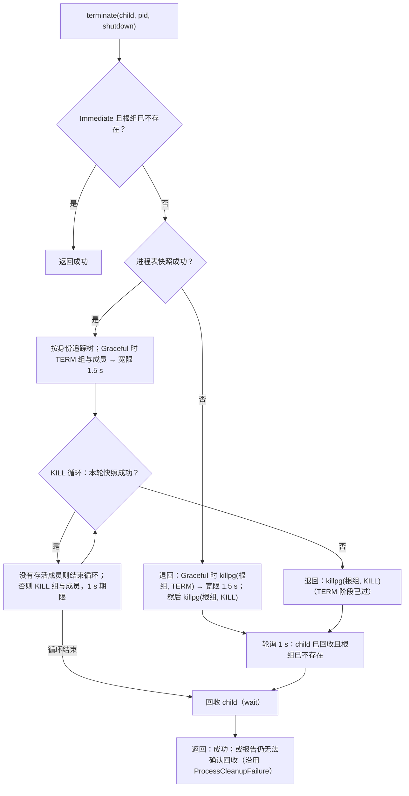

# U0：Rust 基础设施（护栏与基础 crate）

日期：2026-10-09。上级规划：[rust-unified-host.md](rust-unified-host.md) 的 U0；实践清单：[rust-engineering-practices.md](rust-engineering-practices.md) 第 10 节的第 1、2 步。分支：`feat/rust-u0-foundation`，基于 `feat/rust-host`（`9ae6fae`，已包含 workspace-scope 工作）。

## 1. 范围

**本期做**

- 第 1 步，护栏：E1–E6。工具链、构建配置、workspace lints、`clippy.toml`、stdout 保护、nextest、cargo-deny、cargo-shear、PR CI。
- 第 2 步，基础 crate 与缺陷修复：E7–E9。新建 `zcode-kit`、`zcode-async`、`zcode-proc` 三个 crate，两个应用改用它们，并修复第 4 节列出的已确认缺陷。

**本期不做**

| 项                                                                     | 放到哪里                           |
| ---------------------------------------------------------------------- | ---------------------------------- |
| 把 `apps/zcode-cli-rust`、`apps/zcode-host` 的 crate 迁入 `rust/`      | U1 开始前单独做一次机械迁移（3.1） |
| `zcode-net`、`zcode-sqlite`、`zcode-git`、`zcode-observe` 的抽取与去重 | U0 后续步骤                        |
| `TaskScope` 与 `tokio::spawn` 禁令；env / cwd 禁令                     | U2；U1                             |
| `unwrap` / `expect` 存量清理                                           | E14，按 crate 逐个推进             |
| 测试 harness（TestHost、mock 模型服务器）                              | 第 3 步                            |
| 输出头尾截断（R5 的一部分）                                            | 涉及与 Node 的输出一致性，单独决策 |
| Linux `PR_SET_PDEATHSIG`                                               | 见 4.3，暂不做                     |

## 2. 第 1 步：护栏

| 项              | 落地                                                                                                                                                                                                                                                          | 验收                                                              |
| --------------- | ------------------------------------------------------------------------------------------------------------------------------------------------------------------------------------------------------------------------------------------------------------- | ----------------------------------------------------------------- |
| 工具链          | 仓库根 `rust-toolchain.toml` 固定 `1.95.0`（与现有 Windows workflow 相同），组件 `clippy`、`rustfmt`、`rust-src`                                                                                                                                              | 三个 workspace 都使用该版本                                       |
| 构建配置        | 仓库根 `.cargo/config.toml`：Windows MSVC 目标的 `+crt-static`。workflow 中的 `RUSTFLAGS` 随之删除，避免环境变量覆盖配置                                                                                                                                      | 本地与 CI 得到同样的链接方式                                      |
| clippy 配置     | 仓库根 `clippy.toml`：测试中允许 `unwrap` / `expect` / 打印；`await-holding-invalid-types` 列出 tokio 的锁 guard；`disallowed-methods` 见第 3 节                                                                                                              | 三个 workspace 都读到同一份配置                                   |
| workspace lints | 三个 workspace 的 `[workspace.lints.clippy]` 统一为 rust-engineering-practices.md 2.1 中“直接 deny”的列表，外加 `print_stdout`、`print_stderr`；存量违例全部修掉（多数可自动修复）。`unwrap_used` / `expect_used` 只在非测试代码为 0 的 crate 中按 crate 开启 | `cargo clippy --all-targets -- -D warnings` 在三个 workspace 通过 |
| 测试运行        | 各 workspace 的 `.config/nextest.toml`：失败重试 1 次、慢测试 30 s 报告并在 60 s 时终止、JUnit 输出、子进程密集的测试分组限流；测试脚本改用 `cargo nextest run`，doctest 另用 `cargo test --doc`                                                              | 现有测试在 nextest 下全部通过                                     |
| 依赖检查        | 仓库根 `deny.toml`（安全公告、许可证白名单、重复版本告警），每条忽略都写明理由；cargo-shear 清理未使用的依赖                                                                                                                                                  | `cargo deny check` 与 `cargo shear` 在三个 workspace 通过         |
| 汇总命令        | `pnpm check:rust`：边界检查、fmt、clippy、cargo-deny、cargo-shear，覆盖三个 workspace；`pnpm test:rust`：`rust/` workspace 的测试                                                                                                                             | 本地一条命令得到与 CI 相同的结论                                  |
| PR CI           | `.github/workflows/rust-ci.yml`：按路径过滤；Linux 上跑静态检查；Linux / macOS / Windows 上跑 clippy；Linux / macOS 上跑三个 workspace 的测试，Windows 先只跑 `rust/` 与原有两个 crate 的测试；最后由 `required` job 汇总                                     | workflow 语法有效；实际运行结果以首次 PR 为准                     |

Windows 测试范围先与现有 `rust-npm-windows.yml` 对齐，因为其余 crate 的测试从未在 Windows 上运行过；扩大范围单独推进。

## 3. 第 2 步：基础 crate

### 3.1 位置

新 crate 放在仓库根的 `rust/` workspace（`rust/crates/<name>`）。两个应用 workspace 通过路径依赖使用它们。三个 workspace 保持独立、不合并（D-U11 按 D-U13 修订）：两边都要用的代码放在这里，不放在任何一方（[rust-host-cli-boundary.md](rust-host-cli-boundary.md) §3.1）。目前有 `zcode-kit`、`zcode-async`、`zcode-proc` 与 `zcode-shared`（§3.6）。

依赖方向：`rust/` 下的 crate 不依赖任何应用 crate（`scripts/rust/check-foundation-boundaries.mjs` 与 `scripts/rust/check-host-cli-boundary.mjs` 检查）。

### 3.2 `zcode-kit`

```rust
pub mod fs {
    /// 原子写：同目录 create_new 临时文件 → 写入 → sync_all → rename（按表重试）→ fsync 父目录（Unix，尽力而为）。
    /// 任一步失败都删除临时文件；目标文件要么是旧内容，要么是新内容。
    pub async fn atomic_write(path: &Path, bytes: &[u8], options: WriteOptions) -> io::Result<()>;
    pub struct WriteOptions {
        pub mode: FileMode,                  // Default（0o666 & !umask）| Private（Unix 恰好 0600）
        pub temp_name: TempName,             // Hidden `.<name>.<pid>.<ms>.<rand>.tmp` | Visible（不带前导点）
        pub parent: ParentDir,               // Existing | Create（create_dir_all）
        pub rename_retry: &'static [Duration], // PermissionDenied / ResourceBusy / Windows 32、33 时依次等待后重试
    }
}
pub mod paths {
    /// HOME → USERPROFILE → 系统用户数据库（Unix getpwuid_r）；空值视为未设置；都拿不到时报错，绝不返回空路径。
    pub fn home_dir() -> io::Result<PathBuf>;
    /// 同上，环境变量从 lookup 读取（composition root 捕获的环境快照，例如 Host 的 HostEnvironment）。
    pub fn home_dir_with(lookup: impl Fn(&str) -> Option<OsString>) -> io::Result<PathBuf>;
    /// `~` 与 `~/…`（Windows 也接受 `~\…`）展开为 home 下的路径；`~user` 与其余原样返回。
    pub fn expand_home(input: &str, home: &Path) -> PathBuf;
}
pub mod secret {
    /// Debug / Display 输出 `<redacted>`；serde 按原值透明序列化（发给 provider 时需要）。取值只能经 `expose()`。
    pub struct RedactedString(String); // new(impl Into<String>)、expose(&self) -> &str
}
pub mod redact {
    /// 按值脱敏（规则移植自 Codex secrets/sanitizer.rs，补充 GitHub token 与 `sk-proj-` / `sk-ant-`）：
    /// `Bearer …`、`sk-…`、`AKIA…`、`gh[pousr]_…`、`github_pat_…`、`api_key=… / token: …` 等替换为 `[REDACTED]`。
    /// 没有命中时返回 `Cow::Borrowed`。
    pub fn redact_secrets(text: &str) -> Cow<'_, str>;
}
/// 与 JavaScript 语义一致的文本工具（原在 CLI 的 domain，Host 也要用；rust-host-cli-boundary.md §3.1）。
pub mod js {
    /// JS `\s` / `trim` 的空白集合（含 U+FEFF、不含 U+0085）、`trim`、不拆字符的 UTF-16 前缀、
    /// Node `sanitizeText`、ECMAScript `GetSubstitution`。
    pub mod string { /* is_space、trim、utf16_prefix、sanitize_message、substitute */ }
    /// `JSON.stringify`：数组下标键按数值升序在前，数字用 ECMAScript `Number::toString` 的形式。
    pub mod json { /* stringify、encode、js_double */ }
    /// `new Date(ms).toISOString()`。
    pub fn iso_timestamp(ms: u64) -> String;
}
```

`js::json` 依赖 `serde_json` 的 `preserve_order`（按插入顺序输出键），`rust/` 与两个应用 workspace 都打开它。

`atomic_write` 只提供异步版本：迁移的调用处都是异步的，同步版本等有调用方时再加。持久性比 Node 的
`atomicWriteText` / `atomicWritePrivateTextFile` 强（多了临时文件与父目录的 fsync）；内容、权限、临时文件命名与
Node 一致，Node 与 Rust 交替写同一个文件时，Node 的过期临时文件清理（`<name>.*.tmp`）照常生效。

迁移（原子写，B6）：

| 调用处                                             | 选项                                                            | 行为变化                                            |
| -------------------------------------------------- | --------------------------------------------------------------- | --------------------------------------------------- |
| CLI `host/src/trust_store.rs`                      | Private、Hidden、Existing（目录由锁流程建并设 0700）、50…800 ms | 增加父目录 fsync；0600 改为 rename 前对临时文件设置 |
| CLI `host/src/hook_toggle.rs`                      | Private、Hidden、Create、不重试                                 | 增加父目录 fsync                                    |
| CLI `plugins/src/config_file.rs`                   | Private、Hidden、Create、不重试                                 | 增加父目录 fsync；建目录失败也带上下文信息          |
| CLI `net/src/device.rs`（telemetry-state.json）    | Default、Hidden、Existing、不重试（与 Node 相同权限）           | 增加临时文件与父目录 fsync                          |
| Host `store/atomic.rs` `atomic_write_text`         | Default、Visible、Existing、50…3200 ms                          | 增加 fsync；锁与过期临时文件清理仍在 Host，包在外层 |
| Host `store/atomic.rs` `atomic_write_private_text` | Private、Hidden、Create、50…800 ms                              | 增加 fsync；临时文件改为 create_new、恰好 0600      |

不迁移（语义不同，不是“临时文件 + rename 替换”）：

- `plugins/src/atomic_write.rs`：Node `writeFileAtomically` 的事务协议（stage、备份、sidecar 事务记录与回滚）。
- `tools/src/file_write.rs`：Write 工具沿用目标文件的已有权限，并在 rename 前核对观察到的版本（防止覆盖外部写入）。
- `tools/src/checkpoint_blobs.rs`：按内容寻址的 blob，已 fsync 文件与父目录，已存在即复用。
- `tools/src/file_rewind.rs`：rewind journal 的恢复协议（固定 `.tmp` 名，写后逐个恢复文件与权限）。
- `tools/src/tools.rs` 的 `agent.output`、`state/src/node/artifacts.rs`：一次性产物，路径与临时名由 Node 的查找规则决定（artifacts 的临时名不能含 artifact id）。

迁移（其余）：

- CLI 的 4 份用于定位数据目录的 `home()`（`src/lib.rs`、`src/runtime.rs`、`tools/src/extension_config.rs`、`host/src/storage_paths.rs`）改用 `paths::home_dir()`：`app-server` 与 `-p` 在入口解析一次（日志初始化之前），失败时报错退出；`storage_paths::resolve` 改为接收这个 home。`~` 展开统一用 `expand_home`，各调用处原有的相对路径基准不变（storage 相对 cwd，extension 配置相对各自的 base）；裸 `~` 现在展开为 home（以前被当作名为 `~` 的相对路径）。`tools/src/plugin_io.rs` 的 `home()` 不迁移：它是交给插件来源与模板的 Node `process.env.HOME`（未设置时为空），不是数据目录，保持与 Node 一致。`lib.rs` 的 `egress()` / `workspace_tools()` 改为返回 `Result`。
- Host `HostEnvironment::capture` 用 `home_dir_with` 读捕获的环境快照（仍先 trim），缺失时退回系统用户数据库，返回 `io::Result`；`main.rs` 在启动时传播错误。
- CLI `ModelConfig.api_key_value` 与 `headers` 的值改为 `RedactedString`。
- CLI `host/src/logging.rs`：新日志文件以 0600 创建，旧文件打开时收紧到 0600（Unix）；字符串字段、消息与错误文本写入前经 `redact_secrets`（原有的按字段名脱敏保留）；退出时的 Flush 若发现丢弃过日志行，写一行 `logging.lines_dropped` warn 记录数量（队列满时由临时线程等待空位，仍以 1 s 为上限）。
- Host `kit/src/log.rs`：发给 Main 的日志与 stderr 输出都经 `redact_secrets`；Host 不自己创建日志文件（Main 落盘），无文件权限可设。

### 3.3 `zcode-async`

```rust
/// 运行 future；panic 时返回 Err，并带上 panic 消息。用于“无论如何都要发出终态”的任务。
pub async fn catch_panic<F: Future>(future: F) -> Result<F::Output, Panicked>;
pub struct Panicked { pub message: String }
```

迁移：CLI `core/src/app` 中所有 `tokio::spawn` 出去、负责发送终态或延迟回复的任务（run、auxiliary、usage、mcp、plugins 等），都用 `catch_panic` 包住。panic 时照常发出 `Finished{error}`（run）或错误回复（延迟回复的请求）。

### 3.4 `zcode-proc`

```rust
/// 子进程的唯一入口（clippy disallowed-methods 保证）。本期只创建 Command，不改变任何默认行为；
/// U1 起在这里注入 RuntimeEnv。
pub fn command(program: impl AsRef<OsStr>) -> tokio::process::Command;
pub fn std_command(program: impl AsRef<OsStr>) -> std::process::Command;

pub mod shell {
    /// 跑一段 shell 文本：Unix `/bin/bash -c`；Windows `cmd.exe` 用 raw_arg 传入 `cmd_exe_arguments(text)`，
    /// 不经过 CRT 引号转义。
    pub fn script(text: &str) -> tokio::process::Command;
    /// cmd.exe 的完整参数 `/d /s /c "<text>"`（纯函数，全平台可测）；hooks 选用 cmd.exe 时也用它。
    pub fn cmd_exe_arguments(text: &str) -> String;
}
pub mod group {
    /// 让子进程成为新会话与新进程组的首进程（Unix `setsid`，EPERM 时退回 `setpgid(0, 0)`），
    /// 与 Node `spawn({detached: true})` 一致。不与 `process_group(..)` 同用。Windows 无操作（由 Job 负责）。
    pub fn isolate(command: &mut tokio::process::Command);
}
pub mod tree {
    /// 两个平台都可用；Windows 上两种方式相同（Job / taskkill 没有 TERM 阶段）。
    pub enum Shutdown {
        /// TERM → 宽限 1.5 s → KILL。取消、超时、主动关闭。
        Graceful,
        /// 根进程已自行退出：根进程组已不存在时直接返回，否则不发 TERM，直接 KILL 残留成员。
        Immediate,
    }
    /// Unix：按身份（pid + 启动时间）追踪进程树并回收 child。进程表快照失败时退回 killpg(根进程组)，
    /// 不能一个信号都不发（4.1）。`pid` 单独传入：child 已被 wait 回收后 `Child::id()` 为 None，
    /// 残留的后代仍要清理。返回错误表示无法确认回收，调用方沿用 ProcessCleanupFailure。
    #[cfg(unix)]
    pub async fn terminate(child: &mut Child, pid: u32, shutdown: Shutdown) -> anyhow::Result<()>;
}
#[cfg(windows)]
pub mod job {
    /// Job Object：KILL_ON_JOB_CLOSE；terminate() 结束整棵树（退出码 1，与 taskkill /F 相同）；
    /// Job 被 drop（含本进程崩溃，句柄由系统关闭）时其中仍在运行的进程一起结束。
    pub struct Job;
    impl Job {
        pub fn new() -> io::Result<Self>;
        /// 紧接 spawn 调用：加入不是追溯的，之前已创建的后代不在 Job 中。child 已回收时报错。
        pub fn assign(&self, child: &Child) -> io::Result<()>;
        pub fn terminate(&self) -> io::Result<()>;
    }
}
```

迁移：

- CLI `tools/src/process_tree.rs` 整体移入 `zcode-proc::tree`。
- CLI 的 Bash 工具、hooks、MCP stdio、git、PDF 渲染、进程遥测，以及 Host 的 CLI 进程、git、终端 profile 探测：所有 `Command::new` 改为 `zcode_proc::command` / `std_command`。
- Bash 工具与 hooks 的子进程在 Unix 上改用 `group::isolate`（取代 `process_group(0)`）。Windows 上只有 Bash 工具加入 `Job`，结束时调用 `Job::terminate`，加入 Job 失败时退回原来的 `taskkill /T /F`；hooks 仍用 `taskkill`（见下文）。Bash、hooks、MCP 的结束方式收在 `tools/src/tool_process.rs` 的 `ProcessTree` 中。
- MCP stdio 本期不变：Unix 仍是 `process_group(0)` + `tree::terminate`，Windows 仍是 `taskkill /T /F`（`ProcessTree::uncontained`）。
- 各平台的结束时机不变：Bash 工具在 Unix 上命令完成且根进程组已不存在时直接返回，否则 `Immediate` 清理残留；Windows 上每条命令结束后都结束整棵树。hooks 只在取消、超时或根进程退出 1 s 后管道仍未关闭时结束进程树。

Windows 上的行为变化（CI 的 Windows job 验证 `zcode-proc` 本身；应用 crate 的这部分代码只有 clippy 覆盖）：

- Bash 工具：根进程退出后，`taskkill /PID <根> /T` 已找不到根进程，后台后代会遗留；Job 不依赖父子关系，现在一起结束，与 Unix 一致。
- hooks 不加入 Job：Job 在 hook 运行结束时被 drop，会连带结束 hook 留下的后台进程（如 `start /b` 启动并重定向了输出的进程），而原来的 Windows 行为和 Unix 都不会这样。为不引入这个行为变化，hooks 继续用 `taskkill /T /F`。
- runtime 进程崩溃时，系统关闭 Job 句柄，正在运行的 Bash 工具进程树一起结束。

### 3.5 唯一入口规则（本期启用）

`clippy.toml` 的 `disallowed-methods`：

| 被禁止的调用                                                 | 唯一允许的位置 |
| ------------------------------------------------------------ | -------------- |
| `std::process::Command::new`、`tokio::process::Command::new` | `zcode-proc`   |

测试代码同样适用：测试经 `zcode-proc`（dev-dependency）创建子进程，不另加 `#[expect]` 豁免；`zcode-proc` 内两个构造函数是仅有的 `#[expect(clippy::disallowed_methods)]`。

原子写暂不加禁令：`std::fs::rename` 还有移动文件等正当用途，按调用逐个判断的成本高于收益；改由评审规则保证。

### 3.6 `zcode-shared`

CLI 与 Host 共用的产品级格式与规则：只有数据与规则，不做 IO、不持有状态，也不依赖任何应用 crate。

| 模块                 | 内容                                                                              | 来源（原在 CLI 的 domain） |
| -------------------- | --------------------------------------------------------------------------------- | -------------------------- |
| `workspace_identity` | `Workspace`（key / path）、远程 identity 解析 `parse_remote`                      | `workspace_identity.rs`    |
| `option_map`         | provider 选项映射的受限 CEL 表达式：`evaluate`、`merge_patch`、`validate_patches` | `option_map.rs`            |
| `hook_trust`         | 项目 hook 信任记录 `Record` 与信任存储文件的严格解析、序列化（`parse_store` 等）  | `hooks/trust_record.rs`    |

CLI 的 `domain` 按原路径重新导出（`domain::{workspace_identity, option_map}`、`domain::hooks::trust::{Record, …}`），runtime 内部的引用不变；Host 直接依赖 `zcode-shared`。`hooks/trust.rs` 的信任评估（`evaluate`、`grant_records`、`AdmissionView`）用到 domain 的 hook 快照，留在 CLI；它与存储文件格式的对拍测试（`fixtures/workspace-hooks.json`）也留在 domain，经重新导出覆盖 `hook_trust`。

移入 `rust/` 时去掉了 `unwrap()`（`rust/` 禁止），改为等价的写法，行为不变。

## 4. 缺陷修复

每个缺陷先写一个在修复前失败的测试。

| #   | 缺陷                                                                                                                                                                                                                                                     | 位置                                                                             | 修复                                                                                                       | 测试                                                                      |
| --- | -------------------------------------------------------------------------------------------------------------------------------------------------------------------------------------------------------------------------------------------------------- | -------------------------------------------------------------------------------- | ---------------------------------------------------------------------------------------------------------- | ------------------------------------------------------------------------- |
| B1  | run 任务 panic 后不发 `Finished`，会话永远停在 running，Engine 关闭时一直等待                                                                                                                                                                            | `core/src/app/run.rs`                                                            | `catch_panic` 包住 agent loop，panic 转为错误，照常发 `Finished{error}`                                    | 模型端口在流式中 panic：会话收到失败终态，随后可以继续发送                |
| B2  | Windows 上 Bash 工具经 CRT 引号转义调用 cmd.exe，命令中的 `"` 被改写成 cmd 不认识的 `\"`                                                                                                                                                                 | `tools/src/tool_process.rs`                                                      | `zcode_proc::shell::script` 使用 raw_arg                                                                   | 构造出的命令行与 hooks 的现有写法一致（纯字符串测试，全平台运行）         |
| B3  | 终止进程树时，`/bin/ps` 快照失败（缺失、超时、超出预算）就直接返回错误，一个信号都没有发出                                                                                                                                                               | `tools/src/process_tree.rs`                                                      | 快照失败时对根进程组执行 TERM → 宽限 → KILL，然后照常回收                                                  | 注入失败的快照：子进程与它的子进程都被结束                                |
| B4  | `HOME` 为空时 `home()` 返回空路径，数据会写到当前工作目录下                                                                                                                                                                                              | CLI `src/lib.rs`、`src/runtime.rs` 等 5 处                                       | `zcode_kit::paths::home_dir()`：回退到系统用户数据库，仍拿不到就报错                                       | `HOME` 为空时的解析结果                                                   |
| B5  | Host 对反向请求回复的 `error` 被当作 `result: null`：等待方只看到空结果，Host 给出的错误原因丢失。例如鉴权失败时只能报通用的“Provider authentication failed.”，TS CLI 则保留 Host 的错误（`provider-runtime-headers.ts` 明确要求不把根因改写成单一文案） | `app-server/src/stdio.rs`、`core-api` `Input::Response` / `ClientMsg::HostReply` | 应答携带 `Result<Value, HostError>`，一路传到等待方；Engine 收到错误应答时记录一次 Host 的 code 与 message | stdio 收到 error 应答时交给等待方的是 `Err(HostError)`，result 应答仍是值 |
| B6  | 原子写实现不一致：有的不 fsync，有的不设权限                                                                                                                                                                                                             | 3.2 列出的各处                                                                   | 统一使用 `atomic_write`                                                                                    | `atomic_write` 自身的测试：失败时不留临时文件、权限正确、内容完整         |
| B7  | Bash 子进程使用 `process_group(0)`，没有脱离控制终端；在终端里运行 runtime 时，读取 `/dev/tty` 的 ssh / sudo / git 凭据提示会一直挂到超时。Node 用的是 `detached: true`（setsid）                                                                        | `tools/src/tool_process.rs`                                                      | `group::isolate`                                                                                           | 子进程的 sid 等于自身 pid                                                 |

### 4.1 B3 的终止顺序



- 退回 killpg 是安全的：只要进程组里还有成员，它的 ID 就不会被系统分配给新进程（Linux、macOS 都如此）；组已不存在时，killpg 返回 ESRCH，按已结束处理。
- child 尚未回收时，退回路径同时直接对根 pid 发同一信号：此时 pid 仍属于本进程、不会被复用，根进程不是组长时也不会漏掉它。
- 退回路径上发信号失败不立即报错（macOS 上组内有无权发信号的成员时 killpg 返回 EPERM，其余成员仍会收到），以随后的轮询结果为准；期限内未结束则报告无法确认回收。
- 退回时记一条 warn（`tracing`），带快照失败的原因。
- 已离开根进程组的后代（自建会话或进程组）在退回路径上无法追踪，这是没有进程表时的已知限制。
- KILL 循环内为确认“发信号失败的拥有者已退出”而取的快照（原有逻辑）失败时，仍按原样返回错误。

### 4.2 B5 的语义

- `HostError { code: i64, message: String, data: Option<Value> }`（`zcode-cli-core-api`），按 JSON-RPC 的 `error` 对象解析；字段缺失时 code 为 -32603。
- 传递路径：stdio → `Input::Response` → `ClientMsg::HostReply` → Engine 的等待表 → `Event::RequestAuth` / `Event::HostCall` 的 `reply`，类型都是 `Result<Value, HostError>`。
- Engine 收到错误应答时记录一条 warn（`host.request.failed`，含请求 id、code、message；不记录 data）。
- 鉴权反向请求（`interaction/requestProviderRuntimeHeaders`）收到错误：本次模型请求按 `auth_failed` 失败，用户看到的文案暂不变；官方 MCP 鉴权收到错误：与没有应答一样按不可用处理。
- headless 没有 Host，以前用 `null` 应答反向请求，现在回复 `-32601` 错误，等待方的结果不变（鉴权失败 / 不可用）。
- **后续项**：让失败文案带上 Host 的 message，与 TS CLI 一致。`ModelFailure` 目前只携带静态文案，需要单独改结构。

### 4.3 暂不做 Linux `PR_SET_PDEATHSIG`

这个信号绑定在发起 spawn 的**线程**上，而不是进程上。tokio 的 blocking 线程池会回收空闲线程，从这类线程发起的子进程会在线程退出时被意外杀掉。要用它，必须保证所有 spawn 都发生在常驻线程上，这需要单独设计，不在本期范围。

## 5. 验证

- `pnpm check:rust` 与 `pnpm test:rust`；
- `pnpm check:zcode-cli-rust`、`pnpm test:zcode-cli-rust`、`pnpm test:rust-host`；
- `pnpm typecheck`、`pnpm lint`、`pnpm fmt:check`、`pnpm architecture:check --changed`；
- Windows 代码路径：在 macOS 上对 `zcode-proc` 做 `cargo check --target x86_64-pc-windows-msvc`；实际运行依赖 CI 的 Windows job，报告中会如实说明。
