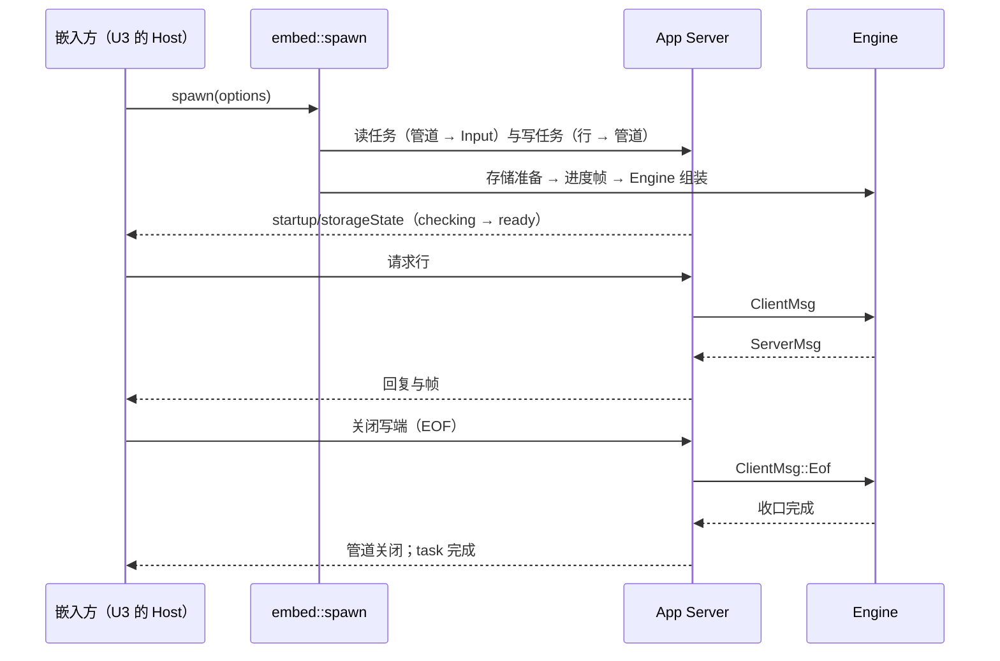
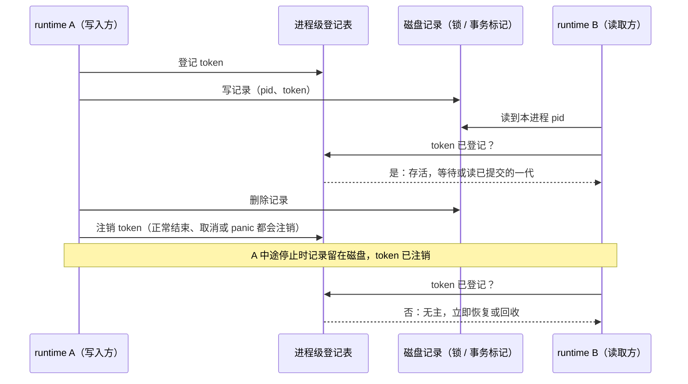

# U1：runtime 库化

日期：2026-10-09。上级规划：[rust-unified-host.md](rust-unified-host.md) 的 U1。基线：`feat/rust-unified-host`（U0 第 1、2 步之后）。

## 1. 目标

让 Rust runtime 可以作为库嵌进另一个进程（U3 的 Rust Host），并保持现有的 `app-server --stdio` 与 `-p` 行为不变。嵌入方必须能做到：

- 不经过子进程和 stdio，启动一个 runtime 并与它交换协议消息；
- 给 runtime 一份**显式的**环境（环境变量、home、数据目录、缺省 workspace），runtime 不再从进程环境、进程 cwd 读取任何东西；
- 在同一个进程里停掉一个 runtime 再启动一个新的（相当于今天重启 CLI 进程）。

## 2. 范围

**本期做**

| #   | 内容                                                                                                                                                                                                           |
| --- | -------------------------------------------------------------------------------------------------------------------------------------------------------------------------------------------------------------- |
| L1  | 组装代码迁入库：`zcode_cli_rust::runtime`（原 `src/runtime.rs`，此前只属于二进制）与 `zcode_cli_rust::serve`（原 `main.rs::app_server` 中与传输无关的部分）                                                    |
| L2  | App Server 的传输与 stdio 解耦：输入可以来自任意 `AsyncBufRead`，输出可以写到任意 `AsyncWrite`；stdin / stdout 线程实现保留给二进制                                                                            |
| L3  | 嵌入入口 `zcode_cli_rust::embed::spawn(options)`：在当前 tokio 运行时里启动 runtime 与 App Server，返回一条内存双工管道和任务句柄                                                                              |
| L4  | 清除进程全局读取：`apps/zcode-cli-rust/crates/**` 的非测试代码不再调用 `std::env::var*` 与 `current_dir`；需要的值来自 `RuntimeEnv` 快照或显式参数                                                             |
| L5  | 唯一入口规则：`clippy.toml` 的 `disallowed-methods` 禁止 `std::env::{var, var_os, vars, vars_os, current_dir}`；允许的位置（二进制入口、`zcode-kit` 的 home 解析、Host 的环境捕获）逐处用 `#[expect]` 标注理由 |
| L6  | 同进程重启的正确性：进程级静态量与以 PID 标识的锁 owner，在“旧 runtime 已停、新 runtime 启动”时不会互相阻塞                                                                                                    |

**本期不做**（记入 U3 或之后）

| 项                                     | 原因                                                                                                                                         |
| -------------------------------------- | -------------------------------------------------------------------------------------------------------------------------------------------- |
| 类型化 sink（去掉“先拼字符串再解析”）  | 嵌入的第一阶段沿用 NDJSON 行，只是从管道改成内存；去掉序列化放在 U3 的第二阶段，届时 Host 的投递逻辑一起合并                                 |
| `Environment` trait（fs / exec / pty） | 远端采用“完整 Host”（D-U2），眼下没有第二种实现。本期只把执行环境做成显式的值（workspace 根目录加 `RuntimeEnv`），等出现第二种实现再抽 trait |
| 把 Engine 循环里的慢操作移出循环       | 改动会碰提交顺序的不变量。先在 U3 做测量（rust-unified-host.md 14.1 的验收），按结果逐个处理                                                 |
| Engine panic 后在进程内重建            | 由嵌入方负责：runtime 任务结束后链路关闭，Host 按“CLI 退出”的现有路径惰性重启（U3）                                                          |

## 3. 接口

```rust
// zcode_cli_rust::runtime
/// runtime 启动所需的全部外部事实。库内任何地方都不再读取进程环境或进程 cwd。
pub struct RuntimeOptions {
    pub home: PathBuf,
    /// runtime 看到的环境变量（含嵌入方注入的 ZCODE_* 配置）；库内经 `RuntimeEnv` 净化后使用。
    pub env: Vec<(String, String)>,
    pub argv: Vec<String>,
    /// 缺省 workspace 的路径（请求不带 workspace 时使用）与身份。
    pub cwd: PathBuf,
    pub workspace_identity: Option<String>,
    /// 相对路径（数据目录、配置里的 storage.dir）的解析基准；二进制传进程 cwd。
    pub base_dir: PathBuf,
    pub data_dir: PathBuf,
}

// zcode_cli_rust::serve
pub struct AppServerOptions {
    pub runtime: RuntimeOptions,
    pub config: Option<PathBuf>,      // --config 静态模型
    pub desktop: bool,                // --surface desktop
    pub prepare_storage: bool,        // --prepare-storage
}
/// 存储准备与进度帧、Engine 组装、App Server 路由；与传输无关。
pub async fn app_server(
    options: AppServerOptions,
    input: mpsc::Receiver<Input>,
    output: Sink,
    cancel: CancellationToken,
) -> Result<()>;

// zcode_cli_rust::embed
pub struct Embedded {
    /// 嵌入方一侧的管道：写入请求行，读出回复与帧（NDJSON，与 stdio 相同）。
    pub io: tokio::io::DuplexStream,
    /// runtime 结束时完成；错误即 runtime 的终止原因。
    pub task: tokio::task::JoinHandle<Result<()>>,
    /// 取消即请求 runtime 收口（等价于向 CLI 进程发 SIGTERM）。
    pub cancel: CancellationToken,
}
pub fn spawn(options: AppServerOptions) -> Embedded;
```

嵌入方关闭 `io` 的写端等价于 stdin EOF：runtime 取消运行中的 run、回收工具进程树、提交中断状态后结束（顺序不变）。

## 4. 状态所有者与顺序

| 状态                     | 所有者                                       | 相对今天                                |
| ------------------------ | -------------------------------------------- | --------------------------------------- |
| 进程环境、argv、进程 cwd | 二进制入口（`main.rs`、`prompt.rs`）         | 只在入口读取一次，写进 `RuntimeOptions` |
| runtime 看到的环境       | `RuntimeEnv`（由 `RuntimeOptions.env` 捕获） | 不变；所有 crate 改为只读它             |
| 全局 tracing subscriber  | 二进制入口                                   | 库不安装；嵌入方安装自己的              |
| rustls provider          | 先安装者                                     | 不变（重复安装的错误被忽略）            |
| 输出积压（backlog）      | `Sink`                                       | 管道写端与 stdout 写端使用同一套计数    |



## 5. 验收

- 现有测试全部通过：`pnpm check:rust`、`pnpm test:zcode-cli-rust`（Node 驱动的集成测试经真实二进制的 stdio）。
- 新测试（Rust，经 `embed::spawn`）：
  - 进程 cwd 与进程环境都与 runtime 的不同：runtime 使用 `RuntimeOptions` 给的值（数据目录、缺省 workspace、注入的环境变量）。
  - 同一个 runtime 里两个 workspace 各自创建会话并运行工具，文件落在各自的目录下。
  - 关闭写端后 `task` 正常完成；之后在同一进程再 `spawn` 一次可以正常服务（L6）。
- `std::env::var*` 与 `current_dir` 在 `apps/zcode-cli-rust/crates/**` 的非测试代码中为 0 处；`#[expect]` 标注的位置都在第 2 节 L5 列出的允许范围内。

## 6. L4–L6 的实现约定

### 6.1 值的来源（L4）

| 需要的值                            | 来源                                                                                                                    |
| ----------------------------------- | ----------------------------------------------------------------------------------------------------------------------- |
| 环境变量                            | `RuntimeEnv`：tools / model 经 `Egress::runtime_env()`；host crate 用调用方给的变量列表（如 `WorkspaceContext` 的 env） |
| home                                | `Egress::home()`（构造时传入的 runtime home）；`zcode_kit::paths::home_dir()` 只在二进制入口调用                        |
| 不属于任何 workspace 的相对路径基准 | `Egress::base_dir()`（二进制传进程 cwd）：设备文件的 `ZCODE_DATA_BASE_DIR`、provider 配置文件路径                       |
| workspace 内的相对路径基准          | 请求所在 workspace 的根（`WorkspaceTools` 的 cwd；plugins 经 `Ports.cwd`，对应 Node 的 `process.cwd()`）                |
| 日志选项                            | `LogOptions::from_env(home, lookup)`：变量由调用方查找，二进制传进程环境                                                |

- git 运行环境检查（`git_safety`）只接受绝对路径；相对路径无法在不读进程 cwd 的前提下确认，按不安全处理（fail-closed）。runtime 传入的工作目录总是绝对路径。
- 与此前读进程环境的差别都向 Node 对齐（Node 读的是净化后的 `process.env`）：被净化的代理与 CA 变量不再出现在插件模板、API key 与重试变量里；beta 入口的 `ZCODE_STORAGE_DIR` 缺省值对 agent profile 与 memory 生效。

### 6.2 同一进程里的多个 runtime（L6）

U3 第一阶段会在同一进程里同时运行多个 runtime（每个 workspace 一个 Engine），也会在旧 runtime 停止或 panic 后启动新的。它们共用进程 pid 与插件事务的 `OWNER_ID`，所以“记录里的 pid 是本进程”不能说明 owner 还活着。规则：

- **以 pid / `OWNER_ID` 标识 owner 的磁盘记录**（插件事务标记、hook 信任存储锁、设备 id 锁）同时写入一个进程内唯一的 token（插件事务用已有的 `transactionId`）。写入方先在进程级登记表里登记 token，再写记录；删除记录后注销。登记由 RAII 值持有，被取消或 panic 的 owner 在 drop 时注销。
- 读取方遇到本进程 pid 的记录时，token 已登记即视为存活（另一个 runtime 正在进行，不回滚、不清理）；未登记即无主，立即按无主规则恢复或回收（不再等待超时，也不再永远视为存活）。其他进程的记录仍按 Node 规则（pid 存活、启动时间、超时）判断。
- 进程级登记表用 `std::sync::Mutex`，只做单次插入与删除；中毒时用 `into_inner` 继续使用，一次 panic 不影响之后的 runtime。



| 进程级状态                                  | 旧 runtime 停止后启动新的                       | 多个 runtime 同时存活                             | 处理                             |
| ------------------------------------------- | ----------------------------------------------- | ------------------------------------------------- | -------------------------------- |
| plugins `OWNER_ID` + 事务标记               | 残留标记曾被永远视为存活，进程内不恢复          | 共用 `OWNER_ID`；以登记表区分，不误回滚对方的事务 | 修复：按 `transactionId` 登记    |
| plugins `ACTIVE` / `RESERVED`               | 由 `Activation` 的 drop 解除                    | 同一目标只允许一个激活，第二个报 already active   | 安全；中毒改为 `into_inner`      |
| plugins `LOCKS`（storage root 的 tokio 锁） | guard 随 future drop 释放                       | 同一 storage root 的变更在进程内串行              | 安全；外层中毒改为 `into_inner`  |
| hook 信任存储锁（pid + token）              | 残留锁曾在进程退出前无法回收                    | 另一个 runtime 持有时等待                         | 修复：token 登记表               |
| 设备 id 锁 `telemetry-state.lock`（pid）    | 残留锁曾要等 5 分钟，期间只能用进程内临时 id    | 另一个 runtime 持有时等待                         | 修复：写入 token，按登记表判断   |
| `official_auth` 的 `OnceLock`               | 字段属于每个 `WorkspaceTools`，不是进程级静态量 | 各 runtime 各自一条 Host 通道                     | 安全                             |
| `read_pdf` 的 pdftoppm 可用性缓存           | 新 runtime 的 PATH 可能不同                     | 各 runtime 的 PATH 可能不同                       | 修复：按 PATH 缓存（只缓存成功） |
| `process_clock` 的开机时间                  | 机器级常量                                      | 同左                                              | 安全                             |
