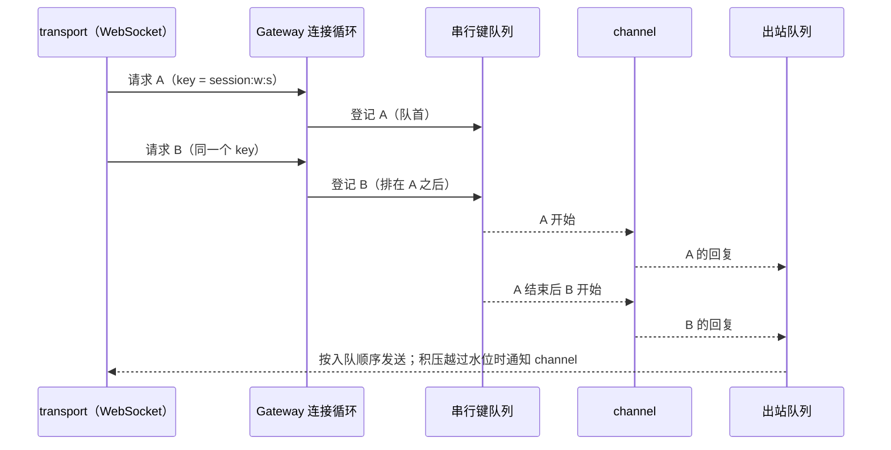

# U2：Gateway（连接、调用顺序与出站队列）

日期：2026-10-09。上级规划：[rust-unified-host.md](rust-unified-host.md) 6.3 与 U2。前置：[rust-u2-host-structure.md](rust-u2-host-structure.md)、[rust-u2-task-scope.md](rust-u2-task-scope.md)。

## 1. 现状与问题

今天一条连接的处理分在两处：`zcode-host/src/ws.rs`（握手、三条无界队列、计数任务、写任务、积压水位）与 `host-core/src/server.rs`（解析请求，每个调用 `tokio::spawn` 一个任务）。问题：

| #   | 问题                                                                                                                                                                             | 证据                                                               |
| --- | -------------------------------------------------------------------------------------------------------------------------------------------------------------------------------- | ------------------------------------------------------------------ |
| G1  | **调用顺序不保证**。同一连接上先后到达的两个调用各自是一个任务，在多线程运行时上谁先执行不确定。Node Host 按到达顺序开始处理。连续发出的两条会话命令可能以相反的顺序到达 runtime | 探针测试：同一连接连续 2000 个调用，639 对的执行顺序与到达顺序相反 |
| G2  | **出站队列无界**。Renderer 不读时，Host 为它缓存的字节没有上限。水位只通知 `zcode-agent` 暂停流式，其他事件源（终端输出、文件监听）不受约束                                      | `ws.rs` 的三条 `unbounded_channel`                                 |
| G3  | **连接上的任务没有归属**。调用与订阅的任务靠一张 `id → AbortHandle` 表回收；写任务、计数任务是分离的                                                                             | `server.rs` 的 `Active`，`ws.rs` 的两处 `tokio::spawn`             |
| G4  | **策略绑在 WebSocket 上**。积压水位在 `ws.rs` 里；U5 的 stdio 链路、测试用的进程内连接要重写一遍                                                                                 | `flow.rs` 在二进制 crate 里                                        |

## 2. 规则

### 2.1 结构

新 crate `zcode-host-gateway`，只依赖 `kit`、`rpc`、`control`、`zcode-async`，不认识任何业务 service。

| 组成       | 职责                                                                                                                       |
| ---------- | -------------------------------------------------------------------------------------------------------------------------- |
| 连接注册表 | 每条连接一项：连接 id、attachment 元数据（含窗口 id）、任务作用域、关闭开关。按 attachment id 关闭连接；供诊断列出当前连接 |
| 连接循环   | 解析请求，按 2.2 启动调用与订阅；连接关闭时按 2.4 收口                                                                     |
| 出站队列   | 2.3                                                                                                                        |
| 调用通道   | 2.2 的串行键                                                                                                               |

transport（今天只有 WebSocket）只做握手、鉴权与分帧，把一条已鉴权的字节流交给 Gateway：

```rust
impl Gateway {
    /// 接入一条已鉴权的连接。transport 把收到的完整 rpc 消息写进 `Connection::inbound`，
    /// 从 `Connection::outbound` 取出要发送的消息，每发完一条调用 `written`。
    pub fn connect(&self, meta: AttachmentMeta, registry: ChannelSource) -> Connection;
}
```

`host-core` 保留组装职责（启动顺序、存储准备、安装 service、远端 scope 的 channel 表解析）。

### 2.2 调用顺序：串行键

- channel 可以为一次调用声明串行键：`ServiceChannel::serial_key(context, method, args) -> Option<String>`，缺省 `None`。
- **有相同串行键的调用，按到达 Gateway 的顺序逐个执行**：前一个结束（完成、失败、被取消）后，下一个才开始。范围是整个 Host，不限于一条连接。
- 没有串行键的调用立即开始，互不等待（与今天相同）。
- 排队位置在请求到达时同步确定，不依赖任务调度。
- 排队中的调用被取消（客户端取消，或它的连接关闭）时直接离队，不会开始执行。
- `zcode-agent`：改变某个会话状态的方法（V4 命令、legacy 的会话写操作）使用 `session:<workspace key>:<session id>`；创建会话与只读方法不设键。其余 channel 暂不设键，发现顺序依赖时逐个补上，并在本节登记。

这只保证 Host 把请求按到达顺序交给 runtime；已接受输入的排队与 admission 仍由 runtime 的 `CommandInbox` 负责（AGENTS.md）。

### 2.3 出站队列

每条连接一个出站队列，按字节计数，由 Gateway 持有。

| 阈值           | 行为                                                                                                                        |
| -------------- | --------------------------------------------------------------------------------------------------------------------------- |
| 高水位 1 MiB   | 边沿通知各 channel `saturated`（不变）：`zcode-agent` 暂停该连接的流式投递并标记需要重新同步（rust-host-resilience.md 2.3） |
| 低水位 256 KiB | 边沿通知 `drained`（不变）                                                                                                  |
| 上限 256 MiB   | 关闭这条连接并记 warn。此时客户端已长时间不读（界面进程挂起）；继续缓存只会拖垮 Host。窗口重新加载后重新接入                |

- 队列顺序即发送顺序。回复与事件走同一个队列，保持它们之间的先后。
- 一条连接的积压不影响其他连接。

### 2.4 连接关闭

顺序：停止读取 → 排队中的调用离队 → 中止这条连接作用域里的任务（进行中的调用、订阅转发、写任务）→ 通知各 channel `connection_closed`（按连接持有状态的 channel 在这里清理，例如 V4 订阅归属、广播的 claim）。`connection_closed` 对每条连接恰好调用一次，且在该连接的任何调用任务结束之后。

### 2.5 状态所有者

| 状态                           | 所有者              |
| ------------------------------ | ------------------- |
| 连接表、连接作用域             | Gateway             |
| 出站队列与水位                 | Gateway（每连接）   |
| 串行键的队列                   | Gateway（Host 级）  |
| capability 签发与兑换          | `host-core`（不变） |
| channel 表（本地与远端 scope） | `host-core`（不变） |



## 3. 验收

- 测试（`zcode-host-gateway`）：
  - 同一串行键的 2000 个连续调用按到达顺序执行（修复前失败）；不同键并行；没有键的调用不被有键的调用阻塞。
  - 排队中的调用被取消后不执行；连接关闭后它排队的调用不执行，其他连接同一键的调用继续。
  - 水位边沿与今天相同；越过上限时只关闭这一条连接。
  - `connection_closed` 恰好一次，且晚于该连接所有调用任务的结束。
- `tokio::spawn` 不出现在 `zcode-host-gateway`、`host-core` 与 `zcode-host` 中（任务都在作用域里）。
- 现有测试、`pnpm test:rust-host`、桌面 E2E 全部通过；控制 RPC 的延迟测试（`control_latency`）不退化。

## 4. 本期不做

| 项                                                                        | 去向与原因                                                                                                                     |
| ------------------------------------------------------------------------- | ------------------------------------------------------------------------------------------------------------------------------ |
| 方法表宏（参数与结果类型、能力检查、向 TS 导出）与 `zcode-gateway-legacy` | U9（D-U5：从 U9 起以 Rust 方法表为契约来源）。在那之前契约来源仍是 TS，40 个 channel 继续由各 service 用 `ServiceBuilder` 注册 |
| 按连接能力过滤方法（手机默认不能用终端等）                                | U7                                                                                                                             |
| 投递策略对象（`Continuous` / `Replayable`）与两份 delivery 的合并         | U3 B 期，与进程内类型化链路一起做                                                                                              |
