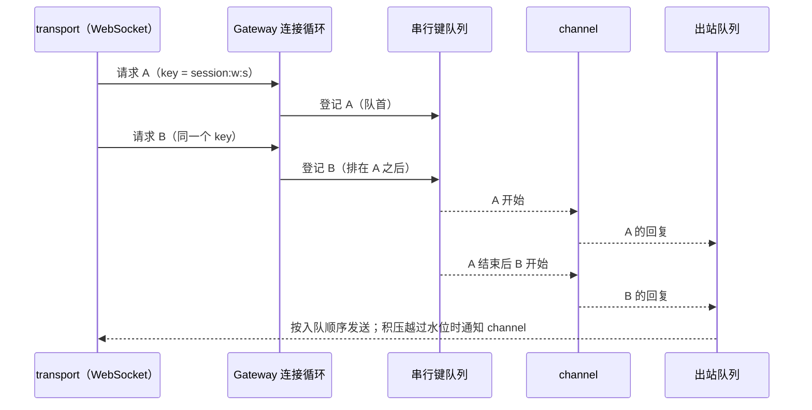

# U2：Gateway（连接、调用顺序与出站队列）

日期：2026-10-09。上级规划：[rust-unified-host.md](rust-unified-host.md) 6.3 与 U2。前置：[rust-u2-host-structure.md](rust-u2-host-structure.md)、[rust-u2-task-scope.md](rust-u2-task-scope.md)。

## 1. 现状与问题

今天一条连接的处理分在两处：`zcode-host/src/ws.rs`（握手、三条无界队列、计数任务、写任务、积压水位）与 `host-core/src/server.rs`（解析请求，每个调用 `tokio::spawn` 一个任务）。问题：

| #   | 问题                                                                                                                                                                             | 证据                                                               |
| --- | -------------------------------------------------------------------------------------------------------------------------------------------------------------------------------- | ------------------------------------------------------------------ |
| G1  | **调用顺序不保证**。同一连接上先后到达的两个调用各自是一个任务，在多线程运行时上谁先执行不确定。Node Host 按到达顺序开始处理。连续发出的两条会话命令可能以相反的顺序到达 runtime | 探针测试：同一连接连续 2000 个调用，639 对的执行顺序与到达顺序相反 |
| G2  | **出站队列无界**。Renderer 不读时，Host 为它缓存的字节没有上限。水位只通知 `zcode-agent` 暂停流式，其他事件源（终端输出、文件监听）不受约束                                      | `ws.rs` 的三条 `unbounded_channel`                                 |
| G3  | **连接上的任务没有归属**。调用与订阅的任务靠一张 `id → AbortHandle` 表回收；写任务、计数任务是分离的                                                                             | `server.rs` 的 `Active`，`ws.rs` 的两处 `tokio::spawn`             |
| G4  | **策略绑在 WebSocket 上**。积压水位在 `ws.rs` 里；U5 的 stdio 链路、测试用的进程内连接要重写一遍                                                                                 | `flow.rs` 在二进制 crate 里                                        |

## 2. 规则

### 2.1 结构

新 crate `zcode-host-gateway`，只依赖 `kit`、`rpc`、`control`、`zcode-async`，不认识任何业务 service。

| 组成       | 职责                                                                                                                       |
| ---------- | -------------------------------------------------------------------------------------------------------------------------- |
| 连接注册表 | 每条连接一项：连接 id、attachment 元数据（含窗口 id）、任务作用域、关闭开关。按 attachment id 关闭连接；供诊断列出当前连接 |
| 连接循环   | 解析请求，按 2.2 启动调用与订阅；连接关闭时按 2.4 收口                                                                     |
| 出站队列   | 2.3                                                                                                                        |
| 调用通道   | 2.2 的串行键                                                                                                               |

transport（今天只有 WebSocket）只做握手、鉴权与分帧，把一条已鉴权的字节流交给 Gateway。接口不含 WebSocket 类型，U5 的 stdio 链路与测试用的进程内连接直接使用：

```rust
impl Gateway {
    /// `root`：连接循环所在的作用域（Host 的根作用域）；连接的作用域 `<root>/connection:<id>` 由它派生。
    pub fn new(root: Spawner, observer: Arc<dyn CallObserver>, limits: OutboundLimits) -> Self;
    /// 接入一条已鉴权的连接。transport 把收到的完整 rpc 消息写进 `Connection::inbound`，
    /// 从 `Connection::outbound` 取出要发送的消息，每发完一条调用 `written`；结束读取时释放 `inbound`。
    pub fn connect(&self, meta: AttachmentMeta, channels: ChannelSource) -> Connection;
    /// `detach-service-port`：关闭该 attachment 的全部连接。
    pub fn close_attachment(&self, attachment_id: &str) -> usize;
    /// 诊断：当前连接（id、attachment 元数据、出站积压）。
    pub fn connections(&self) -> Vec<ConnectionInfo>;
}
pub struct Connection { pub id: u64, pub inbound: Inbound, pub outbound: Outbound }
impl Inbound {
    /// 入站队列满时等待；连接已关闭时返回 Err。
    pub async fn send(&self, message: Vec<u8>) -> Result<(), ConnectionClosed>;
    /// Gateway 关闭这条连接（停止读取）时完成。
    pub async fn closed(&self);
}
impl Outbound {
    /// 下一条要发送的消息；连接关闭后为 None。只有一个消费者。
    pub async fn next(&self) -> Option<Vec<u8>>;
    pub fn written(&self, bytes: usize);
    /// transport 写失败：关闭这条连接。
    pub fn close(&self);
}
/// channel 表的来源：本地 scope 等 Host 就绪，远端 scope 等对应 workspace 接入；None 时不发 `[200]` 就关闭。
pub type ChannelSource = Pin<Box<dyn Future<Output = Option<Channels>> + Send>>;
pub struct Channels { pub registry: Arc<ChannelRegistry>, pub closed: Option<watch::Receiver<bool>> }
/// 每个调用结束时的观测（RPC 网络遥测，由 `host-core` 的 `RpcTelemetry` 实现）。
pub trait CallObserver: Send + Sync { fn call_finished(&self, channel: &str, method: &str, elapsed: Duration, error: Option<&RpcError>); }
```

- 入站队列有界（64 条）。满了以后 transport 停止读 socket，背压经 TCP 到达对端。连接循环处理一条请求时不等待任何东西（调用在任务里执行），队列只会在循环还没拿到 channel 表时积压，而客户端在收到 `[200]` 之前不发请求。
- WebSocket transport 每条 socket 一个任务（`host/websocket` 里的 `socket`），在同一个任务里并发地读（重组完整 rpc 消息 → `Inbound`）和写（`Outbound` → 帧）。原来的三条无界队列、计数任务与写任务不再存在。
- 分层：`zcode-host-gateway` 与 `zcode-host-base` 同层、互不依赖；只有 `zcode-host-core` 与 `zcode-host` 可以依赖它（`scripts/rust/check-host-layers.mjs`）。`AttachmentMeta` 随连接注册表移入 Gateway，`host-core` 重新导出。

`host-core` 保留组装职责（启动顺序、存储准备、安装 service、capability 的签发与兑换、远端 scope 的 channel 表解析），经 `HostCore::connect(meta)` 构造 `ChannelSource` 后调用 Gateway。

### 2.2 调用顺序：串行键

- channel 可以为一次调用声明串行键：`ServiceChannel::serial_key(context, method, args) -> Option<String>`，缺省 `None`。
- **有相同串行键的调用，按到达 Gateway 的顺序逐个执行**：前一个结束（完成、失败、被取消）后，下一个才开始。范围是整个 Host，不限于一条连接。
- 没有串行键的调用立即开始，互不等待（与今天相同）。
- 排队位置在请求到达时同步确定，不依赖任务调度。
- 排队中的调用被取消（客户端取消，或它的连接关闭）时直接离队，不会开始执行。
- `zcode-agent`：改变某个会话状态的方法（V4 命令、legacy 的会话写操作）使用 `session:<workspace key>:<session id>`；创建会话与只读方法不设键。其余 channel 暂不设键，发现顺序依赖时逐个补上，并在本节登记。

这只保证 Host 把请求按到达顺序交给 runtime；已接受输入的排队与 admission 仍由 runtime 的 `CommandInbox` 负责（AGENTS.md）。

实现：

- 通道表 `key → { 队首, 排队的 (ticket, 连接, 唤醒端) }` 由 Gateway 持有，所有连接共用，`std::sync::Mutex` 保护，持锁期间不 await。连接循环按到达顺序处理请求，在循环里同步登记得到排队位置（`Ticket`）；队首的 `Ticket` 释放（完成、失败、panic、任务被中止）时把通道交给下一个仍在排队的调用。
- 没有键的调用在到达时就调用 `channel.call`（与之前相同：转发型 channel 在 `call` 里同步发出请求，因此按到达顺序转发）；有键的调用轮到它时才调用 `channel.call`，排队中的调用不会执行 handler 的任何部分。
- 一个调用的应答先入出站队列，再释放通道：同一键的应答也按到达顺序发出。
- 客户端取消：先从队中撤出（同步），再中止任务。连接关闭：先撤出这条连接全部排队的调用，再中止它的任务，见 2.4。

`zcode-agent` 的串行键（`crates/sessions/src/agent/service.rs` 的 `serial_key`；远端 scope 的同名 channel 共用这张表）：

| 方法                                                                                                                                                          | 会话 id 的位置       |
| ------------------------------------------------------------------------------------------------------------------------------------------------------------- | -------------------- |
| `sendConversationCommandV4`（发送、排队编辑与删除、权限与提问的应答、压缩、目标、回退、删除会话等全部 V4 命令）                                               | `envelope.sessionId` |
| `attachmentBeginV4`、`attachmentChunkV4`、`attachmentCommitV4`、`attachmentAbortV4`（写入会话的上传暂存与附件表）                                             | `sessionId`          |
| `resumeSession`（把会话载入 runtime 并改写运行配置）、`sendPrompt`、`compactSession`、`goalSession`、`closeSession`、`setModel`、`setThoughtLevel`、`setMode` | `sessionId`          |

没有键：V4 `createSession`（信封不带 sessionId）、legacy `createSession`、握手与订阅（`hello`、`initialize`、`subscribe*`、`unsubscribe*`、`resync*`）、全部读取（`read*`、`list*`、`conversation*V4` 的查询、`attachmentReadV4`、`attachmentPreviewSourceV4`、`queryConversationCommandsV4`、`backgroundBashOutputV4`）、workspace 与 App 级的成员（插件、MCP、工作流、生成文本、用量、`disposeWorkspace` 等）。参数缺 `workspacePath` 或 sessionId 为空时不设键（调用本身会以参数错误失败）。

占用通道的时间：上面的方法都在 runtime 接受（ACK）时返回，不等 run 结束；runtime 的 Engine 逐个处理请求，本来也不会在请求里等一个 run 跑完。会有限地等待的情形：runtime 实例启动与存储就绪（`get_ready_client`）、`sendText` 向 Main 取浏览器环境（每个请求至多 30 s）、`deleteSession` / `closeSession` 等被取消的 run 收口、到 runtime 的请求超时（180 s；`compactSession` 放宽到 5 min）。这些等待期间同一会话的后续写操作排在后面，这正是要保证的顺序。

### 2.3 出站队列

每条连接一个出站队列，按字节计数，由 Gateway 持有。

| 阈值           | 行为                                                                                                                                                           |
| -------------- | -------------------------------------------------------------------------------------------------------------------------------------------------------------- |
| 高水位 1 MiB   | 边沿通知各 channel `saturated`：`zcode-agent` 暂停该连接的流式投递并标记需要重新同步（rust-host-resilience.md 2.3）；`terminal` 暂停读该连接订阅的终端（见下） |
| 低水位 256 KiB | 边沿通知 `drained`：`zcode-agent` 刷新、必要时快照恢复；`terminal` 恢复读                                                                                      |
| 上限 256 MiB   | 关闭这条连接并记 warn。此时客户端已长时间不读（界面进程挂起）；继续缓存只会拖垮 Host。正常使用不应到达，见下面的终端流控                                       |

- 队列顺序即发送顺序。回复与事件走同一个队列，保持它们之间的先后。
- 一条连接的积压不影响其他连接。
- 积压是已入队、还没写完的字节数（含 transport 已取出、正在写的那一条）。边沿经连接循环交给各 channel，与请求在同一个循环里处理。
- 连接关闭（任何原因）时，还没发送的消息随连接一起丢弃。越过上限时记 `connection <id> outbound backlog exceeded <limit> bytes; closing the connection`。
- 生产者入队不等待：调用任务、订阅转发与连接循环都不会因为对端读得慢而挂起；约束来自上限，而不是阻塞生产者。
- **终端输出按连接流控**（`crates/workspace/src/terminal/flow.rs`）：读某个终端输出（`onDynamicData`）的连接里只要有一条处于 saturated，Host 就暂停读这个终端的 PTY；这些连接都 drained（或关闭、取消订阅）后恢复。PTY 缓冲写满后 shell 里的进程写阻塞，与真实终端相同；Ctrl+C 走输入方向，不受影响。连接先 saturated、后订阅时立即暂停。子进程退出后不再暂停，剩余输出照常读完。
  - 原因（2026-10-10 桌面 E2E）：PTY 读多快就入队多快，而 Renderer 渲染终端输出只有每秒几 MB。终端里运行 `yes`，积压每秒涨约 40–50 MB，8–11 s 越过上限，Gateway 关闭窗口的连接（调试与发布构建都会）；Gateway 之前的 Host 不关闭，但内存无界增长（24 s 到 1.2 GB）。
  - 其余事件源（文件监听等）仍不受约束，由上限兜底。
- 上限关闭之后：Renderer 把连上之后的任何关闭都当成 Host 退出，显示“正在重连”并等待 Main 重启 Host；而 Host 仍在运行，Main 不会重启，窗口停在这一页，只能退出（`packages/desktop/src/renderer/src/hostConnectionLost.tsx`）。这是已知缺口，见 §4。

### 2.4 连接关闭

顺序：停止读取 → 排队中的调用离队 → 中止这条连接作用域里的任务（进行中的调用、订阅转发）并关闭出站队列（transport 的写循环随之结束）→ 通知各 channel `connection_closed`（按连接持有状态的 channel 在这里清理，例如 V4 订阅归属、广播的 claim）。`connection_closed` 对每条连接恰好调用一次，且在该连接的任何调用任务结束之后：Gateway 中止任务后等待它们的句柄，任务的 future（含 channel 的调用 future）都已释放才通知。

任务与作用域：

| 任务                         | 作用域                 | 说明                                                                                                               |
| ---------------------------- | ---------------------- | ------------------------------------------------------------------------------------------------------------------ |
| `connection`（连接循环）     | `host`                 | 执行上面的收口；不在连接作用域里，否则会中止自己                                                                   |
| `call`、`listen`             | `host/connection:<id>` | 作用域由连接循环持有                                                                                               |
| `socket`（WebSocket 读与写） | `host/websocket`       | 出站队列关闭后发 WebSocket Close（至多等 1 s：对端可能已经不读）并结束；对端断开时释放 `inbound`，Gateway 随之收口 |

- 关闭的触发：transport 释放 `inbound`（对端断开）、`close_attachment`（Main 的 `detach-service-port`）、出站队列越过上限、transport 写失败（`Outbound::close`）、`Channels::closed`（远端 scope 的会话断开）。多个触发同时到达时只收口一次。
- 连接循环被中止（Host 退出时关闭根作用域）时：排队的调用离队，出站队列关闭，连接作用域被释放（其中的任务被中止）。此时不调用 `connection_closed`：Host 正在退出。
- handler panic：调用任务回 `[202]`（`<channel>.<method> failed: internal error in the Rust Host`），释放通道，再把 panic 交还给作用域上报（Host 日志 error：`task panicked: scope=host/connection:<id> task=call: …`）。`serial_key`、`listen` 或 `call` 返回 future 之前的同步部分 panic 时，连接循环回 `[202]`（订阅则不应答）并记 error 日志，循环继续。

### 2.5 状态所有者

| 状态                                     | 所有者                                           |
| ---------------------------------------- | ------------------------------------------------ |
| 根作用域 `host`                          | `HostCore`                                       |
| 连接表、连接作用域                       | Gateway                                          |
| 出站队列与水位                           | Gateway（每连接）                                |
| 终端输出的暂停（哪些连接在读、是否暂停） | `workspace` 的 `terminal` 服务（每个终端一个门） |
| 串行键的队列                             | Gateway（Host 级）                               |
| capability 签发与兑换                    | `host-core`（不变）                              |
| channel 表（本地与远端 scope）           | `host-core`（不变）                              |



## 3. 验收

- 测试（`zcode-host-gateway`）：
  - 同一串行键的 2000 个连续调用按到达顺序执行（修复前失败）；不同键并行；没有键的调用不被有键的调用阻塞。
  - 排队中的调用被取消后不执行；连接关闭后它排队的调用不执行，其他连接同一键的调用继续。
  - 水位边沿与今天相同；越过上限时只关闭这一条连接。
  - `connection_closed` 恰好一次，且晚于该连接所有调用任务的结束。
- 测试（`zcode-host-workspace` 的 `terminal`）：读终端输出的连接 saturated 时 PTY 不再被读（输出停止、写端阻塞），drained 后输出继续到结束；其他连接 saturated 不影响它；saturated 的连接关闭后恢复。
- 桌面 E2E `gateway-backlog`：终端里运行 `yes` 一段时间，窗口的连接不被关闭，Ctrl+C 之后终端与对话都可用；Renderer 卡住数秒期间的多轮大输出完整显示。`gateway-ordering`：忙碌会话里连续发送的两条消息按发送顺序排队、按顺序执行；另一个会话流式输出期间应答权限与提问。`gateway-detach`：流式中途销毁窗口，Host 上它的连接被收口，run 继续，另一个窗口跟到结束；`resilience-reload` 另查 reload 后旧页面的连接被收口。每个场景结束时 harness 断言 Host 日志没有任务 panic 与越过上限的关闭。
- `tokio::spawn` 不出现在 `zcode-host-gateway`、`host-core` 与 `zcode-host` 中（任务都在作用域里）：`scripts/rust/check-host-spawns.mjs`（`pnpm check:rust` 的一步）扫描这三个 crate 的非测试代码，也禁止取运行时句柄自行 spawn。其余 crate 迁移后加入它的列表。
- 现有测试、`pnpm test:rust-host`、桌面 E2E 全部通过；控制 RPC 的延迟测试（`control_latency`）不退化。

## 4. 本期不做

| 项                                                                              | 去向与原因                                                                                                                     |
| ------------------------------------------------------------------------------- | ------------------------------------------------------------------------------------------------------------------------------ |
| 方法表宏（参数与结果类型、能力检查、向 TS 导出）与 `zcode-gateway-legacy`       | U9（D-U5：从 U9 起以 Rust 方法表为契约来源）。在那之前契约来源仍是 TS，40 个 channel 继续由各 service 用 `ServiceBuilder` 注册 |
| 按连接能力过滤方法（手机默认不能用终端等）                                      | U7                                                                                                                             |
| 投递策略对象（`Continuous` / `Replayable`）与两份 delivery 的合并               | U3 B 期，与进程内类型化链路一起做                                                                                              |
| 上限关闭后的 Renderer 恢复（Host 主动关闭连接时重新接入，而不是等待 Host 重启） | 待定：需要 Host 在 WebSocket Close 里给出原因，Renderer 据此 reload；终端流控之后正常使用不再到达上限                          |
