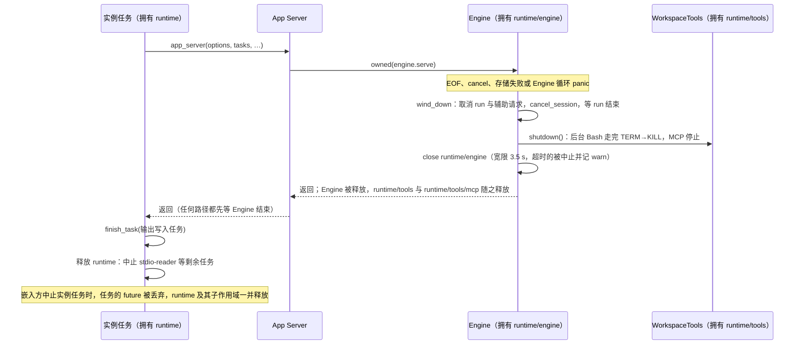

# U2：任务作用域

日期：2026-10-09。上级规划：[rust-unified-host.md](rust-unified-host.md) 的 U2（“所有 spawn 归入 `TaskScope`”）与 [rust-engineering-practices.md](rust-engineering-practices.md) 的 E7。前置：[rust-u2-host-structure.md](rust-u2-host-structure.md)（crate 拆分）。

## 1. 要解决的问题

Host 有约 139 处直接的 `tokio::spawn`，runtime 有约 44 处 `tokio::spawn` / `spawn_blocking`。它们的共同问题：

- **没有归属**。连接断开、workspace 关闭、runtime 实例结束之后，它们派生的任务是否还在运行，只能靠每处自己保存句柄或取消令牌来保证。U3 把 runtime 放进 Host 进程之后，已经出现过一次泄漏：Engine 循环 panic 后 run 任务仍在请求模型（rust-u3-single-process.md 2.5）。
- **panic 无声**。tokio 只结束出错的任务；没有人 await 它的句柄时，没有日志，等待它结果的一方永远等不到。
- **关闭时无法确认**。Host 退出前不知道还有哪些任务在运行。

## 2. 规则

1. 每个任务有唯一的所有者：一个作用域，或者它自己的句柄。
   - **作用域**：作用域有唯一的所有者；所有者释放作用域时，其中仍在运行的任务被中止。任务不能比它的作用域活得更久。丢弃这种任务的句柄不影响任务。
   - **句柄**（`OwnedTask`）：只用于在同一个函数里启动、等待的结构化任务（并发读子进程的 stdout 与 stderr、函数内 `select!` 的辅助任务）。丢弃句柄即中止任务；移动句柄即转移所有权。句柄的持有者本身属于某个作用域，所以这种任务同样不会比作用域活得更久。
   - 同步的阻塞调用（`spawn_blocking(...).await`）用 `blocking`：调用方等待它的结果；丢弃这个 future 只是不再等待，已经开始的阻塞工作无法停止。
2. 作用域可以有子作用域。关闭或释放父作用域，等同于关闭或释放所有子作用域。
3. 任务有名字（静态字符串，说明它在做什么）。panic 被捕获并交给根作用域的上报函数（作用域路径、任务名、panic 信息），等待该任务结果的一方得到错误，而不是一直等待。
4. 关闭作用域分三步：发出取消信号 → 在给定的宽限期内等任务自行结束 → 中止剩余任务并返回它们的名字。关闭之后在这个作用域上启动的任务不会运行，其句柄立即得到“作用域已关闭”。
5. `tokio::spawn` 与 `tokio::task::spawn_blocking` 只允许出现在 `zcode-async` 内。runtime（`apps/zcode-cli-rust` 的 `crates/` 与 `src/`）由 `scripts/check-zcode-cli-rust-boundaries.mjs` 扫描非测试代码强制，例外文件逐个列出（见 4.1）；Host 全部 crate 由 `scripts/rust/check-host-spawns.mjs` 扫描非测试代码强制（6.5）。为什么不由 `clippy.toml` 的 `disallowed-methods` 强制，见 6.5。

## 3. 接口（`zcode-async`）

```rust
/// 作用域的所有者。不可克隆；释放时中止其中（含子作用域）仍在运行的任务。
pub struct TaskScope { /* … */ }
/// 在某个作用域里启动任务的权限。可克隆，可以交给任务自己；不延长作用域的寿命。
#[derive(Clone)]
pub struct Spawner { /* … */ }

impl TaskScope {
    /// 根作用域。`report` 在任务 panic 时被调用一次（在出错任务所在的线程上，不能阻塞）。
    pub fn root(name: impl Into<String>, report: impl Fn(&TaskPanic) + Send + Sync + 'static) -> Self;
    pub fn spawner(&self) -> Spawner;
    /// 取消信号 → 等待至多 `grace` → 中止其余任务。返回被中止的任务（作用域路径与任务名）。
    pub async fn close(&self, grace: Duration) -> Vec<String>;
}
impl Spawner {
    /// 子作用域：路径为 `<父路径>/<name>`，取消信号随父作用域传播。
    pub fn child(&self, name: impl Into<String>) -> TaskScope;
    pub fn spawn<F>(&self, name: &'static str, future: F) -> Task<F::Output>;
    /// 常驻任务（没有自己收口步骤的循环）：作用域收到取消信号时 future 被丢弃、任务正常结束（`Ok(None)`），
    /// `close` 不把它列为被中止的任务。
    pub fn spawn_resident<F>(&self, name: &'static str, future: F) -> Task<Option<F::Output>>;
    pub fn spawn_blocking<F, T>(&self, name: &'static str, work: F) -> Task<T>;
    /// 作用域收到取消信号时完成；需要自行收口的任务用它。
    pub fn cancelled(&self) -> impl Future<Output = ()>;
    pub fn is_closed(&self) -> bool;
    /// 仍在运行的任务名（含子作用域），用于关闭日志与测试。
    pub fn running(&self) -> Vec<String>;
}

/// 任务句柄。丢弃句柄不影响任务（任务仍属于作用域）；`abort` 中止它。
pub struct Task<T> { /* … */ }
impl<T> Future for Task<T> { type Output = Result<T, TaskError>; }
pub enum TaskError { Panicked(Panicked), Aborted, ScopeClosed }
pub struct TaskPanic { pub scope: String, pub task: &'static str, pub message: String }

/// 由句柄拥有的任务：丢弃句柄即中止任务，移动句柄即转移所有权。
pub fn owned<F>(future: F) -> OwnedTask<F::Output>;
pub struct OwnedTask<T> { /* … */ }
impl<T> OwnedTask<T> { pub fn abort(&self); pub fn is_finished(&self) -> bool; }
/// panic 变成 `TaskError::Panicked`，不向等待方传播；被中止时为 `TaskError::Aborted`。
impl<T> Future for OwnedTask<T> { type Output = Result<T, TaskError>; }
/// 在阻塞线程池里运行 `work` 并等待结果；panic 变成 `TaskError::Panicked`。
/// 丢弃返回的 future 只是不再等待：已经开始的阻塞工作会一直运行到结束。
pub async fn blocking<F, T>(work: F) -> Result<T, TaskError>;
```

- `OwnedTask` 的 panic 只交给等待它的一方，不经作用域的上报函数（它没有作用域）；从不被等待、只会被中止的辅助任务不应包含可能 panic 的逻辑。

- 常驻任务与被中止的任务一样在某个等待点上被丢弃，区别只在关闭日志：`close` 返回的是“本该在有序收口里结束、却还在运行”的任务，常驻循环不在其中。轮询、事件转发、owner 任务（actor）这类随所有者一直运行、没有收口步骤的循环用 `spawn_resident`；一次性的工作（请求、派发、写入）用 `spawn`，关闭时还没结束就是要排查的问题。
- `spawn_blocking` 的任务无法被中止（线程里的同步代码不会让出）；关闭时它们计入“仍在运行”，宽限期过后不再等待。
- 作用域内部状态用 `std::sync::Mutex` 保护，不跨 await 持有。

## 4. 作用域的划分

| 作用域                                        | 所有者                                                          | 何时关闭                                         |
| --------------------------------------------- | --------------------------------------------------------------- | ------------------------------------------------ |
| `host`（根）                                  | `HostCore`                                                      | Host 退出（`dispose` / 控制通道关闭）            |
| `host/connection:<id>`                        | Gateway 的连接循环（rust-u2-gateway.md）                        | 连接断开                                         |
| `host/websocket`                              | WebSocket 监听任务                                              | 随 Host                                          |
| `host/services/<service>`                     | 各 service（组装时由 `host/services` 派生，`Installed` 持有）   | 随 Host                                          |
| `host/services/agent/<key>#<代次>`            | 该 runtime 实例的监视任务                                       | 实例结束或被回收                                 |
| `host/services/remote/connection:<requestId>` | 远端连接（注册表里的一个 entry，可被多个 logical session 共用） | 连接释放（最后一个会话断开、被回收或 Host 退出） |

完整的树（含终端、文件监听、Bot 通道等更短命的所有者）见 6.1。

runtime 内部的任务（run、标题、hook、辅助模型请求）属于它所在实例的作用域：Engine 结束（包括 panic 之后的收口）时关闭。

### 4.1 runtime 实例

一个 runtime 实例（一个 App Server 或一次 `-p`）有一个根作用域 `runtime`，由拥有实例的入口创建：二进制的 `main.rs` / `prompt.rs`，嵌入时是 `embed::spawn` 启动的实例任务（作用域随实例任务结束、出错、panic 或被中止而释放）。`Spawner` 经构造参数显式向下传递：入口 → `Context`（`runtime.rs`）→ 会话存储、`WorkspaceTools`、`Engine`。没有全局或 `OnceLock`。

| 作用域              | 所有者                                    | 任务                                                                                                          | 何时关闭                                                                                      |
| ------------------- | ----------------------------------------- | ------------------------------------------------------------------------------------------------------------- | --------------------------------------------------------------------------------------------- |
| `runtime`           | 入口（实例任务 / 二进制入口）             | `stdio-reader`（嵌入）、`signals`、`log-retention`（二进制）、`session-store`（阻塞）                         | 实例结束时释放                                                                                |
| `runtime/engine`    | `Engine`                                  | `run`、`hook`、`permission-hooks`、`session-title`、`auxiliary`、`usage-query`、`mcp-query`、`plugin-request` | `wind_down` 的收口完成之后 `close`（宽限期覆盖工具进程的 TERM→KILL）；Engine 被释放时随之释放 |
| `runtime/tools`     | `WorkspaceTools`（各 workspace 视图共用） | `bash`（前台进程，可能转入后台）、`bash-background`                                                           | 随工具运行时释放                                                                              |
| `runtime/tools/mcp` | MCP hub                                   | `mcp-resource-sampler`、`mcp-stdio-writer`、`mcp-exit-watch`、`mcp-sse`                                       | 随 hub 释放                                                                                   |

- 任务做的事、取消令牌与关闭顺序不变（`Engine::wind_down`、`tools.shutdown()`、工具进程的 TERM→KILL）；作用域是附加的一层：有序收口之后仍在运行的任务，在作用域关闭或释放时被中止。原来为保证发出终态而用 `catch_panic` 包住的任务体保持不变，作用域的捕获是第二道保险。
- 由句柄拥有的结构化任务：子进程输出的并发读取（Bash、hooks、插件 git）、hook 的 stdin 写入、MCP prepare 的取消转发、App Server 里运行 Engine 的任务、嵌入时的协议输出写入任务。读取子进程输出的句柄在结束进程树期间保持存活，管道一直被排空。
- App Server 在任何返回路径上都先关闭它与 Engine 之间的两条通道，再等 Engine 结束（Engine 看到输入结束、输出关闭，照常收口）。原来输出写入失败时它直接返回、丢弃 Engine 的句柄，Engine 的收口发生在实例之外；二进制随即退出时收口被打断。
- 例外：`src/embed.rs` 保留两处 `tokio::spawn`。实例任务本身（Host 需要 `JoinHandle<anyhow::Result<()>>`），以及嵌入方进程级的日志清理（`log_retention::schedule`）；Host 把自己的 `Spawner` 传给 runtime 之后去掉。
- 嵌入方从 `Embedded::tasks` 读取实例中仍在运行的任务名（只读），用于关闭日志与测试。

实例结束时的顺序（嵌入时；二进制入口相同，只是没有外层的实例任务）：



迁移顺序：先让每个 service 从组装根拿到自己的 `Spawner`，把直接的 `tokio::spawn` 换成 `spawner.spawn("…", …)`；寿命比 service 短的任务（连接、实例、会话）再收进更小的作用域。迁移不改变任务做的事。

## 5. 验收

- `zcode-async` 的测试：panic 上报且句柄得到错误；释放作用域中止任务；`close` 的三步（自行结束的不算中止，超时的被中止并列出）；关闭后启动的任务不运行；子作用域随父作用域关闭；任务结束后不再出现在 `running` 里；常驻任务随取消信号结束、不算中止。
- `zcode-async` 的测试还覆盖 `owned` 与 `blocking`：丢弃句柄中止任务；panic 变成错误；结果原样返回；移动后的句柄让任务继续运行。
- Host 与 runtime 的非测试代码中，`tokio::spawn` / `spawn_blocking` 只出现在 `zcode-async`（runtime 由边界脚本强制，例外见 4.1；Host 由 `scripts/rust/check-host-spawns.mjs` 强制，见 6.5）。
- runtime 嵌入测试（`apps/zcode-cli-rust/tests/suite/embed.rs`）：实例因 EOF、Engine panic 或被嵌入方中止而结束之后，实例中没有仍在运行的任务；中止实例时，运行中的 run、标题请求与后台 Bash 任务随之结束（模型请求关闭、后台进程被回收）。
- Host 退出时日志里列出被中止的任务；正常退出时这个列表为空或只含已知的常驻任务。
- 现有测试与桌面 E2E 全部通过。

## 6. Host 的 service（U2 收尾）

U2 的并发规则在 Host 业务 service 上的落地：每个任务有所有者（6.1）、通道都有界（6.2）、不跨 `.await` 持有 tokio 的锁（6.3）、退出时报告被中止的任务（6.4）、由检查保证（6.5）。迁移不改变任务做的事、它们的取消令牌与关闭顺序；所有权是附加的一层。

### 6.1 作用域树

`HostCore` 在根作用域下建 `host/services` 并把它的 `Spawner` 交给组装根 `install`；每个 service 在它下面有自己的子作用域，由 `Installed` 持有（不放全局、不用 `OnceLock`）。寿命比 service 短的所有者（runtime 实例、远端会话、终端、文件监听、Bot 通道……）再各有更小的作用域，所有者结束时关闭或释放它。常驻任务（随所有者一直运行、没有收口步骤的循环）用 `spawn_resident`，见 §3。

| 作用域                                               | 所有者                                                      | 任务                                                                                                                                                                                                                                                                                                                                                                                                                                                                             | 何时结束                                                       |
| ---------------------------------------------------- | ----------------------------------------------------------- | -------------------------------------------------------------------------------------------------------------------------------------------------------------------------------------------------------------------------------------------------------------------------------------------------------------------------------------------------------------------------------------------------------------------------------------------------------------------------------- | -------------------------------------------------------------- |
| `host/services`                                      | `HostCore`                                                  | —                                                                                                                                                                                                                                                                                                                                                                                                                                                                                | Host 退出（根作用域关闭）                                      |
| `host/services/settings`                             | `Installed`                                                 | `setting-writes`（owner：`SettingStore` 的读改写）、`setting-write-requests`（常驻：Main 的 `setting-write`）                                                                                                                                                                                                                                                                                                                                                                    | 随 Host                                                        |
| `host/services/providers`                            | `Installed`                                                 | `provider-config-poll`、`builtin-config-refresh`（常驻）；owner：`personal-provider-writes`（personal 文件的编辑）、`builtin-config-files`（内置配置 Active 与控制文件的读改写）；解析在阻塞线程池里（`blocking`）                                                                                                                                                                                                                                                               | 随 Host                                                        |
| `host/services/agent`                                | `Installed`                                                 | `instance-start`（一次启动，槽位 single-flight）、`instance-monitor`（每个实例一个，持有实例的作用域）、`sessions-index-follow`（每代实例一个，unavailable 或被替换时中止）、`warm-up`、`subscribe`（V4 订阅握手，调用方取消也走完）、`legacy-session-listener`（随订阅流结束）、`connection-dispose`；常驻：`process-events`、`agent-notifications`、`legacy-session-events`、`sessions-index-lifecycle`                                                                        | 随 Host；`dispose_all` 等监视任务收口（上限 3 s）              |
| `host/services/agent/<key>#<代次>[:<lane>]`          | 该实例的 `instance-monitor`                                 | `client-reader`、`client-writer`（owner：stdin）、`storage-first-frame`、`storage-watch`、`idle-reclaim`（mcp-status）、`stderr-drain`、`preferences`（owner：偏好推送）、`account-config-delivery`（owner：账号配置的读取与交付）、`cancel-generate-text`、`reverse-request`                                                                                                                                                                                                    | 监视任务收口的最后一步释放（实例退出、被回收或 dispose）       |
| `host/services/agent/connection:<id>`                | `zcode-agent` channel 的连接状态（`Scope`）                 | `frame-route`（每个 (kind, workspace) 一个）、`connection-flow`（流控边沿的串行转发）                                                                                                                                                                                                                                                                                                                                                                                            | 连接关闭的收口（`closed` 发完、退订之后）关闭                  |
| `host/services/tasks`                                | `Installed`                                                 | 常驻：`task-lifecycle-signals`、`task-index-syncer`、`task-controller-overlays`、`task-controller-workspace-events`、`task-controller-refresh`（owner：分区的读取与应用）                                                                                                                                                                                                                                                                                                        | 随 Host                                                        |
| `host/services/account`                              | `Installed`                                                 | 常驻：`account-builtin-changes`、`account-setting-changes`、`account-config-push`、`host-resource-samples`；`account-first-read`、`account-provider-refresh`、`unauthorized-logout`（401 复核）、`oauth-profile-migration`、`oauth-pending-timeout`；owner：`oauth-session-mutations`（会话变更队列）、`credential-writes`（凭据文件）、`onboarding-record-writes`（引导记录文件）。余额请求的复用窗口改为读取时按发起时间判断，不再为每个请求另起删除计时任务                   | 随 Host                                                        |
| `host/services/extensions`                           | `Installed`                                                 | owner：`extension-config-writes`（与 Main、CLI 共享的 JSON 配置文件，扩展各 service 与 settings-sync 共用）、`skill-writes`（skill 开关）、`subagent-state-writes`（subagent 状态文件）                                                                                                                                                                                                                                                                                          | 随 Host                                                        |
| `host/services/workspace/file-watchers`              | `Installed`（经 `Workspace`）                               | `file-watcher-release`（阻塞：释放底层监听）；监听的启动在阻塞线程池里（`blocking`）                                                                                                                                                                                                                                                                                                                                                                                             | 随 Host；`Workspace::shutdown` 释放全部监听                    |
| `host/services/workspace/file-watchers/watcher:<id>` | 登记表里该监听的条目                                        | `file-watcher-debounce`                                                                                                                                                                                                                                                                                                                                                                                                                                                          | unwatch、出错清理、disposeAll、Host 退出的有序收尾时随条目释放 |
| `host/services/workspace/terminals`                  | `Installed`（经 `Workspace`）                               | `terminal-supervise`（每个终端一个，持有终端的作用域）、`terminal-close`（Windows）；PTY 创建、子进程等待、关闭 master 用 `blocking`                                                                                                                                                                                                                                                                                                                                             | 随 Host；`dispose_all` 结束子进程后各监视任务收尾              |
| `host/services/workspace/terminals/terminal:<id>`    | 该终端的 `terminal-supervise`                               | `pty-reader`、`pty-writer`（Unix；Windows 上是随伪控制台关闭而结束的阻塞线程）                                                                                                                                                                                                                                                                                                                                                                                                   | 子进程退出、输出收尾之后释放                                   |
| `host/services/workspace/git`                        | `Installed`（经 `Workspace`）                               | `git-request`（复用中的请求跑完，调用方取消也不打断）、`git-taskkill`（Windows）；owner：`checkpoint-manifest-io`（checkpoint manifest 的 IO）                                                                                                                                                                                                                                                                                                                                   | 随 Host                                                        |
| `host/services/automation`                           | `Installed`（经 automation 的 `AreaHandle`）                | `scheduler`（调度 actor，`dispose` 后结束；派发是它持有的结构化任务 `owned`）、`automation-claim-heartbeat`、`share-cleanup-abandoned`、`off-peak-settle`；常驻：`automation-settle`、`off-peak-finalize`、`off-peak-sync`（同步定时器）、`task-driver-observe`；owner：`share-import-index`（会话分享导入索引）                                                                                                                                                                 | 随 Host；调度器在 `Installed::shutdown` 最先 `dispose`         |
| `host/services/automation/off-peak-mock-gateway`     | mock 网关（只在 `ZCODE_OFFPEAK_MOCK` 时启动）               | 常驻 `mock-gateway-accept`、每条连接 `mock-gateway-connection`                                                                                                                                                                                                                                                                                                                                                                                                                   | 网关释放时                                                     |
| `host/services/automation/bots`                      | automation 的 `AreaHandle`                                  | `bot-watch`、`bot-typing*`、`bot-terminal-fallback`、`bot-send-prompt`、`*-schedule-refresh`；owner：`feishu-refresh` / `telegram-refresh` / `weixin-refresh`（对齐，只有最新一次走完）、`bot-inbound`（每个聊天上下文一个，随调用方取消）、`bot-store-files`（Bot 配置与状态文件）                                                                                                                                                                                              | 随 Host；`Bots::shutdown` 先停通道运行时                       |
| `host/services/automation/bots/<provider>:<botId>`   | 运行时表里该通道的条目                                      | `feishu-websocket` / `polling`（长连接或长轮询循环；运行锁的续租由锁自己 `owned` 持有）                                                                                                                                                                                                                                                                                                                                                                                          | 停止时等循环收尾后随条目释放                                   |
| `host/services/remote`                               | `Installed`                                                 | `remote-connect`、`remote-connect-request`、`remote-close-watch`、`workspace-prepare`、`workspace-release`、`wsl-idle-dispose`、`remote-dispose*`、`remote-bind-ready`、`remote-provisioning`、`connector-cancel-exit`（建连阶段取消后等连接器退出，持有那条连接的作用域）；常驻：`provisioning-*`；owner：`remote-source-refresh`                                                                                                                                               | 随 Host；`RemoteWorkspaces::shutdown` 先释放全部连接           |
| `host/services/remote/connection:<requestId>`        | 这条连接（`transport::Connection`，由 `RemoteHandle` 持有） | 传输：`connector-child`、`connector-stdin`、`connector-stdout` / `server-stdout`、`connector-stderr`、`rpc-forward`、`rpc-client-reader`；连接上的：常驻 `remote-preferences-bridge`、`remote-resource-telemetry`，`remote-workspace-events`、`remote-task-ready`、`remote-source-events`、`remote-sessions-index`、`remote-frame-route`、`remote-agent-lifecycle`、`remote-subscribe`、`remote-agent-dispose`、`remote-bot-conversation-frames`，以及这条连接派生的 Bots 的任务 | `Connection::dispose`：子进程结束之后关闭                      |
| `.../connection:<requestId>/media-proxy`             | 远端媒体预览代理（桌面 attachment）                         | 常驻 `media-proxy-accept`、每条连接 `media-proxy-connection`                                                                                                                                                                                                                                                                                                                                                                                                                     | 代理 dispose（attachment 关闭）时释放                          |

测试构造 service 时用 `zcode_host_base::testing::spawner()`：一个随测试进程存在、不关闭的根作用域。

迁移中发现并修复的泄漏（所有者结束后任务仍在运行）：

| 位置                                               | 泄漏                                                                                                                                                                                                                           | 测试                                                                                                           |
| -------------------------------------------------- | ------------------------------------------------------------------------------------------------------------------------------------------------------------------------------------------------------------------------------ | -------------------------------------------------------------------------------------------------------------- |
| `sessions/src/agent/runtime.rs` `Handler::request` | 反向请求的处理是分离的任务：实例结束后，一直等不到结果的处理仍在运行并持有已结束实例的 client                                                                                                                                  | `agent::lane_tests::an_ended_instance_leaves_no_tasks_behind`（修复前失败）                                    |
| `automation/src/off_peak/gateway.rs`               | mock 网关释放时只中止监听任务，已接受的连接任务是分离的，网关释放后仍在运行、连接不关闭                                                                                                                                        | `off_peak::tests::dropping_the_mock_gateway_ends_its_connections`（修复前失败）                                |
| `remote/src/remote/media.rs`                       | 远端媒体代理 dispose 时只中止监听任务，已接受、还在等请求头的连接任务一直留着、连接不关闭                                                                                                                                      | `media::tests::dispose_ends_connections_the_proxy_accepted`                                                    |
| `workspace/src/workspace.rs` `Workspace::shutdown` | Host 退出的有序收尾不释放文件监听（Node 的 `disposeServiceResources` 会调用它的 `disposeAll`）：页面没有逐个 unwatch 的监听与它们的防抖任务一直留到进程结束，由关闭报告发现（桌面 E2E 的每个场景都报 `file-watcher-debounce`） | `zcode-host/tests/suite/end_to_end.rs` `a_normal_dispose_leaves_no_tasks_to_abort`（加入文件监听后修复前失败） |

### 6.2 有界通道

每条通道写明容量与满了以后的做法，三种之一：

- **背压**：发送方等空位（`send().await`）。只用于能停下来等的发送方，且接收方的处理不会反过来等这个发送方（否则死锁）。
- **结束落后的一方**：同步的发送方不能等，消息又不能丢时，满了说明接收方已经卡住：结束它的那条流（事件订阅）或整条连接（RPC 链路），记 warn。这是看得见的失败（订阅方重新订阅时取快照，连接方按断开处理），不是悄悄留下的缺口；无限缓存会拖垮整个 Host。
- **合并**：只表示“有变化”的信号，已有一条待处理时丢弃新的。

进程内事件分发 `EventHub`（`zcode-host-kit`）：每个订阅者一条有界队列，构造时给出名字、容量与策略（`Overflow::CloseSubscriber` / `Overflow::Coalesce`）；同步的 `emit` 按策略处理满的订阅者，能等待的发送方用 `emit_waiting`（背压，一个 hub 只用其中一种）。订阅者多是 Renderer 的订阅：Gateway 的转发立即把事件搬进连接的出站队列（rust-u2-gateway.md §2.3），真正的上限是出站队列的 256 MiB；hub 的容量只兜底一个卡住的订阅者。

| hub                                                                            | 位置                                                     | 容量           | 满了     | 订阅者 / 理由                                                      |
| ------------------------------------------------------------------------------ | -------------------------------------------------------- | -------------- | -------- | ------------------------------------------------------------------ |
| `broadcast`                                                                    | `base/src/broadcast.rs`                                  | 1024           | 结束订阅 | 各连接的 `onDidReceive`                                            |
| `setting-updated`                                                              | `settings/src/settings/mod.rs`                           | 256            | 结束订阅 | 数据目录迁移、账号 provider、远端预配：按 patch 的键响应，不能合并 |
| `providers-changed`、`providers-builtin-changed`、`providers-personal-updated` | `providers/src/providers/mod.rs`                         | 1              | 合并     | 变化信号，订阅者重读快照                                           |
| `agent-notifications`                                                          | `sessions/src/agent/extensions.rs`                       | 8192           | 结束订阅 | 通知分发与 legacy 会话事件（同步转换）；流式时每秒数百条           |
| `agent-process-events`                                                         | 同上                                                     | 256            | 结束订阅 | 进程生命周期上报，转交控制通道                                     |
| `agent-plugin-progress`、`agent-local-ttft`、`agent-telemetry`、`agent-cua`    | `sessions/src/agent/notifications.rs`                    | 1024           | 结束订阅 | Renderer 订阅                                                      |
| `agent-lifecycle`、`agent-restarted`、`agent-storage-startup`                  | `sessions/src/agent/runtime.rs`                          | 1024、256、256 | 结束订阅 | Renderer 订阅、sessions-index 观察者、legacy 会话事件              |
| `agent-frames`、`agent-route-frames`、`legacy-session-events`                  | `sessions/src/agent/{runtime,service,session_events}.rs` | 8192           | 结束订阅 | V4 帧与 legacy 事件；流式时每秒数百条，8192 条约是卡住半分钟以上   |
| `sessions-index-events`                                                        | `sessions/src/agent/sessions_index.rs`                   | 4096           | 结束订阅 | syncer（每条写一次 tasks-index）与 controller                      |
| `task-workspace-events`、`task-session-signals`                                | `sessions/src/tasks/{mod,service}.rs`                    | 1024           | 结束订阅 | Renderer 订阅、controller（每条重读分区）、TaskLifecycle           |
| `task-terminal`、`task-ready`、`task-stream`、`task-controller-frames`         | `sessions/src/tasks/{lifecycle,controller}.rs`           | 1024           | 结束订阅 | Renderer 订阅，automation / off-peak / bots 等待终态               |
| `account-providers-changed`、`credential-mutations`                            | `account/src/account/{account_providers,credential}.rs`  | 256            | 结束订阅 | CLI 热同步（原因进日志）、远端预配                                 |
| `feedback-progress`、`share-import-progress`、`share-publish-progress`         | `account`、`automation/src/conversation_share`           | 1024、256、256 | 结束订阅 | 进度：最后一条是终态，不能合并                                     |
| `automation-terminal`                                                          | `automation/src/automation/driver.rs`                    | 1024           | 结束订阅 | bots 的回复观察与 automation 的等待方                              |
| `file-watcher-events`                                                          | `workspace/src/file_watcher.rs`                          | 1024 批        | 结束订阅 | Renderer 的 `onDidChange`                                          |
| `terminal-data`、`terminal-exit`                                               | `workspace/src/terminal/mod.rs`                          | 4096 块、16    | 结束订阅 | Renderer 订阅；saturated 时流控暂停读 PTY                          |
| `remote-route-frames`、`remote-task-ready`                                     | `remote/src/remote/{agent_scope,tasks}.rs`               | 8192、256      | 结束订阅 | 远端 V4 帧的再分发、远端 Bot 的终态兜底                            |

其余通道（mpsc 与 RPC 链路）：

| 通道                                            | 位置                                   | 容量                                                           | 满了                                                                             | 理由                                                                                                                             |
| ----------------------------------------------- | -------------------------------------- | -------------------------------------------------------------- | -------------------------------------------------------------------------------- | -------------------------------------------------------------------------------------------------------------------------------- |
| 连接流控的边沿与补发                            | `sessions/src/agent/flow.rs`           | 256                                                            | 边沿合并为最新状态（处理完队列再转发）；补发丢弃并记 warn；`closed` 等空位       | 接入层同步报告、不能等；边沿成对抵消，最终状态不变                                                                               |
| CLI stdin 的写入                                | `sessions/src/agent/client.rs`         | 64                                                             | 写入方等待（背压）                                                               | 写任务只写 stdin，不等读循环或写入方，不会死锁                                                                                   |
| legacy 会话监听的出口                           | `sessions/src/agent/session_events.rs` | 4096                                                           | 结束这个监听（已入队的照常送达），记 warn                                        | 监听任务同时暂存 live 事件，不能为慢订阅停下                                                                                     |
| tasks-index 的请求                              | `sessions/src/tasks_index/mod.rs`      | 256                                                            | 调用方等待（背压）                                                               | 专用线程只执行同步的 SQLite 操作，不等调用方；线程是连接的 owner，最后一个句柄释放时退出                                         |
| 终端输入                                        | `workspace/src/terminal/pty.rs`        | 1024 块                                                        | 这次写入失败（RPC 错误）并计数记 warn                                            | 写入在调用的同步部分入队（保持到达顺序），不能等；与真实终端输入缓冲写满时丢弃输入相同                                           |
| 文件变化（notify 回调线程 → 防抖任务）          | `workspace/src/file_watcher.rs`        | 不排队：合并进待发批次（第一个路径、是否多个、是否未知、错误） | 合并                                                                             | 回调线程不能等；事件只需要“恰好一个路径”与否，合并结果与原来逐条处理相同                                                         |
| Bot 会话帧（转发任务 → Bot 消费者）             | `automation/src/bots/mod.rs`           | 1024 条                                                        | 转发任务等待（背压）；其间帧总线的订阅继续积压，越过它的上限时订阅被结束、流结束 | 逻辑帧是增量，不能丢；转发任务不持有消费者需要的东西                                                                             |
| rpc 客户端出站（`[200]` 前排队的请求同样计入）  | `rpc/src/client.rs`                    | 4096 条                                                        | 关闭客户端：挂起调用以 Connection closed 失败，按连接断开处理                    | 同步的发送方不能等，消息不能丢；满了说明传输长时间不写                                                                           |
| rpc 客户端的事件流                              | `rpc/src/client.rs`                    | 每个流 4096 条                                                 | 结束这个事件流（已入队的照常读完）并向远端退订                                   | 读循环从不等待，不能为一个慢消费者停下；其他调用与事件流不受影响                                                                 |
| 远端传输：写子进程 stdin、读循环交给 rpc 客户端 | `remote/src/remote/transport.rs`       | 各 1024 条                                                     | 等待（背压，最终到达子进程管道）                                                 | 写任务只写 stdin，rpc 客户端的读循环从不等待，没有环                                                                             |
| 远端 Bot 会话帧                                 | `remote/src/remote/bots.rs`            | 1024 条                                                        | 等待（背压）                                                                     | 同本地 Bot                                                                                                                       |
| Host → Main 控制消息 / 日志                     | `zcode-host/src/main.rs`               | 65536 条（控制消息与日志共用一条队列，其中日志至多 8192 条）   | 丢弃新消息并计数，写任务恢复时补一条 error / warn                                | 同步发送方不能等；控制消息正常每秒几条，满了说明 Main 挂起，继续缓存只会让内存无界增长；共用一条队列保持日志与控制消息的先后顺序 |

### 6.3 不跨 `.await` 持有 tokio 的锁

存量的 `#[expect(clippy::await_holding_invalid_type)]` 逐处按三种方式之一消除，不只是把 `.await` 挪个位置：

1. **缩小临界区**：锁只保护内存状态，持锁期间只做同步的读写，等待放到锁外；需要的顺序保证用代次或版本号确认。
2. **owner 任务（actor）**：资源（一个文件、一条 stdin、一组状态）交给一个任务独占，调用方把工作交给它并等回执。进程内的写队列（`tokio::sync::Mutex<()>`）改为 `zcode_host_kit::Serial`：工作在 owner 任务里按提交顺序逐个执行；提交方放弃等待不打断已经开始的读改写；工作 panic 时提交方得到同一个 panic，owner 继续；队列有界，满了提交方等待；owner 是所在作用域的常驻任务，作用域关闭后提交方得到 `Stopped`。原来持锁执行时，提交方被取消会在等待点放弃这次读改写；改为 owner 后默认不再这样（与 Node 的 promise 队列相同，读改写总是完整执行，不会留下写了一半的凭据或配置）。确实需要随提交方取消的处理用 `Serial::run_cancellable`：排队中的不再执行，已经开始的在等待点被丢弃。
3. **`std::sync::Mutex`，锁内不 await**。

| 位置                                                          | 原来                                                                               | 现在                                                                                                                                                                                                                                                                |
| ------------------------------------------------------------- | ---------------------------------------------------------------------------------- | ------------------------------------------------------------------------------------------------------------------------------------------------------------------------------------------------------------------------------------------------------------------- |
| `settings/src/settings/mod.rs` `locked`                       | 写队列 `Mutex<()>` 跨文件锁与读改写持有                                            | owner 任务 `setting-writes`（`Serial`）：读改写与 `settle`（结果、变更通知）在里面按提交顺序执行；`get` 先提交一个空工作作为屏障                                                                                                                                    |
| `providers/src/providers/personal.rs` `per_provider`          | 每个 provider 一个 `Mutex<()>`（表只增不减），跨“读成员关系 → 读改写 → 读视图”持有 | personal 文件的 owner 任务 `personal-provider-writes`：每个编辑整段在里面执行（含不按 provider 加锁的创建与重排），所有 `PersonalWriter` 实例共用                                                                                                                   |
| `sessions/src/agent/client.rs` `write_line` / `close_input`   | 写端 `tokio::Mutex<Option<writer>>` 跨写入持有                                     | 写任务 `client-writer` 独占 stdin，按提交顺序整行写出（有界 64，满了写入方等待）；关闭 stdin 是排在已提交行之后的一项工作                                                                                                                                           |
| `sessions/src/agent/runtime.rs` `acquire`                     | per-key 槽 `tokio::Mutex` 跨整个启动持有（single-flight）                          | 槽表 `std::sync::Mutex`，持锁只做同步读写；启动在任务 `instance-start` 里，正在启动时等待方共享它的结果（`Shared`）；调用方被取消不再让启动停在半途                                                                                                                 |
| `sessions/src/agent/runtime.rs` `ensure_preferences`          | 每进程 `tokio::Mutex<u64>` 跨推送持有，保证按版本顺序推送                          | 每进程的 owner 任务 `preferences`（`Serial`）：推送循环在里面执行，版本只增不减                                                                                                                                                                                     |
| `sessions/src/tasks/controller.rs` `refresh`                  | 全局 `tokio::Mutex<()>` 跨“读分区 → 应用”持有，避免旧读取覆盖新读取                | 刷新的 owner 任务 `task-controller-refresh`（`Serial`）：逐个执行，顺序不变；调用方放弃等待不打断刷新                                                                                                                                                               |
| `account/src/account/cli.rs` `sync`                           | 每进程 `tokio::Mutex<Option<revision>>` 跨“读快照 → 交付”持有                      | 每进程的 owner 任务 `account-config-delivery`（实例的作用域里）：读与交付在里面逐个执行；已收到的 revision 放在 std 锁里，只在工作里读写                                                                                                                            |
| `account/src/account/net.rs` `network_options`                | `tokio::Mutex<Option<NetworkOptions>>` 跨读设置持有（首次初始化）                  | std 锁只保护缓存值；首次读取在锁外，先写入的为准                                                                                                                                                                                                                    |
| `account/src/account/oauth.rs` `mutate`                       | 会话变更队列 `tokio::Mutex<()>` 跨整个变更持有                                     | owner 任务 `oauth-session-mutations`：9 处变更改为 `FnOnce(OAuthService) -> Future` 交给它执行，顺序不变；提交方取消不再让变更停在半途                                                                                                                              |
| `account/src/account/onboarding.rs`（6 处）                   | 写队列 `tokio::Mutex<()>` 跨读改写持有                                             | owner 任务 `onboarding-record-writes`：每次读改写整段在里面执行                                                                                                                                                                                                     |
| `extensions/src/extensions/skills.rs` `set_enabled`           | 写队列 `tokio::Mutex<()>` 跨“发现 → 写覆盖”持有                                    | owner 任务 `skill-writes`：整段在里面执行，连续开关按提交顺序落盘；配置写入交给 `extension-config-writes`（两个 owner，没有重入）                                                                                                                                   |
| `extensions/src/extensions/subagents/mod.rs`（4 处）          | 写队列 `tokio::Mutex<()>` 跨状态文件的迁移与读改写持有                             | owner 任务 `subagent-state-writes`                                                                                                                                                                                                                                  |
| `workspace/src/git/checkpoint_store.rs`（3 处）               | 一把 `tokio::Mutex<()>` 串行全部 manifest IO                                       | owner 任务 `checkpoint-manifest-io`：读写删按提交顺序执行，读取仍排在之前的写入之后                                                                                                                                                                                 |
| `automation/src/bots/channel.rs`、`runtime.rs` `refresh_*`    | 对齐队列 `tokio::Mutex<()>` 跨整个对齐持有，代次判断“只有最新一次走完”             | 每类通道一个 owner 任务（`telegram-refresh` 等）：代次在入队前递增，对齐逐个执行                                                                                                                                                                                    |
| `automation/src/bots/inbound.rs` `handle_inbound`             | 每个聊天上下文一把 `tokio::Mutex<()>` 跨整个处理持有                               | 每个上下文一个 owner 任务 `bot-inbound`，用 `Serial::run_cancellable`：提交方取消时处理在等待点放弃，与原来持锁执行时相同（测试 `reconnect_is_idempotent_per_delivery_and_per_chat_workspace` 依赖这一点）                                                          |
| `automation/src/conversation_share/import.rs` `persist_index` | 索引写锁 `tokio::Mutex<()>`                                                        | owner 任务 `share-import-index`，轮到时才取内存索引快照                                                                                                                                                                                                             |
| `remote/src/remote/sources.rs` `refresh_source`               | 刷新锁 `tokio::Mutex<()>` 跨“读远端分区 → 应用”                                    | owner 任务 `remote-source-refresh`                                                                                                                                                                                                                                  |
| `remote/src/remote/bots.rs` `ready`                           | 初始化锁 `tokio::Mutex<()>` 跨就绪检查                                             | single-flight：进行中的检查是一个 `Shared` future，并发的首次使用共享结果，失败后清掉、下次重试                                                                                                                                                                     |
| `remote/src/remote/media.rs` `ensure_listening`               | 监听锁 `tokio::Mutex<()>` 跨异步 bind                                              | 缩小临界区：在状态锁（std）里用 std listener 同步绑定回环端口（立即完成的系统调用，锁内不 await）                                                                                                                                                                   |
| `base/src/store/lock.rs` `with_file_lock`                     | 按路径的进程内 FIFO 队列（全局表里的 `tokio::Mutex<()>`），跨整个读改写持有        | 去掉：Host 里每个经它读改写的文件都只有一个进程内写入方，在自己的 owner 任务里调用（设置、personal / 内置 provider 配置、凭据、扩展区配置与 subagent 状态、Bot 配置与状态）。函数只负责跨进程互斥；进程内若仍有并发调用，目录锁照样互斥（轮询），只是不保证先来先得 |

### 6.4 关闭报告

`HostCore::shutdown` 依次：关闭全部连接（Gateway）→ 冲刷遥测 → service 的有序收尾（调度器、终端与文件监听、远端连接、Bot 通道、CLI 进程树）→ 关闭根作用域 `host`，宽限 1 s。

- 常驻任务（`spawn_resident`：监听、轮询、owner、转发循环、定时器）随取消信号立即结束，不算被中止。
- 其余任务正常应在 service 的有序收尾里已经结束；宽限期过后还在运行的被中止，记 warn：`host tasks still running 1s after the services shut down; aborting: [<作用域路径>: <任务名>, …]`（桌面 E2E 的日志检查会因此失败）。
- 正常退出时列表为空，记 info：`host tasks at shutdown: none left running`。没有“已知的常驻任务”例外：常驻任务不进列表。
- 由某个常驻任务持有的子作用域（例如 WebSocket 监听持有的 `host/websocket`）随它结束而释放，其中的任务被中止、不单独列出：Gateway 已先关闭全部连接并等过 transport 发 Close。
- 二进制入口在退出前等控制写任务写完已入队的消息（上限 2 s）。缺陷修复：原来 `run` 返回时写任务随句柄被中止，关闭报告等最后几条日志可能还没写出就丢了。

验收：`crates/zcode-host/tests/suite/end_to_end.rs` 的 `a_normal_dispose_leaves_no_tasks_to_abort`（真实二进制：装好服务、有一条 Renderer 连接与订阅、单层与递归的文件监听各一个，dispose 后只有那条 info）；桌面 E2E 的每个场景在退出后检查 Host 日志里没有 `still running` / `aborting`。

控制通道（Host → Main 的 stdout）：控制消息与日志共用一条有界队列，写任务按入队顺序写出（一条日志与它前后的控制消息在 Main 看到的顺序，就是 Host 发出的顺序）。发送方是同步的 `ControlSink::send` / 日志，不能等：队列 65536 条，其中日志最多占 8192 条。日志占满它的名额时丢弃新日志并计数；整条队列满了说明 Main 已经很久不读 stdout，丢弃新消息并计数；写任务恢复时各补一条 warn / error 说明丢了多少。

### 6.5 护栏

`scripts/rust/check-host-spawns.mjs`（`pnpm check:rust` 的一步）扫描 `apps/zcode-host/crates` 下全部 crate：

- 非测试代码不得直接启动 tokio 任务（`tokio::spawn`、`spawn_blocking`、`spawn_local`、`JoinSet`），也不得取运行时句柄（`Handle::current` / `try_current`）；
- 非测试代码不得使用 tokio 的无界 mpsc（`unbounded_channel`、`UnboundedSender`、`UnboundedReceiver`）；
- 任何代码（含测试）不得 `allow` / `expect` `clippy::await_holding_invalid_type`（这个 lint 在 workspace 级别是 deny）。

测试代码：`tests.rs`、`*_tests.rs`、`tests/` 目录，`#[cfg(test)]` / `#[cfg(all(test, …))]` / `#[cfg(any(test, feature = "test-support"))]` 标注的条目，以及以这些条件声明的外部模块文件（例如 `#[cfg(test)] mod fake_remote;`）。扫描逻辑与 runtime 的边界脚本共用（`scripts/rust/task-spawns.mjs`）。

为什么不由 `clippy.toml` 的 `disallowed-methods` 强制：`clippy.toml` 由三个 Rust workspace 共用（AGENTS.md），没有按 workspace 的覆盖；`disallowed-methods` 对测试代码同样生效，也没有“测试中放行”的开关。runtime（`apps/zcode-cli-rust`）的非测试代码还有直接的 `unbounded_channel`（工具遥测、App Server 的输出），`src/embed.rs` 的两处 `tokio::spawn` 需要逐处 `#[expect]`，三个 workspace 的测试里共有一百多处直接 `tokio::spawn`。把这些规则放进共用的 `clippy.toml` 就要先改 runtime 的代码与全部测试，超出 Host 的范围；runtime 清零之后再改由 clippy 强制，并删去这里的两条扫描。
