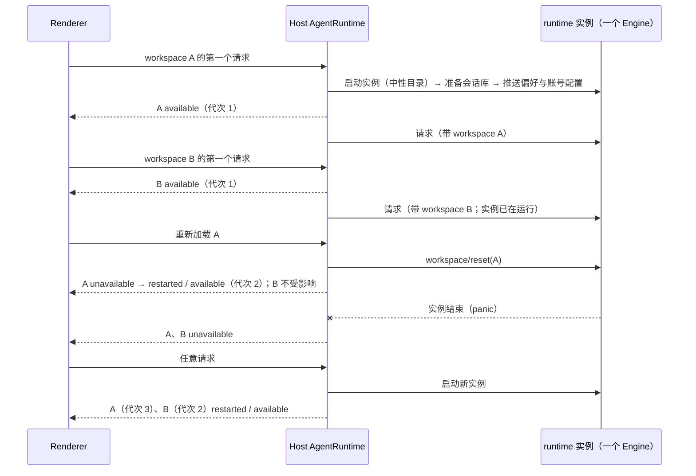

# U3：一个 Engine 管所有本地 workspace（D-U12）

日期：2026-10-10。用户决定：采用一个 Engine；会话库路径与网络策略只认用户级配置。上级：[rust-unified-host.md](rust-unified-host.md) 14.1、[rust-u3-stage-b.md](rust-u3-stage-b.md) 3.3。约束：[rust-host-cli-boundary.md](rust-host-cli-boundary.md)（边界是 App 协议，进程内与子进程两种链路的行为相同）。

## 1. 现状与目标

今天 Host 为每个 workspace key 启动一个 runtime 实例，另有 plugin-management 与 mcp-status 两个控制面实例。Host 的若干行为是“借”实例实现的：

| 行为                               | 今天的实现                                    |
| ---------------------------------- | --------------------------------------------- |
| workspace 可用 / 不可用 / 已重启   | 由该 workspace 的实例启动与退出推出           |
| 帧属于哪个 workspace               | 从哪个实例的链路上来就属于哪个                |
| “重新加载会话”                     | 结束该 workspace 的实例，下次请求时再启动一个 |
| 一次请求超时                       | 回收整个实例                                  |
| app 偏好、功能门禁、账号配置的推送 | 每个实例启动后推一次                          |
| 会话库的准备                       | 每个实例各做一次门禁                          |

目标：所有本地 workspace 的会话由同一个 runtime 实例（一个 Engine）调度。workspace 各自的东西（项目配置、权限、会话索引、MCP 服务、shell）仍按 workspace 分开，放在 Engine 的 workspace 作用域里。两个控制面实例保持不变。

用户可见的行为不变，除了第 2.4 节列出的两点。

## 2. 规则

### 2.1 runtime：一个实例里的多个 workspace

- **缺省 workspace 是中性目录**：实例不以任何用户 workspace 作为启动目录。每个与 workspace 有关的请求都显式带上 workspace（路径与身份）；只带会话 id 的请求按会话所属的 workspace 处理。任何还依赖“实例的缺省 workspace”的方法都改为带 workspace（协议上新增可选字段，旧调用方不受影响）。
- **按 workspace 分开的状态**：项目配置与权限、会话索引、MCP 服务集合及其状态、shell 与后台任务、hook 的项目配置。一个 workspace 的 MCP 启动或探测不占用另一个 workspace 的门。
- **实例级的状态**：会话库连接、网络出口、模型注册表、用户级 hook 与信任存储、运行环境。
- **预算不因合并而对单个 workspace 变紧**：常驻会话的预算与后台请求的并发上限按 workspace 计（今天每个实例一份，实际就是每个 workspace 一份）；空闲 workspace 作用域的淘汰上限是实例级的，需要按 App 的规模重新定值并写在这里。
- **重置一个 workspace**（新协议方法 `workspace/reset`）：取消它的 run（按正常取消的路径提交中断状态）、卸载它的会话、结束它的 MCP 服务与 shell、丢弃它的作用域。之后对它的第一个请求重新打开作用域并重读配置；它的 `sessions-index` 与 `workspace-config` topic 换新的 epoch，旧的订阅只能拿到快照。其他 workspace 不受影响。
- **子进程列表**按 workspace 给出。

### 2.2 会话库与网络策略是用户级配置

- 会话库路径（`storage.dir`、`storage.sessionDbPath`）与网络策略（`network`）只取用户级配置与环境变量。
- 项目配置里出现这两项时不生效，打开该 workspace 时记一条 warn，并在该 workspace 的配置诊断里给出一条说明。
- 这条规则对独立运行的 CLI 同样适用（同一个 runtime，只有一套规则）。这是与 Node CLI 的一处有意差异，记入 [rust-parity-remaining.md](rust-parity-remaining.md)。

### 2.3 Host：共享实例之上的 workspace

- **路由**：chat 的所有本地 workspace 共用一个实例（一条链路）。实例在第一次需要时启动（预热或第一个请求）。
- **激活**：一个 workspace 第一次有请求到达 runtime 时成为“已激活”，Host 发它的 `available`。对尚未激活的 workspace，`existing-only` 的请求照旧得到 `ZCODE_AGENT_RUNTIME_UNAVAILABLE`（界面的休眠语义不变）。
- **代次**：按 workspace 计，含义不变——该 workspace 在 runtime 里的状态每丢失一次就加一。实例重启与重置该 workspace 都会让它加一。
- **实例结束**（出错、panic、被回收）：所有已激活的 workspace 收到 `unavailable`。下一次任何请求触发实例重启；新实例就绪后，之前已激活的 workspace 各自代次加一并收到 `restarted` 与 `available`。
- **帧的归属**：按订阅归属到 workspace（订阅时记下 workspace key），不再按链路。Host 内部的观察者（sessions-index、Bot）同样按自己的订阅识别。
- **“重新加载会话”**：Host 向 runtime 发 `workspace/reset`，然后对该 workspace 发 `unavailable`、代次加一、`restarted` 与 `available`。不重启实例。
- **请求超时只让这次调用失败**。实例是否卡死由存活探测判断：一个不经过会话的轻量请求在限定时间内没有应答时才回收实例。
- **只做一次的事**：会话库准备的门禁、app 偏好与功能门禁的推送、账号配置的推送，都按实例的每一次启动做一次，不再按 workspace。
- **空闲回收**针对整个实例：所有 workspace 都空闲满今天的时长后回收；runtime 内部另按 2.1 淘汰空闲的 workspace 作用域。
- 两个控制面实例（plugin-management、mcp-status）不变。

### 2.4 用户可见的变化

| 变化                                                                        | 说明                                                            |
| --------------------------------------------------------------------------- | --------------------------------------------------------------- |
| Engine 主循环 panic 或实例的致命错误会中断所有本地 workspace 正在运行的会话 | 以前只影响一个 workspace。run 任务的 panic 仍只影响它自己的会话 |
| 项目配置里的 `storage`、`network` 不再生效（2.2）                           | 缺省配置下没有变化                                              |

### 2.5 不互相拖慢

Engine 的循环逐条处理消息。合并后，一个 workspace 的慢操作不能明显拖慢另一个。验收门槛（release 构建，8 个 workspace 同时流式）：

| 指标                                                                                                | 门槛    |
| --------------------------------------------------------------------------------------------------- | ------- |
| 控制 RPC 的 p95                                                                                     | ≤ 20 ms |
| workspace B 在冷加载大会话、提交 20 MiB 附件、打开很深的目录时，workspace A 的 Stop 得到 ACK 的 p95 | ≤ 50 ms |

超标时把循环里的慢操作移到循环外（先定位是哪一个 await），而不是放宽门槛或退回每 workspace 一个实例。测量结果写入 `docs/reports/`。

## 3. 状态所有者

| 状态                                | 所有者                    |
| ----------------------------------- | ------------------------- |
| workspace 作用域、会话、输入队列    | runtime（Engine）         |
| 共享实例的句柄、实例的启动次数      | Host `AgentRuntime`       |
| 已激活的 workspace 集合、各自的代次 | Host `AgentRuntime`       |
| 订阅 → workspace 的归属             | Host 的连接 scope（不变） |

## 4. 步骤

| 步  | 内容                                                                                                                           | 验证                                                                                                         |
| --- | ------------------------------------------------------------------------------------------------------------------------------ | ------------------------------------------------------------------------------------------------------------ |
| E1  | runtime：2.1 与 2.2（中性缺省 workspace、请求显式带 workspace、MCP 与预算按 workspace、`workspace/reset`、子进程按 workspace） | 经嵌入入口的测试：两个 workspace 互不影响；重置一个不影响另一个；项目级 `storage` / `network` 被忽略并有诊断 |
| E2  | Host：2.3（共享实例、激活与代次、按订阅归属、重置的映射、存活探测、只做一次的推送）                                            | Host 的现有测试改为新语义；新测试：实例结束后所有已激活的 workspace 恢复；重新加载只影响一个 workspace       |
| E3  | 2.5 的测量与必要的循环优化；桌面 E2E 全部场景（两种链路）                                                                      | 报告；E2E                                                                                                    |

## 5. 不做

| 项                                    | 原因                                                               |
| ------------------------------------- | ------------------------------------------------------------------ |
| 保留“每 workspace 一个实例”的开关     | 不保留只为过渡存在的路径；需要对照时用历史提交                     |
| 把两个控制面实例并入共享实例          | 它们的隔离理由（探测不占会话的门、空闲回收不误杀）不因本次改动消失 |
| 会话库路径与网络策略按 workspace 生效 | 用户决定只认用户级                                                 |
