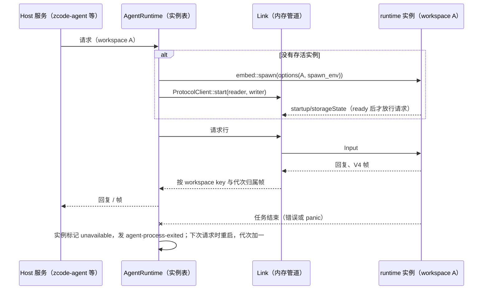

# U3：Host 与 runtime 合并为一个进程

日期：2026-10-09。上级规划：[rust-unified-host.md](rust-unified-host.md) 的 U3。前置：[rust-u1-runtime-library.md](rust-u1-runtime-library.md)（嵌入入口与显式环境）。

## 1. 目标与分期

Rust Host 不再为每个 workspace 启动 CLI 子进程，runtime 以库的形式运行在 Host 进程内。分两期：

| 期  | 内容                                                                                                                                                                 | 交付后的形态                                               |
| --- | -------------------------------------------------------------------------------------------------------------------------------------------------------------------- | ---------------------------------------------------------- |
| A   | 嵌入式链路：Host 的 agent 子系统通过内存管道与进程内 runtime 通信，协议仍是今天的 NDJSON 行；进程管理的语义（按 workspace 的实例、代次、惰性重启、生命周期事件）不变 | 一个 Host 进程，没有 CLI 子进程；Host 的其余代码不感知差别 |
| B   | 去掉进程内的序列化往返，合并两边重复的状态（rust-unified-host.md 2.3 的 P2）：投递与订阅、sessions-index、provider 注册表；反向请求改为端口；已接受输入的持久化      | Host 直接与 runtime 交换类型化消息                         |

本文先规定 A 期。B 期在 A 期验证通过、U2 的服务拆分完成后另写一节。

## 2. A 期的规则

### 2.1 runtime 实例的粒度

A 期每个 workspace key 一个 runtime 实例（一个 Engine），另加 plugin-management 与 mcp-status 两个 lane 的实例，与今天的进程表一一对应。理由：

- Host 按 workspace key 归属帧、发生命周期事件、记代次、做惰性重启；实例粒度不变，这些语义全部保留。
- 一个实例的 panic 或致命错误只结束这个实例，其他 workspace 不受影响，等同于今天一个 CLI 进程崩溃。
- “一个 Engine 管所有 workspace”（rust-unified-host.md D-U12）需要改 Host 的帧归属与生命周期，放到 B 期与投递合并一起评估，届时以 rust-unified-host.md 14.1 的测量为依据。

### 2.2 链路

```rust
/// 一条到 runtime 的协议链路：子进程的 stdio，或进程内 runtime 的内存管道。
pub struct Link {
    pub reader: Box<dyn AsyncRead + Send + Unpin>,
    pub writer: Box<dyn AsyncWrite + Send + Unpin>,
    /// 子进程才有；嵌入式链路没有 pid，也没有 stderr。
    pub pid: Option<u32>,
    pub stderr: Option<ChildStderr>,
    pub exit: Exit,
}
pub enum Exit {
    Process(Child),
    Embedded { task: JoinHandle<anyhow::Result<()>>, cancel: CancellationToken },
}
impl Exit {
    /// 等到 runtime 结束，返回结束原因（进入 `agent-process-exited` 的 reason 与日志）。
    pub async fn wait(&mut self) -> String;
    /// 回收：子进程按“等 1.8 s → TERM 整组 → 等 2 s → KILL”；嵌入式 runtime 先取消，再等任务结束。
    pub async fn terminate(&mut self, pid: Option<u32>);
}
```

- **选择方式**：嵌入式链路是 Rust Host 的缺省（A 期已验证，见 [rust-u3-embedded-runtime.md](../reports/rust-u3-embedded-runtime.md)）。子进程链路只在显式给出命令时使用，只作差分对照，B 期结束时删除（rust-unified-host.md D-U9：Rust Host 内只运行 Rust runtime）。命令解析（`agent/command.rs`）只读 Host 环境里的两个变量，规则如下：

  | `ZCODE_AGENT_SERVER_COMMAND` | `ZCODE_AGENT_SERVER_RUNTIME`  | 结果                                                                                                                                                                                 |
  | ---------------------------- | ----------------------------- | ------------------------------------------------------------------------------------------------------------------------------------------------------------------------------------ |
  | 未设置（或为空）             | 未设置或 `embedded`           | 嵌入式链路                                                                                                                                                                           |
  | 未设置                       | 其他值（含 `zcode-cli-rust`） | 解析失败：子进程链路必须给出命令，不回退到嵌入式                                                                                                                                     |
  | 已设置                       | `zcode-cli-rust`              | Rust CLI 子进程：参数取 `ZCODE_AGENT_SERVER_ARGS_JSON`（缺省 `app-server --stdio`），Host 追加 `--cwd <workspacePath>`；等 `startup/storageState`；会话库以 `--prepare-storage` 准备 |
  | 已设置                       | 未设置                        | 协议替身：按命令原样启动，不等存储就绪，会话库准备报 `unsupported_runtime`。只用于 Host 测试里的脚本替身                                                                             |
  | 已设置                       | `embedded` 或其他值           | 解析失败                                                                                                                                                                             |

  子进程命令最后一律去掉已有的 `--surface` 参数，再追加 `--surface desktop`。解析失败时，请求以错误返回，会话库准备以 `unsupported_runtime` 失败。

  Rust Host 不再查找其他 runtime：开发态 `zcode.cjs`（`ZCODE_HOST_NODE_EXEC_PATH` 加向上查找、`ZCODE_AGENT_BUNDLE_PATH`、`ZCODE_DESKTOP_AGENT_BYTECODE`）和已部署的二进制（`GLM_BINARY_PATH`）都已删除。Main 给 Node Host 准备的环境里带着 `GLM_BINARY_PATH`，Rust Host 忽略它；`ZCODE_HOST_NODE_EXEC_PATH` 仍由 Main 传入，只给远端连接器用（rust-host-remote.md）。

- **环境**：嵌入式 runtime 的 `RuntimeOptions.env` 就是今天传给子进程的那份环境（`spawn_env`：基础环境、网络设置、provider 配置文件路径、各服务贡献的变量、workspace 身份）。runtime 只读这份环境（U1 L4），不读 Host 进程的环境。
- **路径**：`cwd` 是 Host 提交的原始 workspace 路径；`base_dir` 是今天子进程的 cwd；数据目录取环境中的 `ZCODE_CLI_RUST_DATA_DIR`，缺省 `<home>/.zcode/rust`。
- **存储准备**：`--prepare-storage` 握手改为以 `prepare_storage: true` 启动一个嵌入式实例，经同一条管道完成，握手内容不变。
- **日志**：runtime 用 `tracing`。Host 在启动时安装 runtime 的日志 subscriber（写同一个 `zcode-rust-<date>.jsonl`），否则进程内 runtime 的日志无处可去。
- **结束原因**：任务正常结束为 `runtime_exit: ok`；返回错误为 `runtime_exit: <error>`；panic 为 `runtime_panicked: <message>`。后两者按“意外退出”处理，与子进程异常退出走同一条路径（生命周期 `unavailable`、下次请求时惰性重启、代次加一）。Engine 循环里的 panic 由 Engine 转成错误（§2.5），所以表现为 `runtime_exit: task panicked: …`。Host 日志中实例结束的那一行（`agent[<key>#<代次>] closed: <原因>`）记的是这个原因：runtime 结束时输出管道随之关闭，读循环往往先看到 `stdout_closed`；这时 Host 再等结束结果（至多 1 s），runtime 没有正常结束就记它给出的原因。嵌入式 runtime 没有 stderr，不这样做原因就会整个丢失。挂起的请求仍以 `ZCode agent transport closed: stdout_closed` 失败，界面显示“发送失败”并把输入退回输入框，与子进程链路相同。
- **没有 pid 的后果**：不发 `agent-process-*` 事件（它们描述的是进程，Main 的校验要求数字 pid）；runtime 实例的启动与结束写 Host 日志，异常结束记 warn。按 pid 采样的资源统计不再覆盖 runtime（它已经是 Host 进程的一部分），由 Host 进程自身的采样体现。稳定性遥测里的“agent 进程退出”因此没有嵌入式对应项，U8 接入遥测时补一条不带 pid 的事件。
- **子进程归属**：runtime 启动的 MCP 与工具进程现在是 Host 的子进程。`collectLocalRuntimeChildProcesses` 仍按 workspace 与 lane 列出它们，条目里的 `pid` 是 Host 进程自己的 pid。

### 2.3 状态所有者（A 期）

| 状态                                   | 所有者                               | 相对今天                         |
| -------------------------------------- | ------------------------------------ | -------------------------------- |
| 会话事实、队列、seq / epoch、V4 帧编码 | runtime 实例（Engine）               | 不变，只是从子进程变成进程内任务 |
| 实例表、代次、惰性重启、存储准备       | Host `agent` 的 `AgentRuntime`       | 不变                             |
| 每个 attachment 的 V4 订阅归属与路由   | Host connection scope                | 不变                             |
| runtime 看到的环境                     | `RuntimeOptions.env`（由 Host 组装） | 取代子进程环境                   |
| runtime 的 tokio 任务                  | Host 的 tokio 运行时                 | 新增：与 Host 服务共用运行时     |

### 2.4 事件顺序



### 2.5 实例异常结束时的收口

runtime 是独立进程时，它崩溃后操作系统回收一切，Host 再按进程组清理残留的子进程。runtime 在 Host 进程内时没有这层保障，所以：

- **Engine 循环 panic**：panic 被转成错误，Engine 照常执行停止流程——取消运行中的 run、取消各会话的工具、等工具进程树结束——然后 runtime 任务以错误结束。此时内存里的会话事实可能只改了一半，所以按“存储提交失败”处理：停止流程不再提交任何东西。库里仍标记为运行中的会话，由下一个实例按“上一个进程崩溃”的现有规则恢复。
- **run 任务 panic**：只让这一轮失败（U0 的 B1），实例不受影响。
- **实例结束后**：Host 取消该实例的取消令牌（实例内仍在等待它的派生任务随之结束），标记实例不可用，下一次请求时惰性重启，代次加一。其他 workspace 的实例不受影响。
- **以进程内标记的锁 owner**（插件事务、hook 信任存储、设备 id）：实例结束时注销，新实例把残留记录当作无主并立即恢复（U1 L6）。

**故障注入（只在调试构建中编译）**：runtime 环境里有 `ZCODE_RUNTIME_FAULT_MARKER=<标记>` 时，Engine 循环在处理参数中含该标记的请求时 panic。用于测试上面的规则，以及桌面 E2E 中取代“杀掉 CLI 进程”的场景。发布构建不含这段代码。

## 3. 验收（A 期）

- `cargo nextest`：Host 中驱动真实 CLI 的测试（`crates/services/tests/agent_cli.rs` 等）增加嵌入式变体，全部通过；嵌入式变体不需要预先构建 CLI 二进制。
- 一个 runtime 实例 panic：只有它的 workspace 收到不可用与退出事件，其他 workspace 的会话继续流式；下一次请求时重启成功。
- `pnpm test:rust-host` 通过。
- 桌面 E2E（`scripts/rust-host/e2e`）在 `ZCODE_AGENT_SERVER_RUNTIME=embedded` 下全部通过，`desktop-continuous` 与 `web-remote-replayable` 两种语义都覆盖；进程表中没有 CLI 子进程。
- 对照测量：N 个 workspace 同时流式时的控制 RPC p95、Host 进程 RSS 与 CPU，和子进程链路对比，写入 `docs/reports/`。
