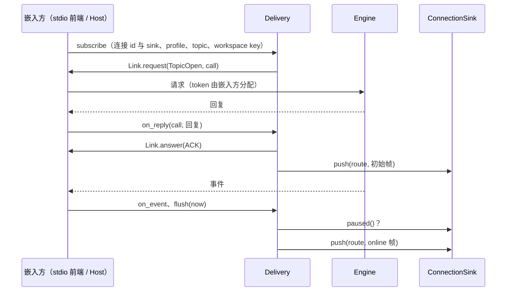
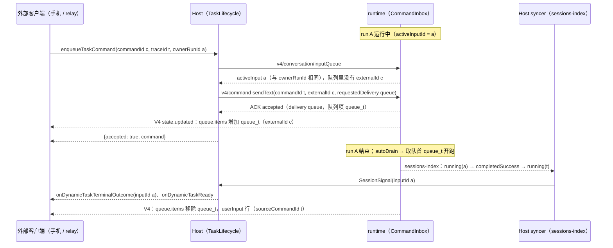

# U3 B 期：进程内合并之后的整理

日期：2026-10-09。上级规划：[rust-unified-host.md](rust-unified-host.md) 的 U3。前置：[rust-u3-single-process.md](rust-u3-single-process.md)（A 期：runtime 已在 Host 进程内，经内存管道说 App 协议）。

**修订（2026-10-09）**：用户决定 Host 与 CLI 在代码结构上保持隔离、能分开编译（[rust-host-cli-boundary.md](rust-host-cli-boundary.md)）。边界是 App 协议，两种链路（进程内、子进程）都保留。本文原先为“去掉进程边界留下的东西”设计的步骤里，凡是要让 Host 依赖 runtime 内部的都取消，见第 4、5 节。

## 1. 目标

A 期之后运行时已经是一个进程。B 期只做与边界不冲突的整理：runtime 内部的结构（投递逻辑只有一份）、同一会话的输入队列归一、以及用测量决定实例粒度。

## 2. 核对后的现状

与规划（rust-unified-host.md 2.3、第 12 节）的假设不一致之处：

| 规划的假设                        | 源码中的事实                                                                                                                                                                          | 对 B 期的影响                                            |
| --------------------------------- | ------------------------------------------------------------------------------------------------------------------------------------------------------------------------------------- | -------------------------------------------------------- |
| 类型化链路的价值在于省掉序列化    | 每个请求省两次编解码、每帧省一次扫描与拷贝，CPU 收益小。真正的价值是删掉 Host 的第二套订阅表、帧的重组、按超时回收实例                                                                | 链路与“投递归一”一起做，单做链路不值得                   |
| 已接受的输入需要持久化（10.2）    | V4 已接受的输入在 admission 时写入账本并在回 ACK 前提交；重启后结算为“已丢弃”，以 `fault.command.inputDiscardedOnRestart` 明确报失败，UI 已处理。只在内存里的是 Host 的 host 命令队列 | 不做“按原顺序恢复”（重放可能让副作用执行两次），只补测试 |
| 扩展目录是双写                    | 两边各自每次重新读文件，没有共享状态；重复的是解析器                                                                                                                                  | 不属于 B 期（解析器合并归 U0 / U9）                      |
| sessions-index 是双写             | tasks-index 存的是 Host 自己的事实（分组、顺序、归档、自动化绑定）。重复的只是观察机制：Host 订阅 wire 帧再自行重组                                                                   | 只改观察机制                                             |
| 子进程链路留到 B 期结束作差分对照 | 它与嵌入式跑同一份 runtime、同一个协议，差别只在进程层面，作为对照信息量很小；而端口化（3.4、3.5）无法跨进程                                                                          | 在 B 期一开始删除                                        |

真正重复的状态：

| 事实                    | runtime 侧                                          | Host 侧                                                                                          |
| ----------------------- | --------------------------------------------------- | ------------------------------------------------------------------------------------------------ |
| V4 订阅归属、暂停与恢复 | `Delivery`：按（topic, 连接）登记，缓冲、窗口、水位 | 每连接一个 scope：归属表、ACK 前的暂存、路由任务、代次过滤、流控消息 `v4/connection/flow` 的扇出 |
| provider 注册表         | 每个实例每秒读两份文件并解析                        | 每秒轮询并解析；写出文件、把路径放进环境变量；账号配置按实例推送                                 |
| 同一会话的输入队列      | `CommandInbox`                                      | host 命令队列（`enqueueTaskCommand` 等）                                                         |

第 2 节表中“真正重复的状态”里，V4 订阅归属与 provider 注册表两项是协议边界两侧各自需要的状态：任何一侧单独运行时都要有自己的一份，所以保留。只有“同一会话的输入队列”一项仍要归一（3.4）。

## 3. 规则

### 3.1 边界

见 [rust-host-cli-boundary.md](rust-host-cli-boundary.md)。Host 在链路之上的代码不区分进程内与子进程；runtime → Host 的请求、provider 配置的传递、控制面的两个 lane、Host 按连接保存的订阅归属都保持 A 期的形态。

### 3.2 投递 crate 的边界与接口

crate：`apps/zcode-cli-rust/crates/delivery`（`zcode-cli-delivery`）。只依赖 `core-api` 与 `domain`，不依赖 `app-server`、`core`、`tools`、`state`、`model`、`host`。它不启动任务，也不读时钟：时间由调用方以 `now` 传入。

| 归投递 crate                                                                                                                  | 留在 stdio 前端（`app-server`）                                                                  |
| ----------------------------------------------------------------------------------------------------------------------------- | ------------------------------------------------------------------------------------------------ |
| 按（topic, 连接）的订阅表、缓冲与刷新窗口、水位、断档与溢出后的快照恢复                                                       | stdin / 管道分帧、请求行解析、`Method::parse` 与方法路由                                         |
| 两种 profile 的规则：窗口、replayable 的过滤与回放、TTFT 只附在 continuous 的 online 帧（`Profile`、`Buffer` 仍在 `domain`）  | 请求参数解析：`topic`、`connectionId`、`clientMode` 得到连接与 profile；校验顺序与错误码不变     |
| 订阅、resync、快照恢复三类 runtime 请求与回复的配对（ACK 与初始帧），runtime 事件到帧的翻译                                   | token 分配与待答表、发往 runtime 的队列、回复与 host 请求的序列化                                |
| 连接表：`saturated` / `drained` 的暂停、积压暂停与恢复、连接关闭时释放 pin                                                    | `v4/connection/flow` 消息本身（保留），`ConnectionClosed`（它属于上传暂存）                      |
| V4 wire v3 的编码与分片（预算仍按 CLI NDJSON、Channel、手机 relay 三种载体计算），以及包成 `v4/conversation/frame` 通知的函数 | 把帧包成通知行写出；stdout 积压的测量与 64 / 16 MiB 阀；刷新定时与每 100 ms 的积压检查；存储握手 |

嵌入方提供两样东西：

- `ConnectionSink`：一条投递连接的出口，由连接的所有者实现。
  - `push(route, frames)`：一个订阅的一个逻辑帧（一条 complete 或一组 fragment，均为 wire JSON），按投递产生的顺序送达；不阻塞，连接已关闭时丢弃。`route` 是 topic 与订阅时给出的 workspace key，嵌入方按它分发，不解析帧。
  - `paused()`：连接的积压是否越过水位（带滞回，由所有者维护）。
- `Link<R>`：runtime 链路与客户端请求的应答。`request(method, params, call)` 发 `TopicOpen` / `TopicSnapshot`，嵌入方分配 token，回复连同 `call` 交回 `Delivery::on_reply`；`release(topic)` 释放一个 pin；`answer(reply, result)` 回答订阅或 resync 请求。`R` 是嵌入方的应答句柄（stdio 前端是请求 id）。

`Delivery` 的入口：`subscribe`、`resync`、`unsubscribe`、`saturated`、`drained`、`close_connection`、`on_reply`、`on_event`、`flush`、`relieve`、`flush_final`、`next_due`。连接（id 与 sink）和 profile 都是参数，由连接的所有者给出：stdio 前端取自请求的 `connectionId` / `clientMode`（与今天相同），B4c 的 Host 取自 Gateway 连接。

规则：

- 同一订阅先 `answer`，再 push 初始帧。stdio 前端的 `answer` 立即写进同一批输出，线上仍是回复行在前、初始帧在后（与今天相同）；Host 的 `answer` 经调用返回，晚于已入队的初始帧，所以 Gateway 队列里初始帧在前（见上面第 5 条）。
- 两种暂停并存：
  - `saturated` / `drained`（`v4/connection/flow`）：停止刷新，缓冲继续累积直到溢出；`drained` 后立即刷新。
  - 积压（`paused()`）：投递在每次刷新前询问未拥塞的连接，为真时丢弃该连接的全部缓冲、标记需要快照恢复，此后跳过它的增量；`relieve` 时询问已拥塞的连接，为假时让需要恢复的订阅立即到期。连接首次登记时按当时的 `paused()` 记初始状态，不清缓冲。
  - 拥塞期间跳过增量的订阅都标记需要快照恢复，包括拥塞期间才登记、或在拥塞期间经 resync、快照恢复、历史重置拿到新快照的订阅。修复：以前只在进入拥塞时标记一次，这些订阅在拥塞解除后要等下一次增量暴露断档才补齐，会话空闲时一直停在旧状态。
- stdio 前端的所有连接共用一个 sink，它的 `paused()` 是前端维护的进程级拥塞位：刷新前写端积压超过 64 MiB 时置位，每 100 ms 检查一次，低于 16 MiB 时清位。所有连接因此同时进入、同时恢复，与抽取前的全局阀相同。B4c 的 Host 让 `paused()` 读出站队列的饱和状态，在 `drained` 边沿或定时调用 `relieve`。
- 连接在第一次订阅登记时按给出的 sink 建立，最后一个订阅结束或 `close_connection` 时删除。`close_connection` 让它的每个订阅各释放一次 pin，topic 的最后一个订阅释放后 runtime 不再保留它；`ConnectionClosed` 由嵌入方随后发送。
- 帧的字节与顺序、窗口（30 ms / 150 ms / 0）、水位、错误码与恢复都与抽取前相同。app-server、`tests/`、Node 驱动的集成测试与 Host 的测试不改断言。

说明：本小节里提到的“B4c 的 Host”是抽取时为第二个使用方预留的接口形状。按修订，Host 不直接使用这个 crate；接口保留，供 runtime 自己的前端与将来保持协议边界的进程内传输使用。

### 3.3 实例粒度（D-U12）

用户决定（2026-10-10）：保持每个本地 workspace 一个 runtime 实例，不切换到一个 Engine 管所有 workspace。对比与理由见 [rust-unified-host.md](rust-unified-host.md) 14.1。一条链路对应一个实例，这对进程内与子进程两种链路都成立。

### 3.4 输入队列（D-U6）

用户决定（2026-10-10）：仓库外的客户端仍在调用 `enqueueTaskCommand` / `promoteTaskCommand` / `cancelTaskCommand`，接口保留，改为映射。

- 同一会话只有一个输入队列，所有者是 runtime 的 `CommandInbox`。Host 不再保存自己的 host 命令队列。
- 映射经 App 协议完成（对两种链路相同）：

| Host 接口            | runtime 命令                                                 |
| -------------------- | ------------------------------------------------------------ |
| `enqueueTaskCommand` | 以排队方式提交输入，沿用调用方的 `commandId` 作幂等键        |
| `promoteTaskCommand` | 把该队列项移到队首（不是“立即发送”：那会取消正在运行的 run） |
| `cancelTaskCommand`  | 删除该队列项                                                 |

- 对外的返回形状与错误码保持不变；做不到完全相同的地方列在 3.4.4。

#### 3.4.1 改动前的契约

Rust Host：`tasks/queries.rs`、`tasks/lifecycle.rs`；Node：`zcodeTaskServiceAdapter.ts` 的同名成员与 drain，形状相同。

| 成员                 | 参数（第一个参数的字段）                                                                                                                                                                           | 返回                                                                                                                                                                                                     | 错误                                                        |
| -------------------- | -------------------------------------------------------------------------------------------------------------------------------------------------------------------------------------------------- | -------------------------------------------------------------------------------------------------------------------------------------------------------------------------------------------------------- | ----------------------------------------------------------- |
| `enqueueTaskCommand` | `workspacePath`、`workspaceIdentity?`、`taskId`、`commandId`、`traceId`、`queryId?`、`type: "send_prompt"`、`content`、`attachments?`、`clientId?`、`clientLabel?`、`automationId?`、`ownerRunId?` | `{accepted: true, command}`：command 由参数拼出（`ZCodeTaskSendPromptCommand`，`status: "accepted"`，`createdAt = updatedAt = now`）                                                                     | 只有 owner 的两个错误码                                     |
| `promoteTaskCommand` | `workspacePath`、`workspaceIdentity?`、`taskId`、`commandId`、`ownerRunId`、`clientMode`                                                                                                           | 该项正在发送：原样返回；否则移到队首、`status` 置 `accepted`、刷新 `updatedAt`，返回 `{accepted: true, command}`                                                                                         | 找不到：`OWNER_COMMAND_FAILED`（`Task command not found.`） |
| `cancelTaskCommand`  | 同上，`ownerRunId?`                                                                                                                                                                                | 找不到：`{canceled: true, commandId, reason: "not_found"}`；正在发送：`{canceled: false, commandId, reason: "already_running", status: "running"}`；否则移除，返回 `{canceled: true, commandId, status}` | owner 的两个错误码                                          |

- owner：带 `ownerRunId` 时与 Host 内存里的 active input 比较。active input 由 `sendPrompt`、`compactSession`、`goalSession` 与 drain 在发送前设置，终态信号清除。没有：`NO_ACTIVE_TASK_OWNER`（`No active task owner.`）；不同：`STALE_TASK_OWNER_COMMAND`（`Stale task owner command.`）。
- 幂等：没有。同一 `commandId` 再入队得到第二项；drain 以 `traceId` 作 V4 commandId 发送，只有 runtime 按 `traceId` 去重。
- 顺序：每个会话一个 drain 门。Host 没有 active input、也没有正在发送的项时，取第一项发出（V4 `sendText`，`heldQueueDisposition: "keepQueueAndSend"`；有附件时走 `session/send`，同 `sendPrompt`）。发送失败的项记为 `failed`，不再自动发送；promote 把它改回 `accepted` 并再次 drain。终态信号（sessions-index 非终态 → 终态）依次：`onDynamicTaskTerminalOutcome {taskId, inputId?, outcome}`（inputId 是此刻的 active input）→ 移除正在发送的项、清 active input → `onDynamicTaskReady` → drain 下一项。
- 可观察：Rust Host 的 legacy `getTaskSnapshot` 是 stub，队列项只出现在三个成员的返回值里；cancel 在 `onDynamicTaskEvent` / `onDynamicStreamEvent` 上发 `task_snapshot_updated` 是唯一的事件。V4 conversation 的 `queue` 只含 runtime 自己的队列，项被 drain 发出后才以 userInput 行出现。Node 另在 legacy 快照的 `runtime.pendingCommands` 里给出队列。
- 生命周期：run 无论成功、失败还是被停止，结束后都继续 drain，不受 runtime 队列暂停的影响；runtime 的队列 held 时，drain 以 `keepQueueAndSend` 直接开跑，runtime 的队列保持暂停。runtime 实例重启时没有终态迁移，active input 不会被清除，队列停住不再发送；Host 重启时队列丢失，不报告。

#### 3.4.2 runtime 的契约

`busy_input.rs`、`commands.rs`、`queue_control.rs`、`state/src/node/acks.rs`。

- `sendText`：会话空闲时立即开跑（ACK `result.delivery = "startNow"`）。空闲但队列暂停（`autoDrain = false` 且队列非空，`inputRouting.mode = "choice"`）时必须带 `heldQueueDisposition`：`keepQueueAndSend` 保留队列并开跑，`clearQueueAndSend` 先清空。运行中则入队：`requestedDelivery` 缺省取会话的 `followupMode`（queue / guide），上限 32 项（`guard.queueFull`）。ACK `{status: "accepted", result: {type: "inputAccepted", delivery, inputId: commandId}}`；队列项 `queueItemId = queue_<commandId>`、`sourceCommandId = commandId`，开跑后轮头与 userInput 行的 `sourceCommandId` 也是它。
- 幂等键是 (sessionId, commandId)：重复提交返回缓存的 ACK（`accepted` 改报 `duplicate`），不再执行。
- run 结束：`autoDrain` 为真时取队首开跑；run 被停止或失败时 `autoDrain` 置假（队列暂停），等 `setAutoDrain`、`sendQueuedNow` 或新的发送。
- `reorderQueueItem {queueItemId, beforeQueueItemId}`、`deleteQueueItem {queueItemId}`：必须带 `baseRevision`，不符时回 `stale`（`revisionAtDecision` 是当前 revision）；项不在队列时报错；项已预留（`dispatch.state ≠ queued`）时回 `rejected guard.queueItemReserved`。删除把该项原来的 `sendText` ACK 改为 `failed guard.queueDeleted`，这个 commandId 不能再用。
- `sendQueuedNow`：预留该项、取消正在运行的 run，run 收口后开跑它；没有 run 时立即开跑。
- 带附件的输入：V4 `sendText` 的 `attachments` 只接受已提交的上传引用；legacy `session/send` 由 runtime 把 legacy 附件登记为会话产物再走同一 admission。legacy 发送开跑的 run 持有 legacy 锁，锁期间再来的 `session/send` 报 `-32010 A prompt is already running for this session`。
- 重启：runtime 实例结束时运行中的会话中断、队列清空。账本里仍是 admitted 的输入在会话下次载入（或查询其命令）时结算为 `discarded / session_resumed`；再提交同一 commandId 或 `v4/commands/query` 得到 `failed fault.command.inputDiscardedOnRestart`（`result: {type: "inputDisposition", delivery: "queue"}`，文案提示确认后重发）。已开跑的输入在 transcript 里，重提得到 `duplicate`。
- 可观察：V4 conversation 快照与 `state.updated` 的 `queue {items, autoDrain}`、`inputRouting.mode`、行的 `sourceCommandId`。continuous 与 replayable 都收到（replayable 只滤掉流式文本增量），断线后由快照或日志回放恢复。

#### 3.4.3 映射

两个 id 的分工与改动前的 drain 相同：`traceId` 是输入的 id（V4 commandId、轮头与 userInput 行的 `sourceCommandId`、终态的 `inputId`、`ownerRunId` 要匹配的值），`commandId` 是调用方给这个队列项的名字。runtime 把后者记在队列项上（`externalId`，3.4.5），promote / cancel 用它找到队列项。Host 经 App 协议调用，进程内与子进程两种链路相同。

三个成员都先读 `v4/conversation/inputQueue`（3.4.5），得到队列、正在运行的输入与 revision，再做下面的判断：

| 成员                 | Host 做什么                                                                                                                                                                                                                                                                                                                                                                                                                                                                              | 返回与错误                                                                                                                                                                                                                     |
| -------------------- | ---------------------------------------------------------------------------------------------------------------------------------------------------------------------------------------------------------------------------------------------------------------------------------------------------------------------------------------------------------------------------------------------------------------------------------------------------------------------------------------- | ------------------------------------------------------------------------------------------------------------------------------------------------------------------------------------------------------------------------------ |
| `enqueueTaskCommand` | 已有 `externalId = commandId` 的队列项或正在运行的输入：不再提交。否则与 `sendPrompt` 共用同一个提交函数：无附件时 V4 `sendText`，commandId 为 `traceId`，clientId 为调用方的 `clientId`（缺省 Host 的），payload 加 `requestedDelivery: "queue"`、`externalId: commandId`、`heldQueueDisposition: "keepQueueAndSend"`、`automationId?`（automation 追加 Cron 写工具，同 `sendPrompt`）；有附件时 legacy `session/send`，`inputId = traceId`，同样带 `requestedDelivery` 与 `externalId` | `accepted` / `duplicate`：`{accepted: true, command}`，command 照旧由参数拼出（`status: "accepted"`）。其余 ACK：`ZCODE_V4_COMMAND_REJECTED`（同 `sendPrompt`，`data.ack` 是原 ACK）；附件路径的错误同 `sendPrompt` 的附件路径 |
| `promoteTaskCommand` | 项在队列且未预留：已是队首，不调用；有 run 在跑，`reorderQueueItem` 移到原队首之前；没有 run（`running` 为假，队列暂停），`sendQueuedNow`，此时没有可取消的 run。两种命令都带读到的 `baseRevision`，`stale` 时重读再判断，至多 4 次；其余拒绝报 `ZCODE_V4_COMMAND_REJECTED`                                                                                                                                                                                                              | `{accepted: true, command}`：command 由队列项重建（3.4.4 第 4 条），`status: "accepted"`；项已预留或正在运行：`status: "running"`，不调用命令。都不是：`OWNER_COMMAND_FAILED`（`Task command not found.`）                     |
| `cancelTaskCommand`  | 项在队列且未预留：`deleteQueueItem`（`baseRevision`，重试同上），成功后照旧在 `onDynamicTaskEvent` / `onDynamicStreamEvent` 发 `task_snapshot_updated`（traceId 取该项的 `sourceCommandId`）                                                                                                                                                                                                                                                                                             | `{canceled: true, commandId, status: "accepted"}`；项已预留或正在运行：`{canceled: false, commandId, reason: "already_running", status: "running"}`；都不是：`{canceled: true, commandId, reason: "not_found"}`                |

- owner 检查：带 `ownerRunId` 时与 `activeInput.inputId` 比较，没有 → `NO_ACTIVE_TASK_OWNER`，不同 → `STALE_TASK_OWNER_COMMAND`。判定、错误码与文案在 `TaskLifecycle`，与改动前相同；事实改由 runtime 给出，Host 不再保存 active input。
- 终态与 ready：syncer 观察到非终态 → 终态时，`SessionSignal` 带上一份摘要的 `activeInputId`，`onDynamicTaskTerminalOutcome` 的 `inputId` 取它，随后发 ready。Host 不再 drain，下一项由 runtime 开跑。
- 空闲会话入队：runtime 立即开跑，与改动前 drain 立即发出相同。
- 队列暂停（held）时入队：`keepQueueAndSend` 直接开跑新项，暂停的队列保持，与改动前 drain 相同（Node 同）。
- 正在发送的项：被 runtime 取出开跑、或已预留（`sendQueuedNow` / startNow）的项，promote 回 `running`，cancel 回 `already_running`。
- 附件：只保留一条附件提交路径，即 legacy `session/send`。V4 附件事务要求 Host 自己把 legacy 附件（本地路径、内联字节、文本、类型与大小规则）转成上传字节，那会在 Host 复制 runtime 的附件规则；legacy 路径由 runtime 用同一套规则登记附件，再走同一 admission。runtime 让它带 `requestedDelivery: "queue"` 时在 legacy 锁下也入队，不报 `-32010`。等 V4 附件命令面就绪，与 `sendPrompt` 的附件路径一起换掉。
- 幂等：队列项在队列里或正在运行时按 `commandId` 去重（Host 读到同名项就不再提交）；之后按 runtime 的 (sessionId, traceId) 去重（重试带同一 traceId 时得到 `duplicate`）。已取消的项用同一 traceId 再入队得到 `failed guard.queueDeleted`，重启后得到 `inputDiscardedOnRestart`（3.4.2），都按上表报错。
- Host 重启与 runtime 实例重启：队列项消失（V4 `queue` 为空），promote 回 `OWNER_COMMAND_FAILED`，cancel 回 `not_found`，同一 traceId 重新入队报 `inputDiscardedOnRestart`。

#### 3.4.4 外部客户端能看到的差别

做不到完全相同的地方。都已按“建议”实现，需用户确认。

| #   | 改动前                                                                                                                  | 改动后                                                                                                                                                                 | 建议与理由                                                                                                                                                                                                                                                                                                                                                          |
| --- | ----------------------------------------------------------------------------------------------------------------------- | ---------------------------------------------------------------------------------------------------------------------------------------------------------------------- | ------------------------------------------------------------------------------------------------------------------------------------------------------------------------------------------------------------------------------------------------------------------------------------------------------------------------------------------------------------------- |
| 1   | 没有幂等：同一 `commandId` 再入队得到第二项                                                                             | 见 3.4.3“幂等”：排队与运行期间按 `commandId`，之后按 traceId                                                                                                           | 上面 D-U6 表格写的是“沿用 commandId 作幂等键”。若把 `commandId` 直接当 V4 commandId，幂等是完整的，但输入的 id 随之变成 `commandId`：终态 `inputId`、`ownerRunId` 匹配与行的 `sourceCommandId` 都从 traceId 变为 commandId，两者不同的客户端此后的 owner 命令会被判为 stale。建议保留现做法；要完整的 commandId 幂等，需要 runtime 在命令账本里按 `externalId` 查找 |
| 2   | run 被停止或失败后，已入队的项继续发送                                                                                  | runtime 的队列随之暂停（`autoDrain = false`），直到有客户端恢复：暂停期间空闲时入队立即开跑；运行中入队则排进暂停的队列，run 结束后不自动开跑；空闲时 promote 开跑该项 | 保留。一个队列只有一套规则；Host 替用户恢复队列是第二条写入路径，也会改掉桌面“停止即暂停队列”的行为                                                                                                                                                                                                                                                                 |
| 3   | runtime 的拒绝在 drain 时发生，项记 `failed`，调用方看不到                                                              | `enqueueTaskCommand` 当场报错：队列满（32 项）、会话不存在、traceId 已取消或在重启时丢弃。三个成员缺 `commandId`（enqueue 还有 `traceId`）时报参数错误                 | 保留。错误与 `sendPrompt` 相同，调用方不会等一个永远不会发出的项                                                                                                                                                                                                                                                                                                    |
| 4   | promote 返回入队时保存的 command                                                                                        | 由队列项重建：`traceId` 取 `sourceCommandId`、`content` 取队列文本、`createdAt` 取入队时间；不含 `queryId`、`clientId`、`clientLabel`、`attachments`、`automationId`   | 保留。Host 不再保存入队参数；需要完整回显时由 runtime 在队列项上保存这些字段                                                                                                                                                                                                                                                                                        |
| 5   | 运行中入队的 automation 项开跑时带 `automationId` 归因                                                                  | runtime 队列只保留算好的工具禁用表（Cron 写工具仍隐藏），开跑时不再带 automation 归因（日志与用量上的 automationId）                                                   | 保留。这是 runtime 队列的既有规则（与 Node CommandInbox 一致），桌面排队的输入相同                                                                                                                                                                                                                                                                                  |
| 6   | runtime 实例重启后队列停住；Host 重启后静默丢失                                                                         | 两种重启都丢弃排队项，同一 traceId 再入队以 `inputDiscardedOnRestart` 明确报告                                                                                         | 保留（第 5 节：不按原顺序重放）                                                                                                                                                                                                                                                                                                                                     |
| 7   | 只有 Host 发出的输入有 active input；桌面或 runtime 开跑的 run，owner 检查回 `NO_ACTIVE_TASK_OWNER`，终态没有 `inputId` | 任何带来源命令的 run 都有：owner 检查对它们回 `STALE_TASK_OWNER_COMMAND`（id 不同）或通过，终态带 `inputId`                                                            | 保留。与 Node 一致（Node 用 `turn.started` 的 inputId 更新 active input）                                                                                                                                                                                                                                                                                           |
| 8   | 队列项只有调用方自己知道                                                                                                | 进入 V4 conversation 的 `queue`：桌面与手机都能看到，桌面可以编辑、删除、重排、立即发送                                                                                | 这是单一队列的目的                                                                                                                                                                                                                                                                                                                                                  |

#### 3.4.5 runtime 新增的协议能力

都是附加的；只有 Rust runtime 实现（Rust Host 只运行 Rust runtime，D-U9）。

| 能力                                                                | 内容                                                                                                                                                                                                                                                                                                                                                                                                                           | TS 定义                                                            |
| ------------------------------------------------------------------- | ------------------------------------------------------------------------------------------------------------------------------------------------------------------------------------------------------------------------------------------------------------------------------------------------------------------------------------------------------------------------------------------------------------------------------ | ------------------------------------------------------------------ |
| `sendText.externalId`                                               | 调用方给这条输入的名字。排队时记在队列项上（`queue.items[].externalId`），开跑时记在轮头上；不进入持久化的 intent，重启后不保留                                                                                                                                                                                                                                                                                                | `zcode-protocol-v4/command.ts`、`snapshot.ts` 的 `queueItemSchema` |
| `v4/conversation/inputQueue`                                        | 只读、无状态、可重发。参数 `{sessionId}`；结果 `{revision, running, queue: {items, autoDrain}, activeInput?}`；`running` 对任何 run 为真（包括没有来源命令、因而没有 `activeInput` 的目标续跑轮）。`items` 是整个队列（含快照不显示的 startNow 预留项）；`activeInput = {inputId, externalId?, text?, startedAt?}` 取自运行中的轮头（`sourceCommandId`、`externalId`、`startedAt`）与该轮第一条 userInput 行的文本，空闲时缺省 | `zcode-protocol-v4/transport.ts`                                   |
| sessions-index 摘要的 `activeInputId`                               | 运行中时等于 `activeInput.inputId`，空闲时缺省；随 phase 一起变化，不增加帧                                                                                                                                                                                                                                                                                                                                                    | `zcode-protocol-v4/sessions-index.ts`                              |
| legacy `session/send` 的 `requestedDelivery: "queue"`、`externalId` | 会话运行中时以 queue 方式入队，即使 legacy 锁被占用；空闲时与缺省相同（立即开跑）。`externalId` 同 `sendText`                                                                                                                                                                                                                                                                                                                  | `zcode-protocol/index.ts` 的 `zcodeSessionSendParamsSchema`        |

#### 3.4.6 所有者与时序

| 事实                                   | 唯一所有者                                                                      | Host 如何得到                                                                                          |
| -------------------------------------- | ------------------------------------------------------------------------------- | ------------------------------------------------------------------------------------------------------ |
| 同一会话的输入队列（顺序、暂停、预留） | runtime `CommandInbox`                                                          | `v4/conversation/inputQueue`；改动只经 V4 命令                                                         |
| 入队幂等                               | runtime 命令账本（sessionId, traceId）；排队与运行期间另按队列项的 `externalId` | ACK；`inputQueue`                                                                                      |
| 正在运行的输入                         | runtime（运行中轮头的 `sourceCommandId` 与 `externalId`）                       | owner 检查读 `inputQueue.activeInput`；终态的 `inputId` 取上一份 sessions-index 摘要的 `activeInputId` |
| owner / stale 判定与错误码             | `TaskLifecycle`（只有规则，不存状态）                                           |                                                                                                        |
| 终态与 ready 事件                      | syncer（sessions-index 迁移）→ `TaskLifecycle`                                  |                                                                                                        |
| 同一会话写调用的到达顺序               | Gateway 串行键（3.4.7）                                                         |                                                                                                        |

#### 3.4.7 调用顺序

三个成员都改变一个会话的输入队列，使用与 `zcode-agent` 会话写操作相同的串行键 `session:<workspace key>:<taskId>`（[rust-u2-gateway.md](rust-u2-gateway.md) §2.2）：手机的入队与桌面直接的 V4 发送按到达顺序交给 runtime；promote / cancel 的“读队列 → 写命令”不会与同一会话的其他写调用交错。`zcode-task.sendPrompt` 的参数不带 workspace，算不出键，保持不设键。

#### 3.4.8 验收

- runtime（`apps/zcode-cli-rust/tests/input_queue.rs`，经 App 协议）：`inputQueue` 的空闲 / 运行中 / 暂停结果；`externalId` 记在队列项与轮头上；摘要的 `activeInputId` 随 run 出现与消失；`session/send` 带 `requestedDelivery: "queue"` 时在 legacy 锁下入队。
- Host（`crates/services/tests/task_queue_cli.rs`，进程内 runtime + 可挂起的模拟模型；设置 `ZCODE_TEST_CLI_RUST_BINARY` 时走子进程链路）：运行中入队进入 runtime 队列、run 结束后由 runtime 开跑并带终态 inputId；promote 改变顺序；暂停的队列上 promote 开跑该项；cancel 移除、正在运行的项回 `already_running`；同一 commandId 重复入队不产生第二项；空闲会话入队立即开跑；held 时入队开跑而队列保持暂停；带附件的项在 legacy 锁下入队；三个成员的返回形状与错误码；runtime 实例重启后的结果（3.4.3 最后一条）；owner 错误码不变。

## 4. 步骤

| 步   | 内容                                                                                                | 状态                                        |
| ---- | --------------------------------------------------------------------------------------------------- | ------------------------------------------- |
| B1   | 嵌入式成为缺省；桌面 E2E 改跑嵌入式；与子进程链路的对比测量                                         | 完成                                        |
| B4a  | 投递逻辑抽成独立 crate（3.2）                                                                       | 完成                                        |
| 边界 | 结构隔离、三种构建形态、单二进制多入口（[rust-host-cli-boundary.md](rust-host-cli-boundary.md)）    | 完成                                        |
| B8   | 实例粒度（3.3）                                                                                     | 决定：保持每个 workspace 一个实例，不做切换 |
| B9   | 输入队列归一（3.4）：三个接口映射到 `CommandInbox`，删除 Host 的命令队列                            | 完成；3.4.4 的差别待用户确认                |
| B10  | 已接受输入在实例重建后的结算：补测试（实例 panic 后查询命令状态得到 `inputDiscardedOnRestart`）     | 未开始                                      |
| 缺陷 | 投递 crate：连接关闭与在途的订阅请求竞争时，连接已关仍登记订阅（今天由 Host 在 ACK 后补发退订清理） | 未开始                                      |

## 5. 不做

| 项                                                                                                                                                                  | 原因                                                                                                                          |
| ------------------------------------------------------------------------------------------------------------------------------------------------------------------- | ----------------------------------------------------------------------------------------------------------------------------- |
| 删除子进程链路（原 B2）                                                                                                                                             | 它是链路的第二种实现，是“可分开编译”的依据                                                                                    |
| 控制面改为直接调用 runtime 库（原 B3）、反向请求改为端口（原 B5）、provider 输入改为进程内的值（原 B6）、Host 直接使用投递 crate 并删除自己的订阅归属（原 B4c、B7） | 让 Host 依赖 runtime 的内部或引入只有进程内才能用的通道，违反边界。两个 lane 各占一个实例，每个约 2–4 MiB，不值得为它破坏边界 |
| 类型化的进程内传输（原 B4b）                                                                                                                                        | 可以在保持协议边界的前提下做（消息类型放进共用 crate），但到 runtime 的往返 p50 已是 0.2 ms，目前没有测量支持                 |
| 扩展目录解析器的合并、provider 解析规则的合并                                                                                                                       | 是代码重复，不是状态重复；需要对拍样例，归 U9。共用的部分进 `rust/` 的共用 crate                                              |
| 已接受输入在重启后按原顺序重放                                                                                                                                      | 可能让副作用执行两次；“丢弃并明确报失败”与 Node 一致                                                                          |
