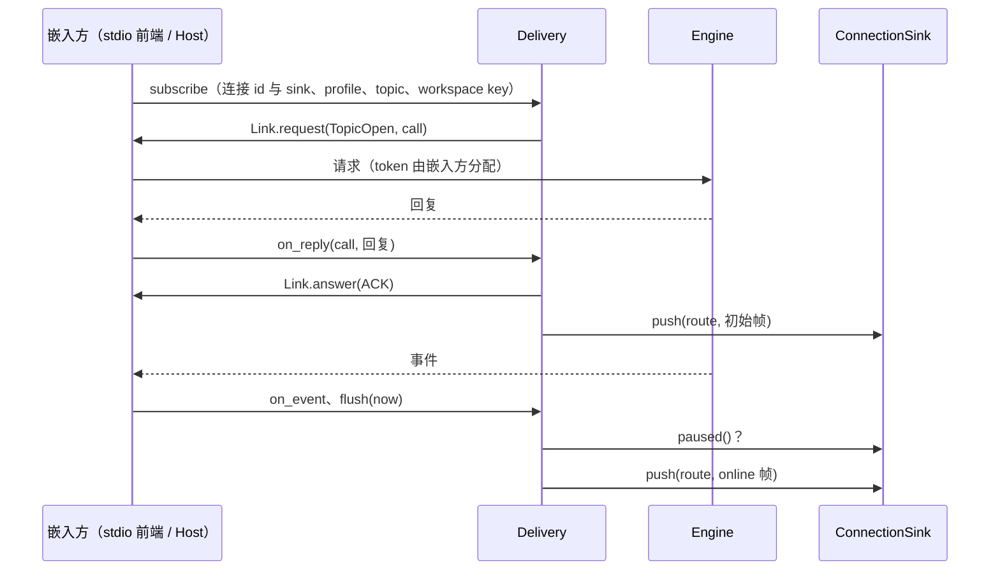
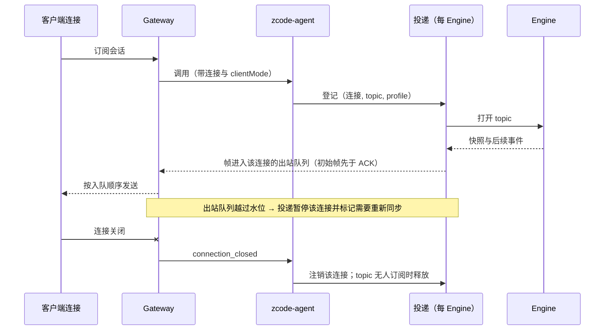

# U3 B 期：去掉进程边界留下的东西

日期：2026-10-09。上级规划：[rust-unified-host.md](rust-unified-host.md) 的 U3。前置：[rust-u3-single-process.md](rust-u3-single-process.md)（A 期：runtime 已在 Host 进程内，仍经内存管道说 NDJSON 协议）、[rust-u2-gateway.md](rust-u2-gateway.md)。

## 1. 目标

A 期之后，Host 与 runtime 在同一个进程里，但两者之间仍然是“两个进程”的形状：一条行协议、两套订阅表、经文件和环境变量传递的配置、为隔离而多起的实例。B 期把这些去掉，让每个事实只有一个所有者。

## 2. 核对后的现状

与规划（rust-unified-host.md 2.3、第 12 节）的假设不一致之处：

| 规划的假设                        | 源码中的事实                                                                                                                                                                          | 对 B 期的影响                                            |
| --------------------------------- | ------------------------------------------------------------------------------------------------------------------------------------------------------------------------------------- | -------------------------------------------------------- |
| 类型化链路的价值在于省掉序列化    | 每个请求省两次编解码、每帧省一次扫描与拷贝，CPU 收益小。真正的价值是删掉 Host 的第二套订阅表、帧的重组、按超时回收实例                                                                | 链路与“投递归一”一起做，单做链路不值得                   |
| 已接受的输入需要持久化（10.2）    | V4 已接受的输入在 admission 时写入账本并在回 ACK 前提交；重启后结算为“已丢弃”，以 `fault.command.inputDiscardedOnRestart` 明确报失败，UI 已处理。只在内存里的是 Host 的 host 命令队列 | 不做“按原顺序恢复”（重放可能让副作用执行两次），只补测试 |
| 扩展目录是双写                    | 两边各自每次重新读文件，没有共享状态；重复的是解析器                                                                                                                                  | 不属于 B 期（解析器合并归 U0 / U9）                      |
| sessions-index 是双写             | tasks-index 存的是 Host 自己的事实（分组、顺序、归档、自动化绑定）。重复的只是观察机制：Host 订阅 wire 帧再自行重组                                                                   | 只改观察机制                                             |
| 子进程链路留到 B 期结束作差分对照 | 它与嵌入式跑同一份 runtime、同一个协议，差别只在进程层面，作为对照信息量很小；而端口化（3.4、3.5）无法跨进程                                                                          | 在 B 期一开始删除                                        |

真正重复的状态：

| 事实                    | runtime 侧                                          | Host 侧                                                                                          |
| ----------------------- | --------------------------------------------------- | ------------------------------------------------------------------------------------------------ |
| V4 订阅归属、暂停与恢复 | `Delivery`：按（topic, 连接）登记，缓冲、窗口、水位 | 每连接一个 scope：归属表、ACK 前的暂存、路由任务、代次过滤、流控消息 `v4/connection/flow` 的扇出 |
| provider 注册表         | 每个实例每秒读两份文件并解析                        | 每秒轮询并解析；写出文件、把路径放进环境变量；账号配置按实例推送                                 |
| 同一会话的输入队列      | `CommandInbox`                                      | host 命令队列（`enqueueTaskCommand` 等）                                                         |

## 3. 规则

### 3.1 链路

- Host 与 runtime 之间交换类型化消息（runtime 已有的 `ClientMsg` / `ServerMsg`），不再有行协议、内存管道与 App Server 前端。方法参数仍是 JSON 值；按方法的参数类型化属于 U9。
- 存储准备的进度由一个状态值表达（取代 `startup/storageState` 行）。
- 一次调用等待超时只让这次调用失败，不再回收实例。实例是否卡死由 Engine 循环的心跳判断。
- 二进制的 `app-server --stdio` 保留（Node 驱动的集成测试与 Node Host 使用），它是同一套 runtime 的另一个前端。

### 3.2 投递只有一个所有者

- 投递逻辑（订阅、缓冲与刷新窗口、快照恢复、两种 profile）只有一份代码，从 App Server 抽成独立 crate；stdio 前端与 Host 都用它。
- 每条 Gateway 连接在它用到的每个 runtime 实例里登记为一条投递连接，帧直接进入该连接的出站队列。
- 暂停与恢复只看 Gateway 出站队列的水位（rust-u2-gateway.md 2.3），不再有 `v4/connection/flow` 消息与按 workspace 的扇出。
- profile 只由 Gateway 给出的 `clientMode` 决定，客户端无法自报。`desktop-continuous` 与 `web-remote-replayable` 的规则（刷新窗口、replayable 的过滤与回放、TTFT 只附在 continuous 帧上）不变。
- 订阅的初始帧先于 ACK 进入连接队列（顺序与今天相同）。Host 侧不再需要 ACK 前的暂存与代次过滤；错误码 `initialFrameStagingOverflow`、`runtimeRestarted` 随之消失。
- Host 内部的消费者（sessions-index 观察者、Bot）接收逻辑帧，不再订阅 wire 帧后自行重组。

#### 投递 crate 的边界与接口（B4a）

crate：`apps/zcode-cli-rust/crates/delivery`（`zcode-cli-delivery`）。只依赖 `core-api` 与 `domain`，不依赖 `app-server`、`core`、`tools`、`state`、`model`、`host`。它不启动任务，也不读时钟：时间由调用方以 `now` 传入。

| 归投递 crate                                                                                                                  | 留在 stdio 前端（`app-server`）                                                                  |
| ----------------------------------------------------------------------------------------------------------------------------- | ------------------------------------------------------------------------------------------------ |
| 按（topic, 连接）的订阅表、缓冲与刷新窗口、水位、断档与溢出后的快照恢复                                                       | stdin / 管道分帧、请求行解析、`Method::parse` 与方法路由                                         |
| 两种 profile 的规则：窗口、replayable 的过滤与回放、TTFT 只附在 continuous 的 online 帧（`Profile`、`Buffer` 仍在 `domain`）  | 请求参数解析：`topic`、`connectionId`、`clientMode` 得到连接与 profile；校验顺序与错误码不变     |
| 订阅、resync、快照恢复三类 runtime 请求与回复的配对（ACK 与初始帧），runtime 事件到帧的翻译                                   | token 分配与待答表、发往 runtime 的队列、回复与 host 请求的序列化                                |
| 连接表：`saturated` / `drained` 的暂停、积压暂停与恢复、连接关闭时释放 pin                                                    | `v4/connection/flow` 消息本身（保留），`ConnectionClosed`（它属于上传暂存）                      |
| V4 wire v3 的编码与分片（预算仍按 CLI NDJSON、Channel、手机 relay 三种载体计算），以及包成 `v4/conversation/frame` 通知的函数 | 把帧包成通知行写出；stdout 积压的测量与 64 / 16 MiB 阀；刷新定时与每 100 ms 的积压检查；存储握手 |

嵌入方提供两样东西：

- `ConnectionSink`：一条投递连接的出口，由连接的所有者实现。
  - `push(route, frames)`：一个订阅的一个逻辑帧（一条 complete 或一组 fragment，均为 wire JSON），按投递产生的顺序送达；不阻塞，连接已关闭时丢弃。`route` 是 topic 与订阅时给出的 workspace key，嵌入方按它分发，不解析帧。
  - `paused()`：连接的积压是否越过水位（带滞回，由所有者维护）。
- `Link<R>`：runtime 链路与客户端请求的应答。`request(method, params, call)` 发 `TopicOpen` / `TopicSnapshot`，嵌入方分配 token，回复连同 `call` 交回 `Delivery::on_reply`；`release(topic)` 释放一个 pin；`answer(reply, result)` 回答订阅或 resync 请求。`R` 是嵌入方的应答句柄（stdio 前端是请求 id）。

`Delivery` 的入口：`subscribe`、`resync`、`unsubscribe`、`saturated`、`drained`、`close_connection`、`on_reply`、`on_event`、`flush`、`relieve`、`flush_final`、`next_due`。连接（id 与 sink）和 profile 都是参数，由连接的所有者给出：stdio 前端取自请求的 `connectionId` / `clientMode`（与今天相同），B4c 的 Host 取自 Gateway 连接。

规则：

- 同一订阅先 `answer`，再 push 初始帧。stdio 前端的 `answer` 立即写进同一批输出，线上仍是回复行在前、初始帧在后（与今天相同）；Host 的 `answer` 经调用返回，晚于已入队的初始帧，所以 Gateway 队列里初始帧在前（见上面第 5 条）。
- 两种暂停并存：
  - `saturated` / `drained`（`v4/connection/flow`）：停止刷新，缓冲继续累积直到溢出；`drained` 后立即刷新。
  - 积压（`paused()`）：投递在每次刷新前询问未拥塞的连接，为真时丢弃该连接的全部缓冲、标记需要快照恢复，此后跳过它的增量；`relieve` 时询问已拥塞的连接，为假时让需要恢复的订阅立即到期。连接首次登记时按当时的 `paused()` 记初始状态，不清缓冲。
- stdio 前端的所有连接共用一个 sink，它的 `paused()` 是前端维护的进程级拥塞位：刷新前写端积压超过 64 MiB 时置位，每 100 ms 检查一次，低于 16 MiB 时清位。所有连接因此同时进入、同时恢复，与抽取前的全局阀相同。B4c 的 Host 让 `paused()` 读出站队列的饱和状态，在 `drained` 边沿或定时调用 `relieve`。
- 连接在第一次订阅登记时按给出的 sink 建立，最后一个订阅结束或 `close_connection` 时删除。`close_connection` 让它的每个订阅各释放一次 pin，topic 的最后一个订阅释放后 runtime 不再保留它；`ConnectionClosed` 由嵌入方随后发送。
- 帧的字节与顺序、窗口（30 ms / 150 ms / 0）、水位、错误码与恢复都与抽取前相同。app-server、`tests/`、Node 驱动的集成测试与 Host 的测试不改断言。

### 3.3 控制面不再占用 runtime 实例

- 插件管理的 16 个成员改为直接调用 runtime 库里的插件操作；它们不需要 Engine。插件操作超时只让这次操作失败。
- MCP 状态探测保留隔离，但只隔离到“一个独立的 MCP Hub”（空闲 5 分钟后关闭），不再为它起一个 runtime 实例。隔离的原因不变：探测不能占住会话准备 MCP 时要用的那把门，空闲回收也不能误杀会话的 MCP 进程。
- Rust runtime 不支持的 `workflows/*` 直接回不支持，不再经过实例。

### 3.4 反向请求改为端口

- runtime 实际发出的反向请求只有两个：模型请求的账号头、官方 MCP 的鉴权头。它们改为构造时传入的端口，由 account 实现；取消即丢弃调用，不再有取消通知与按（workspace, 代次）登记的待答表。
- 二进制的 stdio 前端用一个适配器实现同样的端口（把调用转成今天的协议消息）。
- Host 里只为 TS CLI 准备的反向处理（浏览器、automation、offPeak、权限与提问、资源采样）在子进程链路删除后一并删除登记；对应的服务保留。Rust runtime 实现这些工具时直接按端口接入。

### 3.5 provider 输入只有一个来源

- Host 的 provider 运行时把输入（内置配置、个人配置、账号叠加层、版本号）以值的形式提供给 runtime，变化时通知。runtime 不再轮询文件，Host 不再写出文件与注入路径，也不再按实例推送账号配置。
- 两边各自的解析规则本期不合并（需要先有 UI 模型列表的对拍样例，归 U9）。

### 3.6 运行环境

- runtime 的环境由组装根在启动时构造一份：登录 shell 环境、归一化的运行环境名、启动时的网络设置、服务端地址。修改代理需要重启 App（与今天界面上的提示一致）。
- 按 workspace 贡献环境变量的扩展点删除：今天的三个贡献方都不依赖 workspace；唯一按 workspace 的变量 `ZCODE_WORKSPACE_IDENTITY` 由请求里的 workspace 引用取代。

### 3.7 实例粒度（D-U12）

Host 内用一个拓扑开关表达两种形态：`SingleEngine`（一个 Engine 管所有本地 workspace）与 `PerWorkspace`（A 期的形态）。3.2–3.6 做完后，每实例的推送与投递都已消失，两种形态的差别只剩 workspace → Engine 的路由。

用户的决定是一个 Engine（D-U12），每 workspace 一个实例是文档化的兜底。切换到一个 Engine 之前先测量，结果写入 `docs/reports/`：

| 指标 | 内容                                                                                              | 门槛    |
| ---- | ------------------------------------------------------------------------------------------------- | ------- |
| M1   | N = 1 / 4 / 8 个 workspace 同时流式时，控制 RPC 的 p95                                            | ≤ 20 ms |
| M2   | workspace B 在冷加载大会话、提交 20 MiB 附件、安装插件时，workspace A 的 Stop 得到 ACK 的延迟 p95 | ≤ 50 ms |
| M3   | 每多一个 workspace 增加的常驻内存与线程数（空闲与流式）                                           | 记录    |
| M4   | 新 workspace 第一条命令的 ACK 时间与首 token 时间                                                 | 记录    |
| M5   | Engine panic 后到下一条命令成功的时间                                                             | 记录    |

- M1、M2 达标，且 M3、M4 显示每实例的代价明显：采用一个 Engine。
- M1 或 M2 超标，并且把循环里的慢操作移出后仍超标：保持每 workspace 一个实例，并更新 D-U12。
- 每实例的代价很小（每 workspace 约 5 MB 以内、冷启动 100 ms 以内）：两种形态都可行，隔离性更好的每 workspace 一个实例占优，向用户报告后再定。

采用一个 Engine 时随之改变的规则：

- Engine 循环的 panic 或致命错误中断所有本地会话；Engine 重建后，Host 对所有已激活的 workspace 发生命周期事件（代次加一）。run 任务的 panic 仍只影响它的会话。
- 生命周期与代次由 Host 合成：workspace 第一次被使用时发 `available`，未使用的 workspace 仍报不可用（界面的休眠语义不变）。
- “重新加载会话”改为重置该 workspace 的作用域：取消它的 run、卸载它的会话、关闭它的 MCP 与 shell、重读配置；其他 workspace 不受影响。
- 会话库与网络出口是用户级资源：项目配置里的 `storage`、`network` 不再生效，出现时给出诊断信息。
- 后台请求上限、常驻会话预算、MCP Hub 的门变成整个进程共享，数值需要随之调整。

### 3.8 输入队列（D-U6）

同一会话只有一个输入队列，所有者是 runtime 的 `CommandInbox`。Host 的 host 命令队列删除或改为到 `CommandInbox` 的映射，取决于第 7 节的问题。

## 4. 状态所有者（B 期之后）

| 状态                            | 所有者                                |
| ------------------------------- | ------------------------------------- |
| 会话事实、输入队列、seq / epoch | runtime（Engine）                     |
| 订阅、缓冲、快照恢复            | 投递 crate 的实例（每个 Engine 一个） |
| 连接、出站队列、水位            | Gateway                               |
| provider 输入                   | Host provider 运行时                  |
| 账号凭据                        | Host account（经端口提供）            |
| workspace → Engine 的路由、代次 | Host 的 workspace 注册表              |
| tasks-index（分组、顺序、归档） | Host tasks（不变）                    |

## 5. 步骤

每一步都可以单独合入与验证。

| 步  | 内容                                                                                                                                         | 验证                                                                                                               |
| --- | -------------------------------------------------------------------------------------------------------------------------------------------- | ------------------------------------------------------------------------------------------------------------------ |
| B1  | 嵌入式成为缺省；桌面 E2E 改跑嵌入式；与子进程链路的对比测量（A 期验收）                                                                      | 全部 E2E 场景通过，进程表里没有 CLI；报告                                                                          |
| B2  | 删除子进程链路：进程管理、命令解析链、存储准备的进程模式、`agent-process-*` 事件、`ZCODE_AGENT_SERVER_*`，以及只为 TS CLI 准备的反向处理登记 | 驱动 runtime 的 Host 测试只剩嵌入式且通过；E2E 通过                                                                |
| B3  | 控制面改为直接调用（3.3）                                                                                                                    | 新测试：项目插件列表、stdio MCP 的连接探测、空闲后探测进程被回收；E2E `agent-plugins-mcp`                          |
| B4a | 投递逻辑抽成独立 crate，stdio 前端作为它的一个使用方                                                                                         | 现有投递与 stdio 测试、Node 驱动的集成测试                                                                         |
| B4b | 类型化链路（3.1）；帧暂时经兼容适配                                                                                                          | Host 测试全部通过；控制延迟不退化；与 A 期链路做一次差分 E2E                                                       |
| B4c | Host 使用同一份投递（3.2）；删除 Host 的归属表、暂存、路由、流控扇出                                                                         | 两种 profile 的投递测试；replayable 断线后的快照恢复；慢连接只暂停它自己；E2E 的 reload、ask-user、attachment 场景 |
| B5  | 账号头与官方 MCP 鉴权改为端口（3.4）                                                                                                         | account 的现有测试；新测试：run 取消后迟到的凭据不会交付                                                           |
| B6  | provider 输入只有一个来源（3.5）                                                                                                             | account / provider 的现有测试与对拍；E2E `account-logged-in`                                                       |
| B7  | Host 内部消费者接收逻辑帧（3.2 最后一条）                                                                                                    | tasks、bots 的现有测试；E2E `tasks-*`、`automation-bots`                                                           |
| B8  | 3.7 的测量与决定；采用一个 Engine 时实现 workspace 注册表、重置作用域、Engine 重建                                                           | 测量报告；改写“实例 panic 只影响自己的 workspace”的测试；E2E 的韧性场景                                            |
| B9  | 输入队列归一（3.8）                                                                                                                          | 映射测试                                                                                                           |
| B10 | 已接受输入在 Engine 重建后的结算：补测试                                                                                                     | Engine panic 后查询命令状态得到 `inputDiscardedOnRestart`                                                          |

依赖：B2 在 B1 之后；B4c 在 B4a 与 Gateway 之后；B6 在 B5 之后；B8 在 B4c、B5、B6 之后。B4a、B5 与 B2 / B3 改的文件基本不重叠，可以并行。

## 6. 本期不做

| 项                                                 | 原因                                                    |
| -------------------------------------------------- | ------------------------------------------------------- |
| 扩展目录解析器的合并、provider 解析规则的合并      | 是代码重复，不是状态重复；需要对拍样例，归 U9           |
| 已接受输入在重启后按原顺序重放                     | 可能让副作用执行两次；“丢弃并明确报失败”与 Node 一致    |
| 浏览器、automation、offPeak 工具的端口             | Rust runtime 还没有这些工具（rust-parity-remaining.md） |
| legacy 会话事件的补号逻辑、远端 scope 的订阅归属表 | 前者是外部客户端仍在用的旧接口（U9），后者等 U5         |

## 7. 待定

| 问题                                                                                                                                                        | 影响 | 推荐                                                                                                                                                                                                            |
| ----------------------------------------------------------------------------------------------------------------------------------------------------------- | ---- | --------------------------------------------------------------------------------------------------------------------------------------------------------------------------------------------------------------- |
| 仓库外的客户端（手机 App、relay）是否还调用 `enqueueTaskCommand` / `promoteTaskCommand` / `cancelTaskCommand`？仓库内的界面没有调用方，只有远端转发列表里有 | B9   | 没有调用方：删除 Host 队列与这三个成员。仍在使用：映射到 `CommandInbox`（enqueue → 以排队方式提交并沿用 `commandId` 作幂等键；promote → 移到队首；cancel → 删除队列项），带附件的输入走哪条提交路径在实现前写清 |
