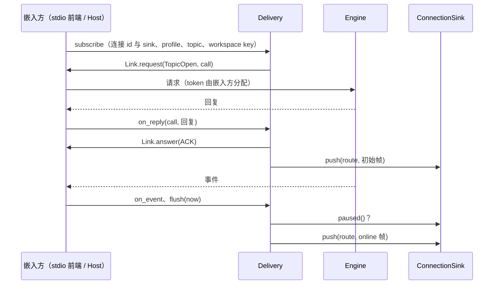

# U3 B 期：进程内合并之后的整理

日期：2026-10-09。上级规划：[rust-unified-host.md](rust-unified-host.md) 的 U3。前置：[rust-u3-single-process.md](rust-u3-single-process.md)（A 期：runtime 已在 Host 进程内，经内存管道说 App 协议）。

**修订（2026-10-09）**：用户决定 Host 与 CLI 在代码结构上保持隔离、能分开编译（[rust-host-cli-boundary.md](rust-host-cli-boundary.md)）。边界是 App 协议，两种链路（进程内、子进程）都保留。本文原先为“去掉进程边界留下的东西”设计的步骤里，凡是要让 Host 依赖 runtime 内部的都取消，见第 4、5 节。

## 1. 目标

A 期之后运行时已经是一个进程。B 期只做与边界不冲突的整理：runtime 内部的结构（投递逻辑只有一份）、同一会话的输入队列归一、以及用测量决定实例粒度。

## 2. 核对后的现状

与规划（rust-unified-host.md 2.3、第 12 节）的假设不一致之处：

| 规划的假设                        | 源码中的事实                                                                                                                                                                          | 对 B 期的影响                                            |
| --------------------------------- | ------------------------------------------------------------------------------------------------------------------------------------------------------------------------------------- | -------------------------------------------------------- |
| 类型化链路的价值在于省掉序列化    | 每个请求省两次编解码、每帧省一次扫描与拷贝，CPU 收益小。真正的价值是删掉 Host 的第二套订阅表、帧的重组、按超时回收实例                                                                | 链路与“投递归一”一起做，单做链路不值得                   |
| 已接受的输入需要持久化（10.2）    | V4 已接受的输入在 admission 时写入账本并在回 ACK 前提交；重启后结算为“已丢弃”，以 `fault.command.inputDiscardedOnRestart` 明确报失败，UI 已处理。只在内存里的是 Host 的 host 命令队列 | 不做“按原顺序恢复”（重放可能让副作用执行两次），只补测试 |
| 扩展目录是双写                    | 两边各自每次重新读文件，没有共享状态；重复的是解析器                                                                                                                                  | 不属于 B 期（解析器合并归 U0 / U9）                      |
| sessions-index 是双写             | tasks-index 存的是 Host 自己的事实（分组、顺序、归档、自动化绑定）。重复的只是观察机制：Host 订阅 wire 帧再自行重组                                                                   | 只改观察机制                                             |
| 子进程链路留到 B 期结束作差分对照 | 它与嵌入式跑同一份 runtime、同一个协议，差别只在进程层面，作为对照信息量很小；而端口化（3.4、3.5）无法跨进程                                                                          | 在 B 期一开始删除                                        |

真正重复的状态：

| 事实                    | runtime 侧                                          | Host 侧                                                                                          |
| ----------------------- | --------------------------------------------------- | ------------------------------------------------------------------------------------------------ |
| V4 订阅归属、暂停与恢复 | `Delivery`：按（topic, 连接）登记，缓冲、窗口、水位 | 每连接一个 scope：归属表、ACK 前的暂存、路由任务、代次过滤、流控消息 `v4/connection/flow` 的扇出 |
| provider 注册表         | 每个实例每秒读两份文件并解析                        | 每秒轮询并解析；写出文件、把路径放进环境变量；账号配置按实例推送                                 |
| 同一会话的输入队列      | `CommandInbox`                                      | host 命令队列（`enqueueTaskCommand` 等）                                                         |

第 2 节表中“真正重复的状态”里，V4 订阅归属与 provider 注册表两项是协议边界两侧各自需要的状态：任何一侧单独运行时都要有自己的一份，所以保留。只有“同一会话的输入队列”一项仍要归一（3.4）。

## 3. 规则

### 3.1 边界

见 [rust-host-cli-boundary.md](rust-host-cli-boundary.md)。Host 在链路之上的代码不区分进程内与子进程；runtime → Host 的请求、provider 配置的传递、控制面的两个 lane、Host 按连接保存的订阅归属都保持 A 期的形态。

### 3.2 投递 crate 的边界与接口

crate：`apps/zcode-cli-rust/crates/delivery`（`zcode-cli-delivery`）。只依赖 `core-api` 与 `domain`，不依赖 `app-server`、`core`、`tools`、`state`、`model`、`host`。它不启动任务，也不读时钟：时间由调用方以 `now` 传入。

| 归投递 crate                                                                                                                  | 留在 stdio 前端（`app-server`）                                                                  |
| ----------------------------------------------------------------------------------------------------------------------------- | ------------------------------------------------------------------------------------------------ |
| 按（topic, 连接）的订阅表、缓冲与刷新窗口、水位、断档与溢出后的快照恢复                                                       | stdin / 管道分帧、请求行解析、`Method::parse` 与方法路由                                         |
| 两种 profile 的规则：窗口、replayable 的过滤与回放、TTFT 只附在 continuous 的 online 帧（`Profile`、`Buffer` 仍在 `domain`）  | 请求参数解析：`topic`、`connectionId`、`clientMode` 得到连接与 profile；校验顺序与错误码不变     |
| 订阅、resync、快照恢复三类 runtime 请求与回复的配对（ACK 与初始帧），runtime 事件到帧的翻译                                   | token 分配与待答表、发往 runtime 的队列、回复与 host 请求的序列化                                |
| 连接表：`saturated` / `drained` 的暂停、积压暂停与恢复、连接关闭时释放 pin                                                    | `v4/connection/flow` 消息本身（保留），`ConnectionClosed`（它属于上传暂存）                      |
| V4 wire v3 的编码与分片（预算仍按 CLI NDJSON、Channel、手机 relay 三种载体计算），以及包成 `v4/conversation/frame` 通知的函数 | 把帧包成通知行写出；stdout 积压的测量与 64 / 16 MiB 阀；刷新定时与每 100 ms 的积压检查；存储握手 |

嵌入方提供两样东西：

- `ConnectionSink`：一条投递连接的出口，由连接的所有者实现。
  - `push(route, frames)`：一个订阅的一个逻辑帧（一条 complete 或一组 fragment，均为 wire JSON），按投递产生的顺序送达；不阻塞，连接已关闭时丢弃。`route` 是 topic 与订阅时给出的 workspace key，嵌入方按它分发，不解析帧。
  - `paused()`：连接的积压是否越过水位（带滞回，由所有者维护）。
- `Link<R>`：runtime 链路与客户端请求的应答。`request(method, params, call)` 发 `TopicOpen` / `TopicSnapshot`，嵌入方分配 token，回复连同 `call` 交回 `Delivery::on_reply`；`release(topic)` 释放一个 pin；`answer(reply, result)` 回答订阅或 resync 请求。`R` 是嵌入方的应答句柄（stdio 前端是请求 id）。

`Delivery` 的入口：`subscribe`、`resync`、`unsubscribe`、`saturated`、`drained`、`close_connection`、`on_reply`、`on_event`、`flush`、`relieve`、`flush_final`、`next_due`。连接（id 与 sink）和 profile 都是参数，由连接的所有者给出：stdio 前端取自请求的 `connectionId` / `clientMode`（与今天相同），B4c 的 Host 取自 Gateway 连接。

规则：

- 同一订阅先 `answer`，再 push 初始帧。stdio 前端的 `answer` 立即写进同一批输出，线上仍是回复行在前、初始帧在后（与今天相同）；Host 的 `answer` 经调用返回，晚于已入队的初始帧，所以 Gateway 队列里初始帧在前（见上面第 5 条）。
- 两种暂停并存：
  - `saturated` / `drained`（`v4/connection/flow`）：停止刷新，缓冲继续累积直到溢出；`drained` 后立即刷新。
  - 积压（`paused()`）：投递在每次刷新前询问未拥塞的连接，为真时丢弃该连接的全部缓冲、标记需要快照恢复，此后跳过它的增量；`relieve` 时询问已拥塞的连接，为假时让需要恢复的订阅立即到期。连接首次登记时按当时的 `paused()` 记初始状态，不清缓冲。
  - 拥塞期间跳过增量的订阅都标记需要快照恢复，包括拥塞期间才登记、或在拥塞期间经 resync、快照恢复、历史重置拿到新快照的订阅。修复：以前只在进入拥塞时标记一次，这些订阅在拥塞解除后要等下一次增量暴露断档才补齐，会话空闲时一直停在旧状态。
- stdio 前端的所有连接共用一个 sink，它的 `paused()` 是前端维护的进程级拥塞位：刷新前写端积压超过 64 MiB 时置位，每 100 ms 检查一次，低于 16 MiB 时清位。所有连接因此同时进入、同时恢复，与抽取前的全局阀相同。B4c 的 Host 让 `paused()` 读出站队列的饱和状态，在 `drained` 边沿或定时调用 `relieve`。
- 连接在第一次订阅登记时按给出的 sink 建立，最后一个订阅结束或 `close_connection` 时删除。`close_connection` 让它的每个订阅各释放一次 pin，topic 的最后一个订阅释放后 runtime 不再保留它；`ConnectionClosed` 由嵌入方随后发送。
- 帧的字节与顺序、窗口（30 ms / 150 ms / 0）、水位、错误码与恢复都与抽取前相同。app-server、`tests/`、Node 驱动的集成测试与 Host 的测试不改断言。

说明：本小节里提到的“B4c 的 Host”是抽取时为第二个使用方预留的接口形状。按修订，Host 不直接使用这个 crate；接口保留，供 runtime 自己的前端与将来保持协议边界的进程内传输使用。

### 3.3 实例粒度（D-U12）

用户决定（2026-10-10）：一个 Engine 管所有本地 workspace；会话库路径与网络策略只认用户级配置。规则与步骤见 [rust-u3-one-engine.md](rust-u3-one-engine.md)。

测量（[报告](../reports/rust-u3-embedded-runtime.md)）显示每 workspace 一个实例的代价不大（每个约 2–4 MiB、冷启动约 17 ms）。采用一个 Engine 的理由不是这点内存，而是只有一个调度者：一个会话库连接（不再是多个实例连同一个 SQLite 文件）、一次 provider 配置轮询、共用到模型服务的连接，跨 workspace 的查询不再需要“任挑一个实例”。代价是 Engine 主循环 panic 会中断所有 workspace 正在运行的会话，以及需要用测量保证 workspace 之间不互相拖慢。

### 3.4 输入队列（D-U6）

用户决定（2026-10-10）：仓库外的客户端仍在调用 `enqueueTaskCommand` / `promoteTaskCommand` / `cancelTaskCommand`，接口保留，改为映射。

- 同一会话只有一个输入队列，所有者是 runtime 的 `CommandInbox`。Host 不再保存自己的 host 命令队列。
- 映射经 App 协议完成（对两种链路相同）：

| Host 接口            | runtime 命令                                                 |
| -------------------- | ------------------------------------------------------------ |
| `enqueueTaskCommand` | 以排队方式提交输入，沿用调用方的 `commandId` 作幂等键        |
| `promoteTaskCommand` | 把该队列项移到队首（不是“立即发送”：那会取消正在运行的 run） |
| `cancelTaskCommand`  | 删除该队列项                                                 |

- 实现前在本节补齐：会话处于 held 状态时的处理（Node 的做法是保留队列并发送）、带附件的输入走哪条提交路径、三个接口的返回值与错误码如何由 runtime 的结果得到、Host 重启前已入队项的可见性。对外的返回形状与错误码保持不变。

## 4. 步骤

| 步   | 内容                                                                                                | 状态               |
| ---- | --------------------------------------------------------------------------------------------------- | ------------------ |
| B1   | 嵌入式成为缺省；桌面 E2E 改跑嵌入式；与子进程链路的对比测量                                         | 完成               |
| B4a  | 投递逻辑抽成独立 crate（3.2）                                                                       | 完成               |
| 边界 | 结构隔离、三种构建形态、单二进制多入口（[rust-host-cli-boundary.md](rust-host-cli-boundary.md)）    | 进行中             |
| B8   | 一个 Engine 管所有本地 workspace（3.3，[rust-u3-one-engine.md](rust-u3-one-engine.md)）             | 用户已决定，未开始 |
| B9   | 输入队列归一（3.4）：三个接口映射到 `CommandInbox`，删除 Host 的命令队列                            | 用户已决定，未开始 |
| B10  | 已接受输入在实例重建后的结算：补测试（实例 panic 后查询命令状态得到 `inputDiscardedOnRestart`）     | 未开始             |
| 缺陷 | 投递 crate：连接关闭与在途的订阅请求竞争时，连接已关仍登记订阅（今天由 Host 在 ACK 后补发退订清理） | 未开始             |

## 5. 不做

| 项                                                                                                                                                                  | 原因                                                                                                                          |
| ------------------------------------------------------------------------------------------------------------------------------------------------------------------- | ----------------------------------------------------------------------------------------------------------------------------- |
| 删除子进程链路（原 B2）                                                                                                                                             | 它是链路的第二种实现，是“可分开编译”的依据                                                                                    |
| 控制面改为直接调用 runtime 库（原 B3）、反向请求改为端口（原 B5）、provider 输入改为进程内的值（原 B6）、Host 直接使用投递 crate 并删除自己的订阅归属（原 B4c、B7） | 让 Host 依赖 runtime 的内部或引入只有进程内才能用的通道，违反边界。两个 lane 各占一个实例，每个约 2–4 MiB，不值得为它破坏边界 |
| 类型化的进程内传输（原 B4b）                                                                                                                                        | 可以在保持协议边界的前提下做（消息类型放进共用 crate），但到 runtime 的往返 p50 已是 0.2 ms，目前没有测量支持                 |
| 扩展目录解析器的合并、provider 解析规则的合并                                                                                                                       | 是代码重复，不是状态重复；需要对拍样例，归 U9。共用的部分进 `rust/` 的共用 crate                                              |
| 已接受输入在重启后按原顺序重放                                                                                                                                      | 可能让副作用执行两次；“丢弃并明确报失败”与 Node 一致                                                                          |
