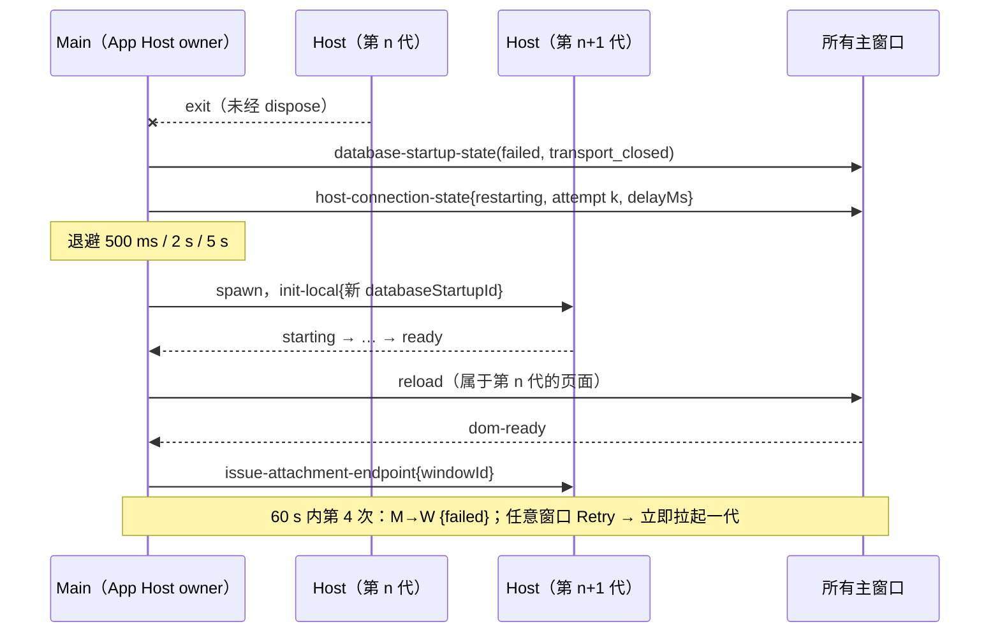
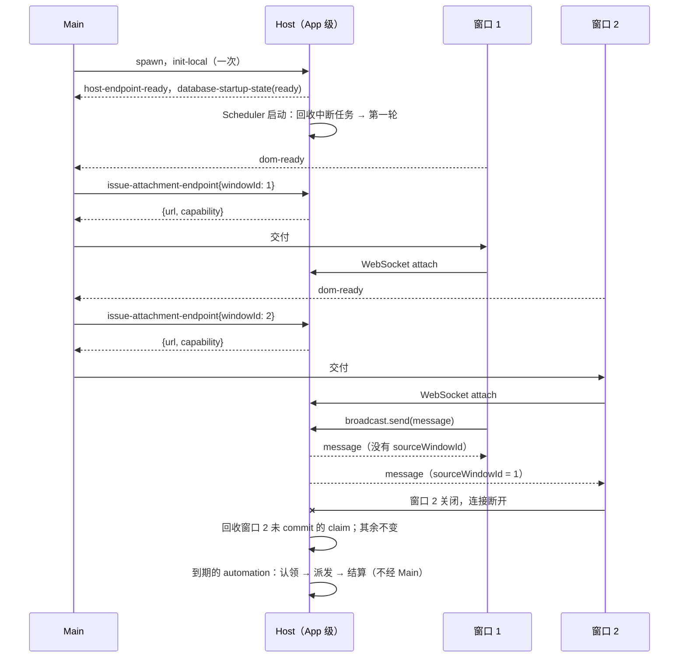

# U4：一个 App 一个 Host

日期：2026-10-09。上级规划：[rust-unified-host.md](rust-unified-host.md) 的 U4、8.1、8.5、9.1 与 D-U7。前置：[rust-u3-single-process.md](rust-u3-single-process.md) A 期（runtime 在 Host 进程内）。

## 1. 目标与范围

Rust Host 从“每个窗口一个进程”改为“每个 App 一个进程”，并收回今天放在 Main 里的业务状态。完成后，Rust 开关下的桌面只有三类进程：Main、Renderer、一个 Host。

- **只改 Rust 开关下的路径**（`ZCODE_DESKTOP_HOST=rust` 且非打包构建）。Node Host 的路径、Node scheduler、BroadcastHub、`taskRealtimeBus` 的代码保持不变，到 U8 一并删除（D-U8）。
- 产品今天只有一个主窗口。本期让 Host 正确支持多个窗口接入，但不新增“打开第二个主窗口”的产品入口；多窗口只通过开发开关验证（2.9）。

## 2. 规则

### 2.1 Host 的生命周期

| 事件                        | 行为                                                                                     |
| --------------------------- | ---------------------------------------------------------------------------------------- |
| App ready                   | Main 采集登录 shell 环境（等待上限与今天相同），随后拉起唯一的 Host，发一次 `init-local` |
| 窗口 dom-ready（含 reload） | Main 为该窗口签发一个 attachment endpoint；Host 尚未就绪时，等就绪后签发                 |
| 窗口关闭或销毁              | 只关闭这个窗口的连接；Host 继续运行                                                      |
| App 退出                    | Main 发 `dispose`，最多等 3.5 s 后结束进程（不变）                                       |
| Host 意外退出               | 见 2.8                                                                                   |

- 拉起时机：App ready 后读完启动设置（数据目录已生效）就拉起，不等第一个窗口。灰度裁决（≤ 2 s）与登录 shell 环境（≤ 4.5 s）的等待规则与今天首个窗口 Host 相同，从拉起时开始计。
- `init-local` 是 App 级的：`runtimeProcessEnvPatch` 是 App 启动时采集的环境，重启沿用；`agentWarmupTargets` 是上次会话的启动 workspace（Host 先于首窗口启动，命令行或 deep link 指定的 workspace 不预热，打开时懒启动）；不再携带 `hostId`（2.5）。`databaseStartupId` 由 Main 在每次拉起（含重启）时新生成，所有窗口共用，保证 Renderer 的同代准入不把上一代的状态与新一代的 endpoint 拼在一起。
- “Host 就绪”指当前代的启动状态第一次进入 `ready`。endpoint 在每个启动尝试第一次 `ready` 时签发给所有还没拿到 endpoint 的窗口（rust-host-resilience.md §2.2 的规则不变）；签发期间窗口已 reload 或关闭的，结果丢弃。
- 窗口级的“Host 已可用”动作（刷新 CUA PiP 焦点、为窗口补挂远端 workspace 的 attachment）在 endpoint 交给这个页面之后执行，不在 dom-ready 时执行：dom-ready 时 Host 可能还在启动或退避。原因记为 `renderer-ready`（窗口第一次加载）或 `renderer-reload`。
- 窗口关闭时 Main 让 Host 释放这个窗口的远端 logical session（`dispose-remote-workspace-session`）、取消它等待中的连接，与今天“关窗即结束该窗口的远程连接”一致；Renderer 的 WebSocket 随页面关闭。
- 没有窗口时 Host 照常工作：调度与本地 workspace 的 Bot 不依赖窗口。远端连接在 U5 之前随发起它的窗口（连接器在 Main 里按窗口持有，见上一条与第 3 节）。

### 2.2 窗口身份

- `issue-attachment-endpoint` 增加 `windowId`（主窗口的窗口 id，即 `webContents.id`，与今天 `sourceWindowId` 用的是同一个值）。窗口的本地与远端 scope Renderer attachment 都带；Main 经 MessagePort 桥接的 attachment（手机远控、Bot 运行时）省略。
- Host 把 `windowId` 记在 attachment 上，连接建立后进入该连接的调用上下文（`CallContext.window_id`）。
- 一个窗口可以有多条连接（reload 前后的新旧连接、同一窗口的多个 attachment），它们的窗口身份相同。
- `windowId` 必须是 ≥ 1 的整数，可省略但不可为 `null`；不合法时按非法载荷回 `ok:false`。
- 需要回到某个窗口的 Host→Main 请求带上发起调用的连接的 `windowId`；Main 按它路由，窗口已不存在时回失败。只有能直接归属到一条连接的请求才带：
  - `browser-execute-request`：发送消息时收集浏览器环境（ambient context）的两条请求带发送方连接的 `windowId`；CLI 回合中的 `browserExecute` 没有“回合 → 连接”的既有关联，不带（Host 不为此新建状态）。
  - `bot-remote-workspace-reconnect-request`：发起方是 Bot 而不是窗口，不带；workspace route 属于哪个窗口由 Main 的 route 表决定（3 节，U5 前归 Main）。
- Host 的 WebSocket 连接上限是 App 级的 64 条（握手前的连接也占名额）：每个主窗口一条本地 attachment 加上每个远端 workspace 一条远端 scope attachment，reload 时新旧连接短暂并存。

### 2.3 广播与 claim

所有者从 Main 的 BroadcastHub 改为 Host 的 `broadcast` 服务；Main 不再中继，也不再收到广播。

| 发送方                      | 同一窗口的连接                | 其他窗口的连接                        |
| --------------------------- | ----------------------------- | ------------------------------------- |
| 某个窗口的连接              | 原样（没有 `sourceWindowId`） | 带 `sourceWindowId` = 发送方的窗口 id |
| Host 内部（如账号失效通知） | 所有连接都收到原样的消息      | 同左                                  |

- UI 用“消息没有 `sourceWindowId`”判断是不是自己窗口发的，这条语义保持不变。发送方自带的 `sourceWindowId` 在同窗口原样保留，到达其他窗口时改写为真实来源（同 BroadcastHub）。
- 没有窗口身份的连接（U7 的手机远控）按“另一个窗口”对待：收到的窗口广播带 `sourceWindowId`；它发出的广播回到它自己时原样（本地回声），到达其他连接时 `sourceWindowId` 为 `0`（窗口 id 从 1 开始，`0` 表示来源不是窗口）。
- 每条连接收到的消息由 Host 按该连接的调用上下文决定（`onMessage` 订阅时取连接的窗口身份），不靠 UI 过滤。
- claim 表在 Host 内，规则与 BroadcastHub 相同：先到先得；`reserved` 5 s 过期；只有持有 token 的申请方可以 commit 或 release；`committed` 永久保留；上限 1024 条，超出时淘汰最早的。申请方是一条连接，连接关闭时回收它尚未 commit 的 reservation。
- `acquireClaim` 不再需要 2 s 的等待上限：结果在 Host 内同步得出。返回给 Renderer 的形状不变：`{status:"acquired", lease:{key, token}}`、`{status:"busy", retryAfterMs}`（`min(250, reservation 剩余时间)`）、`{status:"committed"}`、空 key 时 `{status:"unavailable"}`。

### 2.4 调度

所有者从 Node scheduler 进程改为 Host 内 automation 域的 `Scheduler`（一个任务，actor）。状态机与 `packages/desktop/src/scheduler` 相同：

- **轮次**：启动后先回收中断的闲时任务（`recoverInterrupted`），随后立即一轮，之后每 20 s 一轮。同一时刻只有一轮在执行；执行期间收到的唤醒合并为“结束后立即再来一轮”；启动完成前收到的唤醒并入第一轮。
- **唤醒来源**：闲时任务变为可调度（取号即 ready、轮询翻为 ready）、一次 automation 派发结算完成（闲时任务的结算不唤醒，与 Node 相同）。`Scheduler` 的句柄仍提供 `wake()`，但今天没有“手动运行入列”的生产方：`runAutomationNow` 抢锁后由 Host 直接派发（run 的 `attempts = 1`），没有任何 Host 发 `cron-scheduler-wake-request`；`claimManualRuns` 只接手 `attempts = 0` 或 10 分钟未更新（派发方已崩溃）的 manual run。
- **一轮的内容**：automation `claimDue`（同一事务内先终结 `end_at` 已过的任务、回收超过 10 分钟的认领，再把到期且未认领的任务标为认领）→ 逐个处理；`claimManualRuns` → 逐个派发；闲时任务 `claimDue` → 逐个派发；上报执行中的闲时任务数。一步出错时记 error，本轮其余步骤跳过（已认领未处理的项等认领超时回收）。
- **misfire**：非重试（`dispatchAttempts = 0`）、且 `nextRunAt ≤ now − 5 min` 的 automation，记为 skipped（原因 `computer_asleep_or_app_not_running`）并排到下一个周期；一次性任务（非循环且 `maxRuns ≤ 1`）直接终结。闲时任务没有 misfire，只顺延。
- **派发**：直接调用 Host 内已有的派发器（今天处理 `cron-run` / `off-peak-run` 的那段代码），不经 Main。派发在独立任务中执行，结果作为消息回到 `Scheduler` 结算；轮次不等待派发。请求按 Node 的 `cron-run` / `off-peak-run` 形状构造并做同样的校验，校验不通过时与 Node Host 一样不派发、不结算（等认领超时）。
- **结算**：
  - automation 成功：run 记 dispatched（回填会话），任务的 `run_count`、`scheduled_run_count` 加一并按派发时间计算下一次；有限次任务达到上限或越过 `end_at` 时转 completed。
  - automation 失败：run 记 `failed_to_dispatch`；`transient`（Host 派发器的失败一律是 transient）按 30 s × 2^(n−1)、上限 15 min 退避重试，同一 runId 复用；第 5 次失败后循环任务放弃本轮、排到下一次，有限次任务转 failed；`permanent` 直接转 failed。
  - manual run：成功只累计 `run_count`，不推进周期，也不释放单飞锁（锁由 Host 在会话终态时释放）；失败记 `failed_to_dispatch` 并释放锁。
  - 闲时任务：成功转 running（`markRunning`，任务已不在 queued 时释放认领）；`permanent` 转 failed；`transient` 释放认领并记一次失败，按 30 s × 2^(n−1)、上限 15 min 在内存退避，不设次数上限（重启即清空）。
- **退出**：`dispose` 先等当前一轮结束，再释放仍在途的认领（定时 run 复位为 idle，manual run 只释放锁，闲时任务释放认领），在途的派发任务随 `Scheduler` 结束而取消。
- 认领的 SQL 语义与 Node 的 repo 相同（`BEGIN IMMEDIATE`，认领超时后的回收规则不变）。因此同一份 tasks-index 被另一个 App 实例的 Node scheduler 同时使用时，一个任务仍只会被认领一次。例外是启动回收：`recoverInterrupted` 假设自己是 App 级单例，把所有 running 的闲时任务置回 queued，另一个实例启动时正在执行的闲时任务会被再次派发（Node 相同，不在本期改变）。
- 轮询用单调时钟的定时器，到期判断用墙上时钟。休眠唤醒后最迟 20 s 进入下一轮，由 misfire 规则处理错过的窗口。时钟与轮询间隔可注入，测试不等待 20 s。
- 执行中的闲时任务数变化时（启动后的第一次上报总会发出），Host 发 `off-peak-active-count` 给 Main。Main 的处理与今天 scheduler 上报相同：这个计数目前不驱动任何行为（防休眠只由 `keepAwakeWhileRunning` 设置决定）。`Scheduler` 只依赖构造时传入的上报端口；端口与控制消息的接线在 `services::install` 中完成。

```text
Host install 完成 ─► Scheduler::start ─► recoverInterrupted ─► 第一轮
                                            │
  闲时任务 ready ─wake()─┐                   ▼
  automation 结算 ─wake()┼─► Notify（合并）─► 一轮：claimDue → 派发任务（spawn）
  20 s 单调定时器 ───────┘                   ▲            │ Dispatcher / OffPeakDispatcher
                                            │            ▼
                                  结算（写 tasks-index）◄─ 派发结果（JoinSet）
dispose().await ─► 等当前一轮 ─► 释放在途认领 ─► 取消在途派发
```

Rust 开关下 Main 不再启动 scheduler 进程，也不再转发 `cron-run` / `off-peak-run`。

### 2.5 任务实时总线

只有一个 Host 时，`taskRealtimeBus` 协调的对象只剩它自己。Rust 开关下：

- Main 不把 Host 注册到 `taskRealtimeBus`，`init-local` 不带 `hostId`，Host 不建立到 Main 的实时桥。Main 的旧路径落地前 `init-local` 仍可能带 `hostId` / `deliveryKind`：Host 照常解析、不再使用。
- run 的 owner 判断、stale run 防护、owner 相关错误码（`NO_ACTIVE_TASK_OWNER`、`STALE_TASK_OWNER_COMMAND`、`OWNER_COMMAND_FAILED`）一直由 Host 的 `TaskLifecycle` 判定，不经实时桥，行为不变（AGENTS.md 的 owner / lease 规则）。
- 远端 workspace 的 `sendPrompt` 不再向 Main 申请 run lease、不再镜像用户消息与流事件（`mirrorRemotePrompt`）：只有一个 Host 时 lease 总归它自己，镜像回到它自己也没有订阅者，lease 结果从不阻止发送，所以直接转发远端。
- 远端 workspace 的会话消息请求（`workspace_session_message_send_requested`，今天经 Main 绕回同一个 Host 并固定回失败）改为在 Host 内直接应答：结果 `{status:"failed", error: zcode-task 适配器不支持 deliverSessionMessage 的文案}`，发起方同样无法转交结果、记同一条 warn；错误文案与 `ZCODE_AGENT_UNSUPPORTED_LEGACY_TASK_METHOD` 不变。

### 2.6 设置

`setting.json` 的唯一写入方是 Host 的 `SettingStore`。

| 方向        | 消息                                          | 说明                                                                                     |
| ----------- | --------------------------------------------- | ---------------------------------------------------------------------------------------- |
| Main → Host | `setting-write{requestId, patch}`             | Main 原来直接写文件的位置（窗口尺寸、缩放、更新相关字段、endpoint origin）都改为这条请求 |
| Host → Main | `setting-write-result{requestId, ok, error?}` |                                                                                          |
| Host → Main | `setting-changed{setting}`                    | 任何一次成功写入之后推送完整快照；Main 的设置缓存只由它更新                              |

- `setting-changed` 由 `SettingStore` 的写队列在每次成功写入后发出（`setting` channel 的 `update`、Main 的 `setting-write`、Host 内部写入方，以及读取时补写迁移标记），快照是写入后重读的完整设置；控制通道是有序的，所以一次写入的 `setting-write-result` 先于它引起的 `setting-changed`，`setting-changed` 按写入顺序。失败的写入不发。

```text
写入方：Main 的 setting-write（有界队列，按到达顺序）│ Renderer 的 setting.update │ Host 内部写入方
  ─► SettingStore 写队列：文件锁 → 合并 → 原子写 → 重读完整设置
  ─► setting-write-result{requestId, ok}（只对 Main 的写入，先发）
  ─► setting-changed{setting}（每次成功写入）─► Main 的设置缓存
```

- Host 按到达顺序串行处理 `setting-write`（Main 先后两次写同一字段时后到的后写）；排队上限 64，满时直接回 `ok:false`。`patch` 的校验与 `setting` channel 的 `update` 相同，不合法时回 `ok:false` 和错误文案；没有 `requestId` 的请求无法应答，忽略。服务安装之前（`init-local` 后、`database-startup-state` 到 ready 之前）到达的 `setting-write` 立即回 `ok:false`（`Rust Host services are not initialized`），不让 Main 等满超时。
- Host 启动之前的读取（数据目录、硬件加速、启动 workspace）仍然直接读文件：这些值决定 Host 怎么启动。Main 的其他读取也仍直接读文件（Host 原子写入、落盘后才回 `ok`）。例外：Main 启动时（拉起 Host 之前）的那次读取用的是 TS `settingService.get()`，遇到缺迁移标记（`closeToTrayOnWindowsMigrationInitialized` 等）的文件会补写标记，这是 Rust 开关下 Main 唯一一次直接写 `setting.json`，此时 Host 还没有运行；标记写入后 Main 的读取不再写文件。
- “Main 的设置缓存”指 Main 内存里由设置派生的状态（关闭到托盘、防休眠、更新渠道、菜单快捷键）。Rust 开关下它只由 `setting-changed` 更新：Main 与上一次快照逐字段比较，只应用变化的字段；Renderer 的 `SyncAppSettings` 被忽略。两个来源不并存，同一次修改的 IPC 通知与 Host 推送不会乱序覆盖。基线是 Main 启动时直接读到的设置。比较时“没有快捷键覆盖”（字段缺失）与空覆盖表 `{}` 等价：基线来自 TS 读取、快照来自 Rust `SettingStore`，两边写法不同不能被当成一次快捷键修改（重建菜单并向所有窗口广播 `SettingsChanged`）。
- `patch` 里值为 `undefined` 的字段在线上写成 `null`（JSON 没有 undefined），表示清除。
- Main 在当前代 Host 的启动状态进入 `ready` 之后才发 `setting-write`；Host 不可用时（启动中、重启中）写入请求等待就绪，超过 10 s 记 warn 并放弃这次写入，不回落到直接写文件。等待 `setting-write-result` 同样以 10 s 为上限；当前代 Host 退出时，在途写入失败（是否已落盘未知，由调用方按失败处理）。
- App 退出与安装更新前的写入，先等结果再 `dispose` Host；此时仍在等 Host 就绪的写入直接放弃，之后的新写入被拒绝。等结果的时间计入退出预算（`appShutdownPolicy.ts`）：最多等 `waitTimeoutMs − forceKillDelayMs`（Windows 普通退出 0.5 s，其余 1.5 s），到时照常 `dispose`，没等到结果的写入是否落盘未知；`dispose` 的等待用预算的剩余部分。

### 2.7 Bot 远端运行时

- 连接状态查询改为 Host 直接读自己的远端注册表，不经 Main：存在同 workspaceKey（`workspaceIdentity?.trim() || workspacePath`）、同 target（Main `isSameRemoteTarget` 的比较规则）、在线且 workspace 运行时就绪的 logical session 即为已连接，与 Main 原来按 route 表的判定对应。注册表是 App 级的，不区分窗口。
- 重连仍由 Main 的远端会话管理器执行（它持有 SSH 连接器，U5 替换）。重连只由 Bot 的入站消息发起，没有发起窗口，Host 的请求不带 `windowId`；Main 把重连交给持有该 workspace route 的窗口，没有时用任意一个主窗口（优先聚焦窗口），没有主窗口时回失败。（Main 的校验接受可选的 `windowId`：带了就只找那个窗口，窗口已关闭时回失败。）
- Main 的 `ensureHostListener` 不再把第一个窗口固定为 Host 的归属窗口：连接结果按 (Host, requestId) 找回发起窗口，关闭与退出按 route 记录的 Host 判断。

### 2.8 Host 意外退出

- 只有 Host 进程退出才走这里。Host 仍在运行、主动关闭某个窗口的连接（WebSocket Close 4001 `outbound-backlog`，[rust-u2-gateway.md](rust-u2-gateway.md) §2.6）不是 Host 退出：那个窗口自己 reload，在 dom-ready 时按 2.1 重新接入同一个 Host，不经过重启策略、不计入重启计数（[rust-host-resilience.md](rust-host-resilience.md) §2.5）。其余关闭码与异常断开照旧由 Renderer 显示“正在重连”，等待 Main 的通知。
- 重启策略是 App 级的：60 s 内最多 3 次，退避 500 ms / 2 s / 5 s（数值不变）。
- 顺序：所有主窗口收到连接状态（断开）→ Main 重启 Host → Host 就绪后 Main reload 所有主窗口 → 每个窗口在 dom-ready 时重新接入。
- 退避期间用户手动 reload 的窗口不提前触发重启，等计划中的重启；新一代就绪后它直接拿到 endpoint，不再被 reload。
- 放弃重启后，所有主窗口显示启动失败页；任意一个窗口的 Retry（失败页上的页面自身 reload）触发一次 App 级重启，不经过重启策略、没有退避，并清空重启计数（之后的意外退出重新从第 1 次自动重启计起）；新一代就绪后 reload 其余仍停在失败页的窗口。Exit 退出 App。
- 只有失败页上的 Retry 触发重启。以下 dom-ready 不触发：放弃期间新打开的主窗口（例如从托盘或 Dock 重新打开）；新一代就绪后 Main 让旧页面 reload、reload 完成前这一代又崩溃并放弃时，这次 reload 的 dom-ready（不区分会让启动后很快崩溃的 Host 无人操作地无限重启）。Main 只给这些页面发 `failed`，它们显示同一失败页，它们的 Retry 才触发重启。
- 拉起失败（准备 `init-local` 失败、拉起进程时同步抛错）按这一代的意外退出处理，进入同一重启策略；拉起中途已启动的进程先结束。
- 数据库启动状态（`database-startup-state`）向所有主窗口扇出；任意窗口的 retry / exit 控制都被接受，`snapshot` 只回给请求的窗口。每一代 Host 一份中继绑定，新一代替换旧一代。Host 退出后这一代的绑定不再用 `snapshot` 回放 `failed/transport_closed`：退避期间（或放弃后、Retry 拉起下一代之前）加载或 reload 的页面属于下一代，停在“正在启动”；绑定仍接受 `exit`。



沿用 reload 而不是原地重连：桌面是 `desktop-continuous` 语义，Renderer 没有“断线后补齐”的恢复路径，reload 是今天已验证的做法。

### 2.9 多窗口的开发入口

`ZCODE_DEV_EXTRA_MAIN_WINDOW=1` 且非打包构建时，Main 在第一个主窗口（已登记的主窗口，不是更新状态窗等其他窗口）dom-ready 后再创建一个主窗口（绕过主窗口复用）。只用于 E2E；Node 路径下第二个窗口照旧有自己的 Host。macOS 上点关闭只是隐藏窗口（今天的行为），E2E 要验证“关闭第二个窗口”需销毁它：harness 以 `--inspect=<私有端口>` 启动 Electron，经 Main 的 inspector 调用 `BrowserWindow.destroy()`（`scripts/rust-host/e2e/main-process.mjs`），不为此增加产品开关。

## 3. 状态所有者

| 状态                              | 今天（Rust 开关下）                | U4 之后                                             |
| --------------------------------- | ---------------------------------- | --------------------------------------------------- |
| Host 进程句柄、重启计数           | Main，按窗口                       | Main `rustAppHost.ts`，App 级                       |
| 窗口 → attachment                 | Main `windowHostProcessMap`        | Main（`RustAppHostCore` 的窗口表）与 Host（连接表） |
| Main 发起的在途设置写入           | 无（直接写文件）                   | Main `HostSettingWriter`（只有在途请求）            |
| 广播扇出、claim 表                | Main BroadcastHub                  | Host `broadcast`                                    |
| 调度状态机（认领、misfire、退避） | Node scheduler 进程                | Host automation `Scheduler`                         |
| run lease、owner 路由             | Main `taskRealtimeBus` 加 Host     | Host                                                |
| `setting.json` 写入               | Main 与 Host（跨进程文件锁）       | Host                                                |
| Main 的设置缓存                   | Renderer 的 `SyncAppSettings` 通知 | Host 的 `setting-changed` 推送                      |
| 远端连接注册表                    | Host（窗口级）                     | Host（App 级）                                      |
| SSH 连接器、远端 route 表         | Main，按窗口                       | 不变（U5 迁走）                                     |

## 4. 控制消息

### 4.1 新增与扩展（线上格式）

字段名是 JSON 里的名字；`?` 表示可省略。未列出的字段不变。

| 方向        | `type`                                   | 字段                                                 | 说明                                                                                                      |
| ----------- | ---------------------------------------- | ---------------------------------------------------- | --------------------------------------------------------------------------------------------------------- |
| Main → Host | `issue-attachment-endpoint`              | `+ windowId?: number`（整数，≥ 1）                   | 主窗口的窗口 id；不属于窗口的 attachment 省略                                                             |
| Main → Host | `setting-write`                          | `requestId: string`，`patch: object`                 | `patch` 与 `setting` channel 的 `update` 参数相同（`AppSettings` 的部分字段；值为 `null` 表示清除该字段） |
| Host → Main | `setting-write-result`                   | `requestId: string`，`ok: boolean`，`error?: string` | 写入落盘后才回 `ok: true`                                                                                 |
| Host → Main | `setting-changed`                        | `setting: object`                                    | 写入后的完整设置（与 `setting` channel 的 `get` 返回值相同）；每次成功写入后发一次，不论写入方是谁        |
| Host → Main | `off-peak-active-count`                  | `count: number`（整数，≥ 0）                         | 只在数值变化时发                                                                                          |
| Host → Main | `browser-execute-request`                | `+ windowId?: number`                                | 发起调用的连接的窗口 id（目前只有发送时收集浏览器环境的请求带）；省略时 Main 用任意一个主窗口             |
| Host → Main | `bot-remote-workspace-reconnect-request` | `+ windowId?: number`                                | 发起连接的窗口；Bot 发起的重连没有窗口，Rust Host 目前总是省略，Main 用持有该 workspace route 的窗口      |

`init-local` 不新增字段：App 级 Host 的 `init-local` 不带 `hostId` 与 `deliveryKind`，其余字段的含义见 2.1。

### 4.2 Rust 开关下不再使用

| 方向        | 消息                                                                                                                                                                                                                                                                                                                                                                                                                                                                                                         |
| ----------- | ------------------------------------------------------------------------------------------------------------------------------------------------------------------------------------------------------------------------------------------------------------------------------------------------------------------------------------------------------------------------------------------------------------------------------------------------------------------------------------------------------------ |
| Main → Host | `broadcast`、`broadcast-claim-result`、`task-realtime-deliver`、`task-run-lease-result`、`task-owner-command-deliver`、`task-owner-command-result`、`session-message-deliver`、`session-message-delivery-result`、`cron-run`、`off-peak-run`、`bot-remote-workspace-runtime-port`、`bot-remote-workspace-connection-status-result`                                                                                                                                                                           |
| Host → Main | `broadcast`、`broadcast-claim-request` / `-commit` / `-release`、`task-realtime-publish`、`task-stream-op-publish`、`task-run-lease-acquire` / `-release`、`task-owner-command-request` / `-result`、`session-message-send-requested`、`session-route-announce`、`session-message-deliver-result`、`cron-run-result`、`off-peak-run-result`、`cron-scheduler-wake-request`、`off-peak-scheduler-wake-request`、`bot-remote-workspace-runtime-port-request`、`bot-remote-workspace-connection-status-request` |

Rust Host 删除这些消息的收发代码。协议定义（`packages/shared`）中它们保留到 U8，因为 Node Host 仍在使用。

## 5. 事件顺序



## 6. 验收

- Rust 测试：
  - 广播按窗口身份扇出（同窗口原样、其他窗口带 `sourceWindowId`）；claim 的先到先得、过期、连接关闭回收。
  - 调度状态机：到期认领、misfire 跳过、一次性任务终结、失败退避与上限、手动运行、闲时任务的回收与退避；两个调度器同时认领时一个任务只派发一次。
  - 调度用到的 repo 操作（automation 的认领、台账、结算、释放，闲时任务的认领、释放、回收、计数、结算）与 TS repo 对拍：`scripts/rust-host/scheduler-fixtures.ts` 用真实 TS 实现生成 fixture，Rust 逐步复现返回值与表内容。
  - 没有任何连接时，到期的 automation 被派发并结算。
- Main 单测（`packages/desktop/test/rustAppHostCore.test.ts`、`rustAppHostSettings.test.ts`、`rustAppHostWiring.test.ts`、`databaseStartupRelayExit.test.ts`、`desktopRemoteSessionsHostExit.test.ts`，`packages/shared/test/rustU4ControlMessages.test.ts`）：App Host 状态机（拉起 → 就绪 → 多窗口接入 → 关窗不影响 Host → 意外退出 → 退避重启 → 放弃 → Retry 清空计数；放弃期间的新窗口只显示失败页；拉起失败按意外退出）、窗口级动作在 endpoint 交付之后、退出后中继不回放上一代的失败、按 `windowId` 路由、设置写入的等待 / 超时 / 退出预算内收尾、`setting-changed` 的按序增量应用（空快捷键表等价于没有覆盖）、4.1 消息的严格校验；Node 路径 reload 回退期间同一窗口两个 Host 时，一个 Host 退出只清它自己的等待中连接与 route。
- 桌面 E2E（Rust 开关，`scripts/rust-host/e2e-desktop.mjs`）：
  - 每个场景结束时断言进程表：Electron Main 下恰好一个 Host，没有 Node Host / scheduler 进程，嵌入式 runtime 下没有 CLI 子进程；随后正常退出（SIGTERM 只发给 Main），Host 经 `dispose` 退出，不留进程。
  - `u4-multi-window`：两个窗口（2.9）接入同一个 Host，各自对话；一个窗口切换主题、另一个窗口切换语言，对方都跟随；销毁第二个窗口后第一个窗口继续正常对话；Host 的 pid 全程不变。
  - `resilience-reload`：reload 前后 Host 的 pid 与 runtime 代次不变，页面重新 attach。`resilience-host-crash`（两个窗口）：杀掉 Host 后自动重启，两个窗口 reload 后可用；连续失败后两个窗口都出现失败页，在其中一个窗口 Retry，两个窗口都恢复。`resilience-startup`（两个窗口）：启动失败页出现在两个窗口，任一窗口 Exit 退出，另一窗口 Retry 后两个窗口都进入主界面。
  - `u4-scheduler`：界面上创建“每 1 分钟”的 automation，不点立即运行，到点由 Host 内调度派发并结算；销毁所有主窗口后 Host 继续运行，下一次运行照样派发并结算；重新打开窗口接入同一个 Host。
  - `u4-settings`：Main 发起的设置写入（缩放命令、窗口尺寸）落盘，页面缩放随之变化，冷启动后 Main 恢复缩放与尺寸；设置页打开“保持电脑运行”，Main 经 `setting-changed` 持有 powerSaveBlocker，关闭后释放。
  - Node Host 路径（`--host node`，发布的组合：Node Host + TS CLI）跑 `core`、`u4-settings` 与正常退出，验证 Main 侧重构没有改变 Node 路径。
- 现有 E2E 场景与 `pnpm test:rust-host` 全部通过；owner 相关错误码的现有测试不变。

## 7. 本期不做

| 项                                 | 去向                                                                 |
| ---------------------------------- | -------------------------------------------------------------------- |
| 每个窗口各自的 workspace 列表      | 产品出现第二个主窗口时再定：今天的列表是 Host 级的，多窗口会互相可见 |
| Host 自己采集登录 shell 环境       | U5（远端 Host 也需要）                                               |
| SSH 连接器与远端 route 表迁入 Host | U5                                                                   |
| 手机远控连接的广播与窗口路由       | U7                                                                   |
| Host 重启后不 reload、原地重连     | 需要 Renderer 的恢复路径，另行立项                                   |
