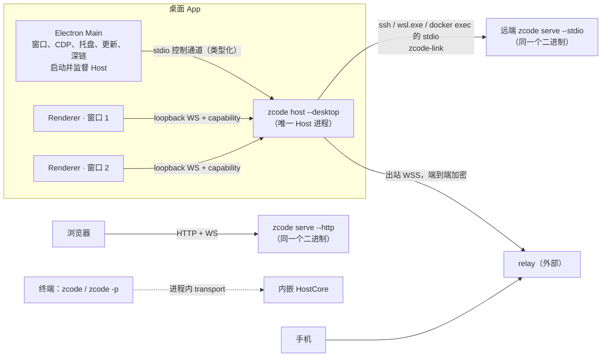
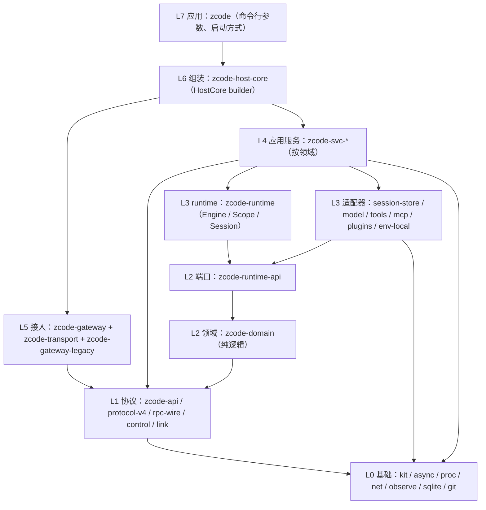
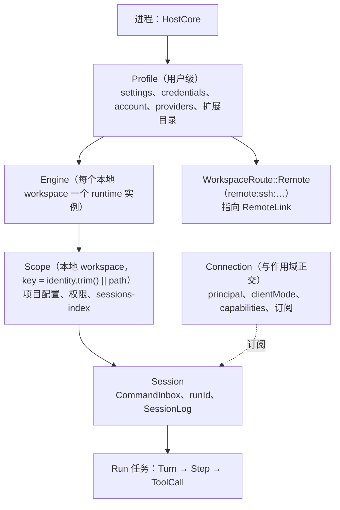
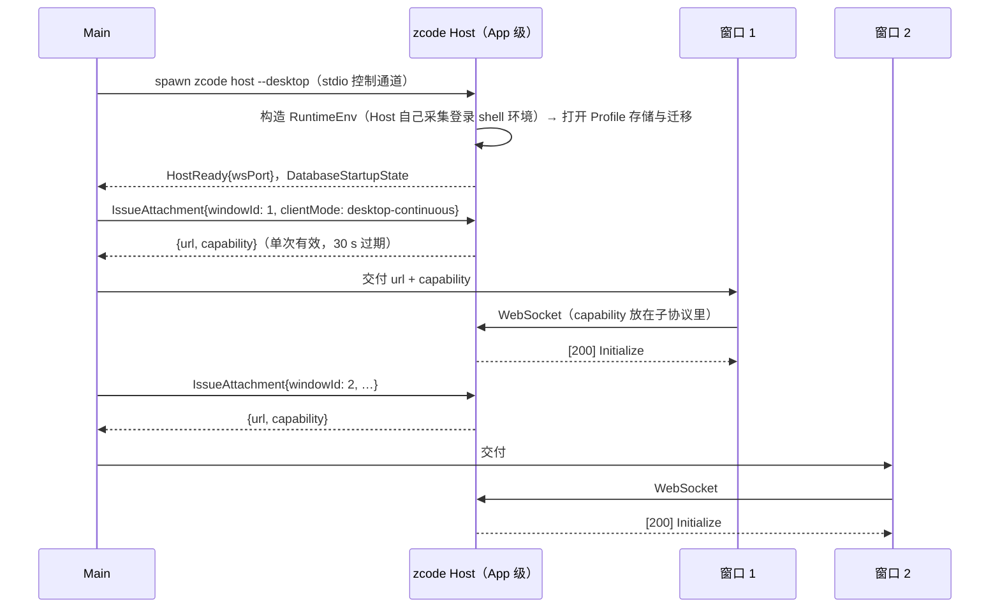
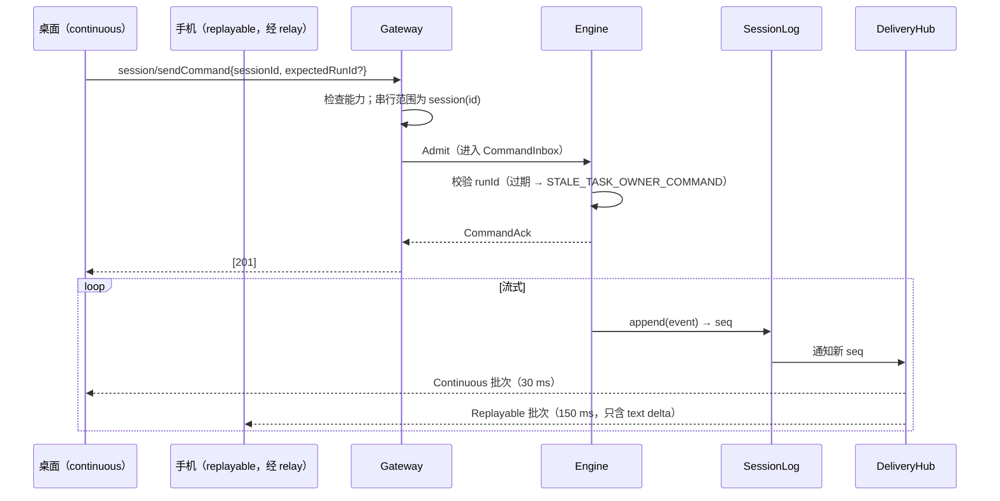
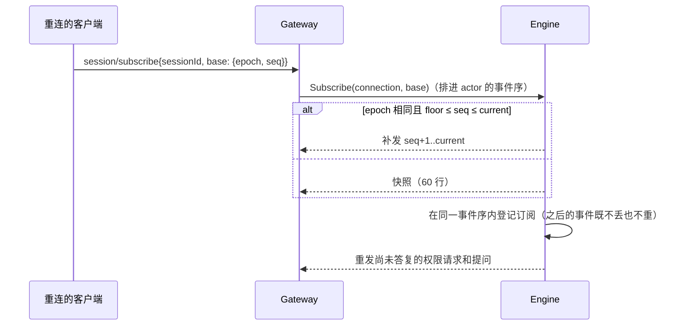
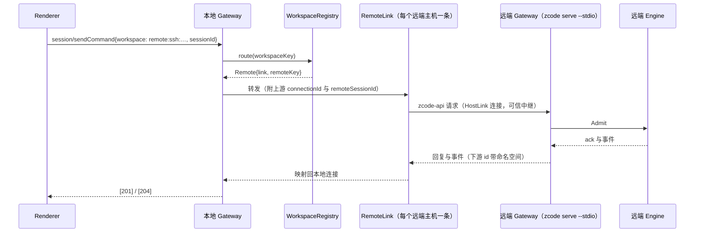
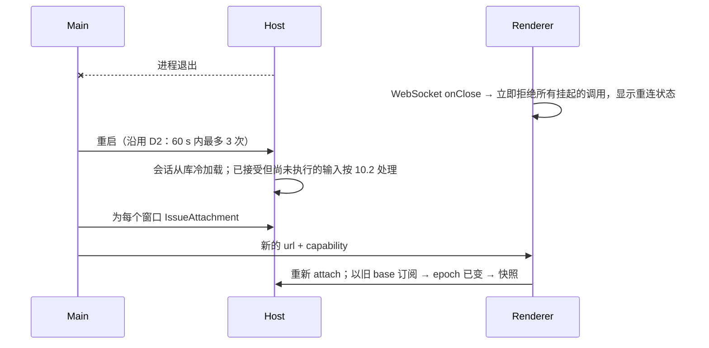
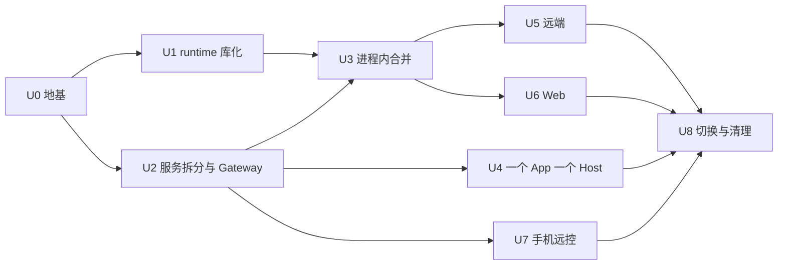

# Rust 单进程 Host：顶层架构规划

日期：2026-10-09（第一版）。基线：`feat/rust-host` / `f8b5087`。状态：规划。已定与待定的决策见第 14 节。

本文接续 [rust-host.md](rust-host.md) 第 9 节“本计划之后”，并扩大范围：

- Host 与 agent runtime 全部用 Rust 实现，合并成一个进程，不再通过 stdio 通信；
- 一个 App 只有一个 Host 进程，同时服务多个 workspace；
- 同一套 Host 还要支撑 SSH / WSL / Docker 远端、Web 版本和手机远控。

这次合并也是一次重构机会。所以本文先定顶层结构，也就是分层、作用域、所有权、接口和依赖方向，再给迁移路线。Codex（`~/bearspace/codex/codex-rs`）中被采纳的做法，会在对应位置注明。

## 1. 目标、约束与非目标

**目标**

| 编号 | 目标                                                                                                       |
| ---- | ---------------------------------------------------------------------------------------------------------- |
| G1   | 一个 Rust 二进制 `zcode`，Host 与 runtime 在同一进程内；进程内不再有 NDJSON 序列化往返                     |
| G2   | 桌面 App 只有一个 Host 进程，同时服务多个窗口和多个 workspace（本地与远端）                                |
| G3   | 同一个 HostCore 支撑四种接入：桌面、SSH / WSL / Docker 远端、Web、手机远控；TUI 与 headless 也走同一套 API |
| G4   | 高内聚、低耦合：按领域拆 crate，依赖单向，每个状态只有一个所有者，跨领域只通过句柄和事件交互               |
| G5   | 可迁移：每一阶段都能独立交付和验证，沿用 R0–R6 已有的契约清单、wire 夹具、差分测试和 E2E 场景              |

**沿用的约束**（来自 AGENTS.md，本规划不改变语义）

- 身份 key 统一为 `workspaceIdentity?.trim() || workspacePath`；远程链路贯穿传递 `workspaceIdentity` 与 `remoteSessionId`。
- `desktop-continuous` 与 `web-remote-replayable` 两种投递语义保持区分，`clientMode` 只能由 Host 注入。
- 已接受的 busy/running 输入由 runtime `CommandInbox` 串行 admission；Renderer 只保留草稿与 pending optimistic overlay。
- 保留 owner/lease、跨 Host 路由和 stale run 防护的**语义与错误码**。单进程以后，它们的实现位置会变（第 7 节）。
- relay 与 Main 只做鉴权、配对、心跳、转发和 attachment 调度，不保存任务队列、快照等业务状态。
- 不用超时掩盖同步问题。

**非目标**

- 重写 UI 业务逻辑。Renderer 继续使用 `@zcode/rpc`，改动只限于建连代码（第 9 节）。
- 改 V4 wire 语义或会话库 schema。
- relay 服务端与手机客户端：不在本仓库，只定义 Host 一侧的接口（9.4）。
- 多用户 Web。Web 仍是单用户，但设计上不再依赖进程级 `HOME`，为多用户留出余地（6.2）。

## 2. 现状与要解决的结构问题（已在源码核对）

### 2.1 进程与协议

今天一次桌面会话涉及 Main、每窗口一个 Host（发布版是 Node Host，Rust Host 只在开发开关后）、每个 workspace 一个 CLI，另有 plugin-management 和 mcp-status 两个 lane 的 CLI、scheduler 进程，以及每个远端各一个 Node `zcode-server.cjs`（远端还会再拉起自己的 CLI）。进程之间共有 9 种协议：

| 链路               | 传输与格式                                                                    | 定义                                                                         |
| ------------------ | ----------------------------------------------------------------------------- | ---------------------------------------------------------------------------- |
| Renderer ↔ Host    | MessagePort（Rust Host 改为本机 WebSocket）+ `@zcode/rpc`                     | `packages/rpc`                                                               |
| Main ↔ Host        | parentPort / stdio，zod 校验                                                  | `packages/shared/src/validation.ts`                                          |
| Main ↔ scheduler   | utilityProcess 消息                                                           | `packages/desktop/src/scheduler/schedulerProtocol.ts`                        |
| Host ↔ CLI         | stdio NDJSON，82 个请求、14 个反向请求、V4 帧                                 | `packages/shared/src/zcode-protocol*`、`apps/zcode-cli-rust/crates/protocol` |
| Host ↔ 远端 server | ssh2 / wsl / docker exec 的 stdio，hello 后跑 `SocketProtocol` + `@zcode/rpc` | `packages/server/src/remote/`                                                |
| Web                | HTTP + WS `SocketProtocol`                                                    | `packages/server/src/http.ts`                                                |
| zcode-server-cli   | 上述各项，另加 JSONL 控制 IPC                                                 | `packages/zcode-server-cli`                                                  |
| Bot webhook        | `POST /api/bots/:provider`                                                    | `packages/server/src/http.ts`                                                |
| 手机 relay         | 外部，不在本仓库                                                              | —                                                                            |

### 2.2 两套 Rust 代码

| 部分                  | 规模                                               | 结构                                                                                                     |
| --------------------- | -------------------------------------------------- | -------------------------------------------------------------------------------------------------------- |
| `apps/zcode-host`     | 约 13 万行，其中 `services` 一个 crate 占 12.08 万 | `rust-host.md` §3.7 计划拆出的 `store`、`net`、`agent-client` 都没有拆，ChannelServer 也放在 `host-core` |
| `apps/zcode-cli-rust` | 约 9.7 万行，16 个 crate                           | `core` 不做 IO，端口定义在 `core-api`；组装代码在二进制入口（`src/runtime.rs`），不在库里                |

正在进行的工作：`feat/rust-cli-workspace-scope`（worktree `ZCode-rs-p-cliws`，未提交）让一个 Rust CLI 进程按请求服务多个 workspace，具体包括 Engine 按 key 持有 Scope、删除 workspace 进程锁。它是 U1 的第一步（第 12 节）。

### 2.3 合并要解决的问题

| #   | 问题                                                                                                                                                                                                                                                                 | 证据                                                                                                                                                                                                                                                                               |
| --- | -------------------------------------------------------------------------------------------------------------------------------------------------------------------------------------------------------------------------------------------------------------------- | ---------------------------------------------------------------------------------------------------------------------------------------------------------------------------------------------------------------------------------------------------------------------------------- |
| P1  | **同一能力在 Host 和 CLI 中各实现一份**：原子写、锁、env 清洗（键表完全相同）、reqwest 代理与 CA、身份请求头、进程树终止、git CLI、`cli/config.json` 与 skills / hooks / MCP / plugin 根目录解析、provider 规则、V4 订阅与暂存                                       | Host `services/src/{store,support,account/net.rs,agent/process.rs,extensions,providers/resolve.rs,agent/service.rs}` 对应 CLI `plugins/src/atomic*.rs`、`net/src/{env,proxy,headers}.rs`、`tools/src/process_tree.rs`、`model/src/registry_rules.rs`、`app-server/src/delivery.rs` |
| P2  | **Host 镜像 CLI 状态，形成双写**：sessions-index 被复制进 `tasks-index.sqlite`；`window-controller` 维护内存视图；`session_events` 自己编 seq；provider 解析逐条镜像 CLI 规则；Host 还直接读 CLI 的文件（`model-io-*.jsonl`、memory）                                | `services/src/{tasks,agent/session.rs,providers/resolve.rs,tasks/trajectory.rs}`                                                                                                                                                                                                   |
| P3  | **`services` 内部耦合**：`agent` 被 13 个模块导入；存在 agent ↔ tasks、automation ↔ bots / off*peak 等环；环靠构造顺序加事后 setter（`OnceLock`、`bind*\*`、`attach_agent`）来解开；`automation::Area` 是装了 13 个依赖的袋子；`lib.rs::install` 有约 270 行手工组装 | `services/src/lib.rs`、`automation/`                                                                                                                                                                                                                                               |
| P4  | **进程全局状态**：CLI 从进程 env 读取 workspace 身份、provider 文件、重试策略、API key；依赖进程 cwd；安装全局 tracing subscriber；Host 用 `std::process::id()` 作锁的 owner，用 `getrusage(RUSAGE_SELF)` 采样。合并后这些都会出错                                   | CLI `src/runtime.rs:61`、`host/src/logging.rs:109`；Host `store/lock.rs:286`、`bots/runtime_lock.rs:179`、`account/telemetry.rs`                                                                                                                                                   |
| P5  | **并发没有监督**：Host 有 139 处 `tokio::spawn`，30 个无界 mpsc，没有 bounded mpsc，没有 CancellationToken / JoinSet，约 205 处 std `Mutex`；CLI 的 run 是分离 spawn，没有 panic 兜底，agent loop 一旦 panic，会话会永远停在 running，Engine 的关闭循环也会挂住      | Host 统计见调研；CLI `core/src/app/run.rs:163`、`engine.rs:239`                                                                                                                                                                                                                    |
| P6  | **Main 承载业务**：Main 自己写 `setting.json`；scheduler 进程写 tasks-index；BroadcastHub、taskRealtimeBus 负责跨 Host 路由；Bot 远端运行时要经 Main 绕回同一个 Host                                                                                                 | `packages/desktop/src/main/{index.ts,taskRealtimeBus.ts,desktopRemoteSessions.ts}`                                                                                                                                                                                                 |
| P7  | **远端依赖 Node 资产**：部署要上传 node、`zcode-server.cjs`、node-pty 和 agent bundle，远端再拉起 CLI；远端连接注册表是窗口级的，两个窗口会建两条连接、起两个远端 server                                                                                             | `packages/server/src/remote/deploy*.ts`、`windowRemoteConnectionRegistry.ts`                                                                                                                                                                                                       |
| P8  | **契约缺少单一来源**：`@zcode/rpc` 有 491 个成员，没有 schema；V4 命令从 zod 生成 Rust；方法名列表和 wire 常量是手工同步的；出站响应用约 346 处 `json!` 拼装                                                                                                         | `apps/zcode-host/contract/channels.json`、CLI `core-api/src/transport.rs`                                                                                                                                                                                                          |

## 3. 设计原则

1. **一个二进制、一个 HostCore、多种启动方式。** 桌面、远端、Web、TUI 的差别只在于组装了哪些 transport、读哪个 profile，HostCore 本身不分形态。
2. **只有一套 API。** Renderer、Web、手机、远端链路、TUI 和测试都经过同一个 Gateway 和同一张方法表。进程内客户端只是换了一种 transport，不是第二套契约。（Codex：TUI 与 `exec` 都经 `app-server` 的 in-process client；`in_process.rs` 明确写着 “not a second execution contract”。）
3. **作用域即所有权。** 进程 → Profile → Workspace → Session → Run。每个状态只有一个所有者，跨作用域只通过句柄访问。
4. **执行环境显式化。** cwd、env、文件系统、进程执行都是 `Environment` 的属性。业务代码不读进程 env，也不读进程 cwd。（Codex：cwd 从 TurnContext 移到 `TurnEnvironmentSelection`，`ExecutorFileSystem` / `ExecBackend` 是 trait。）
5. **结构化并发。** 每个异步任务都属于一个 `TaskScope`。任务 panic 时，变成所属作用域的失败事件，不能静默消失。
6. **有界队列，背压策略写明。** 每条队列都要写清满了以后怎么办：阻塞、丢弃并标记 resync，或者断开该连接。
7. **按领域分 crate，依赖单向，核心保持小。** 新功能优先放进新 crate 或扩展 crate，不往 runtime 核心里加。（Codex AGENTS.md：“resist adding code to codex-core”；`ext/*` 扩展 crate。）
8. **边缘做兼容，内部全类型化。** `@zcode/rpc` 的 40 个 channel 只在 Gateway 边缘做映射，内部全部走类型化的方法和事件，不传 `serde_json::Value` 袋子。
9. **契约只有一个来源，并做漂移检查**（第 14 节 D-U5）。
10. **边界进程只做转发。** Main 只负责窗口、原生能力和进程调度；relay 只转发；两者都不持有会话状态。

## 4. 目标拓扑



| 启动方式               | 谁启动                               | transport                                   | 连接的 clientMode                                         |
| ---------------------- | ------------------------------------ | ------------------------------------------- | --------------------------------------------------------- |
| `zcode host --desktop` | Electron Main，每个 App 一个         | loopback WS（窗口）、stdio 控制、relay 出站 | 窗口：`desktop-continuous`；手机：`web-remote-replayable` |
| `zcode serve --stdio`  | 本地 Host 经 SSH / WSL / Docker 拉起 | stdio 上的 zcode-link，只有一条上游连接     | 由上游逐个连接传入（可信中继）                            |
| `zcode serve --http`   | 用户，或 `zcode daemon`              | HTTP + WS、Bot webhook                      | `web-remote-replayable`                                   |
| `zcode` / `zcode -p`   | 用户，在终端里                       | 进程内                                      | `desktop-continuous`                                      |

## 5. 进程内分层与 crate

### 5.1 分层



依赖只能向下。L3 的适配器实现 L2 的端口，`zcode-runtime` 只依赖端口，不依赖适配器。

### 5.2 crate 清单

所有 Rust 代码放进同一个 Cargo workspace，目录为 `rust/`（D-U11）。下表的“来源”指现有代码迁入的位置。

| 层  | crate                                 | 职责                                                                                                                                                                | 来源                                                                                                                       |
| --- | ------------------------------------- | ------------------------------------------------------------------------------------------------------------------------------------------------------------------- | -------------------------------------------------------------------------------------------------------------------------- |
| L0  | `zcode-kit`                           | id（uuid v7）、`Clock`、`AbsPath`、按 `RuntimeEnv` 解析的 home / data 目录、`atomic_write`、锁目录协议加进程内 FIFO、`RedactedString`、`Fault`                      | Host `store/`、`support/`；CLI `plugins/src/atomic*.rs`、`host/src/storage_paths.rs`；5 份 `home()` 与 25 份 `now_ms` 合一 |
| L0  | `zcode-async`                         | `TaskScope`、`or_cancel`、带溢出策略的有界 mailbox                                                                                                                  | 新增                                                                                                                       |
| L0  | `zcode-proc`                          | 唯一的子进程入口：`RuntimeEnv` 驱动的 spawn；Unix `setsid` / killpg / Linux `PR_SET_PDEATHSIG`；Windows Job Object；进程树终止；头尾截断的输出捕获；shell 探测；pty | CLI `tools/src/{tool_process,process_tree}.rs`；Host `agent/process.rs`、`terminal/`；参考 Codex `utils/pty`               |
| L0  | `zcode-net`                           | HTTP 客户端工厂（代理、CA、身份请求头）、env 清洗、SSE 解码、rustls provider 安装（只在组装时安装一次）                                                             | CLI `net/`；Host `account/net.rs`、`support/http.rs`                                                                       |
| L0  | `zcode-observe`                       | tracing 各层（JSONL 文件、内存环形缓冲、转发给 Main）、按值脱敏、span 字段（workspace / session / connection）、指标                                                | CLI `host/src/logging.rs`；Host `kit/src/log.rs`（改为 tracing）                                                           |
| L0  | `zcode-sqlite`                        | 唯一打开 SQLite 的地方：专用线程、WAL、busy_timeout、迁移账本                                                                                                       | CLI `state/src/node/open.rs`；Host `tasks_index/`                                                                          |
| L0  | `zcode-git`                           | git CLI 封装（唯一一份）                                                                                                                                            | Host `git/command.rs`；CLI `host/src/context_git.rs`、`plugins/src/git.rs`                                                 |
| L1  | `zcode-protocol-v4`                   | V4 命令、帧、行                                                                                                                                                     | CLI `protocol`                                                                                                             |
| L1  | `zcode-rpc-wire`                      | `@zcode/rpc` 值编码与 `SocketProtocol` 分帧                                                                                                                         | Host `rpc`                                                                                                                 |
| L1  | `zcode-control`                       | Main ↔ Host 控制消息（由 zod 生成并做漂移检查）                                                                                                                     | Host `control`                                                                                                             |
| L1  | `zcode-api`                           | **内部统一 API**：方法表（6.3），包括参数、结果和通知类型，以及每个方法的串行范围、所需能力、允许的 clientMode                                                      | 新增；由 CLI 方法列表、Host channel 成员归并而来                                                                           |
| L1  | `zcode-link`                          | Host ↔ Host 握手与版本协商；链路上承载 `zcode-api`                                                                                                                  | 新增；取代 `zcode-hello`                                                                                                   |
| L2  | `zcode-domain`                        | 纯逻辑：配置合并、历史、投递缓冲、权限规则、上下文管理、provider 规则（唯一一份）                                                                                   | CLI `domain`，加上 Host `providers/resolve.rs` 的规则                                                                      |
| L2  | `zcode-runtime-api`                   | runtime 端口：`SessionStore`、`ModelPort`、`ToolPort`、`ContextPort`、`ConfigSource`、`AuthPort`、`Clock`、`EventSink`，新增 `Environment`                          | CLI `core-api`                                                                                                             |
| L3  | `zcode-runtime`                       | Engine（唯一 actor，按 workspace key 持有 Scope 和全部已加载会话）、agent loop、`CommandInbox`（14.1）                                                              | CLI `core`                                                                                                                 |
| L3  | `zcode-ext-*`                         | goal / todo / plan / question / subagent / title 等扩展（U9）                                                                                                       | CLI `core/src/app/*`                                                                                                       |
| L3  | 适配器                                | `zcode-session-store`、`zcode-model`、`zcode-tools`、`zcode-bash`、`zcode-mcp`、`zcode-plugins`、`zcode-env-local`                                                  | CLI 同名 crate                                                                                                             |
| L4  | `zcode-svc-profile`                   | setting、credential、onboarding、settings-sync、data 目录迁移                                                                                                       | Host `settings`、`settings_sync`、`account/credential.rs`                                                                  |
| L4  | `zcode-svc-account`                   | OAuth、ApiClient、用量、coding-plan、feedback、telemetry                                                                                                            | Host `account`                                                                                                             |
| L4  | `zcode-svc-providers`                 | **全进程只有一份**的 provider 注册表，对外发布 ArcSwap 快照                                                                                                         | Host `providers`；CLI `model/src/registry.rs`                                                                              |
| L4  | `zcode-svc-extensions`                | skills、commands、hooks、subagents、MCP 配置、插件管理（用户级与 workspace 级叠加）                                                                                 | Host `extensions`；CLI `plugins` 与 `tools` 中的发现逻辑                                                                   |
| L4  | `zcode-svc-workspace`                 | `WorkspaceRegistry` 与路由；file、file-watcher、media-preview、prompt 附件                                                                                          | Host `workspace.rs`、`file/`、`file_watcher.rs`、`media_preview.rs`                                                        |
| L4  | `zcode-svc-git`、`zcode-svc-terminal` | git 操作与 checkpoint、提交信息生成；终端                                                                                                                           | Host `git/`、`terminal/`                                                                                                   |
| L4  | `zcode-svc-sessions`                  | 会话门面：把 V4 命令和订阅接到 runtime；草稿                                                                                                                        | Host `agent/` 的门面部分                                                                                                   |
| L4  | `zcode-svc-tasks`                     | tasks-index 投影（订阅 runtime 事件，唯一写入方）、window-controller 视图、导入、trajectory                                                                         | Host `tasks/`、`tasks_index/`                                                                                              |
| L4  | `zcode-svc-automation`                | cron、闲时任务（吸收 scheduler 进程）                                                                                                                               | Host `automation/`、`off_peak/`；Main scheduler                                                                            |
| L4  | `zcode-svc-bots`、`zcode-svc-share`   | Bot 渠道；会话分享                                                                                                                                                  | Host `bots/`、`conversation_share/`                                                                                        |
| L4  | `zcode-svc-remote`                    | 远端启动器、部署、`RemoteLink`                                                                                                                                      | Host `remote/`；TS `packages/server/src/remote`                                                                            |
| L4  | `zcode-svc-relay`                     | 手机远控：出站 relay 连接、配对、虚拟连接                                                                                                                           | 新增                                                                                                                       |
| L5  | `zcode-gateway`                       | 连接注册表、鉴权与能力、方法分发与串行范围、出站队列与投递策略、DeliveryHub                                                                                         | Host `host-core/{attachments,server}.rs`、`agent/service.rs`；CLI `app-server/{delivery,subscription,routes}.rs`           |
| L5  | `zcode-gateway-legacy`                | 40 个 `@zcode/rpc` channel 到 `zcode-api` 的映射，注入可信的 `connectionId` / `clientMode`                                                                          | Host 各 `ServiceBuilder` 注册                                                                                              |
| L5  | `zcode-transport`                     | loopback WS、stdio、HTTP、relay、UDS、进程内                                                                                                                        | Host `zcode-host/src`；CLI `app-server/src/stdio.rs`                                                                       |
| L6  | `zcode-host-core`                     | 组装根：唯一读取 `std::env` 的库；显式构造依赖图                                                                                                                    | Host `host-core`、`services/src/lib.rs::install`；CLI `src/runtime.rs`                                                     |
| L7  | `zcode`                               | 二进制：各子命令、argv[0] 分派辅助程序（如 SSH askpass）、TUI 与 headless                                                                                           | CLI 根 crate、`headless`；Host `zcode-host`                                                                                |

### 5.3 依赖规则（加入 `pnpm architecture:check`，基于 `cargo metadata`）

1. 层间依赖只能向下。同层 crate 之间的依赖必须登记在白名单中，并且整体无环。
2. `zcode-runtime` 只依赖 `zcode-runtime-api`、`zcode-domain` 和 L0/L1。
3. `zcode-svc-*` 之间只能通过对方公开的 `Handle` 类型调用，不能读对方的内部模块。出现环时，要么改成事件，要么把共享的概念下沉到更低一层，禁止事后 setter。
4. `zcode-gateway` 不依赖任何 `zcode-svc-*` 的实现，只依赖 `zcode-api` 和由组装根注入的 handler。
5. 用 clippy `disallowed-methods` 把以下能力收口到唯一入口：
   - `std::env::var*` 与 `current_dir` 只能在 `zcode-host-core` 和 `zcode` 中使用；
   - `tokio::spawn` 只能在 `zcode-async` 中使用；
   - `Command::new` 只能在 `zcode-proc` 中使用；
   - `rusqlite::Connection::open*` 只能在 `zcode-sqlite` 中使用；
   - `reqwest::Client::builder` 只能在 `zcode-net` 中使用。

   （Codex 用 `disallowed-methods` 强制 sqlx 只经 shim 使用。）

6. 库 crate 加 `#![deny(clippy::print_stdout, clippy::print_stderr)]`，因为 stdio 本身就是协议通道。
7. 单个模块沿用现有的行数上限。`zcode-runtime` 新增功能时，评审先问能不能放进扩展 crate。

## 6. 核心抽象

### 6.1 HostCore

```rust
pub struct HostCore { /* profile、workspaces、gateway、根 TaskScope */ }

impl HostCore {
    /// 唯一的组装入口：按依赖顺序显式构造，不用事后注入的 setter。
    pub async fn start(env: RuntimeEnv, options: HostOptions) -> Result<HostCore>;
    /// transport 只拿得到这一个入口；连接元数据由 transport 根据鉴权结果填写。
    pub fn connect(&self, meta: ConnectionMeta) -> ConnectionHandle;
    /// 停止接收新命令 → 等待各作用域收口 → 报告无法确认回收的资源。
    pub async fn shutdown(self, policy: DrainPolicy) -> ShutdownReport;
}

/// 不可变的进程环境快照。登录 shell 的 PATH、代理、CA、平台、home / data 目录都在这里。
/// 只由 zcode-host-core 构造；任何子进程都显式接收它（或它的 workspace 叠加层）。
pub struct RuntimeEnv { /* vars、paths、proxy、ca、platform */ }
```

`RuntimeEnv` 取代三样东西：今天的 `InitLocal.runtimeProcessEnvPatch`、Host 对全局 `process.env` 的改写，以及启动每个 CLI 时注入的 `ZCODE_*` 变量（provider 文件路径、workspace 身份、代理）。合并以后，这些信息都通过作用域句柄直接传入，不再经过 env。

### 6.2 作用域与句柄



```rust
pub enum WorkspaceRoute {
    /// 本地 workspace 由它自己的 runtime 实例（一个 Engine）持有。
    Local { engine: EngineHandle, key: WorkspaceKey },
    /// 远端 workspace 归远端 Host 所有；本地只做路由。
    Remote { link: RemoteLinkHandle, remote_key: WorkspaceKey },
}

pub struct ConnectionMeta {
    pub kind: ConnectionKind,          // Renderer | Web | Phone | HostLink | InProcess
    pub client_mode: ClientMode,       // DesktopContinuous | WebRemoteReplayable
    pub principal: Principal,          // 本机窗口 | Web token | 已配对设备 | 上游 Host
    pub capabilities: CapabilitySet,   // 能调用哪些方法组（手机默认不含 terminal、本地文件写入）
    pub scope: AttachmentScope,        // Local | Remote { workspace_identity, remote_session_id }
}
```

- **Profile** 是显式的值，不是进程全局。今天每个进程只有一个 Profile；Web 将来要支持多用户时，只需同时持有多个 Profile。
- **扩展的私有状态** 挂在对应作用域上，采用类型化的 map。这样 goal、todo 等扩展不需要往 `Session` 上加字段（今天约 77 个公开字段）。（Codex：`ExtensionData`。）
- **每个本地 workspace 一个 runtime 实例**（D-U12），都在 Host 进程内；一个实例里是一个 `Engine` actor，持有该 workspace 已加载的会话。下文状态表和时序图中的“Engine”指会话所在 workspace 的那个实例。见 14.1。

### 6.3 Gateway：方法表、串行范围与投递

```rust
api_methods! {
    // 方法                      参数 → 结果                         串行范围                  能力
    "session/sendCommand"   => SendCommand   -> CommandAck,    scope: session(p.session_id), cap: Chat;
    "session/subscribe"     => Subscribe     -> SubscribeAck,  scope: session(p.session_id), cap: Chat;
    "workspace/open"        => OpenWorkspace -> WorkspaceInfo, scope: workspace(p.workspace), cap: Workspace;
    "setting/update"        => UpdateSetting -> Settings,      scope: profile,               cap: Settings;
}
```

一张表生成以下内容（Codex：`client_request_definitions!`）：

- 请求和通知枚举；
- 分发函数；
- 串行范围：同一会话内的请求串行，不同会话之间并行；
- 能力检查与 clientMode 过滤；
- 向 TS 导出的类型清单，用于漂移检查。

Gateway 的规则：

- **出站队列有界。** 沿用现有的水位策略：超过高水位标记 `resyncRequired`，回落到低水位后由客户端用快照恢复。另外，控制类消息（权限请求、Finished）必须送达。慢连接只影响它自己，不拖慢其他连接。
- **连接关闭时**，`ConnectionRpcGate` 阻止排队中的 handler 再启动；该连接等待中的反向请求立即失败。（Codex：`connection_rpc_gate.rs`。）
- **投递策略是策略对象。** `Continuous` 和 `Replayable` 实现同一个 trait，30 ms / 150 ms 的刷新窗口、流式 delta 路径和遥测过滤都在实现内部。CLI `app-server/src/delivery.rs` 与 Host `agent/service.rs` 这两份实现合并成一份。
- **`zcode-gateway-legacy`** 把 491 个 `@zcode/rpc` 成员映射到 `zcode-api`。这一层只做参数和结果的形状转换，不含业务逻辑。现有的契约清单就是它的验收清单。

### 6.4 Environment：执行环境

```rust
/// workspace 的执行环境。工具、git、终端、hooks、MCP stdio 都经由它访问文件和进程，
/// 不读进程 cwd / env。本地实现在 zcode-env-local；将来若要支持“只做远程执行”，只需另写一个实现（D-U2）。
pub trait Environment: Send + Sync {
    fn root(&self) -> &AbsPath;
    fn env(&self) -> &RuntimeEnv;
    fn fs(&self) -> &dyn FileSystem;
    fn exec(&self) -> &dyn ExecBackend; // spawn → ProcessHandle：进程组 / Job Object、取消、头尾截断
    fn pty(&self) -> &dyn PtyBackend;
}
```

这样，P4 中 cwd 和 env 的问题有了统一的出口，第一部分对比中发现的进程类缺陷也只需要在 `zcode-proc` 修一次：cmd.exe 引号、依赖 `/bin/ps`、缺少 `setsid` 和 Job Object。

### 6.5 服务间通信

- **同步依赖用 `Handle`**：可以廉价 clone，背后是 actor 的 mailbox 或 ArcSwap 快照。
- **跨领域通知用进程内 `EventBus`**：主题类型化，订阅方各自持有有界队列。例如 runtime 发出 `SessionIndexChanged`，`zcode-svc-tasks` 订阅后更新 tasks-index，取代今天 syncer 的复制。
- **今天的环这样拆**：
  - agent ↔ tasks：tasks 改为订阅事件；
  - provider runtime ↔ agent：连通性测试改为调用 `zcode-runtime-api` 的 `ModelPort`，不再经过 agent；
  - automation ↔ bots：bots 向 automation 注册投递端口，按依赖顺序在构造时传入。

### 6.6 错误模型

所有 API 错误都是 `Fault { code: "fault.<area>.<name>", kind, status?, retry_after_ms?, data? }`，直接映射到 `@zcode/rpc` `[202]` 载荷里透传的那 9 个键。各领域的错误先在 crate 内用 `thiserror` 定义，到 Gateway 边缘再统一转换。原有错误码保持不变，包括 `NO_ACTIVE_TASK_OWNER`、`STALE_TASK_OWNER_COMMAND` 和 `fault.host.notImplemented`。

## 7. 状态所有者

| 状态                                                       | 唯一所有者                                                    | 作用域              | 持久化                    | 相对今天                                                 |
| ---------------------------------------------------------- | ------------------------------------------------------------- | ------------------- | ------------------------- | -------------------------------------------------------- |
| 进程环境（登录 shell PATH、代理、CA）                      | `RuntimeEnv`（不可变，变更时整体换一份）                      | 进程                | —                         | 取代 InitLocal 补丁、改写全局 env、按 CLI 注入 env       |
| `setting.json`                                             | `zcode-svc-profile` 的 SettingsStore actor                    | Profile             | 文件；兼容期保留跨进程锁  | Main 改为经控制通道读写（D-U7）                          |
| 凭据                                                       | `zcode-svc-profile` 的 CredentialStore                        | Profile             | `credentials.json`        | runtime 通过 `AuthPort` 直接调用，反向请求取消           |
| provider 注册表                                            | `zcode-svc-providers`（ArcSwap 快照）                         | Profile             | `provider_config.json` 等 | 取代 Host 与每个 CLI 各自每秒轮询                        |
| 扩展目录（skills / commands / hooks / MCP / plugins 配置） | `zcode-svc-extensions`                                        | Profile + Workspace | `cli/config.json` 等      | 两套解析合并成一套，写入统一走锁协议                     |
| workspace 打开状态与路由                                   | `WorkspaceRegistry`                                           | 进程                | —                         | 取代 3 个 lane 的进程表和窗口级远端注册表                |
| workspace Scope（项目配置、权限、sessions-index、epoch）   | `Engine` 的 Scope（按 key）                                   | Workspace           | session DB                | 来自 CLI Engine 的 scopes（进行中的工作）                |
| 会话常驻与卸载                                             | `Engine`（`trim_resident`）                                   | 进程                | —                         | 预算从单个 workspace 扩大到整个进程                      |
| 会话事实、`CommandInbox`、runId、seq / epoch               | `Engine`（按会话）                                            | Session             | session DB                | 来自 CLI；replayable 模式下的 Host 命令队列并入（D-U6）  |
| 会话事件日志（保留 2000 条）与订阅                         | `SessionLog` + `DeliveryHub`                                  | Session             | 内存                      | CLI delivery 与 Host connection scope 合并               |
| tasks-index                                                | `zcode-svc-tasks`（事件投影，唯一写入方）                     | Profile             | `tasks-index.sqlite`      | 取代 syncer 复制和 scheduler 写入                        |
| 连接、capability、principal、clientMode                    | `zcode-gateway` 的 ConnectionRegistry                         | 进程                | —                         | attachment registry 与 connection scope 合并             |
| 远端链路                                                   | `zcode-svc-remote`，每个远端主机 key 一条                     | 进程                | —                         | 从窗口级提升为 App 级，多个窗口共用                      |
| 手机配对与 relay 会话                                      | `zcode-svc-relay`                                             | Profile             | 配对记录                  | 新增                                                     |
| cron / 闲时任务调度                                        | `zcode-svc-automation`                                        | Profile             | tasks-index               | scheduler 进程和 Main 转发取消                           |
| 会话的 live owner                                          | `WorkspaceRoute`（本地或远端节点）加上 `Engine` 的 runId 校验 | —                   | —                         | Main `taskRealtimeBus` 退役，错误码与 stale-run 防护保留 |
| 窗口、CDP、原生 UI、自动更新                               | Main                                                          | App                 | —                         | 不变                                                     |

**owner/lease 怎么延续。** 今天 lease 的作用有两个：防止两个 Host 同时驱动同一个会话，以及用 `runId` 拒绝过期命令。单进程以后：

- 同一个会话只会存在于一个 Engine 中。本地会话由本进程的 Engine 持有，远端会话由远端 Host 持有，本地只路由。
- 过期命令仍由 Engine 按 `expectedRunId` 拒绝，错误码沿用 `STALE_TASK_OWNER_COMMAND`。
- 找不到 owner 时，仍返回 `NO_ACTIVE_TASK_OWNER`。

## 8. 关键时序

### 8.1 启动，以及多个窗口 attach 到同一个 Host



### 8.2 一条命令，桌面与手机同时订阅



### 8.3 断线重连：快照与订阅在同一事件序内完成



（Codex：`thread/resume` 在 listener task 内执行，并重发未决的审批。）

### 8.4 远端 workspace：本地 Host 只负责路由



### 8.5 Host 崩溃与重启



## 9. 四种接入形态

### 9.1 桌面

- Main 在 App 启动时拉起唯一的 Host，每个窗口通过 `IssueAttachment` 接入。D2 的自动重启沿用。
- 以下职责从 Main 移入 Host（D-U7）：
  - `setting.json` 写入：Main 改为经控制通道读取快照、订阅变更、请求写入；
  - scheduler 进程：由 `zcode-svc-automation` 接手，系统休眠唤醒等电源事件由 Main 通过控制通道转发；
  - BroadcastHub：Host 内部直接扇出，Main 只接收与原生 UI 相关的广播；
  - `taskRealtimeBus`：见第 7 节；
  - Bot 远端运行时经 Main 绕回的 attachment：改为 Host 内的虚拟连接。
- Main 保留：窗口、CDP 浏览器执行（Host 通过控制通道请求 `BrowserExecute`）、本地媒体路径授权（protocol handler）、原生对话框、自动更新、托盘、深链、崩溃上报。

### 9.2 SSH / WSL / Docker

- **远端运行同一个二进制**：`zcode serve --stdio`。本地 Host 通过 `RemoteLink` 把远端当作一个上游可信连接来访问。远端 workspace 由远端 Host 完整持有（D-U2，已定），语义与今天一致：远端拥有会话和文件。
- **部署大幅简化**：不再上传 node、`zcode-server.cjs`、node-pty 和 agent bundle，只上传一个静态二进制。
  - 安装位置：`~/.zcode/server/bin/<version>/zcode`；
  - 平台：Linux 用 musl，覆盖 x64 和 arm64；另有 darwin；
  - 版本：`zcode --version` 必须与本地完全一致，否则重新部署；
  - 部署锁沿用 `mkdir` 锁加心跳。
- **启动器 trait**：

  ```rust
  /// 能在目标机器上执行命令、上传文件、打开一条双向 stdio 的通道。
  pub trait RemoteLauncher: Send + Sync {
      fn probe(&self) -> BoxFuture<'_, Result<RemotePlatform>>;            // os / arch / libc
      fn exec(&self, argv: &[&str]) -> BoxFuture<'_, Result<ExecOutput>>;  // 探测与部署
      fn upload(&self, local: &AbsPath, remote: &str) -> BoxFuture<'_, Result<()>>;
      fn open_stdio(&self, argv: &[&str]) -> BoxFuture<'_, Result<DuplexStream>>;
  }
  ```

  实现有 Ssh、Wsl（`wsl.exe -d`）、Docker（`docker exec -i` / `docker cp`）三种。SSH 使用系统 OpenSSH（D-U3），配合 `ControlMaster` 复用连接，密码和二次验证由 `zcode askpass`（argv[0] 分派）回到 UI 询问。

- **链路协议 `zcode-link`**：
  - hello 中携带协议版本、二进制版本和特性列表；
  - 之后承载 `zcode-api`，下游连接 id 加命名空间（沿用今天 `relay:<len>:<up><len>:<down>` 的做法）；
  - 两端版本被强制一致，所以链路协议不需要做跨版本兼容。
- **断线**：先与今天保持一致，即远端收到 stdin EOF 后退出，重连时生成新的 `remoteSessionId`，替换离线的行，历史在远端磁盘上冷恢复。远端会话断线后继续存活，可作为后续选项：远端 `zcode daemon` 监听 UDS，ssh 只跑 `zcode bridge` 做 stdio ↔ UDS 转发（D-U4，Codex：`app-server-daemon` + `stdio-to-uds`）。
- **共享**：同一个远端主机 key 在整个 App 里只有一条链路，多个窗口共用。

### 9.3 Web

- `zcode serve --http --listen <addr> [--auth-token]` 取代 `packages/server` 的 HTTP 入口和 `zcode-server-cli`。后者的 `serve` / `status` / `stop` / `update` 改为 `zcode daemon …`。
- 路由与今天一致：
  - `/ws`：`web-remote-replayable`；
  - 静态资源：内嵌或指定 `--web-root`；
  - `POST /api/bots/:provider`：交给 `zcode-svc-bots`。
- 鉴权沿用 token 加 HttpOnly cookie，并补两条规则（Codex）：监听非 loopback 地址时必须配置 token；校验 Origin。
- 仍是单用户。

### 9.4 手机远控

- `zcode-svc-relay` 主动出站连接 relay，由 UI 发起配对码配对。手机上的每条流对应 Host 内一个虚拟连接：
  - principal 为已配对设备；
  - clientMode 为 `web-remote-replayable`；
  - 能力受限：默认不含终端和本地文件写入；今天的 replayable attachment 能访问除 provisioning 以外的所有 channel。
- relay 重连时用 seq / ack 重发尚未确认的帧，大消息分片传输。（Codex：`transport/remote_control`。）
- **端到端加密**：Host 与手机之间建立 Noise 会话，relay 只能看到路由元数据，与“relay 只转发”的规则一致。具体协议需要与 relay 一方约定。
- Main 不参与手机链路。

### 9.5 TUI 与 headless

`zcode` 和 `zcode -p` 在进程内启动一个 HostCore，通过进程内 transport 调用同一套 API。它们与桌面 Host 同时运行时的并发风险，沿用 workspace-scope 工作中已经接受的风险：`zcode -p --resume` 碰到桌面正在运行的会话时没有保护。如果以后改为附着到常驻 Host，见 D-U1。

## 10. 可靠性与故障隔离

### 10.1 爆炸半径

今天 CLI 崩溃只影响一个 workspace；合并以后，Host 崩溃会影响所有窗口、workspace、远端链路和 Bot。应对措施：

| 层面   | 措施                                                                                                                                                                                                                                                                                                                |
| ------ | ------------------------------------------------------------------------------------------------------------------------------------------------------------------------------------------------------------------------------------------------------------------------------------------------------------------- |
| 代码   | workspace 级 lints：`unwrap_used`、`expect_used` 先设为 warn，存量清零后改为 deny；`await_holding_lock`，以及 clippy.toml 的 `await-holding-invalid-types`；使用不会中毒的锁或明确的中毒策略，避免一次 panic 通过锁传染到所有 workspace                                                                             |
| 运行时 | `TaskScope` 边界处捕获 panic：run 任务 panic → 该会话 `Finished{error}`；Engine 循环 panic → 该 workspace 的实例收口后结束，下一次请求时重启（14.1），进程、连接、其他 workspace、远端链路和 Bot 不受影响；handler panic → `[202]` Fault；只有 HostCore 自身的不变量被破坏时才退出进程。必须保持 `panic = "unwind"` |
| 资源   | CPU 密集的工作（搜索、diff、图片缩放）放到 `spawn_blocking` 或专用线程池；会话按 LRU 卸载（沿用 8 个 / 16 MiB）；Scope 按空闲淘汰；暴露 tokio 事件循环延迟指标                                                                                                                                                      |
| 进程   | 工具、MCP stdio 服务和 hooks 本来就是子进程。runtime 所在的进程异常退出时，它们由账本加启动清扫回收，Linux 与 Windows 另有系统机制（D-U15，[rust-tool-process-reaping.md](rust-tool-process-reaping.md)）                                                                                                           |
| 恢复   | Main 自动重启（D2）；会话从库冷加载；客户端按 epoch 走快照恢复                                                                                                                                                                                                                                                      |

### 10.2 已接受的输入要持久化

今天，已接受但尚未执行的输入和 ACK 预留只存在于 CLI 内存中。合并以后，一次崩溃会让所有会话的这类输入一起丢失。U3 需要单独出规格，把 `CommandInbox` 中的已接受条目写进 session DB，重启后按原顺序恢复或明确标记失败。不能静默丢弃。

### 10.3 关闭

`shutdown` 按以下顺序进行：

1. 停止接收新连接和新命令；
2. 取消正在运行的 run，并等待已提交的 `Finished`；
3. 回收工具进程树；
4. 提交需要恢复的中断状态；
5. 关闭存储。

这是 CLI 在 stdin EOF 时的现有顺序，合并后由 HostCore 负责编排。

## 11. 工程护栏（借鉴 Codex，U0 落地）

完整清单、现状对照和落地顺序见 [rust-engineering-practices.md](rust-engineering-practices.md)。与本规划直接相关的有以下几项：

- **唯一入口由编译期检查**：clippy `disallowed-methods` 把 env、spawn、子进程、SQLite、HTTP 客户端、原子写分别收口到唯一的 crate（5.3）。
- **并发安全**：禁止持锁跨 await；所有任务归属 `TaskScope`；通道有界（10.1）。
- **测试入口**：进程内 transport 就是测试 harness（`TestHost`），配合 mock 模型服务器，所有 runtime 改动都经由真实 API 测试。
- **CI 准入**：三平台 PR CI 加单一汇总 job，在 U0 第 1 步建好，此后所有阶段都受它约束。

## 12. 迁移路线



| 阶段 | 规模                                                                                                                                                                                                                                                                                                                       | 内容                                                                                                                                                                                                                                                                                                                                                                                                                                                                                                                                                                                                                           | 验收                                                                                                                                                                                                                                 |
| ---- | -------------------------------------------------------------------------------------------------------------------------------------------------------------------------------------------------------------------------------------------------------------------------------------------------------------------------- | ------------------------------------------------------------------------------------------------------------------------------------------------------------------------------------------------------------------------------------------------------------------------------------------------------------------------------------------------------------------------------------------------------------------------------------------------------------------------------------------------------------------------------------------------------------------------------------------------------------------------------ | ------------------------------------------------------------------------------------------------------------------------------------------------------------------------------------------------------------------------------------ |
| U0   | M                                                                                                                                                                                                                                                                                                                          | • 两个 Cargo workspace 合并为 `rust/`，统一依赖版本、lints、工具链和 CI（第 11 节）<br>• 拆出 L0 crate（kit / async / proc / net / observe / sqlite / git），Host 与 CLI 都改用它们，删除 P1 中的重复实现<br>• 顺带修复已确认的缺陷：run panic 兜底；cmd.exe 引号；`/bin/ps` 失败时不发信号；空 HOME 回落到 cwd；host reply 的 `error` 被当作 null 结果（Desktop 是否会回 error 待确认）；原子写不一致<br>• 架构检查加入 5.3 的规则                                                                                                                                                                                            | • Host 与 CLI 行为不变：Node 驱动的集成测试、`pnpm test:rust-host`、桌面 E2E 场景全部通过<br>• 每个缺陷都有一个修复前失败的测试<br>• 5.3 的 disallowed-methods 规则在 L0 范围内生效                                                  |
| U1   | L                                                                                                                                                                                                                                                                                                                          | • 基于进行中的 `feat/rust-cli-workspace-scope`（Engine 按 key 持有 Scope）<br>• Engine 循环里的慢操作移到循环外；Engine 的监督与重建（14.1）<br>• 组装根迁入库：`Engine::start(EngineSpec{env, store, providers, tools…})`，workspace 按请求打开 Scope<br>• 清除 P4 中 CLI 一侧的进程全局：env、cwd、全局 tracing、锁 owner 改为 token、rustls 只安装一次<br>• `Environment` 端口与本地实现，工具、hooks、git、MCP stdio 都改经它访问文件和进程<br>• 用类型化 sink 取代“先拼字符串再解析”；delivery 抽成独立 crate 供 Gateway 复用<br>• `app-server --stdio` 只作为 Node 驱动集成测试的入口保留，测试迁到进程内 harness 后删除 | • 14.1 的验收项<br>• 同一进程内两个 workspace 并发流式运行的测试<br>• 现有 CLI 测试全部通过<br>• `std::env` 与 `current_dir` 只出现在组装根                                                                                          |
| U2   | 已完成：`services` 拆成分层 crate（分层由脚本检查）；`TaskScope`，runtime 与 Host 的所有任务都有归属；Host 的通道全部有界、不再持锁跨 await（由脚本检查）；Gateway（连接注册表、同键调用按到达顺序、有上限的出站队列、带原因的断开与界面自动接回）；集成测试每个 crate 一个二进制（E12）。未开始：服务之间的拆环与显式组装 | [rust-u2-host-structure.md](rust-u2-host-structure.md)、[rust-u2-task-scope.md](rust-u2-task-scope.md)、[rust-u2-gateway.md](rust-u2-gateway.md)                                                                                                                                                                                                                                                                                                                                                                                                                                                                               |
| U3   | L                                                                                                                                                                                                                                                                                                                          | • Rust Host 的 agent 子系统直接改为进程内调用 runtime；stdio 链路只作为差分测试的对照，U3 结束时删除<br>• 取消 plugin-management / mcp-status lane，改为直接调用服务<br>• 反向请求改为端口实现：`AuthPort` 由 account 实现，浏览器调用经控制通道<br>• 合并 P2 中的双写：provider 注册表、扩展目录、sessions-index 改为事件投影、V4 delivery 只留一份<br>• 已接受输入的持久化（10.2）                                                                                                                                                                                                                                           | • stdio 与进程内两种链路做差分 E2E，两种 V4 语义都覆盖<br>• run 任务 panic 只影响该会话；Engine panic 后整体重建，进程与连接不受影响<br>• N 个 workspace 同时流式时，控制 RPC p95 ≤ 20 ms<br>• RSS 与 CPU 和多进程方案对比，写入报告 |
| U4   | 已完成并在 Electron 里验证（完全合并后的提交上）：一个 App 一个 Rust Host；32 个桌面 E2E 场景在进程内 runtime 下通过，子进程链路（合并二进制的 `cli` 入口与独立 CLI 两种）各 8 个、Node Host 路径 5 个通过                                                                                                                 | [rust-u4-app-host.md](rust-u4-app-host.md)                                                                                                                                                                                                                                                                                                                                                                                                                                                                                                                                                                                     |
| U5   | L                                                                                                                                                                                                                                                                                                                          | • `zcode serve --stdio`；`RemoteLauncher` 的三种实现；单二进制部署（6 个目标平台）；`zcode-link`；路由<br>• 取代远端 Node server                                                                                                                                                                                                                                                                                                                                                                                                                                                                                               | • SSH 覆盖密钥、agent、密码、二次验证、ProxyJump；WSL 与 Docker 的 E2E<br>• 版本不一致时重新部署；并发部署时的锁<br>• 断线与重连语义与今天一致；远端 Bot 正常                                                                        |
| U6   | M                                                                                                                                                                                                                                                                                                                          | • `zcode serve --http`、`zcode daemon`；取代 `packages/server` 的 HTTP 入口与 `zcode-server-cli`                                                                                                                                                                                                                                                                                                                                                                                                                                                                                                                               | • Web E2E（replayable）、token 鉴权、Bot webhook                                                                                                                                                                                     |
| U7   | M                                                                                                                                                                                                                                                                                                                          | • `zcode-svc-relay`：配对、端到端加密、虚拟连接、能力限制（需与 relay 一方约定协议）                                                                                                                                                                                                                                                                                                                                                                                                                                                                                                                                           | • 配对、relay 重连后重发、能力限制生效<br>• relay 无法解密内容                                                                                                                                                                       |
| U8   | M                                                                                                                                                                                                                                                                                                                          | • 默认启用；6 个平台的打包与签名<br>• 删除 Node Host、Node server bundle 和桌面包内的 TS CLI（D-U9）<br>• 更新 AGENTS.md（第 15 节）                                                                                                                                                                                                                                                                                                                                                                                                                                                                                           | • 全平台 E2E 矩阵<br>• 冷启动、常驻 RSS、流式 CPU 都不比 Node Host（当时的发布版）差，实测写入 `docs/reports/`                                                                                                                       |
| U9   | 持续                                                                                                                                                                                                                                                                                                                       | • `zcode-api` 生成 TS 客户端，UI 按领域逐步离开 legacy 映射（D-U5）<br>• runtime 扩展化：goal、todo、title 等移出核心                                                                                                                                                                                                                                                                                                                                                                                                                                                                                                          | 按领域验收                                                                                                                                                                                                                           |

**进度（2026-10-09）**：集成分支 `feat/rust-unified-host`。“已完成”指已合并并通过对应的 Rust / TS 测试；桌面 E2E 的结果单独标出。

| 阶段 | 状态                                                                                                                                                                                                                                                                                                                                                                                                                                    | 子规格                                                                                                                                                   |
| ---- | --------------------------------------------------------------------------------------------------------------------------------------------------------------------------------------------------------------------------------------------------------------------------------------------------------------------------------------------------------------------------------------------------------------------------------------- | -------------------------------------------------------------------------------------------------------------------------------------------------------- |
| U0   | 第 1、2 步已完成：护栏（工具链、lints、nextest、cargo-deny、cargo-shear、PR CI），基础 crate `zcode-kit` / `zcode-async` / `zcode-proc`，缺陷 B1–B7。应用 crate 不再迁入 `rust/`（D-U11 修订）。其余未开始：两边共用的 net / sqlite / git / observe 的抽取，测试 harness                                                                                                                                                                | [rust-u0-foundation.md](rust-u0-foundation.md)                                                                                                           |
| U1   | 已完成本期范围：嵌入入口、显式环境、同进程重启与多实例。规划中 U1 的其余项（类型化链路、`Environment` 端口、Engine 循环里的慢操作）移到 U3 B 期或之后                                                                                                                                                                                                                                                                                   | [rust-u1-runtime-library.md](rust-u1-runtime-library.md)                                                                                                 |
| U2   | 已完成：`services` 拆成 9 个分层 crate（分层由脚本检查）；`TaskScope`；runtime 的任务全部有归属；Gateway（连接注册表、同键调用按到达顺序、有上限的出站队列、连接任务归属）。Host 各 service 的任务归属（每个 service 一个作用域，runtime 实例、远端连接、终端、文件监听、Bot 通道各有子作用域）、Host 的通道全部有界、Host 不再持 tokio 锁跨 `.await`、退出时的任务报告（rust-u2-task-scope.md §6，由脚本检查）。未开始：拆环与显式组装 | [rust-u2-host-structure.md](rust-u2-host-structure.md)、[rust-u2-task-scope.md](rust-u2-task-scope.md)、[rust-u2-gateway.md](rust-u2-gateway.md)         |
| U3   | A 期已完成：Host 进程内运行 runtime（每个 workspace 一个实例，D-U12 的最终形态），进程内是缺省。B 期按 D-U13 修订后：投递逻辑的抽取、结构隔离、三种构建形态、合并二进制的 `cli` 入口已完成。进行中：输入队列的映射（D-U6）、工具进程的回收（D-U15）。未开始：已接受输入在实例重启后的结算测试、投递 crate 的订阅竞争缺陷                                                                                                                | [rust-u3-single-process.md](rust-u3-single-process.md)、[rust-u3-stage-b.md](rust-u3-stage-b.md)、[rust-host-cli-boundary.md](rust-host-cli-boundary.md) |
| U4   | 已完成并在 Electron 里验证（在合并 Gateway 之前的提交上）：一个 App 一个 Rust Host；28 个桌面 E2E 场景在进程内 runtime 下通过，包括多窗口、没有窗口时的调度、设置读写、崩溃重启；Node Host 路径 5 个场景通过。进行中：合并 Gateway 之后重跑全部 E2E                                                                                                                                                                                     | [rust-u4-app-host.md](rust-u4-app-host.md)                                                                                                               |

工具进程的回收（D-U15）已完成：账本与清扫、中止时结束整个进程组、Windows Job；Linux 不启用 `PR_SET_PDEATHSIG`（用户决定）。输入队列的映射（D-U6）已完成，外部客户端能看到的差别已确认（[rust-u3-stage-b.md](rust-u3-stage-b.md) 3.4.4）。

**不做中间发布（D-U8）。** U0–U7 都是开发里程碑，不是发布版本：

- U8 之前，发布版保持 Node Host 加 TS CLI 不变；Rust 一侧只在开发开关后运行。
- 每个阶段只需要在开发构建中可运行、可验证，不必单独达到发布质量。所以不保留只为过渡而存在的产品路径：Rust Host 加独立 CLI 进程的组合不会发布；stdio 链路只作为差分测试的对照；打包与签名在 U8 一次建好。
- 验收方法不变：每个阶段仍以 Node Host 为基准做差分测试，并跑完桌面 E2E 场景。

**实施方式**：沿用 R1–R6 的做法，每个阶段先写子规格，再在并行分支上实现。U2 的拆分是大规模机械移动，需要一个集中窗口完成，期间冻结 `services` 上的功能开发，以免和并行分支冲突。

## 13. 风险

| #   | 风险                                                                                                               | 应对                                                                                     |
| --- | ------------------------------------------------------------------------------------------------------------------ | ---------------------------------------------------------------------------------------- |
| K1  | 爆炸半径扩大                                                                                                       | 第 10 节；U3 的验收包含 panic 隔离                                                       |
| K2  | 开发期两条线并存：发布版 Node Host，开发开关后的 Rust Host                                                         | 不发布中间形态（D-U8）；每个开发开关写明下线阶段；差分测试始终以 Node Host 为基准        |
| K3  | U2 的拆分与并行分支冲突                                                                                            | 集中窗口加功能冻结；用 `git mv` 保留历史；先移动，再改接口                               |
| K4  | 单二进制远端的平台矩阵：glibc 与 musl、arm64、老内核，以及杀毒软件误报                                             | Linux 用 musl 静态链接；部署前先 probe；Windows 与 macOS 签名                            |
| K5  | SSH 认证方式多，本机难以覆盖                                                                                       | D-U3；E2E 环境准备多种 sshd 配置                                                         |
| K6  | 过渡期 `packages/server` 仍有用户                                                                                  | U6 之前保留 TS server，两条路径共用 wire 夹具                                            |
| K7  | 多个 runtime 实例在同一个进程里：各自连同一个会话库、各自轮询 provider 配置；一个实例的 panic 只影响它的 workspace | 14.1；实测每个实例约 2–4 MiB、冷启动约 17 ms（docs/reports/rust-u3-embedded-runtime.md） |
| K8  | relay 协议依赖外部团队                                                                                             | U7 只依赖 U2，可以最后排期；在此之前保留现有挂接点                                       |
| K9  | 内部 API 来源翻转（D-U5）会牵动 UI                                                                                 | 放到 U9，按领域推进；legacy 映射可以长期保留                                             |

## 14. 决策

**已定**（2026-10-09，用户确认）

| 编号  | 问题                          | 决定                                                                                                                                                                                         |
| ----- | ----------------------------- | -------------------------------------------------------------------------------------------------------------------------------------------------------------------------------------------- |
| D-U1  | Host 进程归谁                 | App 的子进程，每个 App 一个。HostCore 不区分启动方式，用户级 daemon 以后作为另一种启动方式补上                                                                                               |
| D-U2  | 远端运行什么                  | 完整 Host（同一个二进制 `zcode serve --stdio`），远端拥有会话。`Environment` 抽象保留，将来可以支持“只做远程执行”                                                                            |
| D-U3  | SSH 怎么实现                  | 系统 OpenSSH 加 askpass。复用用户的 `~/.ssh/config`、agent、ProxyJump、known_hosts；现有 ssh2 的配置项要迁移。替换 rust-host D8 的 TS 连接器                                                 |
| D-U8  | 是否先发布中间形态            | 不先发布 R7，也不发布任何中间形态。按最终设计做，U8 一次切换；第 12 节的阶段只是开发里程碑                                                                                                   |
| D-U12 | runtime 的 actor 粒度         | 每个本地 workspace 一个 runtime 实例，都在 Host 进程内（2026-10-10 最终决定）。此前定过“一个 Engine 管所有 workspace”，核算改动量与实测后改回，理由见 14.1                                   |
| D-U13 | Host 与 CLI 的代码关系        | 结构上隔离，能分开编译：各自成 workspace，Host 只经一个 crate、只用 CLI 的公开入口；边界是 App 协议，进程内与子进程两种链路都保留。见 [rust-host-cli-boundary.md](rust-host-cli-boundary.md) |
| D-U14 | 合并后的二进制怎么当 CLI 用   | 同一个二进制多入口：`cli` 子命令（或以 CLI 的名字运行）时与独立 CLI 行为完全相同。见 rust-host-cli-boundary.md 3.4                                                                           |
| D-U15 | Host 异常退出后工具进程的回收 | 账本加启动清扫，另加 Windows 的 Job Object；Linux 不启用 PDEATHSIG（2026-10-10）。见 [rust-tool-process-reaping.md](rust-tool-process-reaping.md)                                            |

**按推荐执行**（2026-10-09 开始实施前已告知用户，未提出异议）

| 编号  | 问题                              | 执行的选项                                                                                                                                                                                               |
| ----- | --------------------------------- | -------------------------------------------------------------------------------------------------------------------------------------------------------------------------------------------------------- |
| D-U6  | replayable 模式的输入队列         | 并入 runtime `CommandInbox`，只有一个队列所有者。仓库外的客户端仍在调用 `enqueueTaskCommand` 等三个接口：接口保留，映射到 `CommandInbox`（用户决定，2026-10-10；rust-u3-stage-b.md 3.4）                 |
| D-U7  | Main 的业务职责是否收回           | 收回 setting 写入、scheduler、BroadcastHub、`taskRealtimeBus`（U4）                                                                                                                                      |
| D-U9  | Rust runtime 何时成为唯一 runtime | Rust Host 只运行 Rust runtime，缺省在进程内（U3 起，开发开关下）。子进程链路保留为第二种传输（D-U13），不删除。[rust-parity-remaining.md](rust-parity-remaining.md) 的剩余项清零仍是 U8 切换默认前的门槛 |
| D-U10 | 是否接受单进程的爆炸半径          | 接受，用第 10 节的措施兜底。A 期每个 workspace 一个实例，一个实例的 panic 不影响其他 workspace                                                                                                           |
| D-U11 | 代码放在哪里、怎么命名            | 三个 Cargo workspace 保留：`apps/zcode-cli-rust`（CLI）、`apps/zcode-host`（Host）、`rust/`（共用 crate）。不合并成一个 workspace（按 D-U13 修订）；两边共用的代码进 `rust/`                             |

**待定**

| 编号 | 问题                         | 选项                                                              | 推荐与理由                                                                                                          |
| ---- | ---------------------------- | ----------------------------------------------------------------- | ------------------------------------------------------------------------------------------------------------------- |
| D-U4 | 远端会话在断线后是否继续存活 | ① 保持现状；② 远端 daemon 加 stdio ↔ UDS 转发                     | **先 ①**，U5 之后再评估 ②                                                                                           |
| D-U5 | 内部 API 以哪边为来源        | ① Rust 方法表为来源，生成 TS 类型；② 继续以 zod 为来源，生成 Rust | **①，从 U9 开始**。行为全部在 Rust 里，类型应该和行为放在一起（Codex 的做法）。V4 命令的 zod 来源在 U9 之前保持不变 |

### 14.1 D-U12：每个本地 workspace 一个 runtime 实例

**含义。** Host 进程内，每个本地 workspace key 对应一个 runtime 实例（一条链路、一个 `Engine` actor），另有 plugin-management 与 mcp-status 两个控制面实例。这是 U3 A 期落地并经桌面 E2E 验证的形态（[rust-u3-single-process.md](rust-u3-single-process.md) 2.1）。

**决定的经过。** 2026-10-09 定为“一个 Engine 管所有 workspace”，2026-10-10 再次讨论后改为本形态：

| 方面   | 每个 workspace 一个实例（采用）                                                                 | 一个 Engine 管所有 workspace                                                                                         |
| ------ | ----------------------------------------------------------------------------------------------- | -------------------------------------------------------------------------------------------------------------------- |
| 改动   | 无，已实现                                                                                      | runtime 要把 MCP、预算改为按 workspace 分开，新增“重置 workspace”；Host 要改实例管理、生命周期事件、帧归属、超时处理 |
| 故障   | 一个实例的 Engine 循环 panic 只影响它的 workspace                                               | 中断所有本地 workspace 正在运行的会话                                                                                |
| 配置   | 项目级的 `storage`、`network` 照常生效                                                          | 只能认用户级，或再做一层按 workspace 的支持                                                                          |
| 代价   | 每多一个 workspace 约 2–4 MiB、冷启动约 17 ms；各实例各自连同一个会话库、各自轮询 provider 配置 | 一个连接、一次轮询                                                                                                   |
| 与边界 | 一条链路对应一个实例，进程内与子进程两种链路相同（D-U13）                                       | 同样成立                                                                                                             |

数字来自 [docs/reports/rust-u3-embedded-runtime.md](../reports/rust-u3-embedded-runtime.md)（8 个 workspace 同时流式，纯文本负载；没有覆盖工具执行与长时间运行）。

**约束**

1. 实例之间不共享可变状态；以进程内标记的锁 owner（插件事务、hook 信任存储、设备 id）按实例登记（rust-u1-runtime-library.md 第 6 节）。
2. 实例的每个任务都属于实例的任务作用域，实例结束时全部结束（rust-u2-task-scope.md）。
3. Engine 循环 panic 时先收口再结束实例，Host 在下一次请求时重启它，代次加一（rust-u3-single-process.md 2.5）。
4. run 任务 panic 只让这一轮失败。

## 15. 与现有规格和规则的关系

- [rust-host.md](rust-host.md)：第 9 节“本计划之后”由本文接替；R0–R6 的产出与决策继续有效。R7 不单独执行，默认切换、打包与签名并入 U8（D-U8）；D1（每窗口一个 Host）在 U4 改为每 App 一个；D8（TS 连接器）在 U5 由系统 OpenSSH 取代（D-U3）。
- [rust-cli-architecture.md](rust-cli-architecture.md) 的“Workspace 作用域”一节（进行中）是 U1 的起点。本文沿用其中“Engine 按 key 持有作用域”的结构（D-U12），规则不变。
- AGENTS.md 需要在对应阶段更新：
  - “Desktop app 通过 stdio 与 Agent 通信”：U3；
  - “每个窗口使用一个 window-scoped Local Host”“远程 workspace 由窗口内的连接注册表管理”：U4、U5；
  - Host 侧日志规则改为 `tracing`：U8；
  - 新增 5.3 的依赖规则与唯一入口规则：U0。
